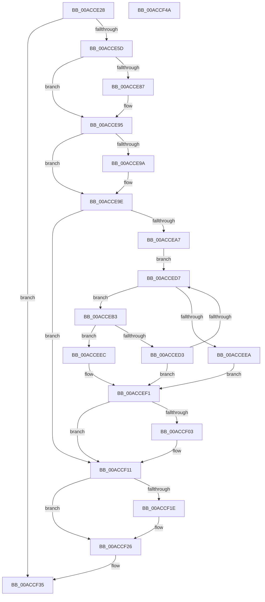

# SepDeleteCachedHandlesTable

- RVA: `0x00ACCE28`–`0x00ACCF4B` (길이 `291` bytes)
- VA: `0x0000000140ACCE28`
- 실행 섹션: `PAGE`
- PDB 이름 있음: `예`; PDB Function 태그: `아니요`
- unwind 정보 RVA: `0x000BE5F8`
- 디코드: `81`개 명령, `291/291` bytes 표시
- 미해석 바이트: `0` (있으면 어셈블리에 `.byte`로 보존)

> 이 문서는 커널 이미지의 기계어와 PDB 기호를 분석해 생성했습니다. 4번과 5번은 함수 원형과 자료형을 바이너리 사용 방식에서 추정한 C 해석이며 원본 소스 복구 결과는 아닙니다.

## 1. Dependencies

- 직접 호출 지점: **10**; 고유 호출 대상: **10**
- 직접 호출자로 확인된 함수: **2**
- RIP 상대 이미지 참조: **0**

### Outgoing calls
- `0x00ACCE77` → [KeAbPreAcquire](../../text/21/KeAbPreAcquire_function_00210230.md) (function, `0x00210230`)
- `0x00ACCE90` → [ExfAcquirePushLockExclusiveEx](../../text/20/ExfAcquirePushLockExclusiveEx_function_0020FC90.md) (function, `0x0020FC90`)
- `0x00ACCEAC` → [RtlInitEnumerationHashTable](../../text/2E/RtlInitEnumerationHashTable_function_002ED0C0.md) (function, `0x002ED0C0`)
- `0x00ACCEC5` → [SepDereferenceCachedHandlesEntryInternal](../A1/SepDereferenceCachedHandlesEntryInternal_function_00A19424.md) (function, `0x00A19424`)
- `0x00ACCEE0` → [RtlEnumerateEntryHashTable](../../text/2E/RtlEnumerateEntryHashTable_function_002EEDE0.md) (function, `0x002EEDE0`)
- `0x00ACCEFA` → [RtlEndEnumerationHashTable](../../text/44/RtlEndEnumerationHashTable_function_00444700.md) (function, `0x00444700`)
- `0x00ACCF07` → [RtlDeleteHashTable](../../text/48/RtlDeleteHashTable_function_0048C570.md) (function, `0x0048C570`)
- `0x00ACCF21` → [ExfTryToWakePushLock](../../text/26/ExfTryToWakePushLock_function_00265DD0.md) (function, `0x00265DD0`)
- `0x00ACCF29` → [KeAbPostRelease](../../text/2E/KeAbPostRelease_function_002E1600.md) (function, `0x002E1600`)
- `0x00ACCF2E` → [KeLeaveCriticalRegion](../../text/25/KeLeaveCriticalRegion_function_0025D8B0.md) (function, `0x0025D8B0`)

### Direct callers
- [SepDeleteLogonSessionTrack](../AA/SepDeleteLogonSessionTrack_function_00AA04E0.md) at `0x00AA0675`
- [SepDeReferenceLogonSession](../AF/SepDeReferenceLogonSession_function_00AF25EC.md) at `0x00AF280D`

### Static image references
- 디코드된 RIP-relative 메모리 참조가 없습니다.

## 2. Other-region calls and transfers

- 다른 실행 섹션으로 향하는 call: **9**
  - `0x00ACCE77` → [KeAbPreAcquire](../../text/21/KeAbPreAcquire_function_00210230.md) (`PAGE` → `.text`)
  - `0x00ACCE90` → [ExfAcquirePushLockExclusiveEx](../../text/20/ExfAcquirePushLockExclusiveEx_function_0020FC90.md) (`PAGE` → `.text`)
  - `0x00ACCEAC` → [RtlInitEnumerationHashTable](../../text/2E/RtlInitEnumerationHashTable_function_002ED0C0.md) (`PAGE` → `.text`)
  - `0x00ACCEE0` → [RtlEnumerateEntryHashTable](../../text/2E/RtlEnumerateEntryHashTable_function_002EEDE0.md) (`PAGE` → `.text`)
  - `0x00ACCEFA` → [RtlEndEnumerationHashTable](../../text/44/RtlEndEnumerationHashTable_function_00444700.md) (`PAGE` → `.text`)
  - `0x00ACCF07` → [RtlDeleteHashTable](../../text/48/RtlDeleteHashTable_function_0048C570.md) (`PAGE` → `.text`)
  - `0x00ACCF21` → [ExfTryToWakePushLock](../../text/26/ExfTryToWakePushLock_function_00265DD0.md) (`PAGE` → `.text`)
  - `0x00ACCF29` → [KeAbPostRelease](../../text/2E/KeAbPostRelease_function_002E1600.md) (`PAGE` → `.text`)
  - `0x00ACCF2E` → [KeLeaveCriticalRegion](../../text/25/KeLeaveCriticalRegion_function_0025D8B0.md) (`PAGE` → `.text`)
- 별도 외부 분기/꼬리 이동을 확인하지 못했습니다.

## 3. Assembly (complete function range)

```asm
00ACCE28  4C 8B DC                        mov r11, rsp
00ACCE2B  49 89 5B 10                     mov qword ptr [r11 + 0x10], rbx
00ACCE2F  49 89 6B 18                     mov qword ptr [r11 + 0x18], rbp
00ACCE33  49 89 73 20                     mov qword ptr [r11 + 0x20], rsi
00ACCE37  57                              push rdi
00ACCE38  48 83 EC 50                     sub rsp, 0x50
00ACCE3C  0F 57 C0                        xorps xmm0, xmm0
00ACCE3F  33 C0                           xor eax, eax
00ACCE41  33 F6                           xor esi, esi
00ACCE43  48 8B F9                        mov rdi, rcx
00ACCE46  0F 11 44 24 20                  movups xmmword ptr [rsp + 0x20], xmm0
00ACCE4B  0F 11 44 24 30                  movups xmmword ptr [rsp + 0x30], xmm0
00ACCE50  49 89 43 E8                     mov qword ptr [r11 - 0x18], rax
00ACCE54  48 85 C9                        test rcx, rcx
00ACCE57  0F 84 D8 00 00 00               je 0x140accf35
00ACCE5D  65 48 8B 04 25 88 01 00 00      mov rax, qword ptr gs:[0x188]
00ACCE66  48 83 CB FF                     or rbx, 0xffffffffffffffff
00ACCE6A  45 33 C0                        xor r8d, r8d
00ACCE6D  33 D2                           xor edx, edx
00ACCE6F  66 01 98 E4 01 00 00            add word ptr [rax + 0x1e4], bx
00ACCE76  90                              nop
00ACCE77  E8 B4 33 74 FF                  call 0x140210230
00ACCE7C  F0 48 0F BA 2F 00               lock bts qword ptr [rdi], 0
00ACCE82  48 8B E8                        mov rbp, rax
00ACCE85  73 0E                           jae 0x140acce95
00ACCE87  4C 8B C7                        mov r8, rdi
00ACCE8A  48 8B D0                        mov rdx, rax
00ACCE8D  48 8B CF                        mov rcx, rdi
00ACCE90  E8 FB 2D 74 FF                  call 0x14020fc90
00ACCE95  48 85 ED                        test rbp, rbp
00ACCE98  74 04                           je 0x140acce9e
00ACCE9A  C6 45 0A 01                     mov byte ptr [rbp + 0xa], 1
00ACCE9E  48 8B 4F 08                     mov rcx, qword ptr [rdi + 8]
00ACCEA2  48 85 C9                        test rcx, rcx
00ACCEA5  74 6A                           je 0x140accf11
00ACCEA7  48 8D 54 24 20                  lea rdx, [rsp + 0x20]
00ACCEAC  E8 0F 02 82 FF                  call 0x1402ed0c0
00ACCEB1  EB 24                           jmp 0x140acced7
00ACCEB3  4C 8D 4C 24 60                  lea r9, [rsp + 0x60]
00ACCEB8  C6 44 24 60 00                  mov byte ptr [rsp + 0x60], 0
00ACCEBD  4C 8B C0                        mov r8, rax
00ACCEC0  B2 01                           mov dl, 1
00ACCEC2  48 8B CF                        mov rcx, rdi
00ACCEC5  E8 5A C5 F4 FF                  call 0x140a19424
00ACCECA  80 7C 24 60 00                  cmp byte ptr [rsp + 0x60], 0
00ACCECF  8B F0                           mov esi, eax
00ACCED1  74 19                           je 0x140acceec
00ACCED3  85 C0                           test eax, eax
00ACCED5  78 1A                           js 0x140accef1
00ACCED7  48 8B 4F 08                     mov rcx, qword ptr [rdi + 8]
00ACCEDB  48 8D 54 24 20                  lea rdx, [rsp + 0x20]
00ACCEE0  E8 FB 1E 82 FF                  call 0x1402eede0
00ACCEE5  48 85 C0                        test rax, rax
00ACCEE8  75 C9                           jne 0x140acceb3
00ACCEEA  EB 05                           jmp 0x140accef1
00ACCEEC  BE 01 00 00 C0                  mov esi, 0xc0000001
00ACCEF1  48 8B 4F 08                     mov rcx, qword ptr [rdi + 8]
00ACCEF5  48 8D 54 24 20                  lea rdx, [rsp + 0x20]
00ACCEFA  E8 01 78 97 FF                  call 0x140444700
00ACCEFF  85 F6                           test esi, esi
00ACCF01  78 0E                           js 0x140accf11
00ACCF03  48 8B 4F 08                     mov rcx, qword ptr [rdi + 8]
00ACCF07  E8 64 F6 9B FF                  call 0x14048c570
00ACCF0C  48 83 67 08 00                  and qword ptr [rdi + 8], 0
00ACCF11  F0 48 0F C1 1F                  lock xadd qword ptr [rdi], rbx
00ACCF16  80 E3 06                        and bl, 6
00ACCF19  80 FB 02                        cmp bl, 2
00ACCF1C  75 08                           jne 0x140accf26
00ACCF1E  48 8B CF                        mov rcx, rdi
00ACCF21  E8 AA 8E 79 FF                  call 0x140265dd0
00ACCF26  48 8B CF                        mov rcx, rdi
00ACCF29  E8 D2 46 81 FF                  call 0x1402e1600
00ACCF2E  E8 7D 09 79 FF                  call 0x14025d8b0
00ACCF33  8B C6                           mov eax, esi
00ACCF35  48 8B 5C 24 68                  mov rbx, qword ptr [rsp + 0x68]
00ACCF3A  48 8B 6C 24 70                  mov rbp, qword ptr [rsp + 0x70]
00ACCF3F  48 8B 74 24 78                  mov rsi, qword ptr [rsp + 0x78]
00ACCF44  48 83 C4 50                     add rsp, 0x50
00ACCF48  5F                              pop rdi
00ACCF49  C3                              ret
00ACCF4A  CC                              int3
```

## 4. C-style interpretation (structured pseudocode)

```c
__int64 __fastcall SepDeleteCachedHandlesTable(__int64 a1, int a2, int a3)
{
    __int64 result;
    __int64 v_rbx;
    __int64 v_rsi;
    __int64 v_rsp;
    unsigned __int64 v_stack_m28;
    unsigned __int64 v_stack_m38;
    unsigned __int64 v_stack_p10;
    unsigned __int64 v_stack_p18;
    unsigned __int64 v_stack_p20;
    unsigned __int64 v_stack_p8;

    *(unsigned __int64 *)(v_rsp + 16) = v_rbx;
    *(unsigned __int64 *)(v_rsp + 24) = v_rbp;
    *(unsigned __int64 *)(v_rsp + 32) = v_rsi;
    v_rsp = (v_rsp) - (80);
    result = 0;
    v_rsi = 0;
    v_stack_m38 = v_xmm0;
    v_stack_m28 = v_xmm0;
    *(unsigned __int64 *)(v_rsp - 24) = 0;
    if (a1 == 0) goto loc_00ACCF35;
    v_rbx = (v_rbx) | (-1);
    a3 = 0;
    a2 = 0;
    result = KeAbPreAcquire(a1, a2, a3, a4);
    if (!(condition_is_above_or_equal)) {
        a3 = a1;
        a2 = result;
        a1 = a1;
        result = ExfAcquirePushLockExclusiveEx(a1, a2, a3, a4);
    }
    if (result != 0) {
        *(unsigned __int8 *)(result + 10) = 1;
    }
    if (*(unsigned __int64 *)(a1 + 8) == 0) goto loc_00ACCF11;
    result = RtlInitEnumerationHashTable(*(unsigned __int64 *)(a1 + 8), v_stack_m38, a3, a4);
    goto loc_00ACCED7;
loc_00ACCEB3:
    v_stack_p8 = 0;
    result = SepDereferenceCachedHandlesEntryInternal(a1, 1, result, v_stack_p8);
    if (v_stack_p8 == 0) goto loc_00ACCEEC;
    if (sign_flag) goto loc_00ACCEF1;
loc_00ACCED7:
    result = RtlEnumerateEntryHashTable(*(unsigned __int64 *)(a1 + 8), v_stack_m38, result, v_stack_p8);
    if (result != 0) goto loc_00ACCEB3;
    goto loc_00ACCEF1;
loc_00ACCEEC:
loc_00ACCEF1:
    result = RtlEndEnumerationHashTable(*(unsigned __int64 *)(a1 + 8), v_stack_m38, result, v_stack_p8);
    if (!(sign_flag)) {
        a1 = *(unsigned __int64 *)(a1 + 8);
        result = RtlDeleteHashTable(a1, v_stack_m38, result, v_stack_p8);
    }
    v_rbx = (unsigned __int8)((v_rbx) & (6));
    if (((unsigned __int8)(v_rbx)) == 2) {
        a1 = a1;
        result = ExfTryToWakePushLock(a1, v_stack_m38, result, v_stack_p8);
    }
    result = KeAbPostRelease(a1, v_stack_m38, result, v_stack_p8);
    result = KeLeaveCriticalRegion(a1, v_stack_m38, result, v_stack_p8);
loc_00ACCF35:
    v_rsp = (v_rsp) + (80);
    return (unsigned int)((unsigned int)((unsigned int)(0xC0000001ULL)));
}
```

## 5. (Beta) C Style

```c
int64_t SepDeleteCachedHandlesTable(void *Arg1, int32_t Arg2, int32_t Arg3)
{
    uint8_t *arg1 = (uint8_t *)Arg1;

    int64_t result;
    int64_t local_rbx;
    int64_t local_rsi;
    int64_t local_rsp;
    uint64_t v_stack_m28;
    uint64_t v_stack_m38;
    uint64_t v_stack_p10;
    uint64_t v_stack_p18;
    uint64_t v_stack_p20;
    uint64_t v_stack_p8;

    *(uint64_t *)(local_rsp + 0x10) = local_rbx;
    *(uint64_t *)(local_rsp + 0x18) = local_rbp;
    *(uint64_t *)(local_rsp + 0x20) = local_rsi;
    local_rsp = (local_rsp) - (80);
    result = 0;
    local_rsi = 0;
    v_stack_m38 = v_xmm0;
    v_stack_m28 = v_xmm0;
    *(uint64_t *)(local_rsp - 0x18) = 0;
    if (Arg1 == NULL) goto loc_00ACCF35;
    local_rbx = (local_rbx) | (-1);
    Arg3 = 0;
    Arg2 = 0;
    result = KeAbPreAcquire(Arg1, Arg2, Arg3, a4);
    if (!(condition_is_above_or_equal)) {
        Arg3 = Arg1;
        Arg2 = result;
        Arg1 = Arg1;
        result = ExfAcquirePushLockExclusiveEx(Arg1, Arg2, Arg3, a4);
    }
    if (result != 0) {
        *(uint8_t *)(result + 0xA) = 1;
    }
    if (*(uint64_t *)(arg1 + 0x8) == 0) goto loc_00ACCF11;
    result = RtlInitEnumerationHashTable(*(uint64_t *)(arg1 + 0x8), v_stack_m38, Arg3, a4);
    goto loc_00ACCED7;
loc_00ACCEB3:
    v_stack_p8 = 0;
    result = SepDereferenceCachedHandlesEntryInternal(Arg1, 1, result, v_stack_p8);
    if (v_stack_p8 == 0) goto loc_00ACCEEC;
    if (sign_flag) goto loc_00ACCEF1;
loc_00ACCED7:
    result = RtlEnumerateEntryHashTable(*(uint64_t *)(arg1 + 0x8), v_stack_m38, result, v_stack_p8);
    if (result != 0) goto loc_00ACCEB3;
    goto loc_00ACCEF1;
loc_00ACCEEC:
loc_00ACCEF1:
    result = RtlEndEnumerationHashTable(*(uint64_t *)(arg1 + 0x8), v_stack_m38, result, v_stack_p8);
    if (!(sign_flag)) {
        Arg1 = *(uint64_t *)(arg1 + 0x8);
        result = RtlDeleteHashTable(Arg1, v_stack_m38, result, v_stack_p8);
    }
    local_rbx = (uint8_t)((local_rbx) & (6));
    if (((uint8_t)(local_rbx)) == 2) {
        Arg1 = Arg1;
        result = ExfTryToWakePushLock(Arg1, v_stack_m38, result, v_stack_p8);
    }
    result = KeAbPostRelease(Arg1, v_stack_m38, result, v_stack_p8);
    result = KeLeaveCriticalRegion(Arg1, v_stack_m38, result, v_stack_p8);
loc_00ACCF35:
    local_rsp = (local_rsp) + (80);
    return (uint32_t)((uint32_t)((uint32_t)(0xC0000001ULL)));
}
```

### 관측된 메모리 오프셋

구조체 형식이 확인되지 않은 접근은 인자 기준의 오프셋으로만 기록했습니다.

| 기준 인자 | 오프셋 표현 | 폭 (bit) | 접근 |
|---|---:|---:|---|
| `Arg1` | `+ 0x0` | `64` | `R/W` |
| `Arg1` | `+ 0x8` | `64` | `R` |
| `Arg1` | `+ 0x8` | `64` | `R/W` |

## 6. Execution-region graph

[열기: 2D/3D 그래프와 함수 탐색 컨트롤 패널](../../../control-panel.html?section=page&rva=0x00ACCE28&view=graph)

- 2D 그래프는 위에서 아래로 흐르고, 3D 그래프는 빈 공간을 드래그해 회전합니다. Shift+드래그는 이동, 휠은 확대·축소, 함수 노드 선택은 대상 보고서 이동입니다.

### Static fallback


