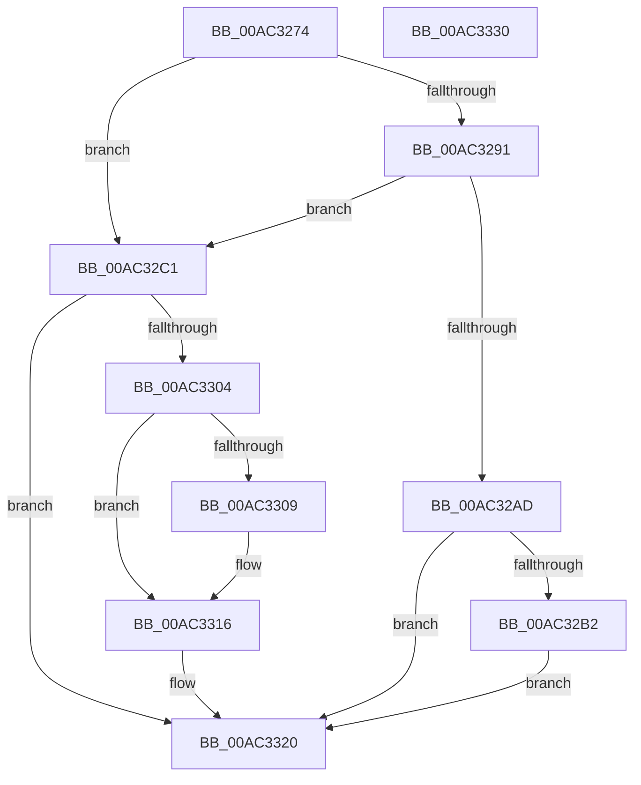

# SepInformLsaOfDeletedLogon

- RVA: `0x00AC3274`–`0x00AC3331` (길이 `189` bytes)
- VA: `0x0000000140AC3274`
- 실행 섹션: `PAGE`
- PDB 이름 있음: `예`; PDB Function 태그: `아니요`
- unwind 정보 RVA: `0x00060BC4`
- 디코드: `51`개 명령, `189/189` bytes 표시
- 미해석 바이트: `0` (있으면 어셈블리에 `.byte`로 보존)

> 이 문서는 커널 이미지의 기계어와 PDB 기호를 분석해 생성했습니다. 4번과 5번은 함수 원형과 자료형을 바이너리 사용 방식에서 추정한 C 해석이며 원본 소스 복구 결과는 아닙니다.

## 1. Dependencies

- 직접 호출 지점: **5**; 고유 호출 대상: **4**
- 직접 호출자로 확인된 함수: **1**
- RIP 상대 이미지 참조: **1**

### Outgoing calls
- `0x00AC32A0` → [ExAllocatePool2](../../poolcode/B8/ExAllocatePool2_function_00B820F0.md) (function, `0x00B820F0`)
- `0x00AC32BA` → [ObfDereferenceObjectWithTag](../../text/2F/ObfDereferenceObjectWithTag_function_002F78E0.md) (function, `0x002F78E0`)
- `0x00AC32FB` → [SepQueueWorkItem](../../text/22/SepQueueWorkItem_function_00225844.md) (function, `0x00225844`)
- `0x00AC3311` → [ObfDereferenceObjectWithTag](../../text/2F/ObfDereferenceObjectWithTag_function_002F78E0.md) (function, `0x002F78E0`)
- `0x00AC331B` → [ExFreePoolWithTag](../../poolcode/B8/ExFreePoolWithTag_function_00B82870.md) (function, `0x00B82870`)

### Direct callers
- [SepDeReferenceLogonSession](../AF/SepDeReferenceLogonSession_function_00AF25EC.md) at `0x00AF281F`

### Static image references
- `0x00AC32C4` → RVA `0x00E67C00` (`.data`; read)

## 2. Other-region calls and transfers

- 다른 실행 섹션으로 향하는 call: **5**
  - `0x00AC32A0` → [ExAllocatePool2](../../poolcode/B8/ExAllocatePool2_function_00B820F0.md) (`PAGE` → `POOLCODE`)
  - `0x00AC32BA` → [ObfDereferenceObjectWithTag](../../text/2F/ObfDereferenceObjectWithTag_function_002F78E0.md) (`PAGE` → `.text`)
  - `0x00AC32FB` → [SepQueueWorkItem](../../text/22/SepQueueWorkItem_function_00225844.md) (`PAGE` → `.text`)
  - `0x00AC3311` → [ObfDereferenceObjectWithTag](../../text/2F/ObfDereferenceObjectWithTag_function_002F78E0.md) (`PAGE` → `.text`)
  - `0x00AC331B` → [ExFreePoolWithTag](../../poolcode/B8/ExFreePoolWithTag_function_00B82870.md) (`PAGE` → `POOLCODE`)
- 별도 외부 분기/꼬리 이동을 확인하지 못했습니다.

## 3. Assembly (complete function range)

```asm
00AC3274  48 89 5C 24 08                  mov qword ptr [rsp + 8], rbx
00AC3279  48 89 74 24 10                  mov qword ptr [rsp + 0x10], rsi
00AC327E  57                              push rdi
00AC327F  48 83 EC 20                     sub rsp, 0x20
00AC3283  49 8B D8                        mov rbx, r8
00AC3286  48 8B FA                        mov rdi, rdx
00AC3289  48 8B F1                        mov rsi, rcx
00AC328C  4D 85 C0                        test r8, r8
00AC328F  75 30                           jne 0x140ac32c1
00AC3291  41 8D 50 40                     lea edx, [r8 + 0x40]
00AC3295  B9 00 01 00 00                  mov ecx, 0x100
00AC329A  41 B8 53 65 4C 77               mov r8d, 0x774c6553
00AC32A0  E8 4B EE 0B 00                  call 0x140b820f0
00AC32A5  48 8B D8                        mov rbx, rax
00AC32A8  48 85 C0                        test rax, rax
00AC32AB  75 14                           jne 0x140ac32c1
00AC32AD  48 85 FF                        test rdi, rdi
00AC32B0  74 6E                           je 0x140ac3320
00AC32B2  BA 53 65 4C 73                  mov edx, 0x734c6553
00AC32B7  48 8B CF                        mov rcx, rdi
00AC32BA  E8 21 46 83 FF                  call 0x1402f78e0
00AC32BF  EB 5F                           jmp 0x140ac3320
00AC32C1  48 8B 06                        mov rax, qword ptr [rsi]
00AC32C4  48 8D 0D 35 49 3A 00            lea rcx, [rip + 0x3a4935]
00AC32CB  48 83 63 28 00                  and qword ptr [rbx + 0x28], 0
00AC32D0  45 33 C0                        xor r8d, r8d
00AC32D3  83 63 30 00                     and dword ptr [rbx + 0x30], 0
00AC32D7  48 8B D3                        mov rdx, rbx
00AC32DA  83 63 14 00                     and dword ptr [rbx + 0x14], 0
00AC32DE  48 89 43 18                     mov qword ptr [rbx + 0x18], rax
00AC32E2  C7 43 20 03 00 00 00            mov dword ptr [rbx + 0x20], 3
00AC32E9  C7 43 24 08 00 00 00            mov dword ptr [rbx + 0x24], 8
00AC32F0  C7 43 10 01 00 00 00            mov dword ptr [rbx + 0x10], 1
00AC32F7  48 89 7B 38                     mov qword ptr [rbx + 0x38], rdi
00AC32FB  E8 44 25 76 FF                  call 0x140225844
00AC3300  84 C0                           test al, al
00AC3302  75 1C                           jne 0x140ac3320
00AC3304  48 85 FF                        test rdi, rdi
00AC3307  74 0D                           je 0x140ac3316
00AC3309  BA 53 65 4C 73                  mov edx, 0x734c6553
00AC330E  48 8B CF                        mov rcx, rdi
00AC3311  E8 CA 45 83 FF                  call 0x1402f78e0
00AC3316  33 D2                           xor edx, edx
00AC3318  48 8B CB                        mov rcx, rbx
00AC331B  E8 50 F5 0B 00                  call 0x140b82870
00AC3320  48 8B 5C 24 30                  mov rbx, qword ptr [rsp + 0x30]
00AC3325  48 8B 74 24 38                  mov rsi, qword ptr [rsp + 0x38]
00AC332A  48 83 C4 20                     add rsp, 0x20
00AC332E  5F                              pop rdi
00AC332F  C3                              ret
00AC3330  CC                              int3
```

## 4. C-style interpretation (structured pseudocode)

```c
__int64 __fastcall SepInformLsaOfDeletedLogon(__int64 a1, __int64 a2, __int64 a3)
{
    __int64 result;
    __int64 v_rsp;
    unsigned __int64 v_stack_p10;
    unsigned __int64 v_stack_p8;

    v_stack_p8 = v_rbx;
    v_stack_p10 = v_rsi;
    v_rsp = (v_rsp) - (32);
    if (a3 != 0) goto loc_00AC32C1;
    result = ExAllocatePool2(256, a3 + 64, (unsigned int)(0x774C6553ULL), a4);
    if (result != 0) goto loc_00AC32C1;
    if (a2 == 0) goto loc_00AC3320;
    result = ObfDereferenceObjectWithTag(a2, (unsigned int)(0x734C6553ULL), (unsigned int)(0x774C6553ULL), a4);
    goto loc_00AC3320;
loc_00AC32C1:
    a3 = 0;
    *(unsigned __int64 *)(result + 24) = *(unsigned __int64 *)(a1);
    *(unsigned int *)(result + 32) = 3;
    *(unsigned int *)(result + 36) = 8;
    *(unsigned int *)(result + 16) = 1;
    *(unsigned __int64 *)(result + 56) = a2;
    result = SepQueueWorkItem(v_rip + 3819829, result, a3, a4);
    if ((unsigned __int8)(result) != 0) goto loc_00AC3320;
    if (a2 != 0) {
        a2 = 0x734C6553ULL;
        a1 = a2;
        result = ObfDereferenceObjectWithTag(a1, a2, a3, a4);
    }
    a2 = 0;
    result = ExFreePoolWithTag(result, a2, a3, a4);
loc_00AC3320:
    v_rsp = (v_rsp) + (32);
    return result;
}
```

## 5. (Beta) C Style

```c
int64_t SepInformLsaOfDeletedLogon(void *Arg1, int64_t Arg2, int64_t Arg3)
{
    uint8_t *arg1 = (uint8_t *)Arg1;

    int64_t result;
    int64_t local_rsp;
    uint64_t v_stack_p10;
    uint64_t v_stack_p8;

    v_stack_p8 = local_rbx;
    v_stack_p10 = local_rsi;
    local_rsp = (local_rsp) - (32);
    if (Arg3 != 0) goto loc_00AC32C1;
    result = ExAllocatePool2(256, Arg3 + 64, (uint32_t)(0x774C6553ULL), a4);
    if (result != 0) goto loc_00AC32C1;
    if (Arg2 == 0) goto loc_00AC3320;
    result = ObfDereferenceObjectWithTag(Arg2, (uint32_t)(0x734C6553ULL), (uint32_t)(0x774C6553ULL), a4);
    goto loc_00AC3320;
loc_00AC32C1:
    Arg3 = 0;
    *(uint64_t *)(result + 0x18) = *(uint64_t *)(arg1);
    *(uint32_t *)(result + 0x20) = 3;
    *(uint32_t *)(result + 0x24) = 8;
    *(uint32_t *)(result + 0x10) = 1;
    *(uint64_t *)(result + 0x38) = Arg2;
    result = SepQueueWorkItem(v_rip + 3819829, result, Arg3, a4);
    if ((uint8_t)(result) != 0) goto loc_00AC3320;
    if (Arg2 != 0) {
        Arg2 = 0x734C6553ULL;
        Arg1 = Arg2;
        result = ObfDereferenceObjectWithTag(Arg1, Arg2, Arg3, a4);
    }
    Arg2 = 0;
    result = ExFreePoolWithTag(result, Arg2, Arg3, a4);
loc_00AC3320:
    local_rsp = (local_rsp) + (32);
    return result;
}
```

### 관측된 메모리 오프셋

구조체 형식이 확인되지 않은 접근은 인자 기준의 오프셋으로만 기록했습니다.

| 기준 인자 | 오프셋 표현 | 폭 (bit) | 접근 |
|---|---:|---:|---|
| `Arg1` | `+ 0x0` | `64` | `R` |

## 6. Execution-region graph

[열기: 2D/3D 그래프와 함수 탐색 컨트롤 패널](../../../control-panel.html?section=page&rva=0x00AC3274&view=graph)

- 2D 그래프는 위에서 아래로 흐르고, 3D 그래프는 빈 공간을 드래그해 회전합니다. Shift+드래그는 이동, 휠은 확대·축소, 함수 노드 선택은 대상 보고서 이동입니다.

### Static fallback


