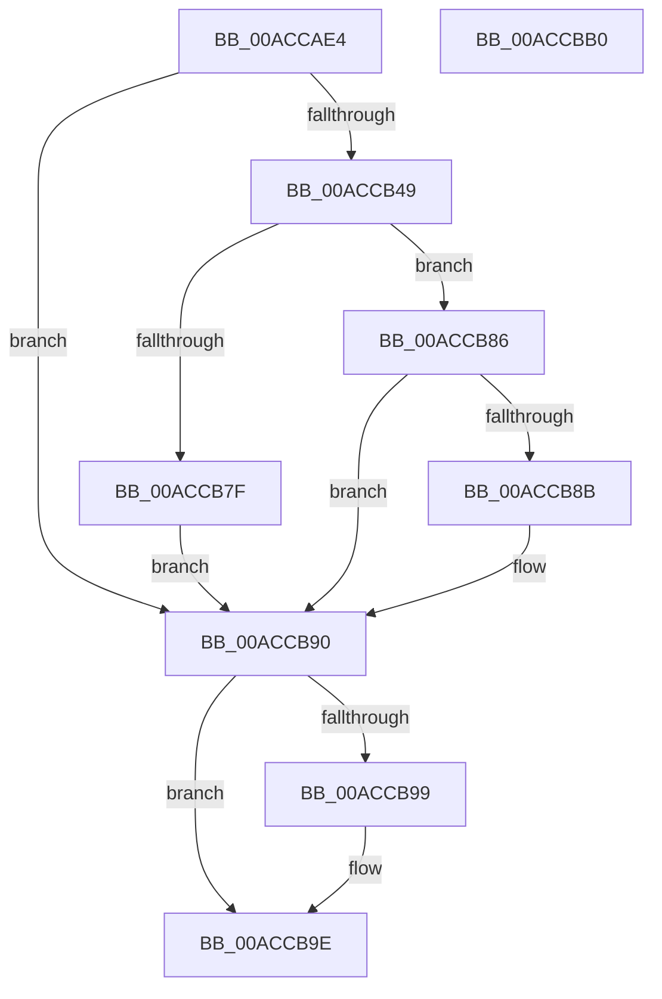

# SmCreateEvent

- RVA: `0x00ACCAE4`–`0x00ACCBB1` (길이 `205` bytes)
- VA: `0x0000000140ACCAE4`
- 실행 섹션: `PAGE`
- PDB 이름 있음: `예`; PDB Function 태그: `아니요`
- unwind 정보 RVA: `0x000BE5B4`
- 디코드: `54`개 명령, `205/205` bytes 표시
- 미해석 바이트: `0` (있으면 어셈블리에 `.byte`로 보존)

> 이 문서는 커널 이미지의 기계어와 PDB 기호를 분석해 생성했습니다. 4번과 5번은 함수 원형과 자료형을 바이너리 사용 방식에서 추정한 C 해석이며 원본 소스 복구 결과는 아닙니다.

## 1. Dependencies

- 직접 호출 지점: **4**; 고유 호출 대상: **4**
- 직접 호출자로 확인된 함수: **1**
- RIP 상대 이미지 참조: **1**

### Outgoing calls
- `0x00ACCB3E` → [ZwCreateEvent](../../text/6A/ZwCreateEvent_function_006AD9D0.md) (function, `0x006AD9D0`)
- `0x00ACCB70` → [ObReferenceObjectByHandle](../86/ObReferenceObjectByHandle_function_00868DB0.md) (function, `0x00868DB0`)
- `0x00ACCB8B` → [ObfDereferenceObject](../../text/2F/ObfDereferenceObject_function_002F9350.md) (function, `0x002F9350`)
- `0x00ACCB99` → [ZwClose](../../text/6A/ZwClose_function_006AD2B0.md) (function, `0x006AD2B0`)

### Direct callers
- [SmRegistrationCtxStart](SmRegistrationCtxStart_function_00ACCA90.md) at `0x00ACCAA8`

### Static image references
- `0x00ACCB49` → RVA `0x00FC6B80` (`ALMOSTRO`; read)

## 2. Other-region calls and transfers

- 다른 실행 섹션으로 향하는 call: **3**
  - `0x00ACCB3E` → [ZwCreateEvent](../../text/6A/ZwCreateEvent_function_006AD9D0.md) (`PAGE` → `.text`)
  - `0x00ACCB8B` → [ObfDereferenceObject](../../text/2F/ObfDereferenceObject_function_002F9350.md) (`PAGE` → `.text`)
  - `0x00ACCB99` → [ZwClose](../../text/6A/ZwClose_function_006AD2B0.md) (`PAGE` → `.text`)
- 별도 외부 분기/꼬리 이동을 확인하지 못했습니다.

## 3. Assembly (complete function range)

```asm
00ACCAE4  48 89 5C 24 08                  mov qword ptr [rsp + 8], rbx
00ACCAE9  48 89 7C 24 10                  mov qword ptr [rsp + 0x10], rdi
00ACCAEE  55                              push rbp
00ACCAEF  48 8B EC                        mov rbp, rsp
00ACCAF2  48 83 EC 60                     sub rsp, 0x60
00ACCAF6  83 65 D4 00                     and dword ptr [rbp - 0x2c], 0
00ACCAFA  4C 8D 45 D0                     lea r8, [rbp - 0x30]
00ACCAFE  83 65 EC 00                     and dword ptr [rbp - 0x14], 0
00ACCB02  48 8D 4D 20                     lea rcx, [rbp + 0x20]
00ACCB06  48 83 65 20 00                  and qword ptr [rbp + 0x20], 0
00ACCB0B  48 8B FA                        mov rdi, rdx
00ACCB0E  48 83 65 D8 00                  and qword ptr [rbp - 0x28], 0
00ACCB13  0F 57 C0                        xorps xmm0, xmm0
00ACCB16  48 83 65 E0 00                  and qword ptr [rbp - 0x20], 0
00ACCB1B  BA 03 00 1F 00                  mov edx, 0x1f0003
00ACCB20  41 B9 01 00 00 00               mov r9d, 1
00ACCB26  C7 45 D0 30 00 00 00            mov dword ptr [rbp - 0x30], 0x30
00ACCB2D  F3 0F 7F 45 F0                  movdqu xmmword ptr [rbp - 0x10], xmm0
00ACCB32  C7 45 E8 00 02 00 00            mov dword ptr [rbp - 0x18], 0x200
00ACCB39  C6 44 24 20 00                  mov byte ptr [rsp + 0x20], 0
00ACCB3E  E8 8D 0E BE FF                  call 0x1406ad9d0
00ACCB43  8B D8                           mov ebx, eax
00ACCB45  85 C0                           test eax, eax
00ACCB47  78 47                           js 0x140accb90
00ACCB49  4C 8B 05 30 A0 4F 00            mov r8, qword ptr [rip + 0x4fa030]
00ACCB50  48 8D 45 28                     lea rax, [rbp + 0x28]
00ACCB54  48 83 64 24 28 00               and qword ptr [rsp + 0x28], 0
00ACCB5A  45 33 C9                        xor r9d, r9d
00ACCB5D  48 8B 4D 20                     mov rcx, qword ptr [rbp + 0x20]
00ACCB61  BA 03 00 1F 00                  mov edx, 0x1f0003
00ACCB66  48 83 65 28 00                  and qword ptr [rbp + 0x28], 0
00ACCB6B  48 89 44 24 20                  mov qword ptr [rsp + 0x20], rax
00ACCB70  E8 3B C2 D9 FF                  call 0x140868db0
00ACCB75  48 8B 4D 28                     mov rcx, qword ptr [rbp + 0x28]
00ACCB79  8B D8                           mov ebx, eax
00ACCB7B  85 C0                           test eax, eax
00ACCB7D  78 07                           js 0x140accb86
00ACCB7F  48 89 0F                        mov qword ptr [rdi], rcx
00ACCB82  33 DB                           xor ebx, ebx
00ACCB84  EB 0A                           jmp 0x140accb90
00ACCB86  48 85 C9                        test rcx, rcx
00ACCB89  74 05                           je 0x140accb90
00ACCB8B  E8 C0 C7 82 FF                  call 0x1402f9350
00ACCB90  48 8B 4D 20                     mov rcx, qword ptr [rbp + 0x20]
00ACCB94  48 85 C9                        test rcx, rcx
00ACCB97  74 05                           je 0x140accb9e
00ACCB99  E8 12 07 BE FF                  call 0x1406ad2b0
00ACCB9E  48 8B 7C 24 78                  mov rdi, qword ptr [rsp + 0x78]
00ACCBA3  8B C3                           mov eax, ebx
00ACCBA5  48 8B 5C 24 70                  mov rbx, qword ptr [rsp + 0x70]
00ACCBAA  48 83 C4 60                     add rsp, 0x60
00ACCBAE  5D                              pop rbp
00ACCBAF  C3                              ret
00ACCBB0  CC                              int3
```

## 4. C-style interpretation (structured pseudocode)

```c
__int64 __fastcall SmCreateEvent(__int64 a1, __int64 a2)
{
    __int64 result;
    __int64 v_rbx;
    __int64 v_rsp;
    unsigned __int64 v_stack_m18;
    unsigned int v_stack_m1C;
    unsigned int v_stack_m20;
    unsigned __int64 v_stack_m28;
    unsigned __int64 v_stack_m30;
    unsigned int v_stack_m34;
    unsigned __int64 v_stack_m38;
    unsigned __int64 v_stack_m40;
    unsigned __int8 v_stack_m48;
    unsigned __int64 v_stack_p10;
    unsigned __int64 v_stack_p18;
    unsigned __int64 v_stack_p20;
    unsigned __int64 v_stack_p8;

    v_stack_p8 = v_rbx;
    v_stack_p10 = v_rdi;
    v_rsp = (v_rsp) - (96);
    v_stack_m38 = 48;
    v_stack_m18 = v_xmm0;
    v_stack_m20 = 512;
    v_stack_m48 = 0;
    result = ZwCreateEvent(v_stack_p18, (unsigned int)(0x1F0003ULL), v_stack_m38, 1);
    if (sign_flag) goto loc_00ACCB90;
    a4 = 0;
    v_stack_m48 = v_stack_p20;
    result = ObReferenceObjectByHandle(v_stack_p18, (unsigned int)(0x1F0003ULL), *(unsigned __int64 *)(v_rip + 5218352), a4);
    if (sign_flag) goto loc_00ACCB86;
    *(unsigned __int64 *)(a2) = v_stack_p20;
    v_rbx = 0;
    goto loc_00ACCB90;
loc_00ACCB86:
    if (v_stack_p20 != 0) {
        result = ObfDereferenceObject(v_stack_p20, (unsigned int)(0x1F0003ULL), *(unsigned __int64 *)(v_rip + 5218352), a4);
    }
    if (v_stack_p18 != 0) {
        result = ZwClose(v_stack_p18, (unsigned int)(0x1F0003ULL), *(unsigned __int64 *)(v_rip + 5218352), a4);
    }
    v_rsp = (v_rsp) + (96);
    return 0;
}
```

## 5. (Beta) C Style

```c
int64_t SmCreateEvent(int64_t Arg1, void *Arg2)
{
    uint8_t *arg2 = (uint8_t *)Arg2;

    int64_t result;
    int64_t local_rbx;
    int64_t local_rsp;
    uint64_t v_stack_m18;
    uint32_t v_stack_m1C;
    uint32_t v_stack_m20;
    uint64_t v_stack_m28;
    uint64_t v_stack_m30;
    uint32_t v_stack_m34;
    uint64_t v_stack_m38;
    uint64_t v_stack_m40;
    uint8_t v_stack_m48;
    uint64_t v_stack_p10;
    uint64_t v_stack_p18;
    uint64_t v_stack_p20;
    uint64_t v_stack_p8;

    v_stack_p8 = local_rbx;
    v_stack_p10 = local_rdi;
    local_rsp = (local_rsp) - (96);
    v_stack_m38 = 48;
    v_stack_m18 = v_xmm0;
    v_stack_m20 = 512;
    v_stack_m48 = 0;
    result = ZwCreateEvent(v_stack_p18, (uint32_t)(0x1F0003ULL), v_stack_m38, 1);
    if (sign_flag) goto loc_00ACCB90;
    a4 = 0;
    v_stack_m48 = v_stack_p20;
    result = ObReferenceObjectByHandle(v_stack_p18, (uint32_t)(0x1F0003ULL), *(uint64_t *)(v_rip + 0x4FA030), a4);
    if (sign_flag) goto loc_00ACCB86;
    *(uint64_t *)(arg2) = v_stack_p20;
    local_rbx = 0;
    goto loc_00ACCB90;
loc_00ACCB86:
    if (v_stack_p20 != 0) {
        result = ObfDereferenceObject(v_stack_p20, (uint32_t)(0x1F0003ULL), *(uint64_t *)(v_rip + 0x4FA030), a4);
    }
    if (v_stack_p18 != 0) {
        result = ZwClose(v_stack_p18, (uint32_t)(0x1F0003ULL), *(uint64_t *)(v_rip + 0x4FA030), a4);
    }
    local_rsp = (local_rsp) + (96);
    return 0;
}
```

### 관측된 메모리 오프셋

구조체 형식이 확인되지 않은 접근은 인자 기준의 오프셋으로만 기록했습니다.

| 기준 인자 | 오프셋 표현 | 폭 (bit) | 접근 |
|---|---:|---:|---|
| `Arg2` | `+ 0x0` | `64` | `W` |

## 6. Execution-region graph

[열기: 2D/3D 그래프와 함수 탐색 컨트롤 패널](../../../control-panel.html?section=page&rva=0x00ACCAE4&view=graph)

- 2D 그래프는 위에서 아래로 흐르고, 3D 그래프는 빈 공간을 드래그해 회전합니다. Shift+드래그는 이동, 휠은 확대·축소, 함수 노드 선택은 대상 보고서 이동입니다.

### Static fallback


