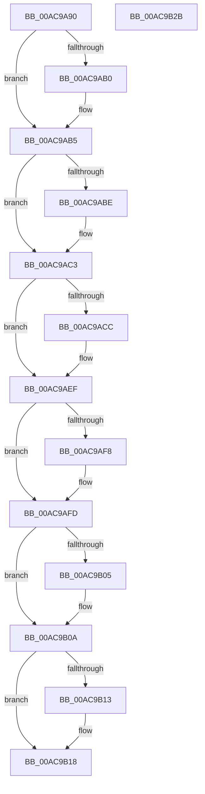

# SmKmFileInfoCleanup

- RVA: `0x00AC9A90`–`0x00AC9B2C` (길이 `156` bytes)
- VA: `0x0000000140AC9A90`
- 실행 섹션: `PAGE`
- PDB 이름 있음: `예`; PDB Function 태그: `아니요`
- unwind 정보 RVA: `0x0005CAAC`
- 디코드: `45`개 명령, `156/156` bytes 표시
- 미해석 바이트: `0` (있으면 어셈블리에 `.byte`로 보존)

> 이 문서는 커널 이미지의 기계어와 PDB 기호를 분석해 생성했습니다. 4번과 5번은 함수 원형과 자료형을 바이너리 사용 방식에서 추정한 C 해석이며 원본 소스 복구 결과는 아닙니다.

## 1. Dependencies

- 직접 호출 지점: **10**; 고유 호출 대상: **8**
- 직접 호출자로 확인된 함수: **5**
- RIP 상대 이미지 참조: **0**

### Outgoing calls
- `0x00AC9A9F` → [IoSetThreadHardErrorMode](../../text/46/IoSetThreadHardErrorMode_function_00466BF0.md) (function, `0x00466BF0`)
- `0x00AC9AB0` → [IoUnregisterPlugPlayNotification](../AA/IoUnregisterPlugPlayNotification_function_00AA5CC0.md) (function, `0x00AA5CC0`)
- `0x00AC9ABE` → [ObfDereferenceObject](../../text/2F/ObfDereferenceObject_function_002F9350.md) (function, `0x002F9350`)
- `0x00AC9ACE` → [IoReuseIrp](../../text/24/IoReuseIrp_function_0024DD70.md) (function, `0x0024DD70`)
- `0x00AC9AE1` → [SmKmSendUsageNotification](../7A/SmKmSendUsageNotification_function_007A8E44.md) (function, `0x007A8E44`)
- `0x00AC9AEA` → [IoFreeIrp](../../text/24/IoFreeIrp_function_0024DF70.md) (function, `0x0024DF70`)
- `0x00AC9AF8` → [ObfDereferenceObject](../../text/2F/ObfDereferenceObject_function_002F9350.md) (function, `0x002F9350`)
- `0x00AC9B05` → [ZwClose](../../text/6A/ZwClose_function_006AD2B0.md) (function, `0x006AD2B0`)
- `0x00AC9B13` → [CmSiFreeMemory](../../text/47/CmSiFreeMemory_function_00475D80.md) (function, `0x00475D80`)
- `0x00AC9B1B` → [IoSetThreadHardErrorMode](../../text/46/IoSetThreadHardErrorMode_function_00466BF0.md) (function, `0x00466BF0`)

### Direct callers
- [SMKM_STORE&lt;SM_TRAITS&gt;::SmStCleanup](../../text/3B/SMKM_STORE_SM_TRAITS_SmStCleanup_function_003B00E0.md) at `0x003B036D`
- [SmKmStoreFileCreate](../7A/SmKmStoreFileCreate_function_007A8F14.md) at `0x007A938A`
- [SmKmStoreFileCreateForIoType](../7A/SmKmStoreFileCreateForIoType_function_007A93C8.md) at `0x007A95D8`
- [SmKmStoreFileCreateForIoType](../7A/SmKmStoreFileCreateForIoType_function_007A93C8.md) at `0x007A9607`
- [SmcCacheCleanup](../7A/SmcCacheCleanup_function_007AB7B4.md) at `0x007AB822`
- [SmKmFileInfoDuplicate](SmKmFileInfoDuplicate_function_00AC98FC.md) at `0x00AC9A6B`

### Static image references
- 디코드된 RIP-relative 메모리 참조가 없습니다.

## 2. Other-region calls and transfers

- 다른 실행 섹션으로 향하는 call: **8**
  - `0x00AC9A9F` → [IoSetThreadHardErrorMode](../../text/46/IoSetThreadHardErrorMode_function_00466BF0.md) (`PAGE` → `.text`)
  - `0x00AC9ABE` → [ObfDereferenceObject](../../text/2F/ObfDereferenceObject_function_002F9350.md) (`PAGE` → `.text`)
  - `0x00AC9ACE` → [IoReuseIrp](../../text/24/IoReuseIrp_function_0024DD70.md) (`PAGE` → `.text`)
  - `0x00AC9AEA` → [IoFreeIrp](../../text/24/IoFreeIrp_function_0024DF70.md) (`PAGE` → `.text`)
  - `0x00AC9AF8` → [ObfDereferenceObject](../../text/2F/ObfDereferenceObject_function_002F9350.md) (`PAGE` → `.text`)
  - `0x00AC9B05` → [ZwClose](../../text/6A/ZwClose_function_006AD2B0.md) (`PAGE` → `.text`)
  - `0x00AC9B13` → [CmSiFreeMemory](../../text/47/CmSiFreeMemory_function_00475D80.md) (`PAGE` → `.text`)
  - `0x00AC9B1B` → [IoSetThreadHardErrorMode](../../text/46/IoSetThreadHardErrorMode_function_00466BF0.md) (`PAGE` → `.text`)
- 별도 외부 분기/꼬리 이동을 확인하지 못했습니다.

## 3. Assembly (complete function range)

```asm
00AC9A90  48 89 5C 24 08                  mov qword ptr [rsp + 8], rbx
00AC9A95  57                              push rdi
00AC9A96  48 83 EC 20                     sub rsp, 0x20
00AC9A9A  48 8B D9                        mov rbx, rcx
00AC9A9D  33 C9                           xor ecx, ecx
00AC9A9F  E8 4C D1 99 FF                  call 0x140466bf0
00AC9AA4  48 8B 4B 20                     mov rcx, qword ptr [rbx + 0x20]
00AC9AA8  40 8A F8                        mov dil, al
00AC9AAB  48 85 C9                        test rcx, rcx
00AC9AAE  74 05                           je 0x140ac9ab5
00AC9AB0  E8 0B C2 FD FF                  call 0x140aa5cc0
00AC9AB5  48 8B 4B 10                     mov rcx, qword ptr [rbx + 0x10]
00AC9AB9  48 85 C9                        test rcx, rcx
00AC9ABC  74 05                           je 0x140ac9ac3
00AC9ABE  E8 8D F8 82 FF                  call 0x1402f9350
00AC9AC3  48 8B 4B 28                     mov rcx, qword ptr [rbx + 0x28]
00AC9AC7  48 85 C9                        test rcx, rcx
00AC9ACA  74 23                           je 0x140ac9aef
00AC9ACC  33 D2                           xor edx, edx
00AC9ACE  E8 9D 42 78 FF                  call 0x14024dd70
00AC9AD3  48 8B 53 08                     mov rdx, qword ptr [rbx + 8]
00AC9AD7  41 B8 01 00 00 00               mov r8d, 1
00AC9ADD  48 8B 4B 28                     mov rcx, qword ptr [rbx + 0x28]
00AC9AE1  E8 5E F3 CD FF                  call 0x1407a8e44
00AC9AE6  48 8B 4B 28                     mov rcx, qword ptr [rbx + 0x28]
00AC9AEA  E8 81 44 78 FF                  call 0x14024df70
00AC9AEF  48 8B 4B 08                     mov rcx, qword ptr [rbx + 8]
00AC9AF3  48 85 C9                        test rcx, rcx
00AC9AF6  74 05                           je 0x140ac9afd
00AC9AF8  E8 53 F8 82 FF                  call 0x1402f9350
00AC9AFD  48 8B 0B                        mov rcx, qword ptr [rbx]
00AC9B00  48 85 C9                        test rcx, rcx
00AC9B03  74 05                           je 0x140ac9b0a
00AC9B05  E8 A6 37 BE FF                  call 0x1406ad2b0
00AC9B0A  48 8B 4B 30                     mov rcx, qword ptr [rbx + 0x30]
00AC9B0E  48 85 C9                        test rcx, rcx
00AC9B11  74 05                           je 0x140ac9b18
00AC9B13  E8 68 C2 9A FF                  call 0x140475d80
00AC9B18  40 8A CF                        mov cl, dil
00AC9B1B  E8 D0 D0 99 FF                  call 0x140466bf0
00AC9B20  48 8B 5C 24 30                  mov rbx, qword ptr [rsp + 0x30]
00AC9B25  48 83 C4 20                     add rsp, 0x20
00AC9B29  5F                              pop rdi
00AC9B2A  C3                              ret
00AC9B2B  CC                              int3
```

## 4. C-style interpretation (structured pseudocode)

```c
__int64 __fastcall SmKmFileInfoCleanup(__int64 a1, int a2)
{
    __int64 result;
    __int64 v_rsp;
    unsigned __int64 v_stack_p8;

    v_stack_p8 = v_rbx;
    v_rsp = (v_rsp) - (32);
    a1 = 0;
    result = IoSetThreadHardErrorMode(a1, a2, a3, a4);
    if (*(unsigned __int64 *)(a1 + 32) != 0) {
        result = IoUnregisterPlugPlayNotification(*(unsigned __int64 *)(a1 + 32), a2, a3, a4);
    }
    if (*(unsigned __int64 *)(a1 + 16) != 0) {
        result = ObfDereferenceObject(*(unsigned __int64 *)(a1 + 16), a2, a3, a4);
    }
    if (*(unsigned __int64 *)(a1 + 40) != 0) {
        a2 = 0;
        result = IoReuseIrp(*(unsigned __int64 *)(a1 + 40), a2, a3, a4);
        a2 = *(unsigned __int64 *)(a1 + 8);
        a3 = 1;
        a1 = *(unsigned __int64 *)(a1 + 40);
        result = SmKmSendUsageNotification(a1, a2, a3, a4);
        a1 = *(unsigned __int64 *)(a1 + 40);
        result = IoFreeIrp(a1, a2, a3, a4);
    }
    if (*(unsigned __int64 *)(a1 + 8) != 0) {
        result = ObfDereferenceObject(*(unsigned __int64 *)(a1 + 8), a2, a3, a4);
    }
    if (*(unsigned __int64 *)(a1) != 0) {
        result = ZwClose(*(unsigned __int64 *)(a1), a2, a3, a4);
    }
    if (*(unsigned __int64 *)(a1 + 48) != 0) {
        result = CmSiFreeMemory(*(unsigned __int64 *)(a1 + 48), a2, a3, a4);
    }
    result = IoSetThreadHardErrorMode((unsigned __int8)((unsigned __int8)(result)), a2, a3, a4);
    v_rsp = (v_rsp) + (32);
    return result;
}
```

## 5. (Beta) C Style

```c
int64_t SmKmFileInfoCleanup(void *Arg1, int32_t Arg2)
{
    uint8_t *arg1 = (uint8_t *)Arg1;

    int64_t result;
    int64_t local_rsp;
    uint64_t v_stack_p8;

    v_stack_p8 = local_rbx;
    local_rsp = (local_rsp) - (32);
    Arg1 = 0;
    result = IoSetThreadHardErrorMode(Arg1, Arg2, a3, a4);
    if (*(uint64_t *)(arg1 + 0x20) != 0) {
        result = IoUnregisterPlugPlayNotification(*(uint64_t *)(arg1 + 0x20), Arg2, a3, a4);
    }
    if (*(uint64_t *)(arg1 + 0x10) != 0) {
        result = ObfDereferenceObject(*(uint64_t *)(arg1 + 0x10), Arg2, a3, a4);
    }
    if (*(uint64_t *)(arg1 + 0x28) != 0) {
        Arg2 = 0;
        result = IoReuseIrp(*(uint64_t *)(arg1 + 0x28), Arg2, a3, a4);
        Arg2 = *(uint64_t *)(arg1 + 0x8);
        a3 = 1;
        Arg1 = *(uint64_t *)(arg1 + 0x28);
        result = SmKmSendUsageNotification(Arg1, Arg2, a3, a4);
        Arg1 = *(uint64_t *)(arg1 + 0x28);
        result = IoFreeIrp(Arg1, Arg2, a3, a4);
    }
    if (*(uint64_t *)(arg1 + 0x8) != 0) {
        result = ObfDereferenceObject(*(uint64_t *)(arg1 + 0x8), Arg2, a3, a4);
    }
    if (*(uint64_t *)(arg1) != 0) {
        result = ZwClose(*(uint64_t *)(arg1), Arg2, a3, a4);
    }
    if (*(uint64_t *)(arg1 + 0x30) != 0) {
        result = CmSiFreeMemory(*(uint64_t *)(arg1 + 0x30), Arg2, a3, a4);
    }
    result = IoSetThreadHardErrorMode((uint8_t)((uint8_t)(result)), Arg2, a3, a4);
    local_rsp = (local_rsp) + (32);
    return result;
}
```

### 관측된 메모리 오프셋

구조체 형식이 확인되지 않은 접근은 인자 기준의 오프셋으로만 기록했습니다.

| 기준 인자 | 오프셋 표현 | 폭 (bit) | 접근 |
|---|---:|---:|---|
| `Arg1` | `+ 0x0` | `64` | `R` |
| `Arg1` | `+ 0x8` | `64` | `R` |
| `Arg1` | `+ 0x10` | `64` | `R` |
| `Arg1` | `+ 0x20` | `64` | `R` |
| `Arg1` | `+ 0x28` | `64` | `R` |
| `Arg1` | `+ 0x30` | `64` | `R` |

## 6. Execution-region graph

[열기: 2D/3D 그래프와 함수 탐색 컨트롤 패널](../../../control-panel.html?section=page&rva=0x00AC9A90&view=graph)

- 2D 그래프는 위에서 아래로 흐르고, 3D 그래프는 빈 공간을 드래그해 회전합니다. Shift+드래그는 이동, 휠은 확대·축소, 함수 노드 선택은 대상 보고서 이동입니다.

### Static fallback


