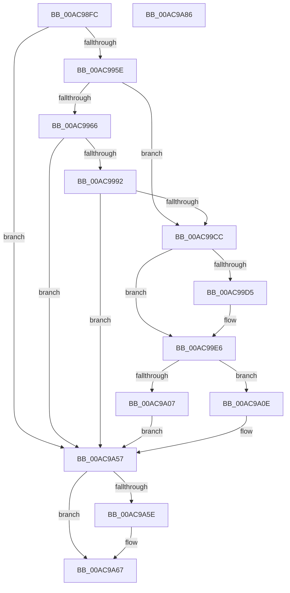

# SmKmFileInfoDuplicate

- RVA: `0x00AC98FC`–`0x00AC9A87` (길이 `395` bytes)
- VA: `0x0000000140AC98FC`
- 실행 섹션: `PAGE`
- PDB 이름 있음: `예`; PDB Function 태그: `아니요`
- unwind 정보 RVA: `0x000BE2CC`
- 디코드: `104`개 명령, `395/395` bytes 표시
- 미해석 바이트: `0` (있으면 어셈블리에 `.byte`로 보존)

> 이 문서는 커널 이미지의 기계어와 PDB 기호를 분석해 생성했습니다. 4번과 5번은 함수 원형과 자료형을 바이너리 사용 방식에서 추정한 C 해석이며 원본 소스 복구 결과는 아닙니다.

## 1. Dependencies

- 직접 호출 지점: **10**; 고유 호출 대상: **9**
- 직접 호출자로 확인된 함수: **1**
- RIP 상대 이미지 참조: **1**

### Outgoing calls
- `0x00AC9924` → [memset](../../text/6C/memset_function_006C6C40.md) (function, `0x006C6C40`)
- `0x00AC994F` → [ObOpenObjectByPointer](../8B/ObOpenObjectByPointer_function_008B7420.md) (function, `0x008B7420`)
- `0x00AC9983` → [ZwDuplicateObject](../../text/6A/ZwDuplicateObject_function_006AD850.md) (function, `0x006AD850`)
- `0x00AC99B5` → [ObReferenceObjectByHandle](../86/ObReferenceObjectByHandle_function_00868DB0.md) (function, `0x00868DB0`)
- `0x00AC99D9` → [ObfReferenceObject](../../text/20/ObfReferenceObject_function_0020FA20.md) (function, `0x0020FA20`)
- `0x00AC99F9` → [SmAllocEx](../../text/34/SmAllocEx_function_0034C794.md) (function, `0x0034C794`)
- `0x00AC9A18` → [memcpy](../../text/6C/memcpy_function_006C6840.md) (function, `0x006C6840`)
- `0x00AC9A50` → [memset](../../text/6C/memset_function_006C6C40.md) (function, `0x006C6C40`)
- `0x00AC9A62` → [ZwClose](../../text/6A/ZwClose_function_006AD2B0.md) (function, `0x006AD2B0`)
- `0x00AC9A6B` → [SmKmFileInfoCleanup](SmKmFileInfoCleanup_function_00AC9A90.md) (function, `0x00AC9A90`)

### Direct callers
- [SMKM_STORE&lt;SM_TRAITS&gt;::SmStStart](../../text/3B/SMKM_STORE_SM_TRAITS_SmStStart_function_003B14DC.md) at `0x003B1A47`

### Static image references
- `0x00AC9929` → RVA `0x00E28948` (`.data`; read)

## 2. Other-region calls and transfers

- 다른 실행 섹션으로 향하는 call: **7**
  - `0x00AC9924` → [memset](../../text/6C/memset_function_006C6C40.md) (`PAGE` → `.text`)
  - `0x00AC9983` → [ZwDuplicateObject](../../text/6A/ZwDuplicateObject_function_006AD850.md) (`PAGE` → `.text`)
  - `0x00AC99D9` → [ObfReferenceObject](../../text/20/ObfReferenceObject_function_0020FA20.md) (`PAGE` → `.text`)
  - `0x00AC99F9` → [SmAllocEx](../../text/34/SmAllocEx_function_0034C794.md) (`PAGE` → `.text`)
  - `0x00AC9A18` → [memcpy](../../text/6C/memcpy_function_006C6840.md) (`PAGE` → `.text`)
  - `0x00AC9A50` → [memset](../../text/6C/memset_function_006C6C40.md) (`PAGE` → `.text`)
  - `0x00AC9A62` → [ZwClose](../../text/6A/ZwClose_function_006AD2B0.md) (`PAGE` → `.text`)
- 별도 외부 분기/꼬리 이동을 확인하지 못했습니다.

## 3. Assembly (complete function range)

```asm
00AC98FC  48 89 5C 24 08                  mov qword ptr [rsp + 8], rbx
00AC9901  55                              push rbp
00AC9902  57                              push rdi
00AC9903  41 56                           push r14
00AC9905  48 8B EC                        mov rbp, rsp
00AC9908  48 81 EC 80 00 00 00            sub rsp, 0x80
00AC990F  48 83 65 30 00                  and qword ptr [rbp + 0x30], 0
00AC9914  48 8B FA                        mov rdi, rdx
00AC9917  33 D2                           xor edx, edx
00AC9919  4C 8B F1                        mov r14, rcx
00AC991C  48 8D 4D C0                     lea rcx, [rbp - 0x40]
00AC9920  44 8D 42 40                     lea r8d, [rdx + 0x40]
00AC9924  E8 17 D3 BF FF                  call 0x1406c6c40
00AC9929  48 8B 0D 18 F0 35 00            mov rcx, qword ptr [rip + 0x35f018]
00AC9930  48 8D 45 30                     lea rax, [rbp + 0x30]
00AC9934  48 89 44 24 30                  mov qword ptr [rsp + 0x30], rax
00AC9939  45 33 C9                        xor r9d, r9d
00AC993C  C6 44 24 28 00                  mov byte ptr [rsp + 0x28], 0
00AC9941  45 33 C0                        xor r8d, r8d
00AC9944  48 83 64 24 20 00               and qword ptr [rsp + 0x20], 0
00AC994A  BA 00 02 00 00                  mov edx, 0x200
00AC994F  E8 CC DA DE FF                  call 0x1408b7420
00AC9954  8B D8                           mov ebx, eax
00AC9956  85 C0                           test eax, eax
00AC9958  0F 88 F9 00 00 00               js 0x140ac9a57
00AC995E  48 8B 17                        mov rdx, qword ptr [rdi]
00AC9961  48 85 D2                        test rdx, rdx
00AC9964  74 66                           je 0x140ac99cc
00AC9966  4C 8B 45 30                     mov r8, qword ptr [rbp + 0x30]
00AC996A  4C 8D 4D C0                     lea r9, [rbp - 0x40]
00AC996E  C7 44 24 30 06 00 00 00         mov dword ptr [rsp + 0x30], 6
00AC9976  49 8B C8                        mov rcx, r8
00AC9979  83 64 24 28 00                  and dword ptr [rsp + 0x28], 0
00AC997E  83 64 24 20 00                  and dword ptr [rsp + 0x20], 0
00AC9983  E8 C8 3E BE FF                  call 0x1406ad850
00AC9988  8B D8                           mov ebx, eax
00AC998A  85 C0                           test eax, eax
00AC998C  0F 88 C5 00 00 00               js 0x140ac9a57
00AC9992  48 83 64 24 28 00               and qword ptr [rsp + 0x28], 0
00AC9998  48 8D 45 38                     lea rax, [rbp + 0x38]
00AC999C  48 8B 4D C0                     mov rcx, qword ptr [rbp - 0x40]
00AC99A0  45 33 C9                        xor r9d, r9d
00AC99A3  48 83 65 38 00                  and qword ptr [rbp + 0x38], 0
00AC99A8  45 33 C0                        xor r8d, r8d
00AC99AB  BA 03 00 01 00                  mov edx, 0x10003
00AC99B0  48 89 44 24 20                  mov qword ptr [rsp + 0x20], rax
00AC99B5  E8 F6 F3 D9 FF                  call 0x140868db0
00AC99BA  8B D8                           mov ebx, eax
00AC99BC  48 8B 45 38                     mov rax, qword ptr [rbp + 0x38]
00AC99C0  48 89 45 C8                     mov qword ptr [rbp - 0x38], rax
00AC99C4  85 DB                           test ebx, ebx
00AC99C6  0F 88 8B 00 00 00               js 0x140ac9a57
00AC99CC  48 8B 4F 10                     mov rcx, qword ptr [rdi + 0x10]
00AC99D0  48 85 C9                        test rcx, rcx
00AC99D3  74 11                           je 0x140ac99e6
00AC99D5  48 89 4D D0                     mov qword ptr [rbp - 0x30], rcx
00AC99D9  E8 42 60 74 FF                  call 0x14020fa20
00AC99DE  48 8B 47 18                     mov rax, qword ptr [rdi + 0x18]
00AC99E2  48 89 45 D8                     mov qword ptr [rbp - 0x28], rax
00AC99E6  8B 47 38                        mov eax, dword ptr [rdi + 0x38]
00AC99E9  41 83 C8 FF                     or r8d, 0xffffffff
00AC99ED  C1 E0 04                        shl eax, 4
00AC99F0  BA 73 6D 58 74                  mov edx, 0x74586d73
00AC99F5  8B C8                           mov ecx, eax
00AC99F7  8B D8                           mov ebx, eax
00AC99F9  E8 96 2D 88 FF                  call 0x14034c794
00AC99FE  48 89 45 F0                     mov qword ptr [rbp - 0x10], rax
00AC9A02  48 85 C0                        test rax, rax
00AC9A05  75 07                           jne 0x140ac9a0e
00AC9A07  BB 9A 00 00 C0                  mov ebx, 0xc000009a
00AC9A0C  EB 49                           jmp 0x140ac9a57
00AC9A0E  48 8B 57 30                     mov rdx, qword ptr [rdi + 0x30]
00AC9A12  4C 8B C3                        mov r8, rbx
00AC9A15  48 8B C8                        mov rcx, rax
00AC9A18  E8 23 CE BF FF                  call 0x1406c6840
00AC9A1D  8B 47 38                        mov eax, dword ptr [rdi + 0x38]
00AC9A20  48 8D 4D C0                     lea rcx, [rbp - 0x40]
00AC9A24  0F 28 45 C0                     movaps xmm0, xmmword ptr [rbp - 0x40]
00AC9A28  33 D2                           xor edx, edx
00AC9A2A  0F 28 4D D0                     movaps xmm1, xmmword ptr [rbp - 0x30]
00AC9A2E  41 0F 11 06                     movups xmmword ptr [r14], xmm0
00AC9A32  89 45 F8                        mov dword ptr [rbp - 8], eax
00AC9A35  0F 28 45 E0                     movaps xmm0, xmmword ptr [rbp - 0x20]
00AC9A39  44 8D 42 40                     lea r8d, [rdx + 0x40]
00AC9A3D  41 0F 11 4E 10                  movups xmmword ptr [r14 + 0x10], xmm1
00AC9A42  0F 28 4D F0                     movaps xmm1, xmmword ptr [rbp - 0x10]
00AC9A46  41 0F 11 46 20                  movups xmmword ptr [r14 + 0x20], xmm0
00AC9A4B  41 0F 11 4E 30                  movups xmmword ptr [r14 + 0x30], xmm1
00AC9A50  E8 EB D1 BF FF                  call 0x1406c6c40
00AC9A55  33 DB                           xor ebx, ebx
00AC9A57  48 83 7D 30 00                  cmp qword ptr [rbp + 0x30], 0
00AC9A5C  74 09                           je 0x140ac9a67
00AC9A5E  48 8B 4D 30                     mov rcx, qword ptr [rbp + 0x30]
00AC9A62  E8 49 38 BE FF                  call 0x1406ad2b0
00AC9A67  48 8D 4D C0                     lea rcx, [rbp - 0x40]
00AC9A6B  E8 20 00 00 00                  call 0x140ac9a90
00AC9A70  8B C3                           mov eax, ebx
00AC9A72  48 8B 9C 24 A0 00 00 00         mov rbx, qword ptr [rsp + 0xa0]
00AC9A7A  48 81 C4 80 00 00 00            add rsp, 0x80
00AC9A81  41 5E                           pop r14
00AC9A83  5F                              pop rdi
00AC9A84  5D                              pop rbp
00AC9A85  C3                              ret
00AC9A86  CC                              int3
```

## 4. C-style interpretation (structured pseudocode)

```c
__int64 __fastcall SmKmFileInfoDuplicate(__int64 a1, __int64 a2, __int64 a3, int a4)
{
    __int64 result;
    __int64 v_rbx;
    __int64 v_rsp;
    unsigned int v_stack_m20;
    unsigned __int64 v_stack_m28;
    unsigned __int64 v_stack_m38;
    unsigned __int64 v_stack_m40;
    unsigned __int64 v_stack_m48;
    unsigned __int64 v_stack_m50;
    unsigned __int64 v_stack_m58;
    unsigned __int64 v_stack_m68;
    unsigned __int8 v_stack_m70;
    unsigned __int64 v_stack_m78;
    unsigned __int64 v_stack_p18;
    unsigned __int64 v_stack_p20;
    unsigned __int64 v_stack_p8;

    v_stack_p8 = v_rbx;
    v_rsp = (v_rsp) - (128);
    a2 = 0;
    result = memset(v_stack_m58, a2, a2 + 64, a4);
    v_stack_m68 = v_stack_p18;
    a4 = 0;
    v_stack_m70 = 0;
    a3 = 0;
    result = ObOpenObjectByPointer(*(unsigned __int64 *)(v_rip + 3534872), 512, a3, a4);
    if (sign_flag) goto loc_00AC9A57;
    if (*(unsigned __int64 *)(a2) == 0) goto loc_00AC99CC;
    v_stack_m68 = 6;
    result = ZwDuplicateObject(v_stack_p18, *(unsigned __int64 *)(a2), v_stack_p18, v_stack_m58);
    if (sign_flag) goto loc_00AC9A57;
    a4 = 0;
    a3 = 0;
    v_stack_m78 = v_stack_p20;
    result = ObReferenceObjectByHandle(v_stack_m58, (unsigned int)(0x10003ULL), a3, a4);
    v_stack_m50 = v_stack_p20;
    if (sign_flag) goto loc_00AC9A57;
loc_00AC99CC:
    result = v_stack_p20;
    if (*(unsigned __int64 *)(a2 + 16) != 0) {
        v_stack_m48 = *(unsigned __int64 *)(a2 + 16);
        result = ObfReferenceObject(*(unsigned __int64 *)(a2 + 16), (unsigned int)(0x10003ULL), a3, a4);
        result = *(unsigned __int64 *)(a2 + 24);
        v_stack_m40 = result;
    }
    a3 = (unsigned int)((a3) | (0xFFFFFFFFULL));
    result = (unsigned int)(((unsigned int)(*(unsigned int *)(a2 + 56))) << (4));
    result = SmAllocEx((unsigned int)((unsigned int)(result)), (unsigned int)(0x74586D73ULL), a3, a4);
    v_stack_m28 = result;
    if (result != 0) goto loc_00AC9A0E;
    goto loc_00AC9A57;
loc_00AC9A0E:
    result = memcpy(result, *(unsigned __int64 *)(a2 + 48), (unsigned int)(0xC000009AULL), a4);
    a2 = 0;
    *(unsigned __int64 *)(a1) = v_xmm0;
    v_stack_m20 = (unsigned int)((unsigned int)(*(unsigned int *)(a2 + 56)));
    *(unsigned __int64 *)(a1 + 16) = v_xmm1;
    *(unsigned __int64 *)(a1 + 32) = v_xmm0;
    *(unsigned __int64 *)(a1 + 48) = v_xmm1;
    result = memset(v_stack_m58, a2, a2 + 64, a4);
    v_rbx = 0;
loc_00AC9A57:
    if (v_stack_p18 != 0) {
        a1 = v_stack_p18;
        result = ZwClose(a1, a2, a2 + 64, a4);
    }
    result = SmKmFileInfoCleanup(v_stack_m58, a2, a2 + 64, a4);
    v_rsp = (v_rsp) + (128);
    return 0;
}
```

## 5. (Beta) C Style

```c
int64_t SmKmFileInfoDuplicate(void *Arg1, void *Arg2, int64_t Arg3, int32_t Arg4)
{
    uint8_t *arg1 = (uint8_t *)Arg1;
    uint8_t *arg2 = (uint8_t *)Arg2;

    int64_t result;
    int64_t local_rbx;
    int64_t local_rsp;
    uint32_t v_stack_m20;
    uint64_t v_stack_m28;
    uint64_t v_stack_m38;
    uint64_t v_stack_m40;
    uint64_t v_stack_m48;
    uint64_t v_stack_m50;
    uint64_t v_stack_m58;
    uint64_t v_stack_m68;
    uint8_t v_stack_m70;
    uint64_t v_stack_m78;
    uint64_t v_stack_p18;
    uint64_t v_stack_p20;
    uint64_t v_stack_p8;

    v_stack_p8 = local_rbx;
    local_rsp = (local_rsp) - (128);
    Arg2 = 0;
    result = memset(v_stack_m58, Arg2, Arg2 + 64, Arg4);
    v_stack_m68 = v_stack_p18;
    Arg4 = 0;
    v_stack_m70 = 0;
    Arg3 = 0;
    result = ObOpenObjectByPointer(*(uint64_t *)(v_rip + 0x35F018), 512, Arg3, Arg4);
    if (sign_flag) goto loc_00AC9A57;
    if (*(uint64_t *)(arg2) == 0) goto loc_00AC99CC;
    v_stack_m68 = 6;
    result = ZwDuplicateObject(v_stack_p18, *(uint64_t *)(arg2), v_stack_p18, v_stack_m58);
    if (sign_flag) goto loc_00AC9A57;
    Arg4 = 0;
    Arg3 = 0;
    v_stack_m78 = v_stack_p20;
    result = ObReferenceObjectByHandle(v_stack_m58, (uint32_t)(0x10003ULL), Arg3, Arg4);
    v_stack_m50 = v_stack_p20;
    if (sign_flag) goto loc_00AC9A57;
loc_00AC99CC:
    result = v_stack_p20;
    if (*(uint64_t *)(arg2 + 0x10) != 0) {
        v_stack_m48 = *(uint64_t *)(arg2 + 0x10);
        result = ObfReferenceObject(*(uint64_t *)(arg2 + 0x10), (uint32_t)(0x10003ULL), Arg3, Arg4);
        result = *(uint64_t *)(arg2 + 0x18);
        v_stack_m40 = result;
    }
    Arg3 = (uint32_t)((Arg3) | (0xFFFFFFFFULL));
    result = (uint32_t)(((uint32_t)(*(uint32_t *)(arg2 + 0x38))) << (4));
    result = SmAllocEx((uint32_t)((uint32_t)(result)), (uint32_t)(0x74586D73ULL), Arg3, Arg4);
    v_stack_m28 = result;
    if (result != 0) goto loc_00AC9A0E;
    goto loc_00AC9A57;
loc_00AC9A0E:
    result = memcpy(result, *(uint64_t *)(arg2 + 0x30), (uint32_t)(0xC000009AULL), Arg4);
    Arg2 = 0;
    *(uint64_t *)(arg1) = v_xmm0;
    v_stack_m20 = (uint32_t)((uint32_t)(*(uint32_t *)(arg2 + 0x38)));
    *(uint64_t *)(arg1 + 0x10) = v_xmm1;
    *(uint64_t *)(arg1 + 0x20) = v_xmm0;
    *(uint64_t *)(arg1 + 0x30) = v_xmm1;
    result = memset(v_stack_m58, Arg2, Arg2 + 64, Arg4);
    local_rbx = 0;
loc_00AC9A57:
    if (v_stack_p18 != 0) {
        Arg1 = v_stack_p18;
        result = ZwClose(Arg1, Arg2, Arg2 + 64, Arg4);
    }
    result = SmKmFileInfoCleanup(v_stack_m58, Arg2, Arg2 + 64, Arg4);
    local_rsp = (local_rsp) + (128);
    return 0;
}
```

### 관측된 메모리 오프셋

구조체 형식이 확인되지 않은 접근은 인자 기준의 오프셋으로만 기록했습니다.

| 기준 인자 | 오프셋 표현 | 폭 (bit) | 접근 |
|---|---:|---:|---|
| `Arg1` | `+ 0x0` | `128` | `R` |
| `Arg1` | `+ 0x10` | `128` | `R` |
| `Arg1` | `+ 0x20` | `128` | `R` |
| `Arg1` | `+ 0x30` | `128` | `R` |
| `Arg2` | `+ 0x0` | `64` | `R` |
| `Arg2` | `+ 0x10` | `64` | `R` |
| `Arg2` | `+ 0x18` | `64` | `R` |
| `Arg2` | `+ 0x30` | `64` | `R` |
| `Arg2` | `+ 0x38` | `32` | `R` |

## 6. Execution-region graph

[열기: 2D/3D 그래프와 함수 탐색 컨트롤 패널](../../../control-panel.html?section=page&rva=0x00AC98FC&view=graph)

- 2D 그래프는 위에서 아래로 흐르고, 3D 그래프는 빈 공간을 드래그해 회전합니다. Shift+드래그는 이동, 휠은 확대·축소, 함수 노드 선택은 대상 보고서 이동입니다.

### Static fallback


