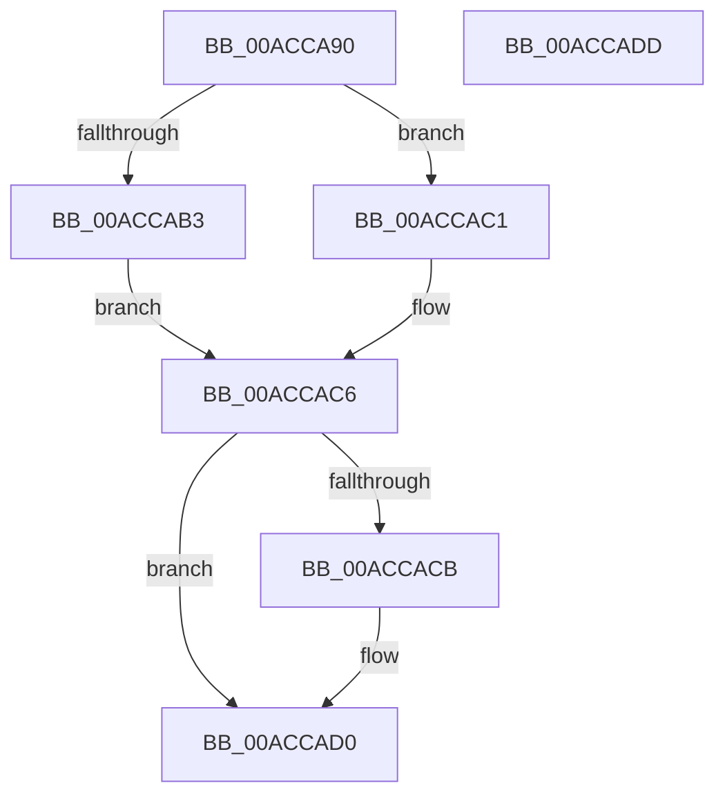

# SmRegistrationCtxStart

- RVA: `0x00ACCA90`–`0x00ACCADE` (길이 `78` bytes)
- VA: `0x0000000140ACCA90`
- 실행 섹션: `PAGE`
- PDB 이름 있음: `예`; PDB Function 태그: `아니요`
- unwind 정보 RVA: `0x0005CAAC`
- 디코드: `25`개 명령, `78/78` bytes 표시
- 미해석 바이트: `0` (있으면 어셈블리에 `.byte`로 보존)

> 이 문서는 커널 이미지의 기계어와 PDB 기호를 분석해 생성했습니다. 4번과 5번은 함수 원형과 자료형을 바이너리 사용 방식에서 추정한 C 해석이며 원본 소스 복구 결과는 아닙니다.

## 1. Dependencies

- 직접 호출 지점: **2**; 고유 호출 대상: **2**
- 직접 호출자로 확인된 함수: **3**
- RIP 상대 이미지 참조: **0**

### Outgoing calls
- `0x00ACCAA8` → [SmCreateEvent](SmCreateEvent_function_00ACCAE4.md) (function, `0x00ACCAE4`)
- `0x00ACCACB` → [ObfDereferenceObject](../../text/2F/ObfDereferenceObject_function_002F9350.md) (function, `0x002F9350`)

### Direct callers
- [SmFirstTimeInit](../../text/4E/SmFirstTimeInit_function_004EA944.md) at `0x004EAA13`
- [SmGetRegistrationInfo](../7A/SmGetRegistrationInfo_function_007A5AC4.md) at `0x007A5B4B`
- [SmcCacheCreatePrepare](../7A/SmcCacheCreatePrepare_function_007A754C.md) at `0x007A75C7`

### Static image references
- 디코드된 RIP-relative 메모리 참조가 없습니다.

## 2. Other-region calls and transfers

- 다른 실행 섹션으로 향하는 call: **1**
  - `0x00ACCACB` → [ObfDereferenceObject](../../text/2F/ObfDereferenceObject_function_002F9350.md) (`PAGE` → `.text`)
- 별도 외부 분기/꼬리 이동을 확인하지 못했습니다.

## 3. Assembly (complete function range)

```asm
00ACCA90  48 89 5C 24 08                  mov qword ptr [rsp + 8], rbx
00ACCA95  57                              push rdi
00ACCA96  48 83 EC 20                     sub rsp, 0x20
00ACCA9A  48 83 64 24 38 00               and qword ptr [rsp + 0x38], 0
00ACCAA0  48 8D 54 24 38                  lea rdx, [rsp + 0x38]
00ACCAA5  48 8B F9                        mov rdi, rcx
00ACCAA8  E8 37 00 00 00                  call 0x140accae4
00ACCAAD  8B D8                           mov ebx, eax
00ACCAAF  85 C0                           test eax, eax
00ACCAB1  78 0E                           js 0x140accac1
00ACCAB3  48 8B 44 24 38                  mov rax, qword ptr [rsp + 0x38]
00ACCAB8  33 C9                           xor ecx, ecx
00ACCABA  48 89 07                        mov qword ptr [rdi], rax
00ACCABD  33 DB                           xor ebx, ebx
00ACCABF  EB 05                           jmp 0x140accac6
00ACCAC1  48 8B 4C 24 38                  mov rcx, qword ptr [rsp + 0x38]
00ACCAC6  48 85 C9                        test rcx, rcx
00ACCAC9  74 05                           je 0x140accad0
00ACCACB  E8 80 C8 82 FF                  call 0x1402f9350
00ACCAD0  8B C3                           mov eax, ebx
00ACCAD2  48 8B 5C 24 30                  mov rbx, qword ptr [rsp + 0x30]
00ACCAD7  48 83 C4 20                     add rsp, 0x20
00ACCADB  5F                              pop rdi
00ACCADC  C3                              ret
00ACCADD  CC                              int3
```

## 4. C-style interpretation (structured pseudocode)

```c
__int64 __fastcall SmRegistrationCtxStart(__int64 a1)
{
    __int64 result;
    __int64 v_rbx;
    __int64 v_rsp;
    unsigned __int64 v_stack_p10;
    unsigned __int64 v_stack_p8;

    v_stack_p8 = v_rbx;
    v_rsp = (v_rsp) - (32);
    result = SmCreateEvent(a1, v_stack_p10, a3, a4);
    if (sign_flag) goto loc_00ACCAC1;
    a1 = 0;
    *(unsigned __int64 *)(a1) = v_stack_p10;
    v_rbx = 0;
    goto loc_00ACCAC6;
loc_00ACCAC1:
loc_00ACCAC6:
    result = v_stack_p10;
    if (v_stack_p10 != 0) {
        result = ObfDereferenceObject(v_stack_p10, v_stack_p10, a3, a4);
    }
    v_rsp = (v_rsp) + (32);
    return 0;
}
```

## 5. (Beta) C Style

```c
int64_t SmRegistrationCtxStart(void *Arg1)
{
    uint8_t *arg1 = (uint8_t *)Arg1;

    int64_t result;
    int64_t local_rbx;
    int64_t local_rsp;
    uint64_t v_stack_p10;
    uint64_t v_stack_p8;

    v_stack_p8 = local_rbx;
    local_rsp = (local_rsp) - (32);
    result = SmCreateEvent(Arg1, v_stack_p10, a3, a4);
    if (sign_flag) goto loc_00ACCAC1;
    Arg1 = 0;
    *(uint64_t *)(arg1) = v_stack_p10;
    local_rbx = 0;
    goto loc_00ACCAC6;
loc_00ACCAC1:
loc_00ACCAC6:
    result = v_stack_p10;
    if (v_stack_p10 != 0) {
        result = ObfDereferenceObject(v_stack_p10, v_stack_p10, a3, a4);
    }
    local_rsp = (local_rsp) + (32);
    return 0;
}
```

### 관측된 메모리 오프셋

구조체 형식이 확인되지 않은 접근은 인자 기준의 오프셋으로만 기록했습니다.

| 기준 인자 | 오프셋 표현 | 폭 (bit) | 접근 |
|---|---:|---:|---|
| `Arg1` | `+ 0x0` | `64` | `W` |

## 6. Execution-region graph

[열기: 2D/3D 그래프와 함수 탐색 컨트롤 패널](../../../control-panel.html?section=page&rva=0x00ACCA90&view=graph)

- 2D 그래프는 위에서 아래로 흐르고, 3D 그래프는 빈 공간을 드래그해 회전합니다. Shift+드래그는 이동, 휠은 확대·축소, 함수 노드 선택은 대상 보고서 이동입니다.

### Static fallback


