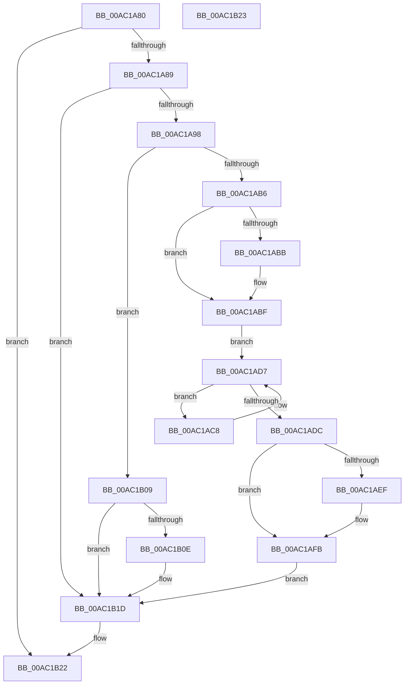

# TlgAggregateInternalProviderCallback

- RVA: `0x00AC1A80`–`0x00AC1B24` (길이 `164` bytes)
- VA: `0x0000000140AC1A80`
- 실행 섹션: `PAGE`
- PDB 이름 있음: `예`; PDB Function 태그: `아니요`
- unwind 정보 RVA: `0x000BDAD8`
- 디코드: `41`개 명령, `164/164` bytes 표시
- 미해석 바이트: `0` (있으면 어셈블리에 `.byte`로 보존)

> 이 문서는 커널 이미지의 기계어와 PDB 기호를 분석해 생성했습니다. 4번과 5번은 함수 원형과 자료형을 바이너리 사용 방식에서 추정한 C 해석이며 원본 소스 복구 결과는 아닙니다.

## 1. Dependencies

- 직접 호출 지점: **5**; 고유 호출 대상: **5**
- 직접 호출자로 확인된 함수: **0**
- RIP 상대 이미지 참조: **3**

### Outgoing calls
- `0x00AC1AA5` → [KeAbPreAcquire](../../text/21/KeAbPreAcquire_function_00210230.md) (function, `0x00210230`)
- `0x00AC1ACB` → [LookUpTableFlushComplete](../A6/LookUpTableFlushComplete_function_00A6957C.md) (function, `0x00A6957C`)
- `0x00AC1AF6` → [ExfTryToWakePushLock](../../text/26/ExfTryToWakePushLock_function_00265DD0.md) (function, `0x00265DD0`)
- `0x00AC1B02` → [KeAbPostRelease](../../text/2E/KeAbPostRelease_function_002E1600.md) (function, `0x002E1600`)
- `0x00AC1B18` → [KeAbPostReleaseEx](../../text/26/KeAbPostReleaseEx_function_00262210.md) (function, `0x00262210`)

### Direct callers
- 이 함수 시작 RVA로 연결되는 직접 call은 확인되지 않았습니다. 간접 호출은 완전히 역산할 수 없습니다.

### Static image references
- `0x00AC1A9E` → RVA `0x00EEFFF0` (`.data`; read)
- `0x00AC1AAA` → RVA `0x00EEFFF0` (`.data`; read/write)
- `0x00AC1ABF` → RVA `0x00EEFFF8` (`.data`; read)

## 2. Other-region calls and transfers

- 다른 실행 섹션으로 향하는 call: **4**
  - `0x00AC1AA5` → [KeAbPreAcquire](../../text/21/KeAbPreAcquire_function_00210230.md) (`PAGE` → `.text`)
  - `0x00AC1AF6` → [ExfTryToWakePushLock](../../text/26/ExfTryToWakePushLock_function_00265DD0.md) (`PAGE` → `.text`)
  - `0x00AC1B02` → [KeAbPostRelease](../../text/2E/KeAbPostRelease_function_002E1600.md) (`PAGE` → `.text`)
  - `0x00AC1B18` → [KeAbPostReleaseEx](../../text/26/KeAbPostReleaseEx_function_00262210.md) (`PAGE` → `.text`)
- 별도 외부 분기/꼬리 이동을 확인하지 못했습니다.

## 3. Assembly (complete function range)

```asm
00AC1A80  83 FA 02                        cmp edx, 2
00AC1A83  0F 85 99 00 00 00               jne 0x140ac1b22
00AC1A89  53                              push rbx
00AC1A8A  48 83 EC 20                     sub rsp, 0x20
00AC1A8E  49 83 F9 20                     cmp r9, 0x20
00AC1A92  0F 85 85 00 00 00               jne 0x140ac1b1d
00AC1A98  33 D2                           xor edx, edx
00AC1A9A  45 8D 41 E1                     lea r8d, [r9 - 0x1f]
00AC1A9E  48 8D 0D 4B E5 42 00            lea rcx, [rip + 0x42e54b]
00AC1AA5  E8 86 E7 74 FF                  call 0x140210230
00AC1AAA  F0 48 0F BA 2D 3C E5 42 00 00   lock bts qword ptr [rip + 0x42e53c], 0
00AC1AB4  72 53                           jb 0x140ac1b09
00AC1AB6  48 85 C0                        test rax, rax
00AC1AB9  74 04                           je 0x140ac1abf
00AC1ABB  C6 40 0A 01                     mov byte ptr [rax + 0xa], 1
00AC1ABF  48 8B 1D 32 E5 42 00            mov rbx, qword ptr [rip + 0x42e532]
00AC1AC6  EB 0F                           jmp 0x140ac1ad7
00AC1AC8  48 8B CB                        mov rcx, rbx
00AC1ACB  E8 AC 7A FA FF                  call 0x140a6957c
00AC1AD0  48 8B 9B 60 01 00 00            mov rbx, qword ptr [rbx + 0x160]
00AC1AD7  48 85 DB                        test rbx, rbx
00AC1ADA  75 EC                           jne 0x140ac1ac8
00AC1ADC  48 83 C8 FF                     or rax, 0xffffffffffffffff
00AC1AE0  F0 48 0F C1 05 07 E5 42 00      lock xadd qword ptr [rip + 0x42e507], rax
00AC1AE9  24 06                           and al, 6
00AC1AEB  3C 02                           cmp al, 2
00AC1AED  75 0C                           jne 0x140ac1afb
00AC1AEF  48 8D 0D FA E4 42 00            lea rcx, [rip + 0x42e4fa]
00AC1AF6  E8 D5 42 7A FF                  call 0x140265dd0
00AC1AFB  48 8D 0D EE E4 42 00            lea rcx, [rip + 0x42e4ee]
00AC1B02  E8 F9 FA 81 FF                  call 0x1402e1600
00AC1B07  EB 14                           jmp 0x140ac1b1d
00AC1B09  48 85 C0                        test rax, rax
00AC1B0C  74 0F                           je 0x140ac1b1d
00AC1B0E  48 8B D0                        mov rdx, rax
00AC1B11  48 8D 0D D8 E4 42 00            lea rcx, [rip + 0x42e4d8]
00AC1B18  E8 F3 06 7A FF                  call 0x140262210
00AC1B1D  48 83 C4 20                     add rsp, 0x20
00AC1B21  5B                              pop rbx
00AC1B22  C3                              ret
00AC1B23  CC                              int3
```

## 4. C-style interpretation (structured pseudocode)

```c
__int64 __fastcall TlgAggregateInternalProviderCallback(__int64 a1, int a2, __int64 a3, __int64 a4)
{
    __int64 result;
    __int64 v_rsp;

    if (a2 != 2) goto loc_00AC1B22;
    v_rsp = (v_rsp) - (32);
    if (a4 != 32) goto loc_00AC1B1D;
    a2 = 0;
    result = KeAbPreAcquire(v_rip + 4384075, a2, a4 - 31, a4);
    if (condition_is_below) goto loc_00AC1B09;
    if (result != 0) {
        *(unsigned __int8 *)(result + 10) = 1;
    }
    goto loc_00AC1AD7;
loc_00AC1AC8:
    result = LookUpTableFlushComplete(*(unsigned __int64 *)(v_rip + 4384050), a2, a4 - 31, a4);
loc_00AC1AD7:
    if (*(unsigned __int64 *)(*(unsigned __int64 *)(v_rip + 4384050) + 352) != 0) goto loc_00AC1AC8;
    result = (result) | (-1);
    result = (unsigned __int8)((result) & (6));
    if (((unsigned __int8)(result)) == 2) {
        a1 = v_rip + 4383994;
        result = ExfTryToWakePushLock(a1, a2, a4 - 31, a4);
    }
    result = KeAbPostRelease(v_rip + 4383982, a2, a4 - 31, a4);
    goto loc_00AC1B1D;
loc_00AC1B09:
    if (result != 0) {
        a2 = result;
        a1 = v_rip + 4383960;
        result = KeAbPostReleaseEx(a1, a2, a4 - 31, a4);
    }
    v_rsp = (v_rsp) + (32);
loc_00AC1B22:
    return result;
}
```

## 5. (Beta) C Style

```c
int64_t TlgAggregateInternalProviderCallback(int64_t Arg1, int32_t Arg2, int64_t Arg3, int64_t Arg4)
{
    int64_t result;
    int64_t local_rsp;

    if (Arg2 != 2) goto loc_00AC1B22;
    local_rsp = (local_rsp) - (32);
    if (Arg4 != 32) goto loc_00AC1B1D;
    Arg2 = 0;
    result = KeAbPreAcquire(v_rip + 4384075, Arg2, Arg4 - 31, Arg4);
    if (condition_is_below) goto loc_00AC1B09;
    if (result != 0) {
        *(uint8_t *)(result + 0xA) = 1;
    }
    goto loc_00AC1AD7;
loc_00AC1AC8:
    result = LookUpTableFlushComplete(*(uint64_t *)(v_rip + 0x42E532), Arg2, Arg4 - 31, Arg4);
loc_00AC1AD7:
    if (*(uint64_t *)(*(uint64_t *)(v_rip + 0x42E532) + 0x160) != 0) goto loc_00AC1AC8;
    result = (result) | (-1);
    result = (uint8_t)((result) & (6));
    if (((uint8_t)(result)) == 2) {
        Arg1 = v_rip + 4383994;
        result = ExfTryToWakePushLock(Arg1, Arg2, Arg4 - 31, Arg4);
    }
    result = KeAbPostRelease(v_rip + 4383982, Arg2, Arg4 - 31, Arg4);
    goto loc_00AC1B1D;
loc_00AC1B09:
    if (result != 0) {
        Arg2 = result;
        Arg1 = v_rip + 4383960;
        result = KeAbPostReleaseEx(Arg1, Arg2, Arg4 - 31, Arg4);
    }
    local_rsp = (local_rsp) + (32);
loc_00AC1B22:
    return result;
}
```

## 6. Execution-region graph

[열기: 2D/3D 그래프와 함수 탐색 컨트롤 패널](../../../control-panel.html?section=page&rva=0x00AC1A80&view=graph)

- 2D 그래프는 위에서 아래로 흐르고, 3D 그래프는 빈 공간을 드래그해 회전합니다. Shift+드래그는 이동, 휠은 확대·축소, 함수 노드 선택은 대상 보고서 이동입니다.

### Static fallback


