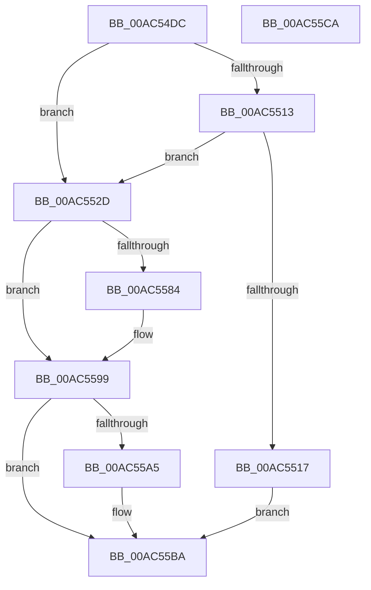

# TtmCleanupCurrentSession

- RVA: `0x00AC54DC`–`0x00AC55CB` (길이 `239` bytes)
- VA: `0x0000000140AC54DC`
- 실행 섹션: `PAGE`
- PDB 이름 있음: `예`; PDB Function 태그: `아니요`
- unwind 정보 RVA: `0x0005CAAC`
- 디코드: `54`개 명령, `239/239` bytes 표시
- 미해석 바이트: `0` (있으면 어셈블리에 `.byte`로 보존)

> 이 문서는 커널 이미지의 기계어와 PDB 기호를 분석해 생성했습니다. 4번과 5번은 함수 원형과 자료형을 바이너리 사용 방식에서 추정한 C 해석이며 원본 소스 복구 결과는 아닙니다.

## 1. Dependencies

- 직접 호출 지점: **16**; 고유 호출 대상: **11**
- 직접 호출자로 확인된 함수: **1**
- RIP 상대 이미지 참조: **3**

### Outgoing calls
- `0x00AC54E6` → [TtmiLogCleanupCurrentSessionStart](TtmiLogCleanupCurrentSessionStart_function_00AC55D4.md) (function, `0x00AC55D4`)
- `0x00AC54FB` → [PsGetProcessSessionIdEx](../../text/22/PsGetProcessSessionIdEx_function_0022F8F0.md) (function, `0x0022F8F0`)
- `0x00AC5502` → [TtmpAcquireSessionLock](../70/TtmpAcquireSessionLock_function_00700408.md) (function, `0x00700408`)
- `0x00AC551E` → [ExReleaseResourceLite](../../text/25/ExReleaseResourceLite_function_0025FA10.md) (function, `0x0025FA10`)
- `0x00AC5523` → [KeLeaveCriticalRegion](../../text/25/KeLeaveCriticalRegion_function_0025D8B0.md) (function, `0x0025D8B0`)
- `0x00AC5530` → [TtmpCleanupPowerRequestsTrackingFromCurrentSession](../77/TtmpCleanupPowerRequestsTrackingFromCurrentSession_function_00777744.md) (function, `0x00777744`)
- `0x00AC5539` → [ObfDereferenceObject](../../text/2F/ObfDereferenceObject_function_002F9350.md) (function, `0x002F9350`)
- `0x00AC5549` → [ObCloseHandle](../8A/ObCloseHandle_function_008A1870.md) (function, `0x008A1870`)
- `0x00AC555A` → [TtmpDereferenceSessionMaybeLast](../77/TtmpDereferenceSessionMaybeLast_function_00777898.md) (function, `0x00777898`)
- `0x00AC556E` → [ExReleaseResourceLite](../../text/25/ExReleaseResourceLite_function_0025FA10.md) (function, `0x0025FA10`)
- `0x00AC5573` → [KeLeaveCriticalRegion](../../text/25/KeLeaveCriticalRegion_function_0025D8B0.md) (function, `0x0025D8B0`)
- `0x00AC5584` → [PoUnregisterPowerSettingCallback](../A8/PoUnregisterPowerSettingCallback_function_00A8E940.md) (function, `0x00A8E940`)
- `0x00AC5594` → [TtmpDereferenceSessionMaybeLast](../77/TtmpDereferenceSessionMaybeLast_function_00777898.md) (function, `0x00777898`)
- `0x00AC55A5` → [PoUnregisterPowerSettingCallback](../A8/PoUnregisterPowerSettingCallback_function_00A8E940.md) (function, `0x00A8E940`)
- `0x00AC55B5` → [TtmpDereferenceSessionMaybeLast](../77/TtmpDereferenceSessionMaybeLast_function_00777898.md) (function, `0x00777898`)
- `0x00AC55BA` → [TtmiLogCleanupCurrentSessionStop](TtmiLogCleanupCurrentSessionStop_function_00AC567C.md) (function, `0x00AC567C`)

### Direct callers
- [NtPowerInformation](../95/NtPowerInformation_function_00955D80.md) at `0x00957561`

### Static image references
- `0x00AC5507` → RVA `0x00FD9B90` (`PAGEDATA`; read)
- `0x00AC5517` → RVA `0x00F06940` (`.data`; read)
- `0x00AC555F` → RVA `0x00FD9B90` (`PAGEDATA`; read/write)

## 2. Other-region calls and transfers

- 다른 실행 섹션으로 향하는 call: **6**
  - `0x00AC54FB` → [PsGetProcessSessionIdEx](../../text/22/PsGetProcessSessionIdEx_function_0022F8F0.md) (`PAGE` → `.text`)
  - `0x00AC551E` → [ExReleaseResourceLite](../../text/25/ExReleaseResourceLite_function_0025FA10.md) (`PAGE` → `.text`)
  - `0x00AC5523` → [KeLeaveCriticalRegion](../../text/25/KeLeaveCriticalRegion_function_0025D8B0.md) (`PAGE` → `.text`)
  - `0x00AC5539` → [ObfDereferenceObject](../../text/2F/ObfDereferenceObject_function_002F9350.md) (`PAGE` → `.text`)
  - `0x00AC556E` → [ExReleaseResourceLite](../../text/25/ExReleaseResourceLite_function_0025FA10.md) (`PAGE` → `.text`)
  - `0x00AC5573` → [KeLeaveCriticalRegion](../../text/25/KeLeaveCriticalRegion_function_0025D8B0.md) (`PAGE` → `.text`)
- 별도 외부 분기/꼬리 이동을 확인하지 못했습니다.

## 3. Assembly (complete function range)

```asm
00AC54DC  48 89 5C 24 08                  mov qword ptr [rsp + 8], rbx
00AC54E1  57                              push rdi
00AC54E2  48 83 EC 20                     sub rsp, 0x20
00AC54E6  E8 E9 00 00 00                  call 0x140ac55d4
00AC54EB  65 48 8B 0C 25 88 01 00 00      mov rcx, qword ptr gs:[0x188]
00AC54F4  48 8B 89 B8 00 00 00            mov rcx, qword ptr [rcx + 0xb8]
00AC54FB  E8 F0 A3 76 FF                  call 0x14022f8f0
00AC5500  8B F8                           mov edi, eax
00AC5502  E8 01 AF C3 FF                  call 0x140700408
00AC5507  48 8B 1D 82 46 51 00            mov rbx, qword ptr [rip + 0x514682]
00AC550E  48 85 DB                        test rbx, rbx
00AC5511  74 1A                           je 0x140ac552d
00AC5513  39 3B                           cmp dword ptr [rbx], edi
00AC5515  74 16                           je 0x140ac552d
00AC5517  48 8D 0D 22 14 44 00            lea rcx, [rip + 0x441422]
00AC551E  E8 ED A4 79 FF                  call 0x14025fa10
00AC5523  E8 88 83 79 FF                  call 0x14025d8b0
00AC5528  E9 8D 00 00 00                  jmp 0x140ac55ba
00AC552D  48 8B CB                        mov rcx, rbx
00AC5530  E8 0F 22 CB FF                  call 0x140777744
00AC5535  48 8B 4B 20                     mov rcx, qword ptr [rbx + 0x20]
00AC5539  E8 12 3E 83 FF                  call 0x1402f9350
00AC553E  48 8B 4B 18                     mov rcx, qword ptr [rbx + 0x18]
00AC5542  33 D2                           xor edx, edx
00AC5544  48 83 63 20 00                  and qword ptr [rbx + 0x20], 0
00AC5549  E8 22 C3 DD FF                  call 0x1408a1870
00AC554E  48 83 63 18 00                  and qword ptr [rbx + 0x18], 0
00AC5553  48 8B CB                        mov rcx, rbx
00AC5556  83 4B 04 04                     or dword ptr [rbx + 4], 4
00AC555A  E8 39 23 CB FF                  call 0x140777898
00AC555F  48 83 25 29 46 51 00 00         and qword ptr [rip + 0x514629], 0
00AC5567  48 8D 0D D2 13 44 00            lea rcx, [rip + 0x4413d2]
00AC556E  E8 9D A4 79 FF                  call 0x14025fa10
00AC5573  E8 38 83 79 FF                  call 0x14025d8b0
00AC5578  48 8B 8B F8 00 00 00            mov rcx, qword ptr [rbx + 0xf8]
00AC557F  48 85 C9                        test rcx, rcx
00AC5582  74 15                           je 0x140ac5599
00AC5584  E8 B7 93 FC FF                  call 0x140a8e940
00AC5589  48 83 A3 F8 00 00 00 00         and qword ptr [rbx + 0xf8], 0
00AC5591  48 8B CB                        mov rcx, rbx
00AC5594  E8 FF 22 CB FF                  call 0x140777898
00AC5599  48 8B 8B 00 01 00 00            mov rcx, qword ptr [rbx + 0x100]
00AC55A0  48 85 C9                        test rcx, rcx
00AC55A3  74 15                           je 0x140ac55ba
00AC55A5  E8 96 93 FC FF                  call 0x140a8e940
00AC55AA  48 83 A3 00 01 00 00 00         and qword ptr [rbx + 0x100], 0
00AC55B2  48 8B CB                        mov rcx, rbx
00AC55B5  E8 DE 22 CB FF                  call 0x140777898
00AC55BA  E8 BD 00 00 00                  call 0x140ac567c
00AC55BF  48 8B 5C 24 30                  mov rbx, qword ptr [rsp + 0x30]
00AC55C4  48 83 C4 20                     add rsp, 0x20
00AC55C8  5F                              pop rdi
00AC55C9  C3                              ret
00AC55CA  CC                              int3
```

## 4. C-style interpretation (structured pseudocode)

```c
__int64 __fastcall TtmCleanupCurrentSession(__int64 a1, int a2)
{
    __int64 result;
    __int64 v_rsp;
    unsigned __int64 v_stack_p8;

    v_stack_p8 = v_rbx;
    v_rsp = (v_rsp) - (32);
    result = TtmiLogCleanupCurrentSessionStart(a1, a2, a3, a4);
    result = PsGetProcessSessionIdEx(*(unsigned __int64 *)(*(unsigned __int64 *)(gs_base + (0 + 392)) + 184), a2, a3, a4);
    result = TtmpAcquireSessionLock(*(unsigned __int64 *)(*(unsigned __int64 *)(gs_base + (0 + 392)) + 184), a2, a3, a4);
    if (*(unsigned __int64 *)(v_rip + 5326466) == 0) goto loc_00AC552D;
    if ((*(unsigned int *)(*(unsigned __int64 *)(v_rip + 5326466))) == ((unsigned int)((unsigned int)((unsigned int)(result))))) goto loc_00AC552D;
    result = ExReleaseResourceLite(v_rip + 4461602, a2, a3, a4);
    result = KeLeaveCriticalRegion(v_rip + 4461602, a2, a3, a4);
    goto loc_00AC55BA;
loc_00AC552D:
    result = TtmpCleanupPowerRequestsTrackingFromCurrentSession(*(unsigned __int64 *)(v_rip + 5326466), a2, a3, a4);
    result = ObfDereferenceObject(*(unsigned __int64 *)(*(unsigned __int64 *)(v_rip + 5326466) + 32), a2, a3, a4);
    a2 = 0;
    result = ObCloseHandle(*(unsigned __int64 *)(*(unsigned __int64 *)(v_rip + 5326466) + 24), a2, a3, a4);
    result = TtmpDereferenceSessionMaybeLast(*(unsigned __int64 *)(v_rip + 5326466), a2, a3, a4);
    result = ExReleaseResourceLite(v_rip + 4461522, a2, a3, a4);
    result = KeLeaveCriticalRegion(v_rip + 4461522, a2, a3, a4);
    if (*(unsigned __int64 *)(*(unsigned __int64 *)(v_rip + 5326466) + 248) != 0) {
        result = PoUnregisterPowerSettingCallback(*(unsigned __int64 *)(*(unsigned __int64 *)(v_rip + 5326466) + 248), a2, a3, a4);
        a1 = *(unsigned __int64 *)(v_rip + 5326466);
        result = TtmpDereferenceSessionMaybeLast(a1, a2, a3, a4);
    }
    if (*(unsigned __int64 *)(*(unsigned __int64 *)(v_rip + 5326466) + 256) != 0) {
        result = PoUnregisterPowerSettingCallback(*(unsigned __int64 *)(*(unsigned __int64 *)(v_rip + 5326466) + 256), a2, a3, a4);
        a1 = *(unsigned __int64 *)(v_rip + 5326466);
        result = TtmpDereferenceSessionMaybeLast(a1, a2, a3, a4);
    }
    result = TtmiLogCleanupCurrentSessionStop(a1, a2, a3, a4);
    v_rsp = (v_rsp) + (32);
    return result;
}
```

## 5. (Beta) C Style

```c
int64_t TtmCleanupCurrentSession(int64_t Arg1, int32_t Arg2)
{
    int64_t result;
    int64_t local_rsp;
    uint64_t v_stack_p8;

    v_stack_p8 = local_rbx;
    local_rsp = (local_rsp) - (32);
    result = TtmiLogCleanupCurrentSessionStart(Arg1, Arg2, a3, a4);
    result = PsGetProcessSessionIdEx(*(uint64_t *)(*(uint64_t *)(gs_base + (0 + 0x188)) + 0xB8), Arg2, a3, a4);
    result = TtmpAcquireSessionLock(*(uint64_t *)(*(uint64_t *)(gs_base + (0 + 0x188)) + 0xB8), Arg2, a3, a4);
    if (*(uint64_t *)(v_rip + 0x514682) == 0) goto loc_00AC552D;
    if ((*(uint32_t *)(*(uint64_t *)(v_rip + 0x514682))) == ((uint32_t)((uint32_t)((uint32_t)(result))))) goto loc_00AC552D;
    result = ExReleaseResourceLite(v_rip + 4461602, Arg2, a3, a4);
    result = KeLeaveCriticalRegion(v_rip + 4461602, Arg2, a3, a4);
    goto loc_00AC55BA;
loc_00AC552D:
    result = TtmpCleanupPowerRequestsTrackingFromCurrentSession(*(uint64_t *)(v_rip + 0x514682), Arg2, a3, a4);
    result = ObfDereferenceObject(*(uint64_t *)(*(uint64_t *)(v_rip + 0x514682) + 0x20), Arg2, a3, a4);
    Arg2 = 0;
    result = ObCloseHandle(*(uint64_t *)(*(uint64_t *)(v_rip + 0x514682) + 0x18), Arg2, a3, a4);
    result = TtmpDereferenceSessionMaybeLast(*(uint64_t *)(v_rip + 0x514682), Arg2, a3, a4);
    result = ExReleaseResourceLite(v_rip + 4461522, Arg2, a3, a4);
    result = KeLeaveCriticalRegion(v_rip + 4461522, Arg2, a3, a4);
    if (*(uint64_t *)(*(uint64_t *)(v_rip + 0x514682) + 0xF8) != 0) {
        result = PoUnregisterPowerSettingCallback(*(uint64_t *)(*(uint64_t *)(v_rip + 0x514682) + 0xF8), Arg2, a3, a4);
        Arg1 = *(uint64_t *)(v_rip + 0x514682);
        result = TtmpDereferenceSessionMaybeLast(Arg1, Arg2, a3, a4);
    }
    if (*(uint64_t *)(*(uint64_t *)(v_rip + 0x514682) + 0x100) != 0) {
        result = PoUnregisterPowerSettingCallback(*(uint64_t *)(*(uint64_t *)(v_rip + 0x514682) + 0x100), Arg2, a3, a4);
        Arg1 = *(uint64_t *)(v_rip + 0x514682);
        result = TtmpDereferenceSessionMaybeLast(Arg1, Arg2, a3, a4);
    }
    result = TtmiLogCleanupCurrentSessionStop(Arg1, Arg2, a3, a4);
    local_rsp = (local_rsp) + (32);
    return result;
}
```

## 6. Execution-region graph

[열기: 2D/3D 그래프와 함수 탐색 컨트롤 패널](../../../control-panel.html?section=page&rva=0x00AC54DC&view=graph)

- 2D 그래프는 위에서 아래로 흐르고, 3D 그래프는 빈 공간을 드래그해 회전합니다. Shift+드래그는 이동, 휠은 확대·축소, 함수 노드 선택은 대상 보고서 이동입니다.

### Static fallback


