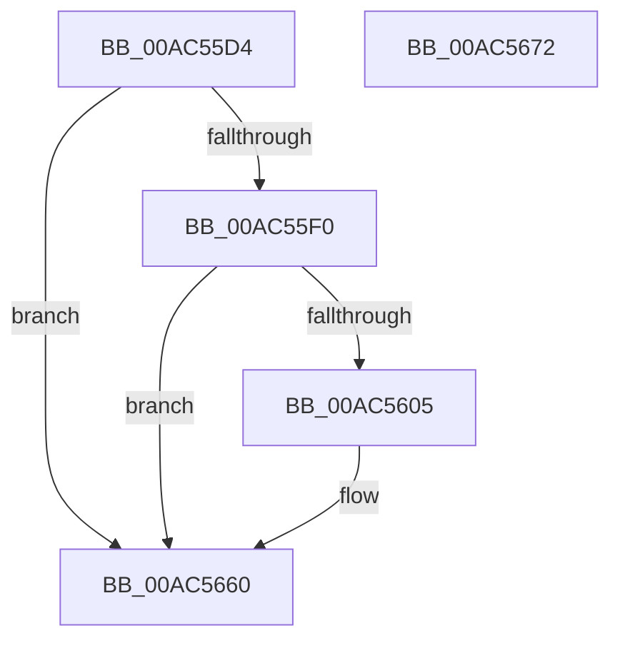

# TtmiLogCleanupCurrentSessionStart

- RVA: `0x00AC55D4`–`0x00AC5673` (길이 `159` bytes)
- VA: `0x0000000140AC55D4`
- 실행 섹션: `PAGE`
- PDB 이름 있음: `예`; PDB Function 태그: `아니요`
- unwind 정보 RVA: `0x000986E4`
- 디코드: `33`개 명령, `159/159` bytes 표시
- 미해석 바이트: `0` (있으면 어셈블리에 `.byte`로 보존)

> 이 문서는 커널 이미지의 기계어와 PDB 기호를 분석해 생성했습니다. 4번과 5번은 함수 원형과 자료형을 바이너리 사용 방식에서 추정한 C 해석이며 원본 소스 복구 결과는 아닙니다.

## 1. Dependencies

- 직접 호출 지점: **4**; 고유 호출 대상: **4**
- 직접 호출자로 확인된 함수: **1**
- RIP 상대 이미지 참조: **3**

### Outgoing calls
- `0x00AC55FC` → [tlgKeywordOn](../../text/42/tlgKeywordOn_function_0042EAA0.md) (function, `0x0042EAA0`)
- `0x00AC5615` → [PsGetProcessSessionIdEx](../../text/22/PsGetProcessSessionIdEx_function_0022F8F0.md) (function, `0x0022F8F0`)
- `0x00AC565B` → [tlgWriteTransfer_EtwWriteTransfer](../../text/42/tlgWriteTransfer_EtwWriteTransfer_function_004260E0.md) (function, `0x004260E0`)
- `0x00AC5668` → [_security_check_cookie](../../text/6A/_security_check_cookie_function_006AC640.md) (function, `0x006AC640`)

### Direct callers
- [TtmCleanupCurrentSession](TtmCleanupCurrentSession_function_00AC54DC.md) at `0x00AC54E6`

### Static image references
- `0x00AC55D8` → RVA `0x00E0A740` (`.data`; read)
- `0x00AC55E7` → RVA `0x00FD88C8` (`PAGEDATA`; read)
- `0x00AC561F` → RVA `0x00051654` (`.rdata`; read)

## 2. Other-region calls and transfers

- 다른 실행 섹션으로 향하는 call: **4**
  - `0x00AC55FC` → [tlgKeywordOn](../../text/42/tlgKeywordOn_function_0042EAA0.md) (`PAGE` → `.text`)
  - `0x00AC5615` → [PsGetProcessSessionIdEx](../../text/22/PsGetProcessSessionIdEx_function_0022F8F0.md) (`PAGE` → `.text`)
  - `0x00AC565B` → [tlgWriteTransfer_EtwWriteTransfer](../../text/42/tlgWriteTransfer_EtwWriteTransfer_function_004260E0.md) (`PAGE` → `.text`)
  - `0x00AC5668` → [_security_check_cookie](../../text/6A/_security_check_cookie_function_006AC640.md) (`PAGE` → `.text`)
- 별도 외부 분기/꼬리 이동을 확인하지 못했습니다.

## 3. Assembly (complete function range)

```asm
00AC55D4  48 83 EC 78                     sub rsp, 0x78
00AC55D8  48 8B 05 61 51 34 00            mov rax, qword ptr [rip + 0x345161]
00AC55DF  48 33 C4                        xor rax, rsp
00AC55E2  48 89 44 24 68                  mov qword ptr [rsp + 0x68], rax
00AC55E7  83 3D DA 32 51 00 05            cmp dword ptr [rip + 0x5132da], 5
00AC55EE  76 70                           jbe 0x140ac5660
00AC55F0  BA 01 00 00 00                  mov edx, 1
00AC55F5  48 8D 0D CC 32 51 00            lea rcx, [rip + 0x5132cc]
00AC55FC  E8 9F 94 96 FF                  call 0x14042eaa0
00AC5601  84 C0                           test al, al
00AC5603  74 5B                           je 0x140ac5660
00AC5605  65 48 8B 0C 25 88 01 00 00      mov rcx, qword ptr gs:[0x188]
00AC560E  48 8B 89 B8 00 00 00            mov rcx, qword ptr [rcx + 0xb8]
00AC5615  E8 D6 A2 76 FF                  call 0x14022f8f0
00AC561A  83 64 24 64 00                  and dword ptr [rsp + 0x64], 0
00AC561F  48 8D 15 2E C0 58 FF            lea rdx, [rip - 0xa73fd2]
00AC5626  89 44 24 30                     mov dword ptr [rsp + 0x30], eax
00AC562A  48 8D 0D 97 32 51 00            lea rcx, [rip + 0x513297]
00AC5631  48 8D 44 24 30                  lea rax, [rsp + 0x30]
00AC5636  C7 44 24 60 04 00 00 00         mov dword ptr [rsp + 0x60], 4
00AC563E  48 89 44 24 58                  mov qword ptr [rsp + 0x58], rax
00AC5643  45 33 C9                        xor r9d, r9d
00AC5646  48 8D 44 24 38                  lea rax, [rsp + 0x38]
00AC564B  45 33 C0                        xor r8d, r8d
00AC564E  48 89 44 24 28                  mov qword ptr [rsp + 0x28], rax
00AC5653  C7 44 24 20 03 00 00 00         mov dword ptr [rsp + 0x20], 3
00AC565B  E8 80 0A 96 FF                  call 0x1404260e0
00AC5660  48 8B 4C 24 68                  mov rcx, qword ptr [rsp + 0x68]
00AC5665  48 33 CC                        xor rcx, rsp
00AC5668  E8 D3 6F BE FF                  call 0x1406ac640
00AC566D  48 83 C4 78                     add rsp, 0x78
00AC5671  C3                              ret
00AC5672  CC                              int3
```

## 4. C-style interpretation (structured pseudocode)

```c
__int64 __fastcall TtmiLogCleanupCurrentSessionStart(__int64 a1, __int64 a2, int a3, int a4)
{
    __int64 result;
    __int64 v_rsp;
    unsigned __int64 v_stack_m10;
    unsigned int v_stack_m14;
    unsigned int v_stack_m18;
    unsigned __int64 v_stack_m20;
    unsigned __int64 v_stack_m40;
    unsigned int v_stack_m48;
    unsigned __int64 v_stack_m50;
    unsigned int v_stack_m58;

    v_rsp = (v_rsp) - (120);
    result = (*(unsigned __int64 *)(v_rip + 3428705)) ^ (v_rsp);
    v_stack_m10 = result;
    if ((*(unsigned int *)(v_rip + 5321434)) <= 5) goto loc_00AC5660;
    result = tlgKeywordOn(v_rip + 5321420, 1, a3, a4);
    if ((unsigned __int8)(result) != 0) {
        a1 = *(unsigned __int64 *)(gs_base + (0 + 392));
        a1 = *(unsigned __int64 *)(a1 + 184);
        result = PsGetProcessSessionIdEx(a1, 1, a3, a4);
        a2 = v_rip - 10960850;
        v_stack_m48 = (unsigned int)(result);
        a1 = v_rip + 5321367;
        result = v_stack_m48;
        v_stack_m18 = 4;
        v_stack_m20 = result;
        a4 = 0;
        result = v_stack_m40;
        a3 = 0;
        v_stack_m50 = result;
        v_stack_m58 = 3;
        result = tlgWriteTransfer_EtwWriteTransfer(a1, a2, a3, a4);
    }
    a1 = (v_stack_m10) ^ (v_rsp);
    result = _security_check_cookie(a1, a2, a3, a4);
    v_rsp = (v_rsp) + (120);
    return result;
}
```

## 5. (Beta) C Style

```c
int64_t TtmiLogCleanupCurrentSessionStart(int64_t Arg1, int64_t Arg2, int32_t Arg3, int32_t Arg4)
{
    int64_t result;
    int64_t local_rsp;
    uint64_t v_stack_m10;
    uint32_t v_stack_m14;
    uint32_t v_stack_m18;
    uint64_t v_stack_m20;
    uint64_t v_stack_m40;
    uint32_t v_stack_m48;
    uint64_t v_stack_m50;
    uint32_t v_stack_m58;

    local_rsp = (local_rsp) - (120);
    result = (*(uint64_t *)(v_rip + 0x345161)) ^ (local_rsp);
    v_stack_m10 = result;
    if ((*(uint32_t *)(v_rip + 0x5132DA)) <= 5) goto loc_00AC5660;
    result = tlgKeywordOn(v_rip + 5321420, 1, Arg3, Arg4);
    if ((uint8_t)(result) != 0) {
        Arg1 = *(uint64_t *)(gs_base + (0 + 0x188));
        Arg1 = *(uint64_t *)(Arg1 + 0xB8);
        result = PsGetProcessSessionIdEx(Arg1, 1, Arg3, Arg4);
        Arg2 = v_rip - 10960850;
        v_stack_m48 = (uint32_t)(result);
        Arg1 = v_rip + 5321367;
        result = v_stack_m48;
        v_stack_m18 = 4;
        v_stack_m20 = result;
        Arg4 = 0;
        result = v_stack_m40;
        Arg3 = 0;
        v_stack_m50 = result;
        v_stack_m58 = 3;
        result = tlgWriteTransfer_EtwWriteTransfer(Arg1, Arg2, Arg3, Arg4);
    }
    Arg1 = (v_stack_m10) ^ (local_rsp);
    result = _security_check_cookie(Arg1, Arg2, Arg3, Arg4);
    local_rsp = (local_rsp) + (120);
    return result;
}
```

## 6. Execution-region graph

[열기: 2D/3D 그래프와 함수 탐색 컨트롤 패널](../../../control-panel.html?section=page&rva=0x00AC55D4&view=graph)

- 2D 그래프는 위에서 아래로 흐르고, 3D 그래프는 빈 공간을 드래그해 회전합니다. Shift+드래그는 이동, 휠은 확대·축소, 함수 노드 선택은 대상 보고서 이동입니다.

### Static fallback


