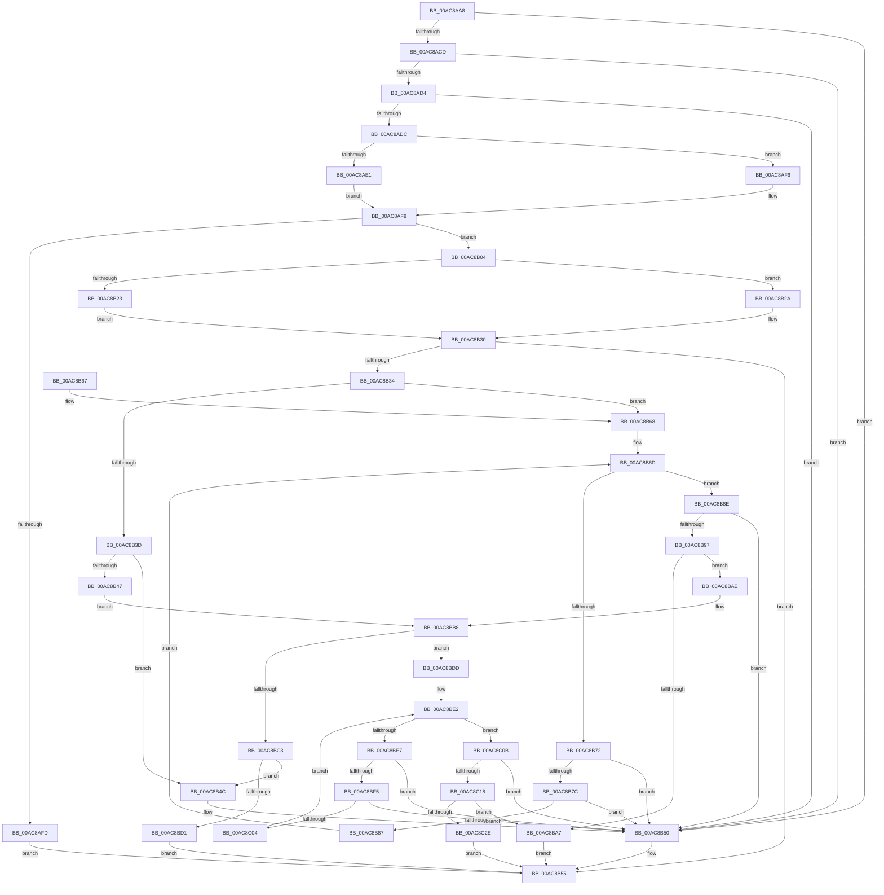

# sub_00AC8AA8

- RVA: `0x00AC8AA8`–`0x00AC8C3E` (길이 `406` bytes)
- VA: `0x0000000140AC8AA8`
- 실행 섹션: `PAGE`
- PDB 이름 있음: `아니요`; PDB Function 태그: `아니요`
- unwind 정보 RVA: `0x000BE14C`
- 디코드: `128`개 명령, `406/406` bytes 표시
- 미해석 바이트: `0` (있으면 어셈블리에 `.byte`로 보존)

> 이 문서는 커널 이미지의 기계어와 PDB 기호를 분석해 생성했습니다. 4번과 5번은 함수 원형과 자료형을 바이너리 사용 방식에서 추정한 C 해석이며 원본 소스 복구 결과는 아닙니다.

## 1. Dependencies

- 직접 호출 지점: **1**; 고유 호출 대상: **1**
- 직접 호출자로 확인된 함수: **1**
- RIP 상대 이미지 참조: **1**

### Outgoing calls
- `0x00AC8B19` → [ExAllocatePool2](../../poolcode/B8/ExAllocatePool2_function_00B820F0.md) (function, `0x00B820F0`)

### Direct callers
- [sub_00968AF6](../96/Unknown_function_00968AF6.md) at `0x0096A41D`

### Static image references
- `0x00AC8AED` → RVA `0x00FD8218` (`PAGEDATA`; write)

## 2. Other-region calls and transfers

- 다른 실행 섹션으로 향하는 call: **1**
  - `0x00AC8B19` → [ExAllocatePool2](../../poolcode/B8/ExAllocatePool2_function_00B820F0.md) (`PAGE` → `POOLCODE`)
- 별도 외부 분기/꼬리 이동을 확인하지 못했습니다.

## 3. Assembly (complete function range)

```asm
00AC8AA8  48 89 5C 24 08                  mov qword ptr [rsp + 8], rbx
00AC8AAD  48 89 74 24 10                  mov qword ptr [rsp + 0x10], rsi
00AC8AB2  57                              push rdi
00AC8AB3  48 83 EC 20                     sub rsp, 0x20
00AC8AB7  49 8B F9                        mov rdi, r9
00AC8ABA  8B 4A 10                        mov ecx, dword ptr [rdx + 0x10]
00AC8ABD  44 8B 4A 20                     mov r9d, dword ptr [rdx + 0x20]
00AC8AC1  83 C1 30                        add ecx, 0x30
00AC8AC4  83 F9 30                        cmp ecx, 0x30
00AC8AC7  0F 82 83 00 00 00               jb 0x140ac8b50
00AC8ACD  8D 41 04                        lea eax, [rcx + 4]
00AC8AD0  3B C1                           cmp eax, ecx
00AC8AD2  72 7C                           jb 0x140ac8b50
00AC8AD4  42 8D 0C 08                     lea ecx, [rax + r9]
00AC8AD8  3B C8                           cmp ecx, eax
00AC8ADA  72 74                           jb 0x140ac8b50
00AC8ADC  44 3B C1                        cmp r8d, ecx
00AC8ADF  72 15                           jb 0x140ac8af6
00AC8AE1  0F 31                           rdtsc
00AC8AE3  48 C1 E2 20                     shl rdx, 0x20
00AC8AE7  48 0B C2                        or rax, rdx
00AC8AEA  48 8B F0                        mov rsi, rax
00AC8AED  48 89 05 24 F7 50 00            mov qword ptr [rip + 0x50f724], rax
00AC8AF4  EB 02                           jmp 0x140ac8af8
00AC8AF6  33 F6                           xor esi, esi
00AC8AF8  48 85 FF                        test rdi, rdi
00AC8AFB  75 07                           jne 0x140ac8b04
00AC8AFD  BB 0D 00 00 C0                  mov ebx, 0xc000000d
00AC8B02  EB 51                           jmp 0x140ac8b55
00AC8B04  BA 14 00 00 00                  mov edx, 0x14
00AC8B09  B9 00 01 00 00                  mov ecx, 0x100
00AC8B0E  41 B8 53 4C 53 20               mov r8d, 0x20534c53
00AC8B14  89 57 04                        mov dword ptr [rdi + 4], edx
00AC8B17  33 DB                           xor ebx, ebx
00AC8B19  E8 D2 95 0B 00                  call 0x140b820f0
00AC8B1E  48 85 C0                        test rax, rax
00AC8B21  75 07                           jne 0x140ac8b2a
00AC8B23  BB 17 00 00 C0                  mov ebx, 0xc0000017
00AC8B28  EB 06                           jmp 0x140ac8b30
00AC8B2A  48 89 47 08                     mov qword ptr [rdi + 8], rax
00AC8B2E  21 1F                           and dword ptr [rdi], ebx
00AC8B30  85 DB                           test ebx, ebx
00AC8B32  78 21                           js 0x140ac8b55
00AC8B34  48 8B 57 08                     mov rdx, qword ptr [rdi + 8]
00AC8B38  48 85 D2                        test rdx, rdx
00AC8B3B  75 2B                           jne 0x140ac8b68
00AC8B3D  8B 47 04                        mov eax, dword ptr [rdi + 4]
00AC8B40  8D 48 08                        lea ecx, [rax + 8]
00AC8B43  3B C8                           cmp ecx, eax
00AC8B45  72 05                           jb 0x140ac8b4c
00AC8B47  89 4F 04                        mov dword ptr [rdi + 4], ecx
00AC8B4A  EB 6C                           jmp 0x140ac8bb8
00AC8B4C  83 4F 04 FF                     or dword ptr [rdi + 4], 0xffffffff
00AC8B50  BB 95 00 00 C0                  mov ebx, 0xc0000095
00AC8B55  48 8B 74 24 38                  mov rsi, qword ptr [rsp + 0x38]
00AC8B5A  8B C3                           mov eax, ebx
00AC8B5C  48 8B 5C 24 30                  mov rbx, qword ptr [rsp + 0x30]
00AC8B61  48 83 C4 20                     add rsp, 0x20
00AC8B65  5F                              pop rdi
00AC8B66  C3                              ret
00AC8B67  CC                              int3
00AC8B68  44 8B 0F                        mov r9d, dword ptr [rdi]
00AC8B6B  33 C9                           xor ecx, ecx
00AC8B6D  41 3B C9                        cmp ecx, r9d
00AC8B70  73 1C                           jae 0x140ac8b8e
00AC8B72  8B 02                           mov eax, dword ptr [rdx]
00AC8B74  83 C0 04                        add eax, 4
00AC8B77  83 F8 04                        cmp eax, 4
00AC8B7A  72 D4                           jb 0x140ac8b50
00AC8B7C  44 8B C0                        mov r8d, eax
00AC8B7F  4C 03 C2                        add r8, rdx
00AC8B82  4C 3B C2                        cmp r8, rdx
00AC8B85  72 C9                           jb 0x140ac8b50
00AC8B87  49 8B D0                        mov rdx, r8
00AC8B8A  FF C1                           inc ecx
00AC8B8C  EB DF                           jmp 0x140ac8b6d
00AC8B8E  4C 8D 42 04                     lea r8, [rdx + 4]
00AC8B92  4C 3B C2                        cmp r8, rdx
00AC8B95  72 B9                           jb 0x140ac8b50
00AC8B97  8B 4F 04                        mov ecx, dword ptr [rdi + 4]
00AC8B9A  48 8D 42 08                     lea rax, [rdx + 8]
00AC8B9E  48 03 4F 08                     add rcx, qword ptr [rdi + 8]
00AC8BA2  48 3B C1                        cmp rax, rcx
00AC8BA5  76 07                           jbe 0x140ac8bae
00AC8BA7  BB 23 00 00 C0                  mov ebx, 0xc0000023
00AC8BAC  EB A7                           jmp 0x140ac8b55
00AC8BAE  C7 02 04 00 00 00               mov dword ptr [rdx], 4
00AC8BB4  41 83 20 00                     and dword ptr [r8], 0
00AC8BB8  FF 07                           inc dword ptr [rdi]
00AC8BBA  48 8B 57 08                     mov rdx, qword ptr [rdi + 8]
00AC8BBE  48 85 D2                        test rdx, rdx
00AC8BC1  75 1A                           jne 0x140ac8bdd
00AC8BC3  8B 47 04                        mov eax, dword ptr [rdi + 4]
00AC8BC6  8D 48 0C                        lea ecx, [rax + 0xc]
00AC8BC9  3B C8                           cmp ecx, eax
00AC8BCB  0F 82 7B FF FF FF               jb 0x140ac8b4c
00AC8BD1  FF 07                           inc dword ptr [rdi]
00AC8BD3  33 DB                           xor ebx, ebx
00AC8BD5  89 4F 04                        mov dword ptr [rdi + 4], ecx
00AC8BD8  E9 78 FF FF FF                  jmp 0x140ac8b55
00AC8BDD  44 8B 0F                        mov r9d, dword ptr [rdi]
00AC8BE0  33 C9                           xor ecx, ecx
00AC8BE2  41 3B C9                        cmp ecx, r9d
00AC8BE5  73 24                           jae 0x140ac8c0b
00AC8BE7  8B 02                           mov eax, dword ptr [rdx]
00AC8BE9  83 C0 04                        add eax, 4
00AC8BEC  83 F8 04                        cmp eax, 4
00AC8BEF  0F 82 5B FF FF FF               jb 0x140ac8b50
00AC8BF5  44 8B C0                        mov r8d, eax
00AC8BF8  4C 03 C2                        add r8, rdx
00AC8BFB  4C 3B C2                        cmp r8, rdx
00AC8BFE  0F 82 4C FF FF FF               jb 0x140ac8b50
00AC8C04  49 8B D0                        mov rdx, r8
00AC8C07  FF C1                           inc ecx
00AC8C09  EB D7                           jmp 0x140ac8be2
00AC8C0B  4C 8D 42 04                     lea r8, [rdx + 4]
00AC8C0F  4C 3B C2                        cmp r8, rdx
00AC8C12  0F 82 38 FF FF FF               jb 0x140ac8b50
00AC8C18  8B 4F 04                        mov ecx, dword ptr [rdi + 4]
00AC8C1B  48 8D 42 0C                     lea rax, [rdx + 0xc]
00AC8C1F  48 03 4F 08                     add rcx, qword ptr [rdi + 8]
00AC8C23  33 DB                           xor ebx, ebx
00AC8C25  48 3B C1                        cmp rax, rcx
00AC8C28  0F 87 79 FF FF FF               ja 0x140ac8ba7
00AC8C2E  C7 02 08 00 00 00               mov dword ptr [rdx], 8
00AC8C34  49 89 30                        mov qword ptr [r8], rsi
00AC8C37  FF 07                           inc dword ptr [rdi]
00AC8C39  E9 17 FF FF FF                  jmp 0x140ac8b55
```

## 4. C-style interpretation (structured pseudocode)

```c
__int64 __fastcall sub_00AC8AA8(__int64 a1, __int64 a2, int a3, __int64 a4)
{
    __int64 result;
    __int64 v_rbx;
    __int64 v_rsi;
    __int64 v_rsp;
    unsigned __int64 v_stack_p10;
    unsigned __int64 v_stack_p8;

    v_stack_p8 = v_rbx;
    v_stack_p10 = v_rsi;
    v_rsp = (v_rsp) - (32);
    a1 = (unsigned int)(((unsigned int)(*(unsigned int *)(a2 + 16))) + (48));
    if (((unsigned int)(a1)) < 48) goto loc_00AC8B50;
    if (((unsigned int)(a1 + 4)) < ((unsigned int)(a1))) goto loc_00AC8B50;
    if (((unsigned int)(a1 + 4 + (unsigned int)(*(unsigned int *)(a2 + 32)) * 1)) < ((unsigned int)(a1 + 4))) goto loc_00AC8B50;
    if (a3 < ((unsigned int)(a1 + 4 + (unsigned int)(*(unsigned int *)(a2 + 32)) * 1))) goto loc_00AC8AF6;
    a2 = (a2) << (32);
    result = (a1 + 4) | (a2);
    *(unsigned __int64 *)(v_rip + 5306148) = result;
    goto loc_00AC8AF8;
loc_00AC8AF6:
    v_rsi = 0;
loc_00AC8AF8:
    if (a4 != 0) goto loc_00AC8B04;
    goto loc_00AC8B55;
loc_00AC8B04:
    *(unsigned int *)(a4 + 4) = 20;
    v_rbx = 0;
    result = ExAllocatePool2(256, 20, (unsigned int)(0x20534C53ULL), (unsigned int)(*(unsigned int *)(a2 + 32)));
    if (result != 0) goto loc_00AC8B2A;
    goto loc_00AC8B30;
loc_00AC8B2A:
    *(unsigned __int64 *)(a4 + 8) = result;
loc_00AC8B30:
    if (sign_flag) goto loc_00AC8B55;
    if (*(unsigned __int64 *)(a4 + 8) != 0) goto loc_00AC8B68;
    if (((unsigned int)((unsigned int)(*(unsigned int *)(a4 + 4)) + 8)) < ((unsigned int)((unsigned int)(*(unsigned int *)(a4 + 4))))) goto loc_00AC8B4C;
    *(unsigned int *)(a4 + 4) = (unsigned int)((unsigned int)(*(unsigned int *)(a4 + 4)) + 8);
    goto loc_00AC8BB8;
loc_00AC8B4C:
loc_00AC8B50:
loc_00AC8B55:
    v_rsp = (v_rsp) + (32);
    return (unsigned int)((unsigned int)((unsigned int)(0xC0000095ULL)));
loc_00AC8B68:
    a1 = 0;
loc_00AC8B6D:
    if (0 >= ((unsigned int)((unsigned int)(*(unsigned int *)(a4))))) goto loc_00AC8B8E;
    result = (unsigned int)(((unsigned int)(*(unsigned int *)(*(unsigned __int64 *)(a4 + 8)))) + (4));
    if (((unsigned int)(result)) < 4) goto loc_00AC8B50;
    a3 = ((unsigned int)((unsigned int)(result))) + (*(unsigned __int64 *)(a4 + 8));
    if (a3 < (*(unsigned __int64 *)(a4 + 8))) goto loc_00AC8B50;
    a1 = (unsigned int)((a1) + 1);
    goto loc_00AC8B6D;
loc_00AC8B8E:
    if ((a3 + 4) < a3) goto loc_00AC8B50;
    a1 = ((unsigned int)(*(unsigned int *)(a4 + 4))) + (*(unsigned __int64 *)(a4 + 8));
    if ((a3 + 8) <= a1) goto loc_00AC8BAE;
loc_00AC8BA7:
    goto loc_00AC8B55;
loc_00AC8BAE:
    *(unsigned int *)(a3) = 4;
loc_00AC8BB8:
    if (*(unsigned __int64 *)(a4 + 8) != 0) goto loc_00AC8BDD;
    if (((unsigned int)((unsigned int)(*(unsigned int *)(a4 + 4)) + 12)) < ((unsigned int)((unsigned int)(*(unsigned int *)(a4 + 4))))) goto loc_00AC8B4C;
    v_rbx = 0;
    *(unsigned int *)(a4 + 4) = (unsigned int)((unsigned int)(*(unsigned int *)(a4 + 4)) + 12);
    goto loc_00AC8B55;
loc_00AC8BDD:
    a1 = 0;
loc_00AC8BE2:
    if (0 >= ((unsigned int)((unsigned int)(*(unsigned int *)(a4))))) goto loc_00AC8C0B;
    result = (unsigned int)(((unsigned int)(*(unsigned int *)(*(unsigned __int64 *)(a4 + 8)))) + (4));
    if (((unsigned int)(result)) < 4) goto loc_00AC8B50;
    a3 = ((unsigned int)((unsigned int)(result))) + (*(unsigned __int64 *)(a4 + 8));
    if (a3 < (*(unsigned __int64 *)(a4 + 8))) goto loc_00AC8B50;
    a1 = (unsigned int)((a1) + 1);
    goto loc_00AC8BE2;
loc_00AC8C0B:
    if ((a3 + 4) < a3) goto loc_00AC8B50;
    a1 = ((unsigned int)(*(unsigned int *)(a4 + 4))) + (*(unsigned __int64 *)(a4 + 8));
    v_rbx = 0;
    if ((a3 + 12) > a1) goto loc_00AC8BA7;
    *(unsigned int *)(a3) = 8;
    *(unsigned __int64 *)(a3 + 4) = v_stack_p10;
    goto loc_00AC8B55;
}
```

## 5. (Beta) C Style

```c
int64_t sub_00AC8AA8(int64_t Arg1, void *Arg2, int32_t Arg3, int64_t Arg4)
{
    uint8_t *arg2 = (uint8_t *)Arg2;

    int64_t result;
    int64_t local_rbx;
    int64_t local_rsi;
    int64_t local_rsp;
    uint64_t v_stack_p10;
    uint64_t v_stack_p8;

    v_stack_p8 = local_rbx;
    v_stack_p10 = local_rsi;
    local_rsp = (local_rsp) - (32);
    Arg1 = (uint32_t)(((uint32_t)(*(uint32_t *)(arg2 + 0x10))) + (48));
    if (((uint32_t)(Arg1)) < 48) goto loc_00AC8B50;
    if (((uint32_t)(Arg1 + 4)) < ((uint32_t)(Arg1))) goto loc_00AC8B50;
    if (((uint32_t)(Arg1 + 4 + (uint32_t)(*(uint32_t *)(arg2 + 0x20)) * 1)) < ((uint32_t)(Arg1 + 4))) goto loc_00AC8B50;
    if (Arg3 < ((uint32_t)(Arg1 + 4 + (uint32_t)(*(uint32_t *)(arg2 + 0x20)) * 1))) goto loc_00AC8AF6;
    Arg2 = (Arg2) << (32);
    result = (Arg1 + 4) | (Arg2);
    *(uint64_t *)(v_rip + 0x50F724) = result;
    goto loc_00AC8AF8;
loc_00AC8AF6:
    local_rsi = 0;
loc_00AC8AF8:
    if (Arg4 != 0) goto loc_00AC8B04;
    goto loc_00AC8B55;
loc_00AC8B04:
    *(uint32_t *)(Arg4 + 0x4) = 20;
    local_rbx = 0;
    result = ExAllocatePool2(256, 20, (uint32_t)(0x20534C53ULL), (uint32_t)(*(uint32_t *)(arg2 + 0x20)));
    if (result != 0) goto loc_00AC8B2A;
    goto loc_00AC8B30;
loc_00AC8B2A:
    *(uint64_t *)(Arg4 + 0x8) = result;
loc_00AC8B30:
    if (sign_flag) goto loc_00AC8B55;
    if (*(uint64_t *)(Arg4 + 0x8) != 0) goto loc_00AC8B68;
    if (((uint32_t)((uint32_t)(*(uint32_t *)(Arg4 + 0x4)) + 8)) < ((uint32_t)((uint32_t)(*(uint32_t *)(Arg4 + 0x4))))) goto loc_00AC8B4C;
    *(uint32_t *)(Arg4 + 0x4) = (uint32_t)((uint32_t)(*(uint32_t *)(Arg4 + 0x4)) + 8);
    goto loc_00AC8BB8;
loc_00AC8B4C:
loc_00AC8B50:
loc_00AC8B55:
    local_rsp = (local_rsp) + (32);
    return (uint32_t)((uint32_t)((uint32_t)(0xC0000095ULL)));
loc_00AC8B68:
    Arg1 = 0;
loc_00AC8B6D:
    if (0 >= ((uint32_t)((uint32_t)(*(uint32_t *)(Arg4))))) goto loc_00AC8B8E;
    result = (uint32_t)(((uint32_t)(*(uint32_t *)(*(uint64_t *)(Arg4 + 0x8)))) + (4));
    if (((uint32_t)(result)) < 4) goto loc_00AC8B50;
    Arg3 = ((uint32_t)((uint32_t)(result))) + (*(uint64_t *)(Arg4 + 0x8));
    if (Arg3 < (*(uint64_t *)(Arg4 + 0x8))) goto loc_00AC8B50;
    Arg1 = (uint32_t)((Arg1) + 1);
    goto loc_00AC8B6D;
loc_00AC8B8E:
    if ((Arg3 + 4) < Arg3) goto loc_00AC8B50;
    Arg1 = ((uint32_t)(*(uint32_t *)(Arg4 + 0x4))) + (*(uint64_t *)(Arg4 + 0x8));
    if ((Arg3 + 8) <= Arg1) goto loc_00AC8BAE;
loc_00AC8BA7:
    goto loc_00AC8B55;
loc_00AC8BAE:
    *(uint32_t *)(Arg3) = 4;
loc_00AC8BB8:
    if (*(uint64_t *)(Arg4 + 0x8) != 0) goto loc_00AC8BDD;
    if (((uint32_t)((uint32_t)(*(uint32_t *)(Arg4 + 0x4)) + 12)) < ((uint32_t)((uint32_t)(*(uint32_t *)(Arg4 + 0x4))))) goto loc_00AC8B4C;
    local_rbx = 0;
    *(uint32_t *)(Arg4 + 0x4) = (uint32_t)((uint32_t)(*(uint32_t *)(Arg4 + 0x4)) + 12);
    goto loc_00AC8B55;
loc_00AC8BDD:
    Arg1 = 0;
loc_00AC8BE2:
    if (0 >= ((uint32_t)((uint32_t)(*(uint32_t *)(Arg4))))) goto loc_00AC8C0B;
    result = (uint32_t)(((uint32_t)(*(uint32_t *)(*(uint64_t *)(Arg4 + 0x8)))) + (4));
    if (((uint32_t)(result)) < 4) goto loc_00AC8B50;
    Arg3 = ((uint32_t)((uint32_t)(result))) + (*(uint64_t *)(Arg4 + 0x8));
    if (Arg3 < (*(uint64_t *)(Arg4 + 0x8))) goto loc_00AC8B50;
    Arg1 = (uint32_t)((Arg1) + 1);
    goto loc_00AC8BE2;
loc_00AC8C0B:
    if ((Arg3 + 4) < Arg3) goto loc_00AC8B50;
    Arg1 = ((uint32_t)(*(uint32_t *)(Arg4 + 0x4))) + (*(uint64_t *)(Arg4 + 0x8));
    local_rbx = 0;
    if ((Arg3 + 12) > Arg1) goto loc_00AC8BA7;
    *(uint32_t *)(Arg3) = 8;
    *(uint64_t *)(Arg3 + 0x4) = v_stack_p10;
    goto loc_00AC8B55;
}
```

### 관측된 메모리 오프셋

구조체 형식이 확인되지 않은 접근은 인자 기준의 오프셋으로만 기록했습니다.

| 기준 인자 | 오프셋 표현 | 폭 (bit) | 접근 |
|---|---:|---:|---|
| `Arg2` | `+ 0x10` | `32` | `R` |
| `Arg2` | `+ 0x20` | `32` | `R` |

## 6. Execution-region graph

[열기: 2D/3D 그래프와 함수 탐색 컨트롤 패널](../../../control-panel.html?section=page&rva=0x00AC8AA8&view=graph)

- 2D 그래프는 위에서 아래로 흐르고, 3D 그래프는 빈 공간을 드래그해 회전합니다. Shift+드래그는 이동, 휠은 확대·축소, 함수 노드 선택은 대상 보고서 이동입니다.

### Static fallback


