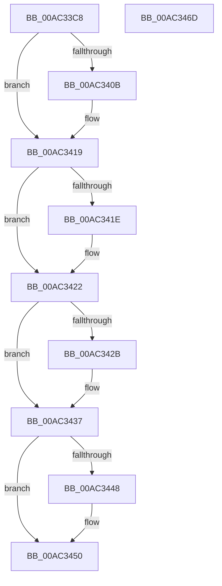

# VrpDecrementSiloCount

- RVA: `0x00AC33C8`–`0x00AC346E` (길이 `166` bytes)
- VA: `0x0000000140AC33C8`
- 실행 섹션: `PAGE`
- PDB 이름 있음: `예`; PDB Function 태그: `아니요`
- unwind 정보 RVA: `0x00060BC4`
- 디코드: `42`개 명령, `166/166` bytes 표시
- 미해석 바이트: `0` (있으면 어셈블리에 `.byte`로 보존)

> 이 문서는 커널 이미지의 기계어와 PDB 기호를 분석해 생성했습니다. 4번과 5번은 함수 원형과 자료형을 바이너리 사용 방식에서 추정한 C 해석이며 원본 소스 복구 결과는 아닙니다.

## 1. Dependencies

- 직접 호출 지점: **6**; 고유 호출 대상: **6**
- 직접 호출자로 확인된 함수: **1**
- RIP 상대 이미지 참조: **4**

### Outgoing calls
- `0x00AC33FB` → [KeAbPreAcquire](../../text/21/KeAbPreAcquire_function_00210230.md) (function, `0x00210230`)
- `0x00AC3414` → [ExfAcquirePushLockExclusiveEx](../../text/20/ExfAcquirePushLockExclusiveEx_function_0020FC90.md) (function, `0x0020FC90`)
- `0x00AC3432` → [CmUnRegisterCallback](../7E/CmUnRegisterCallback_function_007E1510.md) (function, `0x007E1510`)
- `0x00AC344B` → [ExfTryToWakePushLock](../../text/26/ExfTryToWakePushLock_function_00265DD0.md) (function, `0x00265DD0`)
- `0x00AC3453` → [KeAbPostRelease](../../text/2E/KeAbPostRelease_function_002E1600.md) (function, `0x002E1600`)
- `0x00AC3458` → [KeLeaveCriticalRegion](../../text/25/KeLeaveCriticalRegion_function_0025D8B0.md) (function, `0x0025D8B0`)

### Direct callers
- [VrpJobContextDelete](../AB/VrpJobContextDelete_function_00AB7330.md) at `0x00AB7353`

### Static image references
- `0x00AC33E0` → RVA `0x00EF02C0` (`.data`; read)
- `0x00AC3422` → RVA `0x00EF0020` (`.data`; read/write)
- `0x00AC342B` → RVA `0x00EF02C8` (`.data`; read)
- `0x00AC3437` → RVA `0x00EF02C0` (`.data`; read/write)

## 2. Other-region calls and transfers

- 다른 실행 섹션으로 향하는 call: **5**
  - `0x00AC33FB` → [KeAbPreAcquire](../../text/21/KeAbPreAcquire_function_00210230.md) (`PAGE` → `.text`)
  - `0x00AC3414` → [ExfAcquirePushLockExclusiveEx](../../text/20/ExfAcquirePushLockExclusiveEx_function_0020FC90.md) (`PAGE` → `.text`)
  - `0x00AC344B` → [ExfTryToWakePushLock](../../text/26/ExfTryToWakePushLock_function_00265DD0.md) (`PAGE` → `.text`)
  - `0x00AC3453` → [KeAbPostRelease](../../text/2E/KeAbPostRelease_function_002E1600.md) (`PAGE` → `.text`)
  - `0x00AC3458` → [KeLeaveCriticalRegion](../../text/25/KeLeaveCriticalRegion_function_0025D8B0.md) (`PAGE` → `.text`)
- 별도 외부 분기/꼬리 이동을 확인하지 못했습니다.

## 3. Assembly (complete function range)

```asm
00AC33C8  48 89 5C 24 08                  mov qword ptr [rsp + 8], rbx
00AC33CD  48 89 74 24 10                  mov qword ptr [rsp + 0x10], rsi
00AC33D2  57                              push rdi
00AC33D3  48 83 EC 20                     sub rsp, 0x20
00AC33D7  65 48 8B 04 25 88 01 00 00      mov rax, qword ptr gs:[0x188]
00AC33E0  48 8D 35 D9 CE 42 00            lea rsi, [rip + 0x42ced9]
00AC33E7  48 83 CB FF                     or rbx, 0xffffffffffffffff
00AC33EB  45 33 C0                        xor r8d, r8d
00AC33EE  33 D2                           xor edx, edx
00AC33F0  48 8B CE                        mov rcx, rsi
00AC33F3  66 01 98 E4 01 00 00            add word ptr [rax + 0x1e4], bx
00AC33FA  90                              nop
00AC33FB  E8 30 CE 74 FF                  call 0x140210230
00AC3400  F0 48 0F BA 2E 00               lock bts qword ptr [rsi], 0
00AC3406  48 8B F8                        mov rdi, rax
00AC3409  73 0E                           jae 0x140ac3419
00AC340B  4C 8B C6                        mov r8, rsi
00AC340E  48 8B D0                        mov rdx, rax
00AC3411  48 8B CE                        mov rcx, rsi
00AC3414  E8 77 C8 74 FF                  call 0x14020fc90
00AC3419  48 85 FF                        test rdi, rdi
00AC341C  74 04                           je 0x140ac3422
00AC341E  C6 47 0A 01                     mov byte ptr [rdi + 0xa], 1
00AC3422  83 05 F7 CB 42 00 FF            add dword ptr [rip + 0x42cbf7], -1
00AC3429  75 0C                           jne 0x140ac3437
00AC342B  48 8B 0D 96 CE 42 00            mov rcx, qword ptr [rip + 0x42ce96]
00AC3432  E8 D9 E0 D1 FF                  call 0x1407e1510
00AC3437  F0 48 0F C1 1D 80 CE 42 00      lock xadd qword ptr [rip + 0x42ce80], rbx
00AC3440  80 E3 06                        and bl, 6
00AC3443  80 FB 02                        cmp bl, 2
00AC3446  75 08                           jne 0x140ac3450
00AC3448  48 8B CE                        mov rcx, rsi
00AC344B  E8 80 29 7A FF                  call 0x140265dd0
00AC3450  48 8B CE                        mov rcx, rsi
00AC3453  E8 A8 E1 81 FF                  call 0x1402e1600
00AC3458  E8 53 A4 79 FF                  call 0x14025d8b0
00AC345D  48 8B 5C 24 30                  mov rbx, qword ptr [rsp + 0x30]
00AC3462  48 8B 74 24 38                  mov rsi, qword ptr [rsp + 0x38]
00AC3467  48 83 C4 20                     add rsp, 0x20
00AC346B  5F                              pop rdi
00AC346C  C3                              ret
00AC346D  CC                              int3
```

## 4. C-style interpretation (structured pseudocode)

```c
__int64 __fastcall VrpDecrementSiloCount(__int64 a1, int a2, int a3)
{
    __int64 result;
    __int64 v_rbx;
    __int64 v_rsp;
    unsigned __int64 v_stack_p10;
    unsigned __int64 v_stack_p8;

    v_stack_p8 = v_rbx;
    v_stack_p10 = v_rsi;
    v_rsp = (v_rsp) - (32);
    v_rbx = (v_rbx) | (-1);
    a3 = 0;
    a2 = 0;
    result = KeAbPreAcquire(v_rip + 4378329, a2, a3, a4);
    if (!(condition_is_above_or_equal)) {
        a3 = v_rip + 4378329;
        a2 = result;
        a1 = v_rip + 4378329;
        result = ExfAcquirePushLockExclusiveEx(a1, a2, a3, a4);
    }
    if (result != 0) {
        *(unsigned __int8 *)(result + 10) = 1;
    }
    if (result == 0) {
        a1 = *(unsigned __int64 *)(v_rip + 4378262);
        result = CmUnRegisterCallback(a1, a2, a3, a4);
    }
    v_rbx = (unsigned __int8)((v_rbx) & (6));
    if (((unsigned __int8)(v_rbx)) == 2) {
        a1 = v_rip + 4378329;
        result = ExfTryToWakePushLock(a1, a2, a3, a4);
    }
    result = KeAbPostRelease(v_rip + 4378329, a2, a3, a4);
    result = KeLeaveCriticalRegion(v_rip + 4378329, a2, a3, a4);
    v_rsp = (v_rsp) + (32);
    return result;
}
```

## 5. (Beta) C Style

```c
int64_t VrpDecrementSiloCount(int64_t Arg1, int32_t Arg2, int32_t Arg3)
{
    int64_t result;
    int64_t local_rbx;
    int64_t local_rsp;
    uint64_t v_stack_p10;
    uint64_t v_stack_p8;

    v_stack_p8 = local_rbx;
    v_stack_p10 = local_rsi;
    local_rsp = (local_rsp) - (32);
    local_rbx = (local_rbx) | (-1);
    Arg3 = 0;
    Arg2 = 0;
    result = KeAbPreAcquire(v_rip + 4378329, Arg2, Arg3, a4);
    if (!(condition_is_above_or_equal)) {
        Arg3 = v_rip + 4378329;
        Arg2 = result;
        Arg1 = v_rip + 4378329;
        result = ExfAcquirePushLockExclusiveEx(Arg1, Arg2, Arg3, a4);
    }
    if (result != 0) {
        *(uint8_t *)(result + 0xA) = 1;
    }
    if (result == 0) {
        Arg1 = *(uint64_t *)(v_rip + 0x42CE96);
        result = CmUnRegisterCallback(Arg1, Arg2, Arg3, a4);
    }
    local_rbx = (uint8_t)((local_rbx) & (6));
    if (((uint8_t)(local_rbx)) == 2) {
        Arg1 = v_rip + 4378329;
        result = ExfTryToWakePushLock(Arg1, Arg2, Arg3, a4);
    }
    result = KeAbPostRelease(v_rip + 4378329, Arg2, Arg3, a4);
    result = KeLeaveCriticalRegion(v_rip + 4378329, Arg2, Arg3, a4);
    local_rsp = (local_rsp) + (32);
    return result;
}
```

## 6. Execution-region graph

[열기: 2D/3D 그래프와 함수 탐색 컨트롤 패널](../../../control-panel.html?section=page&rva=0x00AC33C8&view=graph)

- 2D 그래프는 위에서 아래로 흐르고, 3D 그래프는 빈 공간을 드래그해 회전합니다. Shift+드래그는 이동, 휠은 확대·축소, 함수 노드 선택은 대상 보고서 이동입니다.

### Static fallback


