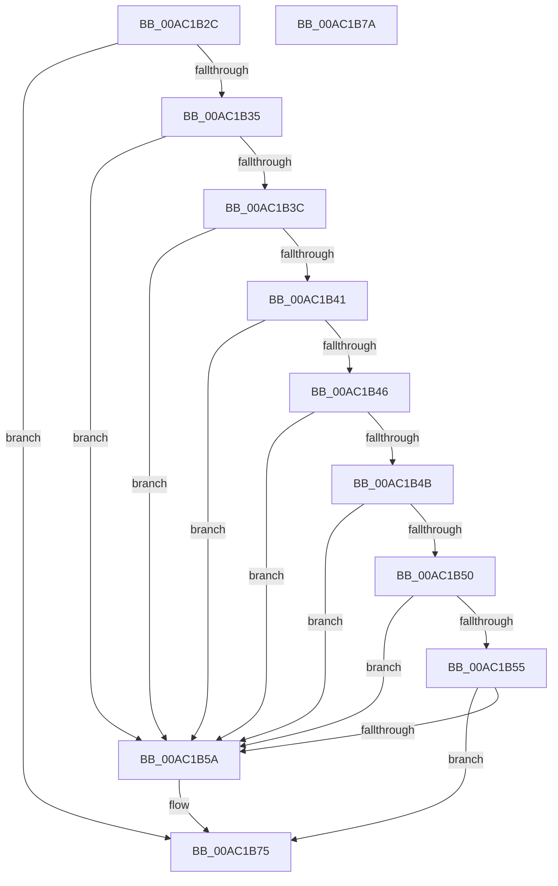

# WheapPropagatePolicyToHal

- RVA: `0x00AC1B2C`–`0x00AC1B7B` (길이 `79` bytes)
- VA: `0x0000000140AC1B2C`
- 실행 섹션: `PAGE`
- PDB 이름 있음: `예`; PDB Function 태그: `아니요`
- unwind 정보 RVA: `0x0005C788`
- 디코드: `28`개 명령, `79/79` bytes 표시
- 미해석 바이트: `0` (있으면 어셈블리에 `.byte`로 보존)

> 이 문서는 커널 이미지의 기계어와 PDB 기호를 분석해 생성했습니다. 4번과 5번은 함수 원형과 자료형을 바이너리 사용 방식에서 추정한 C 해석이며 원본 소스 복구 결과는 아닙니다.

## 1. Dependencies

- 직접 호출 지점: **1**; 고유 호출 대상: **1**
- 직접 호출자로 확인된 함수: **2**
- RIP 상대 이미지 참조: **1**

### Outgoing calls
- `0x00AC1B70` → [HalWheaUpdateCmciPolicy](../../text/54/HalWheaUpdateCmciPolicy_function_00540130.md) (function, `0x00540130`)

### Direct callers
- [WheaRegChangeNotifyCallback](../7D/WheaRegChangeNotifyCallback_function_007D8A50.md) at `0x007D8B55`
- [WheapLoadPolicy](../../init/C5/WheapLoadPolicy_function_00C5574C.md) at `0x00C5581F`

### Static image references
- `0x00AC1B5F` → RVA `0x00E095A8` (`.data`; read)

## 2. Other-region calls and transfers

- 다른 실행 섹션으로 향하는 call: **1**
  - `0x00AC1B70` → [HalWheaUpdateCmciPolicy](../../text/54/HalWheaUpdateCmciPolicy_function_00540130.md) (`PAGE` → `.text`)
- 별도 외부 분기/꼬리 이동을 확인하지 못했습니다.

## 3. Assembly (complete function range)

```asm
00AC1B2C  48 83 EC 28                     sub rsp, 0x28
00AC1B30  83 F9 16                        cmp ecx, 0x16
00AC1B33  73 40                           jae 0x140ac1b75
00AC1B35  8B C1                           mov eax, ecx
00AC1B37  83 E8 07                        sub eax, 7
00AC1B3A  74 1E                           je 0x140ac1b5a
00AC1B3C  83 E8 01                        sub eax, 1
00AC1B3F  74 19                           je 0x140ac1b5a
00AC1B41  83 E8 01                        sub eax, 1
00AC1B44  74 14                           je 0x140ac1b5a
00AC1B46  83 E8 01                        sub eax, 1
00AC1B49  74 0F                           je 0x140ac1b5a
00AC1B4B  83 E8 01                        sub eax, 1
00AC1B4E  74 0A                           je 0x140ac1b5a
00AC1B50  83 E8 01                        sub eax, 1
00AC1B53  74 05                           je 0x140ac1b5a
00AC1B55  83 F8 08                        cmp eax, 8
00AC1B58  75 1B                           jne 0x140ac1b75
00AC1B5A  0F AE E8                        lfence
00AC1B5D  8B D1                           mov edx, ecx
00AC1B5F  48 8D 05 42 7A 34 00            lea rax, [rip + 0x347a42]
00AC1B66  48 C1 E2 05                     shl rdx, 5
00AC1B6A  48 8B 14 02                     mov rdx, qword ptr [rdx + rax]
00AC1B6E  8B 12                           mov edx, dword ptr [rdx]
00AC1B70  E8 BB E5 A7 FF                  call 0x140540130
00AC1B75  48 83 C4 28                     add rsp, 0x28
00AC1B79  C3                              ret
00AC1B7A  CC                              int3
```

## 4. C-style interpretation (structured pseudocode)

```c
__int64 __fastcall WheapPropagatePolicyToHal(int a1)
{
    __int64 result;
    __int64 v_rsp;

    v_rsp = (v_rsp) - (40);
    if (a1 >= 22) goto loc_00AC1B75;
    result = (unsigned int)(((unsigned int)(a1)) - (7));
    if (condition_is_equal) goto loc_00AC1B5A;
    result = (unsigned int)((result) - (1));
    if (condition_is_equal) goto loc_00AC1B5A;
    result = (unsigned int)((result) - (1));
    if (condition_is_equal) goto loc_00AC1B5A;
    result = (unsigned int)((result) - (1));
    if (condition_is_equal) goto loc_00AC1B5A;
    result = (unsigned int)((result) - (1));
    if (condition_is_equal) goto loc_00AC1B5A;
    result = (unsigned int)((result) - (1));
    if (condition_is_equal) goto loc_00AC1B5A;
    if (((unsigned int)(result)) == 8) {
        a2 = a1;
        result = v_rip + 3439170;
        a2 = (a2) << (5);
        a2 = *(unsigned __int64 *)(a2 + result * 1);
        a2 = *(unsigned int *)(a2);
        result = HalWheaUpdateCmciPolicy(a1, a2, a3, a4);
    }
    v_rsp = (v_rsp) + (40);
    return result;
}
```

## 5. (Beta) C Style

```c
int64_t WheapPropagatePolicyToHal(int32_t Arg1)
{
    int64_t result;
    int64_t local_rsp;

    local_rsp = (local_rsp) - (40);
    if (Arg1 >= 22) goto loc_00AC1B75;
    result = (uint32_t)(((uint32_t)(Arg1)) - (7));
    if (condition_is_equal) goto loc_00AC1B5A;
    result = (uint32_t)((result) - (1));
    if (condition_is_equal) goto loc_00AC1B5A;
    result = (uint32_t)((result) - (1));
    if (condition_is_equal) goto loc_00AC1B5A;
    result = (uint32_t)((result) - (1));
    if (condition_is_equal) goto loc_00AC1B5A;
    result = (uint32_t)((result) - (1));
    if (condition_is_equal) goto loc_00AC1B5A;
    result = (uint32_t)((result) - (1));
    if (condition_is_equal) goto loc_00AC1B5A;
    if (((uint32_t)(result)) == 8) {
        a2 = Arg1;
        result = v_rip + 3439170;
        a2 = (a2) << (5);
        a2 = *(uint64_t *)(a2 + result * 1);
        a2 = *(uint32_t *)(a2);
        result = HalWheaUpdateCmciPolicy(Arg1, a2, a3, a4);
    }
    local_rsp = (local_rsp) + (40);
    return result;
}
```

## 6. Execution-region graph

[열기: 2D/3D 그래프와 함수 탐색 컨트롤 패널](../../../control-panel.html?section=page&rva=0x00AC1B2C&view=graph)

- 2D 그래프는 위에서 아래로 흐르고, 3D 그래프는 빈 공간을 드래그해 회전합니다. Shift+드래그는 이동, 휠은 확대·축소, 함수 노드 선택은 대상 보고서 이동입니다.

### Static fallback


