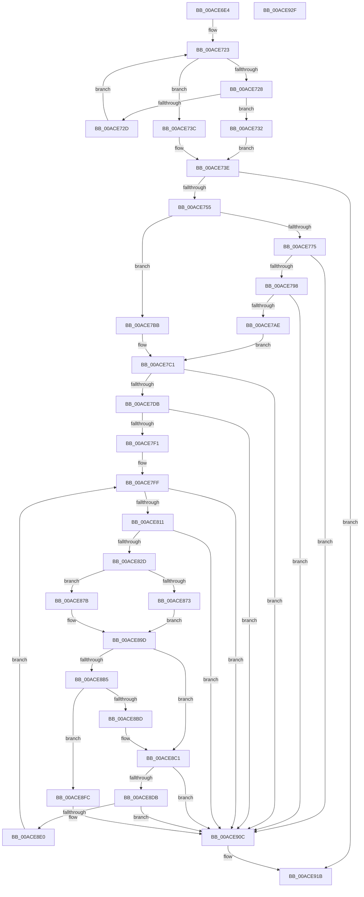

# WmipDereferenceEvent

- RVA: `0x00ACE6E4`–`0x00ACE930` (길이 `588` bytes)
- VA: `0x0000000140ACE6E4`
- 실행 섹션: `PAGE`
- PDB 이름 있음: `예`; PDB Function 태그: `아니요`
- unwind 정보 RVA: `0x000BE788`
- 디코드: `161`개 명령, `588/588` bytes 표시
- 미해석 바이트: `0` (있으면 어셈블리에 `.byte`로 보존)

> 이 문서는 커널 이미지의 기계어와 PDB 기호를 분석해 생성했습니다. 4번과 5번은 함수 원형과 자료형을 바이너리 사용 방식에서 추정한 C 해석이며 원본 소스 복구 결과는 아닙니다.

## 1. Dependencies

- 직접 호출 지점: **11**; 고유 호출 대상: **10**
- 직접 호출자로 확인된 함수: **1**
- RIP 상대 이미지 참조: **3**

### Outgoing calls
- `0x00ACE714` → [KeWaitForSingleObject](../../text/20/KeWaitForSingleObject_function_0020E6B0.md) (function, `0x0020E6B0`)
- `0x00ACE735` → [WmipReferenceEntry](../9E/WmipReferenceEntry_function_009E1BF8.md) (function, `0x009E1BF8`)
- `0x00ACE747` → [KeReleaseMutex](../../text/39/KeReleaseMutex_function_00396810.md) (function, `0x00396810`)
- `0x00ACE78B` → [WmipAlign](../../text/47/WmipAlign_function_00472274.md) (function, `0x00472274`)
- `0x00ACE7CE` → [WmipAlign](../../text/47/WmipAlign_function_00472274.md) (function, `0x00472274`)
- `0x00ACE81C` → [ExAllocatePool2](../../poolcode/B8/ExAllocatePool2_function_00B820F0.md) (function, `0x00B820F0`)
- `0x00ACE83A` → [memset](../../text/6C/memset_function_006C6C40.md) (function, `0x006C6C40`)
- `0x00ACE898` → [memcpy](../../text/6C/memcpy_function_006C6840.md) (function, `0x006C6840`)
- `0x00ACE8A8` → [WmipDeliverWnodeToDS](../AA/WmipDeliverWnodeToDS_function_00AAE460.md) (function, `0x00AAE460`)
- `0x00ACE8CE` → [ExFreePoolWithTag](../../poolcode/B8/ExFreePoolWithTag_function_00B82870.md) (function, `0x00B82870`)
- `0x00ACE916` → [WmipUnreferenceEntry](../9E/WmipUnreferenceEntry_function_009E0CC8.md) (function, `0x009E0CC8`)

### Direct callers
- [WmipProcessEvent](../9D/WmipProcessEvent_function_009DFA40.md) at `0x009DFBAC`

### Static image references
- `0x00ACE705` → RVA `0x00EFFA60` (`.data`; read)
- `0x00ACE719` → RVA `0x00EFFB20` (`.data`; read)
- `0x00ACE90F` → RVA `0x00E03648` (`.data`; read)

## 2. Other-region calls and transfers

- 다른 실행 섹션으로 향하는 call: **8**
  - `0x00ACE714` → [KeWaitForSingleObject](../../text/20/KeWaitForSingleObject_function_0020E6B0.md) (`PAGE` → `.text`)
  - `0x00ACE747` → [KeReleaseMutex](../../text/39/KeReleaseMutex_function_00396810.md) (`PAGE` → `.text`)
  - `0x00ACE78B` → [WmipAlign](../../text/47/WmipAlign_function_00472274.md) (`PAGE` → `.text`)
  - `0x00ACE7CE` → [WmipAlign](../../text/47/WmipAlign_function_00472274.md) (`PAGE` → `.text`)
  - `0x00ACE81C` → [ExAllocatePool2](../../poolcode/B8/ExAllocatePool2_function_00B820F0.md) (`PAGE` → `POOLCODE`)
  - `0x00ACE83A` → [memset](../../text/6C/memset_function_006C6C40.md) (`PAGE` → `.text`)
  - `0x00ACE898` → [memcpy](../../text/6C/memcpy_function_006C6840.md) (`PAGE` → `.text`)
  - `0x00ACE8CE` → [ExFreePoolWithTag](../../poolcode/B8/ExFreePoolWithTag_function_00B82870.md) (`PAGE` → `POOLCODE`)
- 별도 외부 분기/꼬리 이동을 확인하지 못했습니다.

## 3. Assembly (complete function range)

```asm
00ACE6E4  40 53                           push rbx
00ACE6E6  55                              push rbp
00ACE6E7  56                              push rsi
00ACE6E8  57                              push rdi
00ACE6E9  41 54                           push r12
00ACE6EB  41 55                           push r13
00ACE6ED  41 56                           push r14
00ACE6EF  41 57                           push r15
00ACE6F1  48 83 EC 48                     sub rsp, 0x48
00ACE6F5  8B 69 04                        mov ebp, dword ptr [rcx + 4]
00ACE6F8  33 FF                           xor edi, edi
00ACE6FA  48 21 7C 24 20                  and qword ptr [rsp + 0x20], rdi
00ACE6FF  48 8B F1                        mov rsi, rcx
00ACE702  45 33 E4                        xor r12d, r12d
00ACE705  48 8D 0D 54 13 43 00            lea rcx, [rip + 0x431354]
00ACE70C  45 33 C9                        xor r9d, r9d
00ACE70F  45 33 C0                        xor r8d, r8d
00ACE712  33 D2                           xor edx, edx
00ACE714  E8 97 FF 73 FF                  call 0x14020e6b0
00ACE719  48 8B 05 00 14 43 00            mov rax, qword ptr [rip + 0x431400]
00ACE720  48 8B 18                        mov rbx, qword ptr [rax]
00ACE723  48 3B D8                        cmp rbx, rax
00ACE726  74 14                           je 0x140ace73c
00ACE728  39 6B 38                        cmp dword ptr [rbx + 0x38], ebp
00ACE72B  74 05                           je 0x140ace732
00ACE72D  48 8B 1B                        mov rbx, qword ptr [rbx]
00ACE730  EB F1                           jmp 0x140ace723
00ACE732  48 8B CB                        mov rcx, rbx
00ACE735  E8 BE 34 F1 FF                  call 0x1409e1bf8
00ACE73A  EB 02                           jmp 0x140ace73e
00ACE73C  33 DB                           xor ebx, ebx
00ACE73E  33 D2                           xor edx, edx
00ACE740  48 8D 0D 19 13 43 00            lea rcx, [rip + 0x431319]
00ACE747  E8 C4 80 8C FF                  call 0x140396810
00ACE74C  48 85 DB                        test rbx, rbx
00ACE74F  0F 84 C6 01 00 00               je 0x140ace91b
00ACE755  44 8B 6E 2C                     mov r13d, dword ptr [rsi + 0x2c]
00ACE759  41 81 E5 80 00 00 00            and r13d, 0x80
00ACE760  C7 84 24 90 00 00 00 40 00 00 00  mov dword ptr [rsp + 0x90], 0x40
00ACE76B  44 89 AC 24 A8 00 00 00         mov dword ptr [rsp + 0xa8], r13d
00ACE773  75 46                           jne 0x140ace7bb
00ACE775  44 0F B7 76 44                  movzx r14d, word ptr [rsi + 0x44]
00ACE77A  48 8D 94 24 90 00 00 00         lea rdx, [rsp + 0x90]
00ACE782  B9 02 00 00 00                  mov ecx, 2
00ACE787  41 83 C6 02                     add r14d, 2
00ACE78B  E8 E4 3A 9A FF                  call 0x140472274
00ACE790  84 C0                           test al, al
00ACE792  0F 84 74 01 00 00               je 0x140ace90c
00ACE798  44 8B BC 24 90 00 00 00         mov r15d, dword ptr [rsp + 0x90]
00ACE7A0  41 8B C7                        mov eax, r15d
00ACE7A3  F7 D0                           not eax
00ACE7A5  44 3B F0                        cmp r14d, eax
00ACE7A8  0F 87 5E 01 00 00               ja 0x140ace90c
00ACE7AE  43 8D 04 3E                     lea eax, [r14 + r15]
00ACE7B2  89 84 24 90 00 00 00            mov dword ptr [rsp + 0x90], eax
00ACE7B9  EB 06                           jmp 0x140ace7c1
00ACE7BB  45 33 F6                        xor r14d, r14d
00ACE7BE  45 33 FF                        xor r15d, r15d
00ACE7C1  48 8D 94 24 90 00 00 00         lea rdx, [rsp + 0x90]
00ACE7C9  B9 08 00 00 00                  mov ecx, 8
00ACE7CE  E8 A1 3A 9A FF                  call 0x140472274
00ACE7D3  84 C0                           test al, al
00ACE7D5  0F 84 31 01 00 00               je 0x140ace90c
00ACE7DB  8B 94 24 90 00 00 00            mov edx, dword ptr [rsp + 0x90]
00ACE7E2  8B C2                           mov eax, edx
00ACE7E4  8B 4E 40                        mov ecx, dword ptr [rsi + 0x40]
00ACE7E7  F7 D0                           not eax
00ACE7E9  3B C8                           cmp ecx, eax
00ACE7EB  0F 87 1B 01 00 00               ja 0x140ace90c
00ACE7F1  8D 2C 11                        lea ebp, [rcx + rdx]
00ACE7F4  33 C9                           xor ecx, ecx
00ACE7F6  8B C5                           mov eax, ebp
00ACE7F8  89 AC 24 98 00 00 00            mov dword ptr [rsp + 0x98], ebp
00ACE7FF  33 FF                           xor edi, edi
00ACE801  89 8C 24 A0 00 00 00            mov dword ptr [rsp + 0xa0], ecx
00ACE808  83 F9 02                        cmp ecx, 2
00ACE80B  0F 83 FB 00 00 00               jae 0x140ace90c
00ACE811  8B D0                           mov edx, eax
00ACE813  8D 4F 40                        lea ecx, [rdi + 0x40]
00ACE816  41 B8 57 6D 69 70               mov r8d, 0x70696d57
00ACE81C  E8 CF 38 0B 00                  call 0x140b820f0
00ACE821  48 8B F8                        mov rdi, rax
00ACE824  48 85 C0                        test rax, rax
00ACE827  0F 84 DF 00 00 00               je 0x140ace90c
00ACE82D  44 8B 84 24 98 00 00 00         mov r8d, dword ptr [rsp + 0x98]
00ACE835  33 D2                           xor edx, edx
00ACE837  48 8B C8                        mov rcx, rax
00ACE83A  E8 01 84 BF FF                  call 0x1406c6c40
00ACE83F  89 2F                           mov dword ptr [rdi], ebp
00ACE841  41 8B C5                        mov eax, r13d
00ACE844  8B 4E 04                        mov ecx, dword ptr [rsi + 4]
00ACE847  83 C8 02                        or eax, 2
00ACE84A  83 BC 24 A8 00 00 00 00         cmp dword ptr [rsp + 0xa8], 0
00ACE852  89 4F 04                        mov dword ptr [rdi + 4], ecx
00ACE855  0F 10 46 30                     movups xmm0, xmmword ptr [rsi + 0x30]
00ACE859  F3 0F 7F 47 18                  movdqu xmmword ptr [rdi + 0x18], xmm0
00ACE85E  8B 4E 08                        mov ecx, dword ptr [rsi + 8]
00ACE861  89 47 2C                        mov dword ptr [rdi + 0x2c], eax
00ACE864  8B 84 24 90 00 00 00            mov eax, dword ptr [rsp + 0x90]
00ACE86B  89 47 38                        mov dword ptr [rdi + 0x38], eax
00ACE86E  89 4F 08                        mov dword ptr [rdi + 8], ecx
00ACE871  74 08                           je 0x140ace87b
00ACE873  8B 46 44                        mov eax, dword ptr [rsi + 0x44]
00ACE876  89 47 34                        mov dword ptr [rdi + 0x34], eax
00ACE879  EB 22                           jmp 0x140ace89d
00ACE87B  41 83 C6 FE                     add r14d, -2
00ACE87F  44 89 7F 30                     mov dword ptr [rdi + 0x30], r15d
00ACE883  41 8B CF                        mov ecx, r15d
00ACE886  48 8D 56 46                     lea rdx, [rsi + 0x46]
00ACE88A  48 03 CF                        add rcx, rdi
00ACE88D  45 8B C6                        mov r8d, r14d
00ACE890  66 44 89 31                     mov word ptr [rcx], r14w
00ACE894  48 83 C1 02                     add rcx, 2
00ACE898  E8 A3 7F BF FF                  call 0x1406c6840
00ACE89D  44 8B CD                        mov r9d, ebp
00ACE8A0  4C 8B C7                        mov r8, rdi
00ACE8A3  48 8B D3                        mov rdx, rbx
00ACE8A6  B1 01                           mov cl, 1
00ACE8A8  E8 B3 FB FD FF                  call 0x140aae460
00ACE8AD  89 44 24 30                     mov dword ptr [rsp + 0x30], eax
00ACE8B1  85 C0                           test eax, eax
00ACE8B3  78 0C                           js 0x140ace8c1
00ACE8B5  8B 4F 2C                        mov ecx, dword ptr [rdi + 0x2c]
00ACE8B8  F6 C1 20                        test cl, 0x20
00ACE8BB  74 3F                           je 0x140ace8fc
00ACE8BD  44 8B 67 30                     mov r12d, dword ptr [rdi + 0x30]
00ACE8C1  33 D2                           xor edx, edx
00ACE8C3  44 89 A4 24 98 00 00 00         mov dword ptr [rsp + 0x98], r12d
00ACE8CB  48 8B CF                        mov rcx, rdi
00ACE8CE  E8 9D 3F 0B 00                  call 0x140b82870
00ACE8D3  33 FF                           xor edi, edi
00ACE8D5  39 7C 24 30                     cmp dword ptr [rsp + 0x30], edi
00ACE8D9  7C 31                           jl 0x140ace90c
00ACE8DB  44 3B E5                        cmp r12d, ebp
00ACE8DE  76 2C                           jbe 0x140ace90c
00ACE8E0  8B 8C 24 A0 00 00 00            mov ecx, dword ptr [rsp + 0xa0]
00ACE8E7  41 8B EC                        mov ebp, r12d
00ACE8EA  44 8B AC 24 A8 00 00 00         mov r13d, dword ptr [rsp + 0xa8]
00ACE8F2  FF C1                           inc ecx
00ACE8F4  41 8B C4                        mov eax, r12d
00ACE8F7  E9 03 FF FF FF                  jmp 0x140ace7ff
00ACE8FC  8B 46 2C                        mov eax, dword ptr [rsi + 0x2c]
00ACE8FF  25 08 00 00 FF                  and eax, 0xff000008
00ACE904  0B C1                           or eax, ecx
00ACE906  83 C8 08                        or eax, 8
00ACE909  89 47 2C                        mov dword ptr [rdi + 0x2c], eax
00ACE90C  48 8B D3                        mov rdx, rbx
00ACE90F  48 8D 0D 32 4D 33 00            lea rcx, [rip + 0x334d32]
00ACE916  E8 AD 23 F1 FF                  call 0x1409e0cc8
00ACE91B  48 8B C7                        mov rax, rdi
00ACE91E  48 83 C4 48                     add rsp, 0x48
00ACE922  41 5F                           pop r15
00ACE924  41 5E                           pop r14
00ACE926  41 5D                           pop r13
00ACE928  41 5C                           pop r12
00ACE92A  5F                              pop rdi
00ACE92B  5E                              pop rsi
00ACE92C  5D                              pop rbp
00ACE92D  5B                              pop rbx
00ACE92E  C3                              ret
00ACE92F  CC                              int3
```

## 4. C-style interpretation (structured pseudocode)

```c
__int64 __fastcall WmipDereferenceEvent(__int64 a1, int a2, int a3, int a4)
{
    __int64 result;
    __int64 v_r12;
    __int64 v_r13;
    __int64 v_r14;
    __int64 v_r15;
    __int64 v_rbx;
    __int64 v_rdi;
    __int64 v_rsp;
    unsigned int v_stack_m58;
    unsigned __int64 v_stack_m68;
    unsigned int v_stack_p10;
    unsigned int v_stack_p18;
    unsigned int v_stack_p20;
    unsigned int v_stack_p8;

    v_rsp = (v_rsp) - (72);
    v_rdi = 0;
    v_r12 = 0;
    a4 = 0;
    a3 = 0;
    a2 = 0;
    result = KeWaitForSingleObject(v_rip + 4395860, a2, a3, a4);
loc_00ACE723:
    if ((*(unsigned __int64 *)(*(unsigned __int64 *)(v_rip + 4396032))) == (*(unsigned __int64 *)(v_rip + 4396032))) goto loc_00ACE73C;
    if ((*(unsigned int *)(*(unsigned __int64 *)(*(unsigned __int64 *)(v_rip + 4396032)) + 56)) == ((unsigned int)((unsigned int)(*(unsigned int *)(a1 + 4))))) goto loc_00ACE732;
    goto loc_00ACE723;
loc_00ACE732:
    result = WmipReferenceEntry(*(unsigned __int64 *)(*(unsigned __int64 *)(*(unsigned __int64 *)(v_rip + 4396032))), a2, a3, a4);
    goto loc_00ACE73E;
loc_00ACE73C:
    v_rbx = 0;
loc_00ACE73E:
    a2 = 0;
    result = KeReleaseMutex(v_rip + 4395801, a2, a3, a4);
    if (0 == 0) goto loc_00ACE91B;
    v_r13 = (unsigned int)(((unsigned int)(*(unsigned int *)(a1 + 44))) & (128));
    v_stack_p8 = 64;
    v_stack_p20 = (unsigned int)(v_r13);
    if (condition_is_not_equal) goto loc_00ACE7BB;
    v_r14 = (unsigned int)((*(unsigned __int16 *)(a1 + 68)) + (2));
    result = WmipAlign(2, v_stack_p8, a3, a4);
    if ((unsigned __int8)(result) == 0) goto loc_00ACE90C;
    result = (unsigned int)(~((unsigned int)((unsigned int)((unsigned int)(v_stack_p8)))));
    if (((unsigned int)(v_r14)) > ((unsigned int)(result))) goto loc_00ACE90C;
    v_stack_p8 = (unsigned int)(v_r14 + (unsigned int)(v_stack_p8) * 1);
    goto loc_00ACE7C1;
loc_00ACE7BB:
    v_r14 = 0;
    v_r15 = 0;
loc_00ACE7C1:
    result = WmipAlign(8, v_stack_p8, a3, a4);
    if ((unsigned __int8)(result) == 0) goto loc_00ACE90C;
    result = (unsigned int)(~((unsigned int)((unsigned int)((unsigned int)(v_stack_p8)))));
    if (((unsigned int)((unsigned int)(*(unsigned int *)(a1 + 64)))) > ((unsigned int)(result))) goto loc_00ACE90C;
    a1 = 0;
    v_stack_p10 = (unsigned int)((unsigned int)(*(unsigned int *)(a1 + 64)) + (unsigned int)(v_stack_p8) * 1);
loc_00ACE7FF:
    v_rdi = 0;
    v_stack_p18 = 0;
    if (0 >= 2) goto loc_00ACE90C;
    result = ExAllocatePool2(v_rdi + 64, (unsigned int)((unsigned int)((unsigned int)((unsigned int)((unsigned int)(*(unsigned int *)(a1 + 64)) + (unsigned int)(v_stack_p8) * 1)))), (unsigned int)(0x70696D57ULL), a4);
    if (result == 0) goto loc_00ACE90C;
    a2 = 0;
    result = memset(result, a2, (unsigned int)(v_stack_p10), a4);
    *(unsigned int *)(result) = (unsigned int)((unsigned int)(*(unsigned int *)(a1 + 64)) + (unsigned int)(v_stack_p8) * 1);
    result = (unsigned int)(((unsigned int)((unsigned int)(v_r13))) | (2));
    *(unsigned int *)(result + 4) = (unsigned int)((unsigned int)(*(unsigned int *)(a1 + 4)));
    *(unsigned __int64 *)(result + 24) = v_xmm0;
    *(unsigned int *)(result + 44) = (unsigned int)(result);
    *(unsigned int *)(result + 56) = (unsigned int)((unsigned int)(v_stack_p8));
    *(unsigned int *)(result + 8) = (unsigned int)((unsigned int)(*(unsigned int *)(a1 + 8)));
    if (v_stack_p20 == 0) goto loc_00ACE87B;
    *(unsigned int *)(result + 52) = (unsigned int)((unsigned int)(*(unsigned int *)(a1 + 68)));
    goto loc_00ACE89D;
loc_00ACE87B:
    v_r14 = (unsigned int)((v_r14) + (-2));
    *(unsigned int *)(result + 48) = 0;
    a1 = (0) + (result);
    *(unsigned __int16 *)(a1) = (unsigned __int16)(v_r14);
    a1 = (a1) + (2);
    result = memcpy(a1, a1 + 70, (unsigned int)((unsigned int)(v_r14)), a4);
loc_00ACE89D:
    result = WmipDeliverWnodeToDS(1, 0, result, (unsigned int)((unsigned int)((unsigned int)(*(unsigned int *)(a1 + 64)) + (unsigned int)(v_stack_p8) * 1)));
    v_stack_m58 = (unsigned int)(result);
    if (sign_flag) goto loc_00ACE8C1;
    if ((((unsigned __int8)((unsigned int)(*(unsigned int *)(result + 44)))) & (32)) == 0) goto loc_00ACE8FC;
loc_00ACE8C1:
    a2 = 0;
    v_stack_p10 = (unsigned int)((unsigned int)(*(unsigned int *)(result + 48)));
    result = ExFreePoolWithTag(result, a2, result, (unsigned int)((unsigned int)((unsigned int)(*(unsigned int *)(a1 + 64)) + (unsigned int)(v_stack_p8) * 1)));
    v_rdi = 0;
    if (v_stack_m58 < 0) goto loc_00ACE90C;
    if (((unsigned int)((unsigned int)(*(unsigned int *)(result + 48)))) <= ((unsigned int)((unsigned int)(*(unsigned int *)(a1 + 64)) + (unsigned int)(v_stack_p8) * 1))) goto loc_00ACE90C;
    a1 = (unsigned int)(((unsigned int)(v_stack_p18)) + 1);
    goto loc_00ACE7FF;
loc_00ACE8FC:
    result = (unsigned int)(((unsigned int)(*(unsigned int *)(a1 + 44))) & (0xFF000008ULL));
    result = (unsigned int)((result) | ((unsigned int)(a1)));
    result = (unsigned int)((result) | (8));
    *(unsigned int *)(v_rdi + 44) = (unsigned int)(result);
loc_00ACE90C:
    result = WmipUnreferenceEntry(v_rip + 3362098, 0, result, (unsigned int)((unsigned int)((unsigned int)(*(unsigned int *)(a1 + 64)) + (unsigned int)(v_stack_p8) * 1)));
loc_00ACE91B:
    v_rsp = (v_rsp) + (72);
    return 0;
}
```

## 5. (Beta) C Style

```c
int64_t WmipDereferenceEvent(void *Arg1, int32_t Arg2, int32_t Arg3, int32_t Arg4)
{
    uint8_t *arg1 = (uint8_t *)Arg1;

    int64_t result;
    int64_t local_r12;
    int64_t local_r13;
    int64_t local_r14;
    int64_t local_r15;
    int64_t local_rbx;
    int64_t local_rdi;
    int64_t local_rsp;
    uint32_t v_stack_m58;
    uint64_t v_stack_m68;
    uint32_t v_stack_p10;
    uint32_t v_stack_p18;
    uint32_t v_stack_p20;
    uint32_t v_stack_p8;

    local_rsp = (local_rsp) - (72);
    local_rdi = 0;
    local_r12 = 0;
    Arg4 = 0;
    Arg3 = 0;
    Arg2 = 0;
    result = KeWaitForSingleObject(v_rip + 4395860, Arg2, Arg3, Arg4);
loc_00ACE723:
    if ((*(uint64_t *)(*(uint64_t *)(v_rip + 0x431400))) == (*(uint64_t *)(v_rip + 0x431400))) goto loc_00ACE73C;
    if ((*(uint32_t *)(*(uint64_t *)(*(uint64_t *)(v_rip + 0x431400)) + 0x38)) == ((uint32_t)((uint32_t)(*(uint32_t *)(arg1 + 0x4))))) goto loc_00ACE732;
    goto loc_00ACE723;
loc_00ACE732:
    result = WmipReferenceEntry(*(uint64_t *)(*(uint64_t *)(*(uint64_t *)(v_rip + 0x431400))), Arg2, Arg3, Arg4);
    goto loc_00ACE73E;
loc_00ACE73C:
    local_rbx = 0;
loc_00ACE73E:
    Arg2 = 0;
    result = KeReleaseMutex(v_rip + 4395801, Arg2, Arg3, Arg4);
    if (0 == 0) goto loc_00ACE91B;
    local_r13 = (uint32_t)(((uint32_t)(*(uint32_t *)(arg1 + 0x2C))) & (128));
    v_stack_p8 = 64;
    v_stack_p20 = (uint32_t)(local_r13);
    if (condition_is_not_equal) goto loc_00ACE7BB;
    local_r14 = (uint32_t)((*(uint16_t *)(arg1 + 0x44)) + (2));
    result = WmipAlign(2, v_stack_p8, Arg3, Arg4);
    if ((uint8_t)(result) == 0) goto loc_00ACE90C;
    result = (uint32_t)(~((uint32_t)((uint32_t)((uint32_t)(v_stack_p8)))));
    if (((uint32_t)(local_r14)) > ((uint32_t)(result))) goto loc_00ACE90C;
    v_stack_p8 = (uint32_t)(local_r14 + (uint32_t)(v_stack_p8) * 1);
    goto loc_00ACE7C1;
loc_00ACE7BB:
    local_r14 = 0;
    local_r15 = 0;
loc_00ACE7C1:
    result = WmipAlign(8, v_stack_p8, Arg3, Arg4);
    if ((uint8_t)(result) == 0) goto loc_00ACE90C;
    result = (uint32_t)(~((uint32_t)((uint32_t)((uint32_t)(v_stack_p8)))));
    if (((uint32_t)((uint32_t)(*(uint32_t *)(arg1 + 0x40)))) > ((uint32_t)(result))) goto loc_00ACE90C;
    Arg1 = 0;
    v_stack_p10 = (uint32_t)((uint32_t)(*(uint32_t *)(arg1 + 0x40)) + (uint32_t)(v_stack_p8) * 1);
loc_00ACE7FF:
    local_rdi = 0;
    v_stack_p18 = 0;
    if (0 >= 2) goto loc_00ACE90C;
    result = ExAllocatePool2(local_rdi + 64, (uint32_t)((uint32_t)((uint32_t)((uint32_t)((uint32_t)(*(uint32_t *)(arg1 + 0x40)) + (uint32_t)(v_stack_p8) * 1)))), (uint32_t)(0x70696D57ULL), Arg4);
    if (result == 0) goto loc_00ACE90C;
    Arg2 = 0;
    result = memset(result, Arg2, (uint32_t)(v_stack_p10), Arg4);
    *(uint32_t *)(result) = (uint32_t)((uint32_t)(*(uint32_t *)(arg1 + 0x40)) + (uint32_t)(v_stack_p8) * 1);
    result = (uint32_t)(((uint32_t)((uint32_t)(local_r13))) | (2));
    *(uint32_t *)(result + 0x4) = (uint32_t)((uint32_t)(*(uint32_t *)(arg1 + 0x4)));
    *(uint64_t *)(result + 0x18) = v_xmm0;
    *(uint32_t *)(result + 0x2C) = (uint32_t)(result);
    *(uint32_t *)(result + 0x38) = (uint32_t)((uint32_t)(v_stack_p8));
    *(uint32_t *)(result + 0x8) = (uint32_t)((uint32_t)(*(uint32_t *)(arg1 + 0x8)));
    if (v_stack_p20 == 0) goto loc_00ACE87B;
    *(uint32_t *)(result + 0x34) = (uint32_t)((uint32_t)(*(uint32_t *)(arg1 + 0x44)));
    goto loc_00ACE89D;
loc_00ACE87B:
    local_r14 = (uint32_t)((local_r14) + (-2));
    *(uint32_t *)(result + 0x30) = 0;
    Arg1 = (0) + (result);
    *(uint16_t *)(arg1) = (uint16_t)(local_r14);
    Arg1 = (Arg1) + (2);
    result = memcpy(Arg1, Arg1 + 70, (uint32_t)((uint32_t)(local_r14)), Arg4);
loc_00ACE89D:
    result = WmipDeliverWnodeToDS(1, 0, result, (uint32_t)((uint32_t)((uint32_t)(*(uint32_t *)(arg1 + 0x40)) + (uint32_t)(v_stack_p8) * 1)));
    v_stack_m58 = (uint32_t)(result);
    if (sign_flag) goto loc_00ACE8C1;
    if ((((uint8_t)((uint32_t)(*(uint32_t *)(result + 0x2C)))) & (32)) == 0) goto loc_00ACE8FC;
loc_00ACE8C1:
    Arg2 = 0;
    v_stack_p10 = (uint32_t)((uint32_t)(*(uint32_t *)(result + 0x30)));
    result = ExFreePoolWithTag(result, Arg2, result, (uint32_t)((uint32_t)((uint32_t)(*(uint32_t *)(arg1 + 0x40)) + (uint32_t)(v_stack_p8) * 1)));
    local_rdi = 0;
    if (v_stack_m58 < 0) goto loc_00ACE90C;
    if (((uint32_t)((uint32_t)(*(uint32_t *)(result + 0x30)))) <= ((uint32_t)((uint32_t)(*(uint32_t *)(arg1 + 0x40)) + (uint32_t)(v_stack_p8) * 1))) goto loc_00ACE90C;
    Arg1 = (uint32_t)(((uint32_t)(v_stack_p18)) + 1);
    goto loc_00ACE7FF;
loc_00ACE8FC:
    result = (uint32_t)(((uint32_t)(*(uint32_t *)(arg1 + 0x2C))) & (0xFF000008ULL));
    result = (uint32_t)((result) | ((uint32_t)(Arg1)));
    result = (uint32_t)((result) | (8));
    *(uint32_t *)(local_rdi + 0x2C) = (uint32_t)(result);
loc_00ACE90C:
    result = WmipUnreferenceEntry(v_rip + 3362098, 0, result, (uint32_t)((uint32_t)((uint32_t)(*(uint32_t *)(arg1 + 0x40)) + (uint32_t)(v_stack_p8) * 1)));
loc_00ACE91B:
    local_rsp = (local_rsp) + (72);
    return 0;
}
```

### 관측된 메모리 오프셋

구조체 형식이 확인되지 않은 접근은 인자 기준의 오프셋으로만 기록했습니다.

| 기준 인자 | 오프셋 표현 | 폭 (bit) | 접근 |
|---|---:|---:|---|
| `Arg1` | `+ 0x4` | `32` | `R` |
| `Arg1` | `+ 0x8` | `32` | `R` |
| `Arg1` | `+ 0x2C` | `32` | `R` |
| `Arg1` | `+ 0x30` | `128` | `R` |
| `Arg1` | `+ 0x40` | `32` | `R` |
| `Arg1` | `+ 0x44` | `16` | `R` |
| `Arg1` | `+ 0x44` | `32` | `R` |
| `Arg1` | `+ 0x46` | `64` | `R` |

## 6. Execution-region graph

[열기: 2D/3D 그래프와 함수 탐색 컨트롤 패널](../../../control-panel.html?section=page&rva=0x00ACE6E4&view=graph)

- 2D 그래프는 위에서 아래로 흐르고, 3D 그래프는 빈 공간을 드래그해 회전합니다. Shift+드래그는 이동, 휠은 확대·축소, 함수 노드 선택은 대상 보고서 이동입니다.

### Static fallback


