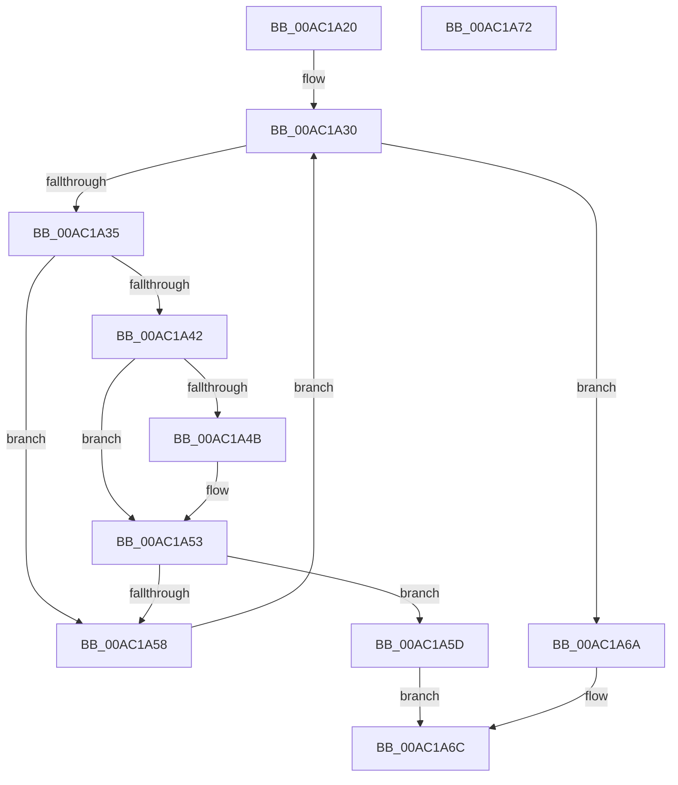

# WmipFindISInDSByGuid

- RVA: `0x00AC1A20`–`0x00AC1A73` (길이 `83` bytes)
- VA: `0x0000000140AC1A20`
- 실행 섹션: `PAGE`
- PDB 이름 있음: `예`; PDB Function 태그: `아니요`
- unwind 정보 RVA: `0x0005CF00`
- 디코드: `29`개 명령, `83/83` bytes 표시
- 미해석 바이트: `0` (있으면 어셈블리에 `.byte`로 보존)

> 이 문서는 커널 이미지의 기계어와 PDB 기호를 분석해 생성했습니다. 4번과 5번은 함수 원형과 자료형을 바이너리 사용 방식에서 추정한 C 해석이며 원본 소스 복구 결과는 아닙니다.

## 1. Dependencies

- 직접 호출 지점: **1**; 고유 호출 대상: **1**
- 직접 호출자로 확인된 함수: **2**
- RIP 상대 이미지 참조: **0**

### Outgoing calls
- `0x00AC1A60` → [WmipReferenceEntry](../9E/WmipReferenceEntry_function_009E1BF8.md) (function, `0x009E1BF8`)

### Direct callers
- [WmipUpdateModifyGuid](../7B/WmipUpdateModifyGuid_function_007B4798.md) at `0x007B47E8`
- [WmipUpdateDataSource](../9D/WmipUpdateDataSource_function_009DD474.md) at `0x009DD521`

### Static image references
- 디코드된 RIP-relative 메모리 참조가 없습니다.

## 2. Other-region calls and transfers

- 다른 실행 섹션으로 향하는 call: **0**
- 별도 외부 분기/꼬리 이동을 확인하지 못했습니다.

## 3. Assembly (complete function range)

```asm
00AC1A20  40 53                           push rbx
00AC1A22  48 83 EC 20                     sub rsp, 0x20
00AC1A26  4C 8D 49 28                     lea r9, [rcx + 0x28]
00AC1A2A  4C 8B D2                        mov r10, rdx
00AC1A2D  49 8B 09                        mov rcx, qword ptr [r9]
00AC1A30  49 3B C9                        cmp rcx, r9
00AC1A33  74 35                           je 0x140ac1a6a
00AC1A35  48 8D 59 D8                     lea rbx, [rcx - 0x28]
00AC1A39  4C 8B 43 38                     mov r8, qword ptr [rbx + 0x38]
00AC1A3D  4D 85 C0                        test r8, r8
00AC1A40  74 16                           je 0x140ac1a58
00AC1A42  49 8B 12                        mov rdx, qword ptr [r10]
00AC1A45  49 2B 50 48                     sub rdx, qword ptr [r8 + 0x48]
00AC1A49  75 08                           jne 0x140ac1a53
00AC1A4B  49 8B 52 08                     mov rdx, qword ptr [r10 + 8]
00AC1A4F  49 2B 50 50                     sub rdx, qword ptr [r8 + 0x50]
00AC1A53  48 85 D2                        test rdx, rdx
00AC1A56  74 05                           je 0x140ac1a5d
00AC1A58  48 8B 09                        mov rcx, qword ptr [rcx]
00AC1A5B  EB D3                           jmp 0x140ac1a30
00AC1A5D  48 8B CB                        mov rcx, rbx
00AC1A60  E8 93 01 F2 FF                  call 0x1409e1bf8
00AC1A65  48 8B C3                        mov rax, rbx
00AC1A68  EB 02                           jmp 0x140ac1a6c
00AC1A6A  33 C0                           xor eax, eax
00AC1A6C  48 83 C4 20                     add rsp, 0x20
00AC1A70  5B                              pop rbx
00AC1A71  C3                              ret
00AC1A72  CC                              int3
```

## 4. C-style interpretation (structured pseudocode)

```c
__int64 __fastcall WmipFindISInDSByGuid(__int64 a1, __int64 a2)
{
    __int64 result;
    __int64 v_rsp;

    v_rsp = (v_rsp) - (32);
loc_00AC1A30:
    if ((*(unsigned __int64 *)(a1 + 40)) == (a1 + 40)) goto loc_00AC1A6A;
    if (*(unsigned __int64 *)(*(unsigned __int64 *)(a1 + 40) - 40 + 56) == 0) goto loc_00AC1A58;
    a2 = (*(unsigned __int64 *)(a2)) - (*(unsigned __int64 *)(*(unsigned __int64 *)(*(unsigned __int64 *)(a1 + 40) - 40 + 56) + 72));
    if (!(condition_is_not_equal)) {
        a2 = *(unsigned __int64 *)(a2 + 8);
        a2 = (a2) - (*(unsigned __int64 *)(*(unsigned __int64 *)(*(unsigned __int64 *)(a1 + 40) - 40 + 56) + 80));
    }
    if (a2 == 0) goto loc_00AC1A5D;
loc_00AC1A58:
    goto loc_00AC1A30;
loc_00AC1A5D:
    result = WmipReferenceEntry(*(unsigned __int64 *)(a1 + 40) - 40, a2, *(unsigned __int64 *)(*(unsigned __int64 *)(a1 + 40) - 40 + 56), a1 + 40);
    goto loc_00AC1A6C;
loc_00AC1A6A:
    result = 0;
loc_00AC1A6C:
    v_rsp = (v_rsp) + (32);
    return result;
}
```

## 5. (Beta) C Style

```c
int64_t WmipFindISInDSByGuid(void *Arg1, void *Arg2)
{
    uint8_t *arg1 = (uint8_t *)Arg1;
    uint8_t *arg2 = (uint8_t *)Arg2;

    int64_t result;
    int64_t local_rsp;

    local_rsp = (local_rsp) - (32);
loc_00AC1A30:
    if ((*(uint64_t *)(arg1 + 0x28)) == (Arg1 + 40)) goto loc_00AC1A6A;
    if (*(uint64_t *)(*(uint64_t *)(arg1 + 0x28) - 0x28 + 0x38) == 0) goto loc_00AC1A58;
    Arg2 = (*(uint64_t *)(arg2)) - (*(uint64_t *)(*(uint64_t *)(*(uint64_t *)(arg1 + 0x28) - 0x28 + 0x38) + 0x48));
    if (!(condition_is_not_equal)) {
        Arg2 = *(uint64_t *)(arg2 + 0x8);
        Arg2 = (Arg2) - (*(uint64_t *)(*(uint64_t *)(*(uint64_t *)(arg1 + 0x28) - 0x28 + 0x38) + 0x50));
    }
    if (Arg2 == NULL) goto loc_00AC1A5D;
loc_00AC1A58:
    goto loc_00AC1A30;
loc_00AC1A5D:
    result = WmipReferenceEntry(*(uint64_t *)(arg1 + 0x28) - 40, Arg2, *(uint64_t *)(*(uint64_t *)(arg1 + 0x28) - 0x28 + 0x38), Arg1 + 40);
    goto loc_00AC1A6C;
loc_00AC1A6A:
    result = 0;
loc_00AC1A6C:
    local_rsp = (local_rsp) + (32);
    return result;
}
```

### 관측된 메모리 오프셋

구조체 형식이 확인되지 않은 접근은 인자 기준의 오프셋으로만 기록했습니다.

| 기준 인자 | 오프셋 표현 | 폭 (bit) | 접근 |
|---|---:|---:|---|
| `Arg1` | `+ 0x0` | `64` | `R` |
| `Arg1` | `+ 0x28` | `64` | `R` |
| `Arg2` | `+ 0x0` | `64` | `R` |
| `Arg2` | `+ 0x8` | `64` | `R` |

## 6. Execution-region graph

[열기: 2D/3D 그래프와 함수 탐색 컨트롤 패널](../../../control-panel.html?section=page&rva=0x00AC1A20&view=graph)

- 2D 그래프는 위에서 아래로 흐르고, 3D 그래프는 빈 공간을 드래그해 회전합니다. Shift+드래그는 이동, 휠은 확대·축소, 함수 노드 선택은 대상 보고서 이동입니다.

### Static fallback


