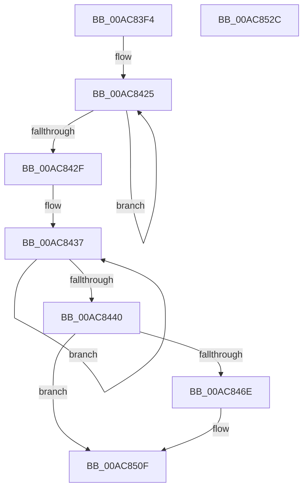

# WmipGenerateMofResourceNotification

- RVA: `0x00AC83F4`–`0x00AC852D` (길이 `313` bytes)
- VA: `0x0000000140AC83F4`
- 실행 섹션: `PAGE`
- PDB 이름 있음: `예`; PDB Function 태그: `아니요`
- unwind 정보 RVA: `0x00075C18`
- 디코드: `83`개 명령, `313/313` bytes 표시
- 미해석 바이트: `0` (있으면 어셈블리에 `.byte`로 보존)

> 이 문서는 커널 이미지의 기계어와 PDB 기호를 분석해 생성했습니다. 4번과 5번은 함수 원형과 자료형을 바이너리 사용 방식에서 추정한 C 해석이며 원본 소스 복구 결과는 아닙니다.

## 1. Dependencies

- 직접 호출 지점: **6**; 고유 호출 대상: **5**
- 직접 호출자로 확인된 함수: **2**
- RIP 상대 이미지 참조: **0**

### Outgoing calls
- `0x00AC845D` → [ExAllocatePool2](../../poolcode/B8/ExAllocatePool2_function_00B820F0.md) (function, `0x00B820F0`)
- `0x00AC8476` → [memset](../../text/6C/memset_function_006C6C40.md) (function, `0x006C6C40`)
- `0x00AC84D4` → [memcpy](../../text/6C/memcpy_function_006C6840.md) (function, `0x006C6840`)
- `0x00AC84F3` → [memcpy](../../text/6C/memcpy_function_006C6840.md) (function, `0x006C6840`)
- `0x00AC8500` → [WmipProcessEvent](../9D/WmipProcessEvent_function_009DFA40.md) (function, `0x009DFA40`)
- `0x00AC850A` → [ExFreePoolWithTag](../../poolcode/B8/ExFreePoolWithTag_function_00B82870.md) (function, `0x00B82870`)

### Direct callers
- [WmipAddDataSource](../9D/WmipAddDataSource_function_009DDC30.md) at `0x009DDF3C`
- [WmipMRCleanup](../AB/WmipMRCleanup_function_00ABE810.md) at `0x00ABE840`

### Static image references
- 디코드된 RIP-relative 메모리 참조가 없습니다.

## 2. Other-region calls and transfers

- 다른 실행 섹션으로 향하는 call: **5**
  - `0x00AC845D` → [ExAllocatePool2](../../poolcode/B8/ExAllocatePool2_function_00B820F0.md) (`PAGE` → `POOLCODE`)
  - `0x00AC8476` → [memset](../../text/6C/memset_function_006C6C40.md) (`PAGE` → `.text`)
  - `0x00AC84D4` → [memcpy](../../text/6C/memcpy_function_006C6840.md) (`PAGE` → `.text`)
  - `0x00AC84F3` → [memcpy](../../text/6C/memcpy_function_006C6840.md) (`PAGE` → `.text`)
  - `0x00AC850A` → [ExFreePoolWithTag](../../poolcode/B8/ExFreePoolWithTag_function_00B82870.md) (`PAGE` → `POOLCODE`)
- 별도 외부 분기/꼬리 이동을 확인하지 못했습니다.

## 3. Assembly (complete function range)

```asm
00AC83F4  48 89 5C 24 08                  mov qword ptr [rsp + 8], rbx
00AC83F9  48 89 6C 24 10                  mov qword ptr [rsp + 0x10], rbp
00AC83FE  48 89 74 24 18                  mov qword ptr [rsp + 0x18], rsi
00AC8403  57                              push rdi
00AC8404  41 54                           push r12
00AC8406  41 55                           push r13
00AC8408  41 56                           push r14
00AC840A  41 57                           push r15
00AC840C  48 83 EC 20                     sub rsp, 0x20
00AC8410  48 83 C8 FF                     or rax, 0xffffffffffffffff
00AC8414  4C 8B F1                        mov r14, rcx
00AC8417  4C 8B D0                        mov r10, rax
00AC841A  33 C9                           xor ecx, ecx
00AC841C  45 8B E1                        mov r12d, r9d
00AC841F  4D 8B E8                        mov r13, r8
00AC8422  4C 8B FA                        mov r15, rdx
00AC8425  49 FF C2                        inc r10
00AC8428  66 43 39 0C 56                  cmp word ptr [r14 + r10*2], cx
00AC842D  75 F6                           jne 0x140ac8425
00AC842F  4A 8D 34 55 04 00 00 00         lea rsi, [r10*2 + 4]
00AC8437  48 FF C0                        inc rax
00AC843A  66 39 0C 42                     cmp word ptr [rdx + rax*2], cx
00AC843E  75 F7                           jne 0x140ac8437
00AC8440  48 8D 2C 45 04 00 00 00         lea rbp, [rax*2 + 4]
00AC8448  41 B8 57 6D 69 70               mov r8d, 0x70696d57
00AC844E  48 8D 5D 48                     lea rbx, [rbp + 0x48]
00AC8452  B9 00 01 00 00                  mov ecx, 0x100
00AC8457  48 03 DE                        add rbx, rsi
00AC845A  48 8B D3                        mov rdx, rbx
00AC845D  E8 8E 9C 0B 00                  call 0x140b820f0
00AC8462  48 8B F8                        mov rdi, rax
00AC8465  48 85 C0                        test rax, rax
00AC8468  0F 84 A1 00 00 00               je 0x140ac850f
00AC846E  4C 8B C3                        mov r8, rbx
00AC8471  33 D2                           xor edx, edx
00AC8473  48 8B C8                        mov rcx, rax
00AC8476  E8 C5 E7 BF FF                  call 0x1406c6c40
00AC847B  89 1F                           mov dword ptr [rdi], ebx
00AC847D  33 C9                           xor ecx, ecx
00AC847F  44 89 67 04                     mov dword ptr [rdi + 4], r12d
00AC8483  49 8B D6                        mov rdx, r14
00AC8486  48 C7 47 08 01 00 00 00         mov qword ptr [rdi + 8], 1
00AC848E  C7 47 2C 0A 01 00 00            mov dword ptr [rdi + 0x2c], 0x10a
00AC8495  41 0F 10 45 00                  movups xmm0, xmmword ptr [r13]
00AC849A  F3 0F 7F 47 18                  movdqu xmmword ptr [rdi + 0x18], xmm0
00AC849F  48 A1 14 00 00 00 80 F7 FF FF   movabs rax, qword ptr [0xfffff78000000014]
00AC84A9  48 89 47 10                     mov qword ptr [rdi + 0x10], rax
00AC84AD  8D 04 2E                        lea eax, [rsi + rbp]
00AC84B0  66 89 4F 40                     mov word ptr [rdi + 0x40], cx
00AC84B4  48 83 EE 02                     sub rsi, 2
00AC84B8  C7 47 30 40 00 00 00            mov dword ptr [rdi + 0x30], 0x40
00AC84BF  48 8D 4F 4A                     lea rcx, [rdi + 0x4a]
00AC84C3  C7 47 38 48 00 00 00            mov dword ptr [rdi + 0x38], 0x48
00AC84CA  4C 8B C6                        mov r8, rsi
00AC84CD  89 47 3C                        mov dword ptr [rdi + 0x3c], eax
00AC84D0  66 89 77 48                     mov word ptr [rdi + 0x48], si
00AC84D4  E8 67 E3 BF FF                  call 0x1406c6840
00AC84D9  48 D1 EE                        shr rsi, 1
00AC84DC  48 8D 4F 4C                     lea rcx, [rdi + 0x4c]
00AC84E0  48 83 ED 02                     sub rbp, 2
00AC84E4  49 8B D7                        mov rdx, r15
00AC84E7  4C 8B C5                        mov r8, rbp
00AC84EA  48 8D 0C 71                     lea rcx, [rcx + rsi*2]
00AC84EE  66 89 6C 77 4A                  mov word ptr [rdi + rsi*2 + 0x4a], bp
00AC84F3  E8 48 E3 BF FF                  call 0x1406c6840
00AC84F8  45 33 C0                        xor r8d, r8d
00AC84FB  B2 01                           mov dl, 1
00AC84FD  48 8B CF                        mov rcx, rdi
00AC8500  E8 3B 75 F1 FF                  call 0x1409dfa40
00AC8505  33 D2                           xor edx, edx
00AC8507  48 8B CF                        mov rcx, rdi
00AC850A  E8 61 A3 0B 00                  call 0x140b82870
00AC850F  48 8B 5C 24 50                  mov rbx, qword ptr [rsp + 0x50]
00AC8514  48 8B 6C 24 58                  mov rbp, qword ptr [rsp + 0x58]
00AC8519  48 8B 74 24 60                  mov rsi, qword ptr [rsp + 0x60]
00AC851E  48 83 C4 20                     add rsp, 0x20
00AC8522  41 5F                           pop r15
00AC8524  41 5E                           pop r14
00AC8526  41 5D                           pop r13
00AC8528  41 5C                           pop r12
00AC852A  5F                              pop rdi
00AC852B  C3                              ret
00AC852C  CC                              int3
```

## 4. C-style interpretation (structured pseudocode)

```c
__int64 __fastcall WmipGenerateMofResourceNotification(__int64 a1, __int64 a2, __int64 a3, int a4)
{
    __int64 result;
    __int64 v_r10;
    __int64 v_rbp;
    __int64 v_rbx;
    __int64 v_rsi;
    __int64 v_rsp;
    unsigned __int64 v_stack_p10;
    unsigned __int64 v_stack_p18;
    unsigned __int64 v_stack_p8;

    v_stack_p8 = v_rbx;
    v_stack_p10 = v_rbp;
    v_stack_p18 = v_rsi;
    v_rsp = (v_rsp) - (32);
    result = (result) | (-1);
    a1 = 0;
loc_00AC8425:
    v_r10 = (result) + 1;
    if ((*(unsigned __int16 *)(a1 + v_r10 * 2)) != 0) goto loc_00AC8425;
loc_00AC8437:
    result = (result) + 1;
    if ((*(unsigned __int16 *)(a2 + result * 2)) != 0) goto loc_00AC8437;
    v_rbx = (result * 2 + 4 + 72) + (v_r10 * 2 + 4);
    result = ExAllocatePool2(256, v_rbx, (unsigned int)(0x70696D57ULL), a4);
    v_rsi = v_r10 * 2 + 4;
    v_rbp = result * 2 + 4;
    if (result != 0) {
        a3 = v_rbx;
        a2 = 0;
        a1 = result;
        result = memset(a1, a2, a3, a4);
        *(unsigned int *)(result) = (unsigned int)(v_rbx);
        a1 = 0;
        *(unsigned int *)(result + 4) = (unsigned int)((unsigned int)(a4));
        a2 = 0;
        *(unsigned __int64 *)(result + 8) = 1;
        *(unsigned int *)(result + 44) = 266;
        *(unsigned __int64 *)(result + 24) = v_xmm0;
        *(unsigned __int64 *)(result + 16) = result;
        result = v_r10 * 2 + 4 + result * 2 + 4 * 1;
        *(unsigned __int16 *)(result + 64) = 0;
        v_rsi = (v_r10 * 2 + 4) - (2);
        *(unsigned int *)(result + 48) = 64;
        a1 = result + 74;
        *(unsigned int *)(result + 56) = 72;
        a3 = v_rsi;
        *(unsigned int *)(result + 60) = (unsigned int)(result);
        *(unsigned __int16 *)(result + 72) = (unsigned __int16)(v_rsi);
        result = memcpy(a1, a2, a3, a4);
        v_rsi = (v_rsi) >> (1);
        a1 = result + 76;
        v_rbp = (result * 2 + 4) - (2);
        a2 = a2;
        a3 = v_rbp;
        a1 = a1 + v_rsi * 2;
        *(unsigned __int16 *)(result + v_rsi * 2 + 74) = (unsigned __int16)(v_rbp);
        result = memcpy(a1, a2, a3, a4);
        a3 = 0;
        a2 = 1;
        a1 = result;
        result = WmipProcessEvent(a1, a2, a3, a4);
        a2 = 0;
        a1 = result;
        result = ExFreePoolWithTag(a1, a2, a3, a4);
    }
    v_rsp = (v_rsp) + (32);
    return result;
}
```

## 5. (Beta) C Style

```c
int64_t WmipGenerateMofResourceNotification(void *Arg1, void *Arg2, void *Arg3, int32_t Arg4)
{
    uint8_t *arg1 = (uint8_t *)Arg1;
    uint8_t *arg2 = (uint8_t *)Arg2;
    uint8_t *arg3 = (uint8_t *)Arg3;

    int64_t result;
    int64_t local_r10;
    int64_t local_rbp;
    int64_t local_rbx;
    int64_t local_rsi;
    int64_t local_rsp;
    uint64_t v_stack_p10;
    uint64_t v_stack_p18;
    uint64_t v_stack_p8;

    v_stack_p8 = local_rbx;
    v_stack_p10 = local_rbp;
    v_stack_p18 = local_rsi;
    local_rsp = (local_rsp) - (32);
    result = (result) | (-1);
    Arg1 = 0;
loc_00AC8425:
    local_r10 = (result) + 1;
    if ((*(uint16_t *)(arg1 + local_r10 * 2)) != 0) goto loc_00AC8425;
loc_00AC8437:
    result = (result) + 1;
    if ((*(uint16_t *)(arg2 + result * 2)) != 0) goto loc_00AC8437;
    local_rbx = (result * 2 + 4 + 72) + (local_r10 * 2 + 4);
    result = ExAllocatePool2(256, local_rbx, (uint32_t)(0x70696D57ULL), Arg4);
    local_rsi = local_r10 * 2 + 4;
    local_rbp = result * 2 + 4;
    if (result != 0) {
        Arg3 = local_rbx;
        Arg2 = 0;
        Arg1 = result;
        result = memset(Arg1, Arg2, Arg3, Arg4);
        *(uint32_t *)(result) = (uint32_t)(local_rbx);
        Arg1 = 0;
        *(uint32_t *)(result + 0x4) = (uint32_t)((uint32_t)(Arg4));
        Arg2 = 0;
        *(uint64_t *)(result + 0x8) = 1;
        *(uint32_t *)(result + 0x2C) = 266;
        *(uint64_t *)(result + 0x18) = v_xmm0;
        *(uint64_t *)(result + 0x10) = result;
        result = local_r10 * 2 + 4 + result * 2 + 4 * 1;
        *(uint16_t *)(result + 0x40) = 0;
        local_rsi = (local_r10 * 2 + 4) - (2);
        *(uint32_t *)(result + 0x30) = 64;
        Arg1 = result + 74;
        *(uint32_t *)(result + 0x38) = 72;
        Arg3 = local_rsi;
        *(uint32_t *)(result + 0x3C) = (uint32_t)(result);
        *(uint16_t *)(result + 0x48) = (uint16_t)(local_rsi);
        result = memcpy(Arg1, Arg2, Arg3, Arg4);
        local_rsi = (local_rsi) >> (1);
        Arg1 = result + 76;
        local_rbp = (result * 2 + 4) - (2);
        Arg2 = Arg2;
        Arg3 = local_rbp;
        Arg1 = Arg1 + local_rsi * 2;
        *(uint16_t *)(result + local_rsi * 2 + 0x4A) = (uint16_t)(local_rbp);
        result = memcpy(Arg1, Arg2, Arg3, Arg4);
        Arg3 = 0;
        Arg2 = 1;
        Arg1 = result;
        result = WmipProcessEvent(Arg1, Arg2, Arg3, Arg4);
        Arg2 = 0;
        Arg1 = result;
        result = ExFreePoolWithTag(Arg1, Arg2, Arg3, Arg4);
    }
    local_rsp = (local_rsp) + (32);
    return result;
}
```

### 관측된 메모리 오프셋

구조체 형식이 확인되지 않은 접근은 인자 기준의 오프셋으로만 기록했습니다.

| 기준 인자 | 오프셋 표현 | 폭 (bit) | 접근 |
|---|---:|---:|---|
| `Arg1` | `+ 0x0 + r10*2` | `16` | `R` |
| `Arg2` | `+ 0x0 + rax*2` | `16` | `R` |
| `Arg3` | `+ 0x0` | `128` | `R` |

## 6. Execution-region graph

[열기: 2D/3D 그래프와 함수 탐색 컨트롤 패널](../../../control-panel.html?section=page&rva=0x00AC83F4&view=graph)

- 2D 그래프는 위에서 아래로 흐르고, 3D 그래프는 빈 공간을 드래그해 회전합니다. Shift+드래그는 이동, 휠은 확대·축소, 함수 노드 선택은 대상 보고서 이동입니다.

### Static fallback


