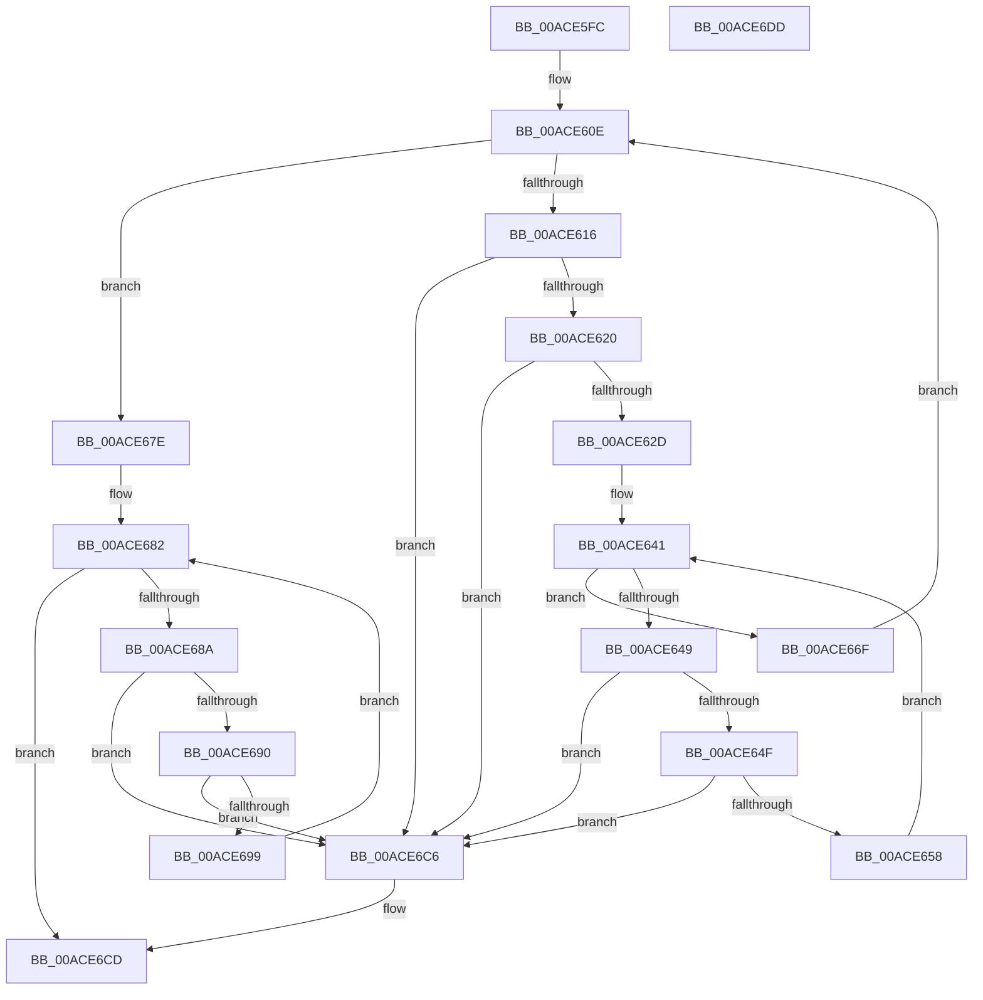

# WmipProcessSynchronousEtw

- RVA: `0x00ACE5FC`–`0x00ACE6DE` (길이 `226` bytes)
- VA: `0x0000000140ACE5FC`
- 실행 섹션: `PAGE`
- PDB 이름 있음: `예`; PDB Function 태그: `아니요`
- unwind 정보 RVA: `0x000794E0`
- 디코드: `66`개 명령, `226/226` bytes 표시
- 미해석 바이트: `0` (있으면 어셈블리에 `.byte`로 보존)

> 이 문서는 커널 이미지의 기계어와 PDB 기호를 분석해 생성했습니다. 4번과 5번은 함수 원형과 자료형을 바이너리 사용 방식에서 추정한 C 해석이며 원본 소스 복구 결과는 아닙니다.

## 1. Dependencies

- 직접 호출 지점: **5**; 고유 호출 대상: **4**
- 직접 호출자로 확인된 함수: **1**
- RIP 상대 이미지 참조: **0**

### Outgoing calls
- `0x00ACE638` → [WmipLegacyEtwWorker](../9E/WmipLegacyEtwWorker_function_009E3290.md) (function, `0x009E3290`)
- `0x00ACE668` → [KeSetEvent](../../text/33/KeSetEvent_function_0033F310.md) (function, `0x0033F310`)
- `0x00ACE677` → [ExFreePoolWithTag](../../poolcode/B8/ExFreePoolWithTag_function_00B82870.md) (function, `0x00B82870`)
- `0x00ACE6B2` → [KeWaitForSingleObject](../../text/20/KeWaitForSingleObject_function_0020E6B0.md) (function, `0x0020E6B0`)
- `0x00ACE6BF` → [ExFreePoolWithTag](../../poolcode/B8/ExFreePoolWithTag_function_00B82870.md) (function, `0x00B82870`)

### Direct callers
- [WmipAddDataSource](../9D/WmipAddDataSource_function_009DDC30.md) at `0x009DDEE3`

### Static image references
- 디코드된 RIP-relative 메모리 참조가 없습니다.

## 2. Other-region calls and transfers

- 다른 실행 섹션으로 향하는 call: **4**
  - `0x00ACE668` → [KeSetEvent](../../text/33/KeSetEvent_function_0033F310.md) (`PAGE` → `.text`)
  - `0x00ACE677` → [ExFreePoolWithTag](../../poolcode/B8/ExFreePoolWithTag_function_00B82870.md) (`PAGE` → `POOLCODE`)
  - `0x00ACE6B2` → [KeWaitForSingleObject](../../text/20/KeWaitForSingleObject_function_0020E6B0.md) (`PAGE` → `.text`)
  - `0x00ACE6BF` → [ExFreePoolWithTag](../../poolcode/B8/ExFreePoolWithTag_function_00B82870.md) (`PAGE` → `POOLCODE`)
- 별도 외부 분기/꼬리 이동을 확인하지 못했습니다.

## 3. Assembly (complete function range)

```asm
00ACE5FC  48 89 5C 24 08                  mov qword ptr [rsp + 8], rbx
00ACE601  48 89 74 24 10                  mov qword ptr [rsp + 0x10], rsi
00ACE606  57                              push rdi
00ACE607  48 83 EC 30                     sub rsp, 0x30
00ACE60B  48 8B F9                        mov rdi, rcx
00ACE60E  48 8B 1F                        mov rbx, qword ptr [rdi]
00ACE611  48 3B DF                        cmp rbx, rdi
00ACE614  74 68                           je 0x140ace67e
00ACE616  48 39 7B 08                     cmp qword ptr [rbx + 8], rdi
00ACE61A  0F 85 A6 00 00 00               jne 0x140ace6c6
00ACE620  48 8B 03                        mov rax, qword ptr [rbx]
00ACE623  48 39 58 08                     cmp qword ptr [rax + 8], rbx
00ACE627  0F 85 99 00 00 00               jne 0x140ace6c6
00ACE62D  48 89 07                        mov qword ptr [rdi], rax
00ACE630  48 89 78 08                     mov qword ptr [rax + 8], rdi
00ACE634  48 8B 4B 10                     mov rcx, qword ptr [rbx + 0x10]
00ACE638  E8 53 4C F1 FF                  call 0x1409e3290
00ACE63D  48 8D 73 28                     lea rsi, [rbx + 0x28]
00ACE641  48 8B 0E                        mov rcx, qword ptr [rsi]
00ACE644  48 3B CE                        cmp rcx, rsi
00ACE647  74 26                           je 0x140ace66f
00ACE649  48 39 71 08                     cmp qword ptr [rcx + 8], rsi
00ACE64D  75 77                           jne 0x140ace6c6
00ACE64F  48 8B 01                        mov rax, qword ptr [rcx]
00ACE652  48 39 48 08                     cmp qword ptr [rax + 8], rcx
00ACE656  75 6E                           jne 0x140ace6c6
00ACE658  48 89 06                        mov qword ptr [rsi], rax
00ACE65B  48 83 C1 10                     add rcx, 0x10
00ACE65F  45 33 C0                        xor r8d, r8d
00ACE662  48 89 70 08                     mov qword ptr [rax + 8], rsi
00ACE666  33 D2                           xor edx, edx
00ACE668  E8 A3 0C 87 FF                  call 0x14033f310
00ACE66D  EB D2                           jmp 0x140ace641
00ACE66F  BA 57 6D 69 70                  mov edx, 0x70696d57
00ACE674  48 8B CB                        mov rcx, rbx
00ACE677  E8 F4 41 0B 00                  call 0x140b82870
00ACE67C  EB 90                           jmp 0x140ace60e
00ACE67E  48 83 C7 10                     add rdi, 0x10
00ACE682  48 8B 1F                        mov rbx, qword ptr [rdi]
00ACE685  48 3B DF                        cmp rbx, rdi
00ACE688  74 43                           je 0x140ace6cd
00ACE68A  48 39 7B 08                     cmp qword ptr [rbx + 8], rdi
00ACE68E  75 36                           jne 0x140ace6c6
00ACE690  48 8B 03                        mov rax, qword ptr [rbx]
00ACE693  48 39 58 08                     cmp qword ptr [rax + 8], rbx
00ACE697  75 2D                           jne 0x140ace6c6
00ACE699  48 83 64 24 20 00               and qword ptr [rsp + 0x20], 0
00ACE69F  48 8D 4B 20                     lea rcx, [rbx + 0x20]
00ACE6A3  48 89 07                        mov qword ptr [rdi], rax
00ACE6A6  45 33 C9                        xor r9d, r9d
00ACE6A9  45 33 C0                        xor r8d, r8d
00ACE6AC  48 89 78 08                     mov qword ptr [rax + 8], rdi
00ACE6B0  33 D2                           xor edx, edx
00ACE6B2  E8 F9 FF 73 FF                  call 0x14020e6b0
00ACE6B7  BA 57 6D 69 70                  mov edx, 0x70696d57
00ACE6BC  48 8B CB                        mov rcx, rbx
00ACE6BF  E8 AC 41 0B 00                  call 0x140b82870
00ACE6C4  EB BC                           jmp 0x140ace682
00ACE6C6  B9 03 00 00 00                  mov ecx, 3
00ACE6CB  CD 29                           int 0x29
00ACE6CD  48 8B 5C 24 40                  mov rbx, qword ptr [rsp + 0x40]
00ACE6D2  48 8B 74 24 48                  mov rsi, qword ptr [rsp + 0x48]
00ACE6D7  48 83 C4 30                     add rsp, 0x30
00ACE6DB  5F                              pop rdi
00ACE6DC  C3                              ret
00ACE6DD  CC                              int3
```

## 4. C-style interpretation (structured pseudocode)

```c
__int64 __fastcall WmipProcessSynchronousEtw(__int64 a1, int a2, int a3, int a4)
{
    __int64 result;
    __int64 v_rdi;
    __int64 v_rsp;
    unsigned __int64 v_stack_m18;
    unsigned __int64 v_stack_p10;
    unsigned __int64 v_stack_p8;

    v_stack_p8 = v_rbx;
    v_stack_p10 = v_rsi;
    v_rsp = (v_rsp) - (48);
loc_00ACE60E:
    if ((*(unsigned __int64 *)(a1)) == a1) goto loc_00ACE67E;
    if ((*(unsigned __int64 *)(*(unsigned __int64 *)(a1) + 8)) != a1) goto loc_00ACE6C6;
    if ((*(unsigned __int64 *)(*(unsigned __int64 *)(*(unsigned __int64 *)(a1)) + 8)) != (*(unsigned __int64 *)(a1))) goto loc_00ACE6C6;
    *(unsigned __int64 *)(a1) = *(unsigned __int64 *)(*(unsigned __int64 *)(a1));
    *(unsigned __int64 *)(*(unsigned __int64 *)(*(unsigned __int64 *)(a1)) + 8) = a1;
    result = WmipLegacyEtwWorker(*(unsigned __int64 *)(*(unsigned __int64 *)(a1) + 16), a2, a3, a4);
loc_00ACE641:
    if ((*(unsigned __int64 *)(*(unsigned __int64 *)(a1) + 40)) == (*(unsigned __int64 *)(a1) + 40)) goto loc_00ACE66F;
    if ((*(unsigned __int64 *)(*(unsigned __int64 *)(*(unsigned __int64 *)(a1) + 40) + 8)) != (*(unsigned __int64 *)(a1) + 40)) goto loc_00ACE6C6;
    if ((*(unsigned __int64 *)(*(unsigned __int64 *)(*(unsigned __int64 *)(*(unsigned __int64 *)(a1) + 40)) + 8)) != (*(unsigned __int64 *)(*(unsigned __int64 *)(a1) + 40))) goto loc_00ACE6C6;
    *(unsigned __int64 *)(*(unsigned __int64 *)(a1) + 40) = *(unsigned __int64 *)(*(unsigned __int64 *)(*(unsigned __int64 *)(a1) + 40));
    a1 = (*(unsigned __int64 *)(*(unsigned __int64 *)(a1) + 40)) + (16);
    a3 = 0;
    *(unsigned __int64 *)(*(unsigned __int64 *)(*(unsigned __int64 *)(*(unsigned __int64 *)(a1) + 40)) + 8) = *(unsigned __int64 *)(a1) + 40;
    a2 = 0;
    result = KeSetEvent(a1, a2, a3, a4);
    goto loc_00ACE641;
loc_00ACE66F:
    result = ExFreePoolWithTag(*(unsigned __int64 *)(a1), (unsigned int)(0x70696D57ULL), a3, a4);
    goto loc_00ACE60E;
loc_00ACE67E:
    v_rdi = (a1) + (16);
loc_00ACE682:
    if ((*(unsigned __int64 *)(v_rdi)) == v_rdi) goto loc_00ACE6CD;
    if ((*(unsigned __int64 *)(*(unsigned __int64 *)(v_rdi) + 8)) != v_rdi) goto loc_00ACE6C6;
    if ((*(unsigned __int64 *)(*(unsigned __int64 *)(*(unsigned __int64 *)(v_rdi)) + 8)) != (*(unsigned __int64 *)(v_rdi))) goto loc_00ACE6C6;
    *(unsigned __int64 *)(v_rdi) = *(unsigned __int64 *)(*(unsigned __int64 *)(v_rdi));
    a4 = 0;
    a3 = 0;
    *(unsigned __int64 *)(*(unsigned __int64 *)(*(unsigned __int64 *)(v_rdi)) + 8) = v_rdi;
    a2 = 0;
    result = KeWaitForSingleObject(*(unsigned __int64 *)(v_rdi) + 32, a2, a3, a4);
    result = ExFreePoolWithTag(*(unsigned __int64 *)(v_rdi), (unsigned int)(0x70696D57ULL), a3, a4);
    goto loc_00ACE682;
loc_00ACE6C6:
loc_00ACE6CD:
    v_rsp = (v_rsp) + (48);
    return result;
}
```

## 5. (Beta) C Style

```c
int64_t WmipProcessSynchronousEtw(void *Arg1, int32_t Arg2, int32_t Arg3, int32_t Arg4)
{
    uint8_t *arg1 = (uint8_t *)Arg1;

    int64_t result;
    int64_t local_rdi;
    int64_t local_rsp;
    uint64_t v_stack_m18;
    uint64_t v_stack_p10;
    uint64_t v_stack_p8;

    v_stack_p8 = local_rbx;
    v_stack_p10 = local_rsi;
    local_rsp = (local_rsp) - (48);
loc_00ACE60E:
    if ((*(uint64_t *)(arg1)) == Arg1) goto loc_00ACE67E;
    if ((*(uint64_t *)(*(uint64_t *)(arg1) + 0x8)) != Arg1) goto loc_00ACE6C6;
    if ((*(uint64_t *)(*(uint64_t *)(*(uint64_t *)(arg1)) + 0x8)) != (*(uint64_t *)(arg1))) goto loc_00ACE6C6;
    *(uint64_t *)(arg1) = *(uint64_t *)(*(uint64_t *)(arg1));
    *(void **)(*(uint64_t *)(*(uint64_t *)(arg1)) + 0x8) = Arg1;
    result = WmipLegacyEtwWorker(*(uint64_t *)(*(uint64_t *)(arg1) + 0x10), Arg2, Arg3, Arg4);
loc_00ACE641:
    if ((*(uint64_t *)(*(uint64_t *)(arg1) + 0x28)) == (*(uint64_t *)(arg1) + 40)) goto loc_00ACE66F;
    if ((*(uint64_t *)(*(uint64_t *)(*(uint64_t *)(arg1) + 0x28) + 0x8)) != (*(uint64_t *)(arg1) + 40)) goto loc_00ACE6C6;
    if ((*(uint64_t *)(*(uint64_t *)(*(uint64_t *)(*(uint64_t *)(arg1) + 0x28)) + 0x8)) != (*(uint64_t *)(*(uint64_t *)(arg1) + 0x28))) goto loc_00ACE6C6;
    *(uint64_t *)(*(uint64_t *)(arg1) + 0x28) = *(uint64_t *)(*(uint64_t *)(*(uint64_t *)(arg1) + 0x28));
    Arg1 = (*(uint64_t *)(*(uint64_t *)(arg1) + 0x28)) + (16);
    Arg3 = 0;
    *(uint64_t *)(*(uint64_t *)(*(uint64_t *)(*(uint64_t *)(arg1) + 0x28)) + 0x8) = *(uint64_t *)(arg1) + 40;
    Arg2 = 0;
    result = KeSetEvent(Arg1, Arg2, Arg3, Arg4);
    goto loc_00ACE641;
loc_00ACE66F:
    result = ExFreePoolWithTag(*(uint64_t *)(arg1), (uint32_t)(0x70696D57ULL), Arg3, Arg4);
    goto loc_00ACE60E;
loc_00ACE67E:
    local_rdi = (Arg1) + (16);
loc_00ACE682:
    if ((*(uint64_t *)(local_rdi)) == local_rdi) goto loc_00ACE6CD;
    if ((*(uint64_t *)(*(uint64_t *)(local_rdi) + 0x8)) != local_rdi) goto loc_00ACE6C6;
    if ((*(uint64_t *)(*(uint64_t *)(*(uint64_t *)(local_rdi)) + 0x8)) != (*(uint64_t *)(local_rdi))) goto loc_00ACE6C6;
    *(uint64_t *)(local_rdi) = *(uint64_t *)(*(uint64_t *)(local_rdi));
    Arg4 = 0;
    Arg3 = 0;
    *(uint64_t *)(*(uint64_t *)(*(uint64_t *)(local_rdi)) + 0x8) = local_rdi;
    Arg2 = 0;
    result = KeWaitForSingleObject(*(uint64_t *)(local_rdi) + 32, Arg2, Arg3, Arg4);
    result = ExFreePoolWithTag(*(uint64_t *)(local_rdi), (uint32_t)(0x70696D57ULL), Arg3, Arg4);
    goto loc_00ACE682;
loc_00ACE6C6:
loc_00ACE6CD:
    local_rsp = (local_rsp) + (48);
    return result;
}
```

### 관측된 메모리 오프셋

구조체 형식이 확인되지 않은 접근은 인자 기준의 오프셋으로만 기록했습니다.

| 기준 인자 | 오프셋 표현 | 폭 (bit) | 접근 |
|---|---:|---:|---|
| `Arg1` | `+ 0x0` | `64` | `R` |
| `Arg1` | `+ 0x0` | `64` | `W` |

## 6. Execution-region graph

[열기: 2D/3D 그래프와 함수 탐색 컨트롤 패널](../../../control-panel.html?section=page&rva=0x00ACE5FC&view=graph)

- 2D 그래프는 위에서 아래로 흐르고, 3D 그래프는 빈 공간을 드래그해 회전합니다. Shift+드래그는 이동, 휠은 확대·축소, 함수 노드 선택은 대상 보고서 이동입니다.

### Static fallback


