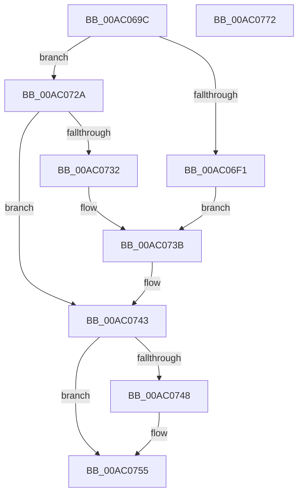

# wil_RtlStagingConfig_QueryFeatureState

- RVA: `0x00AC069C`–`0x00AC0773` (길이 `215` bytes)
- VA: `0x0000000140AC069C`
- 실행 섹션: `PAGE`
- PDB 이름 있음: `예`; PDB Function 태그: `아니요`
- unwind 정보 RVA: `0x000BD884`
- 디코드: `72`개 명령, `215/215` bytes 표시
- 미해석 바이트: `0` (있으면 어셈블리에 `.byte`로 보존)

> 이 문서는 커널 이미지의 기계어와 PDB 기호를 분석해 생성했습니다. 4번과 5번은 함수 원형과 자료형을 바이너리 사용 방식에서 추정한 C 해석이며 원본 소스 복구 결과는 아닙니다.

## 1. Dependencies

- 직접 호출 지점: **2**; 고유 호출 대상: **2**
- 직접 호출자로 확인된 함수: **2**
- RIP 상대 이미지 참조: **1**

### Outgoing calls
- `0x00AC06E6` → [RtlQueryFeatureConfiguration](../../text/4B/RtlQueryFeatureConfiguration_function_004BDD10.md) (function, `0x004BDD10`)
- `0x00AC075F` → [_security_check_cookie](../../text/6A/_security_check_cookie_function_006AC640.md) (function, `0x006AC640`)

### Direct callers
- [wil_details_GetCurrentFeatureEnabledState](../../text/3F/wil_details_GetCurrentFeatureEnabledState_function_003FEA98.md) at `0x003FEADF`
- [wil_details_GetCurrentVariantState](../../text/5B/wil_details_GetCurrentVariantState_function_005B8790.md) at `0x005B87DB`

### Static image references
- `0x00AC06AB` → RVA `0x00E0A740` (`.data`; read)

## 2. Other-region calls and transfers

- 다른 실행 섹션으로 향하는 call: **2**
  - `0x00AC06E6` → [RtlQueryFeatureConfiguration](../../text/4B/RtlQueryFeatureConfiguration_function_004BDD10.md) (`PAGE` → `.text`)
  - `0x00AC075F` → [_security_check_cookie](../../text/6A/_security_check_cookie_function_006AC640.md) (`PAGE` → `.text`)
- 별도 외부 분기/꼬리 이동을 확인하지 못했습니다.

## 3. Assembly (complete function range)

```asm
00AC069C  4C 8B DC                        mov r11, rsp
00AC069F  49 89 5B 18                     mov qword ptr [r11 + 0x18], rbx
00AC06A3  56                              push rsi
00AC06A4  57                              push rdi
00AC06A5  41 56                           push r14
00AC06A7  48 83 EC 40                     sub rsp, 0x40
00AC06AB  48 8B 05 8E A0 34 00            mov rax, qword ptr [rip + 0x34a08e]
00AC06B2  48 33 C4                        xor rax, rsp
00AC06B5  48 89 44 24 38                  mov qword ptr [rsp + 0x38], rax
00AC06BA  33 FF                           xor edi, edi
00AC06BC  8B C2                           mov eax, edx
00AC06BE  48 8B F1                        mov rsi, rcx
00AC06C1  49 89 7B C8                     mov qword ptr [r11 - 0x38], rdi
00AC06C5  33 C9                           xor ecx, ecx
00AC06C7  8B D7                           mov edx, edi
00AC06C9  45 85 C0                        test r8d, r8d
00AC06CC  49 89 4B D0                     mov qword ptr [r11 - 0x30], rcx
00AC06D0  4D 8B F1                        mov r14, r9
00AC06D3  89 4C 24 30                     mov dword ptr [rsp + 0x30], ecx
00AC06D7  0F 94 C2                        sete dl
00AC06DA  4D 8D 4B D0                     lea r9, [r11 - 0x30]
00AC06DE  4D 8D 43 C8                     lea r8, [r11 - 0x38]
00AC06E2  8B C8                           mov ecx, eax
00AC06E4  8B DF                           mov ebx, edi
00AC06E6  E8 25 D6 9F FF                  call 0x1404bdd10
00AC06EB  8B D0                           mov edx, eax
00AC06ED  85 C0                           test eax, eax
00AC06EF  75 39                           jne 0x140ac072a
00AC06F1  8B 4C 24 2C                     mov ecx, dword ptr [rsp + 0x2c]
00AC06F5  8D 5F 01                        lea ebx, [rdi + 1]
00AC06F8  8B C1                           mov eax, ecx
00AC06FA  C1 E8 04                        shr eax, 4
00AC06FD  83 E0 03                        and eax, 3
00AC0700  89 06                           mov dword ptr [rsi], eax
00AC0702  8B C1                           mov eax, ecx
00AC0704  C1 E8 08                        shr eax, 8
00AC0707  24 3F                           and al, 0x3f
00AC0709  88 46 04                        mov byte ptr [rsi + 4], al
00AC070C  8B 44 24 30                     mov eax, dword ptr [rsp + 0x30]
00AC0710  89 46 0C                        mov dword ptr [rsi + 0xc], eax
00AC0713  8B C1                           mov eax, ecx
00AC0715  C1 E8 0E                        shr eax, 0xe
00AC0718  83 E0 03                        and eax, 3
00AC071B  89 46 08                        mov dword ptr [rsi + 8], eax
00AC071E  8B C1                           mov eax, ecx
00AC0720  C1 E8 06                        shr eax, 6
00AC0723  23 C3                           and eax, ebx
00AC0725  89 46 14                        mov dword ptr [rsi + 0x14], eax
00AC0728  EB 11                           jmp 0x140ac073b
00AC072A  81 FA 17 01 00 00               cmp edx, 0x117
00AC0730  75 11                           jne 0x140ac0743
00AC0732  8B 4C 24 2C                     mov ecx, dword ptr [rsp + 0x2c]
00AC0736  BB 01 00 00 00                  mov ebx, 1
00AC073B  C1 E9 07                        shr ecx, 7
00AC073E  23 CB                           and ecx, ebx
00AC0740  89 4E 10                        mov dword ptr [rsi + 0x10], ecx
00AC0743  4D 85 F6                        test r14, r14
00AC0746  74 0D                           je 0x140ac0755
00AC0748  81 FA 22 00 00 80               cmp edx, 0x80000022
00AC074E  40 0F 95 C7                     setne dil
00AC0752  41 89 3E                        mov dword ptr [r14], edi
00AC0755  8B C3                           mov eax, ebx
00AC0757  48 8B 4C 24 38                  mov rcx, qword ptr [rsp + 0x38]
00AC075C  48 33 CC                        xor rcx, rsp
00AC075F  E8 DC BE BE FF                  call 0x1406ac640
00AC0764  48 8B 5C 24 70                  mov rbx, qword ptr [rsp + 0x70]
00AC0769  48 83 C4 40                     add rsp, 0x40
00AC076D  41 5E                           pop r14
00AC076F  5F                              pop rdi
00AC0770  5E                              pop rsi
00AC0771  C3                              ret
00AC0772  CC                              int3
```

## 4. C-style interpretation (structured pseudocode)

```c
__int64 __fastcall wil_RtlStagingConfig_QueryFeatureState(__int64 a1, int a2, int a3, __int64 a4)
{
    __int64 result;
    __int64 v_rdi;
    __int64 v_rsp;
    unsigned __int64 v_stack_m20;
    unsigned int v_stack_m28;
    unsigned int v_stack_m2C;
    unsigned __int64 v_stack_p18;

    *(unsigned __int64 *)(v_rsp + 24) = v_rbx;
    v_rsp = (v_rsp) - (64);
    result = (*(unsigned __int64 *)(v_rip + 3448974)) ^ (v_rsp);
    v_stack_m20 = result;
    v_rdi = 0;
    *(unsigned __int64 *)(v_rsp - 56) = 0;
    a1 = 0;
    *(unsigned __int64 *)(v_rsp - 48) = 0;
    v_stack_m28 = 0;
    a2 = (a3 == 0) ? 1 : 0;
    result = RtlQueryFeatureConfiguration((unsigned int)((unsigned int)((unsigned int)(a2))), a2, v_rsp - 56, v_rsp - 48);
    if ((unsigned int)(result) != 0) goto loc_00AC072A;
    result = (unsigned int)(((unsigned int)((unsigned int)((unsigned int)(v_stack_m2C)))) >> (4));
    result = (unsigned int)((result) & (3));
    *(unsigned int *)(a1) = (unsigned int)(result);
    result = (unsigned int)(((unsigned int)((unsigned int)((unsigned int)(v_stack_m2C)))) >> (8));
    result = (unsigned __int8)((result) & (63));
    *(unsigned __int8 *)(a1 + 4) = (unsigned __int8)(result);
    *(unsigned int *)(a1 + 12) = (unsigned int)((unsigned int)(v_stack_m28));
    result = (unsigned int)(((unsigned int)((unsigned int)((unsigned int)(v_stack_m2C)))) >> (14));
    result = (unsigned int)((result) & (3));
    *(unsigned int *)(a1 + 8) = (unsigned int)(result);
    result = (unsigned int)(((unsigned int)((unsigned int)((unsigned int)(v_stack_m2C)))) >> (6));
    result = (unsigned int)((result) & ((unsigned int)(v_rdi + 1)));
    *(unsigned int *)(a1 + 20) = (unsigned int)(result);
    goto loc_00AC073B;
loc_00AC072A:
    if (((unsigned int)((unsigned int)((unsigned int)(result)))) != 279) goto loc_00AC0743;
loc_00AC073B:
    a1 = (unsigned int)(((unsigned int)(v_stack_m2C)) >> (7));
    a1 = (unsigned int)((a1) & (1));
    *(unsigned int *)(a1 + 16) = (unsigned int)(a1);
loc_00AC0743:
    if (a4 != 0) {
        v_rdi = (((unsigned int)((unsigned int)((unsigned int)(result)))) != 0x80000022ULL) ? 1 : 0;
        *(unsigned int *)(a4) = (unsigned int)(v_rdi);
    }
    a1 = (v_stack_m20) ^ (v_rsp);
    result = _security_check_cookie(a1, (unsigned int)((unsigned int)(result)), v_rsp - 56, v_rsp - 48);
    v_rsp = (v_rsp) + (64);
    return result;
}
```

## 5. (Beta) C Style

```c
int64_t wil_RtlStagingConfig_QueryFeatureState(void *Arg1, int32_t Arg2, int32_t Arg3, int64_t Arg4)
{
    uint8_t *arg1 = (uint8_t *)Arg1;

    int64_t result;
    int64_t local_rdi;
    int64_t local_rsp;
    uint64_t v_stack_m20;
    uint32_t v_stack_m28;
    uint32_t v_stack_m2C;
    uint64_t v_stack_p18;

    *(uint64_t *)(local_rsp + 0x18) = local_rbx;
    local_rsp = (local_rsp) - (64);
    result = (*(uint64_t *)(v_rip + 0x34A08E)) ^ (local_rsp);
    v_stack_m20 = result;
    local_rdi = 0;
    *(uint64_t *)(local_rsp - 0x38) = 0;
    Arg1 = 0;
    *(uint64_t *)(local_rsp - 0x30) = 0;
    v_stack_m28 = 0;
    Arg2 = (Arg3 == 0) ? 1 : 0;
    result = RtlQueryFeatureConfiguration((uint32_t)((uint32_t)((uint32_t)(Arg2))), Arg2, local_rsp - 56, local_rsp - 48);
    if ((uint32_t)(result) != 0) goto loc_00AC072A;
    result = (uint32_t)(((uint32_t)((uint32_t)((uint32_t)(v_stack_m2C)))) >> (4));
    result = (uint32_t)((result) & (3));
    *(uint32_t *)(arg1) = (uint32_t)(result);
    result = (uint32_t)(((uint32_t)((uint32_t)((uint32_t)(v_stack_m2C)))) >> (8));
    result = (uint8_t)((result) & (63));
    *(uint8_t *)(arg1 + 0x4) = (uint8_t)(result);
    *(uint32_t *)(arg1 + 0xC) = (uint32_t)((uint32_t)(v_stack_m28));
    result = (uint32_t)(((uint32_t)((uint32_t)((uint32_t)(v_stack_m2C)))) >> (14));
    result = (uint32_t)((result) & (3));
    *(uint32_t *)(arg1 + 0x8) = (uint32_t)(result);
    result = (uint32_t)(((uint32_t)((uint32_t)((uint32_t)(v_stack_m2C)))) >> (6));
    result = (uint32_t)((result) & ((uint32_t)(local_rdi + 1)));
    *(uint32_t *)(arg1 + 0x14) = (uint32_t)(result);
    goto loc_00AC073B;
loc_00AC072A:
    if (((uint32_t)((uint32_t)((uint32_t)(result)))) != 279) goto loc_00AC0743;
loc_00AC073B:
    Arg1 = (uint32_t)(((uint32_t)(v_stack_m2C)) >> (7));
    Arg1 = (uint32_t)((Arg1) & (1));
    *(uint32_t *)(arg1 + 0x10) = (uint32_t)(Arg1);
loc_00AC0743:
    if (Arg4 != 0) {
        local_rdi = (((uint32_t)((uint32_t)((uint32_t)(result)))) != 0x80000022ULL) ? 1 : 0;
        *(uint32_t *)(Arg4) = (uint32_t)(local_rdi);
    }
    Arg1 = (v_stack_m20) ^ (local_rsp);
    result = _security_check_cookie(Arg1, (uint32_t)((uint32_t)(result)), local_rsp - 56, local_rsp - 48);
    local_rsp = (local_rsp) + (64);
    return result;
}
```

### 관측된 메모리 오프셋

구조체 형식이 확인되지 않은 접근은 인자 기준의 오프셋으로만 기록했습니다.

| 기준 인자 | 오프셋 표현 | 폭 (bit) | 접근 |
|---|---:|---:|---|
| `Arg1` | `+ 0x0` | `32` | `W` |
| `Arg1` | `+ 0x4` | `8` | `W` |
| `Arg1` | `+ 0x8` | `32` | `W` |
| `Arg1` | `+ 0xC` | `32` | `W` |
| `Arg1` | `+ 0x10` | `32` | `W` |
| `Arg1` | `+ 0x14` | `32` | `W` |

## 6. Execution-region graph

[열기: 2D/3D 그래프와 함수 탐색 컨트롤 패널](../../../control-panel.html?section=page&rva=0x00AC069C&view=graph)

- 2D 그래프는 위에서 아래로 흐르고, 3D 그래프는 빈 공간을 드래그해 회전합니다. Shift+드래그는 이동, 휠은 확대·축소, 함수 노드 선택은 대상 보고서 이동입니다.

### Static fallback


