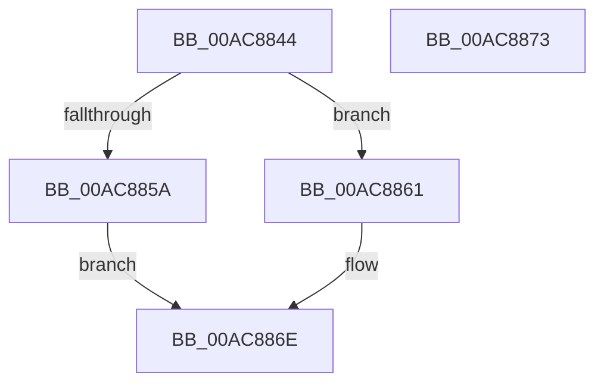

# wil_details_EvaluateFeatureDependencies_GetCachedFeatureEnabledState

- RVA: `0x00AC8844`–`0x00AC8874` (길이 `48` bytes)
- VA: `0x0000000140AC8844`
- 실행 섹션: `PAGE`
- PDB 이름 있음: `예`; PDB Function 태그: `아니요`
- unwind 정보 RVA: `0x0005C788`
- 디코드: `14`개 명령, `48/48` bytes 표시
- 미해석 바이트: `0` (있으면 어셈블리에 `.byte`로 보존)

> 이 문서는 커널 이미지의 기계어와 PDB 기호를 분석해 생성했습니다. 4번과 5번은 함수 원형과 자료형을 바이너리 사용 방식에서 추정한 C 해석이며 원본 소스 복구 결과는 아닙니다.

## 1. Dependencies

- 직접 호출 지점: **1**; 고유 호출 대상: **1**
- 직접 호출자로 확인된 함수: **2**
- RIP 상대 이미지 참조: **0**

### Outgoing calls
- `0x00AC8869` → [wil_details_EvaluateFeatureDependencies_ReevaluateCachedFeatureEnabledState](wil_details_EvaluateFeatureDependencies_ReevaluateCachedFeatureEnabledState_function_00ACA3D4.md) (function, `0x00ACA3D4`)

### Direct callers
- [wil_details_EvaluateFeatureDependencies](../70/wil_details_EvaluateFeatureDependencies_function_0070282C.md) at `0x007028BE`
- [wil_details_EvaluateFeatureDependencies_ReevaluateCachedFeatureEnabledState](wil_details_EvaluateFeatureDependencies_ReevaluateCachedFeatureEnabledState_function_00ACA3D4.md) at `0x00ACA445`

### Static image references
- 디코드된 RIP-relative 메모리 참조가 없습니다.

## 2. Other-region calls and transfers

- 다른 실행 섹션으로 향하는 call: **0**
- 별도 외부 분기/꼬리 이동을 확인하지 못했습니다.

## 3. Assembly (complete function range)

```asm
00AC8844  48 83 EC 28                     sub rsp, 0x28
00AC8848  48 83 64 24 30 00               and qword ptr [rsp + 0x30], 0
00AC884E  8B 01                           mov eax, dword ptr [rcx]
00AC8850  89 44 24 30                     mov dword ptr [rsp + 0x30], eax
00AC8854  0F BA E0 09                     bt eax, 9
00AC8858  72 07                           jb 0x140ac8861
00AC885A  48 8B 44 24 30                  mov rax, qword ptr [rsp + 0x30]
00AC885F  EB 0D                           jmp 0x140ac886e
00AC8861  4C 8B C2                        mov r8, rdx
00AC8864  48 8B 54 24 30                  mov rdx, qword ptr [rsp + 0x30]
00AC8869  E8 66 1B 00 00                  call 0x140aca3d4
00AC886E  48 83 C4 28                     add rsp, 0x28
00AC8872  C3                              ret
00AC8873  CC                              int3
```

## 4. C-style interpretation (structured pseudocode)

```c
__int64 __fastcall wil_details_EvaluateFeatureDependencies_GetCachedFeatureEnabledState(__int64 a1, __int64 a2)
{
    __int64 result;
    __int64 v_rsp;
    unsigned __int64 v_stack_p8;

    v_rsp = (v_rsp) - (40);
    v_stack_p8 = (unsigned int)((unsigned int)(*(unsigned int *)(a1)));
    if (condition_is_below) goto loc_00AC8861;
    goto loc_00AC886E;
loc_00AC8861:
    result = wil_details_EvaluateFeatureDependencies_ReevaluateCachedFeatureEnabledState(a1, v_stack_p8, a2, a4);
loc_00AC886E:
    v_rsp = (v_rsp) + (40);
    return result;
}
```

## 5. (Beta) C Style

```c
int64_t wil_details_EvaluateFeatureDependencies_GetCachedFeatureEnabledState(void *Arg1, int64_t Arg2)
{
    uint8_t *arg1 = (uint8_t *)Arg1;

    int64_t result;
    int64_t local_rsp;
    uint64_t v_stack_p8;

    local_rsp = (local_rsp) - (40);
    v_stack_p8 = (uint32_t)((uint32_t)(*(uint32_t *)(arg1)));
    if (condition_is_below) goto loc_00AC8861;
    goto loc_00AC886E;
loc_00AC8861:
    result = wil_details_EvaluateFeatureDependencies_ReevaluateCachedFeatureEnabledState(Arg1, v_stack_p8, Arg2, a4);
loc_00AC886E:
    local_rsp = (local_rsp) + (40);
    return result;
}
```

### 관측된 메모리 오프셋

구조체 형식이 확인되지 않은 접근은 인자 기준의 오프셋으로만 기록했습니다.

| 기준 인자 | 오프셋 표현 | 폭 (bit) | 접근 |
|---|---:|---:|---|
| `Arg1` | `+ 0x0` | `32` | `R` |

## 6. Execution-region graph

[열기: 2D/3D 그래프와 함수 탐색 컨트롤 패널](../../../control-panel.html?section=page&rva=0x00AC8844&view=graph)

- 2D 그래프는 위에서 아래로 흐르고, 3D 그래프는 빈 공간을 드래그해 회전합니다. Shift+드래그는 이동, 휠은 확대·축소, 함수 노드 선택은 대상 보고서 이동입니다.

### Static fallback


