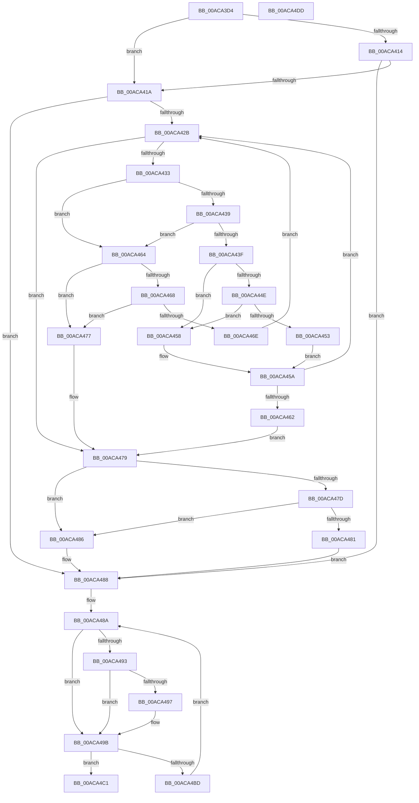

# wil_details_EvaluateFeatureDependencies_ReevaluateCachedFeatureEnabledState

- RVA: `0x00ACA3D4`–`0x00ACA4DE` (길이 `266` bytes)
- VA: `0x0000000140ACA3D4`
- 실행 섹션: `PAGE`
- PDB 이름 있음: `예`; PDB Function 태그: `아니요`
- unwind 정보 RVA: `0x000BE354`
- 디코드: `99`개 명령, `266/266` bytes 표시
- 미해석 바이트: `0` (있으면 어셈블리에 `.byte`로 보존)

> 이 문서는 커널 이미지의 기계어와 PDB 기호를 분석해 생성했습니다. 4번과 5번은 함수 원형과 자료형을 바이너리 사용 방식에서 추정한 C 해석이며 원본 소스 복구 결과는 아닙니다.

## 1. Dependencies

- 직접 호출 지점: **1**; 고유 호출 대상: **1**
- 직접 호출자로 확인된 함수: **1**
- RIP 상대 이미지 참조: **0**

### Outgoing calls
- `0x00ACA445` → [wil_details_EvaluateFeatureDependencies_GetCachedFeatureEnabledState](wil_details_EvaluateFeatureDependencies_GetCachedFeatureEnabledState_function_00AC8844.md) (function, `0x00AC8844`)

### Direct callers
- [wil_details_EvaluateFeatureDependencies_GetCachedFeatureEnabledState](wil_details_EvaluateFeatureDependencies_GetCachedFeatureEnabledState_function_00AC8844.md) at `0x00AC8869`

### Static image references
- 디코드된 RIP-relative 메모리 참조가 없습니다.

## 2. Other-region calls and transfers

- 다른 실행 섹션으로 향하는 call: **0**
- 별도 외부 분기/꼬리 이동을 확인하지 못했습니다.

## 3. Assembly (complete function range)

```asm
00ACA3D4  48 89 5C 24 18                  mov qword ptr [rsp + 0x18], rbx
00ACA3D9  48 89 6C 24 20                  mov qword ptr [rsp + 0x20], rbp
00ACA3DE  56                              push rsi
00ACA3DF  57                              push rdi
00ACA3E0  41 55                           push r13
00ACA3E2  41 56                           push r14
00ACA3E4  41 57                           push r15
00ACA3E6  48 83 EC 20                     sub rsp, 0x20
00ACA3EA  48 83 64 24 58 00               and qword ptr [rsp + 0x58], 0
00ACA3F0  41 BD 01 00 00 00               mov r13d, 1
00ACA3F6  8B F2                           mov esi, edx
00ACA3F8  4C 8B F9                        mov r15, rcx
00ACA3FB  C1 EE 06                        shr esi, 6
00ACA3FE  B9 00 0C 00 00                  mov ecx, 0xc00
00ACA403  8B C2                           mov eax, edx
00ACA405  41 23 F5                        and esi, r13d
00ACA408  23 C1                           and eax, ecx
00ACA40A  48 8B DA                        mov rbx, rdx
00ACA40D  41 8B FD                        mov edi, r13d
00ACA410  3B C1                           cmp eax, ecx
00ACA412  74 06                           je 0x140aca41a
00ACA414  33 ED                           xor ebp, ebp
00ACA416  85 F6                           test esi, esi
00ACA418  74 6E                           je 0x140aca488
00ACA41A  4D 8B 70 20                     mov r14, qword ptr [r8 + 0x20]
00ACA41E  33 ED                           xor ebp, ebp
00ACA420  3B C1                           cmp eax, ecx
00ACA422  40 0F 94 C5                     sete bpl
00ACA426  4D 85 F6                        test r14, r14
00ACA429  74 5D                           je 0x140aca488
00ACA42B  49 8B 06                        mov rax, qword ptr [r14]
00ACA42E  48 85 C0                        test rax, rax
00ACA431  74 46                           je 0x140aca479
00ACA433  80 78 1E 00                     cmp byte ptr [rax + 0x1e], 0
00ACA437  75 2B                           jne 0x140aca464
00ACA439  80 78 1D 00                     cmp byte ptr [rax + 0x1d], 0
00ACA43D  75 25                           jne 0x140aca464
00ACA43F  48 8B 08                        mov rcx, qword ptr [rax]
00ACA442  48 8B D0                        mov rdx, rax
00ACA445  E8 FA E3 FF FF                  call 0x140ac8844
00ACA44A  85 FF                           test edi, edi
00ACA44C  74 0A                           je 0x140aca458
00ACA44E  41 84 C5                        test r13b, al
00ACA451  74 05                           je 0x140aca458
00ACA453  41 8B FD                        mov edi, r13d
00ACA456  EB 02                           jmp 0x140aca45a
00ACA458  33 FF                           xor edi, edi
00ACA45A  49 83 C6 08                     add r14, 8
00ACA45E  85 FF                           test edi, edi
00ACA460  75 C9                           jne 0x140aca42b
00ACA462  EB 15                           jmp 0x140aca479
00ACA464  85 FF                           test edi, edi
00ACA466  74 0F                           je 0x140aca477
00ACA468  80 78 1F 00                     cmp byte ptr [rax + 0x1f], 0
00ACA46C  74 09                           je 0x140aca477
00ACA46E  41 8B FD                        mov edi, r13d
00ACA471  49 83 C6 08                     add r14, 8
00ACA475  EB B4                           jmp 0x140aca42b
00ACA477  33 FF                           xor edi, edi
00ACA479  85 F6                           test esi, esi
00ACA47B  74 09                           je 0x140aca486
00ACA47D  85 FF                           test edi, edi
00ACA47F  74 05                           je 0x140aca486
00ACA481  41 8B F5                        mov esi, r13d
00ACA484  EB 02                           jmp 0x140aca488
00ACA486  33 F6                           xor esi, esi
00ACA488  8B D3                           mov edx, ebx
00ACA48A  83 E2 FE                        and edx, 0xfffffffe
00ACA48D  0B D6                           or edx, esi
00ACA48F  85 ED                           test ebp, ebp
00ACA491  74 08                           je 0x140aca49b
00ACA493  85 FF                           test edi, edi
00ACA495  75 04                           jne 0x140aca49b
00ACA497  0F BA F2 0A                     btr edx, 0xa
00ACA49B  8B C3                           mov eax, ebx
00ACA49D  8B CA                           mov ecx, edx
00ACA49F  41 23 C5                        and eax, r13d
00ACA4A2  83 E1 CF                        and ecx, 0xffffffcf
00ACA4A5  3B C6                           cmp eax, esi
00ACA4A7  8B C3                           mov eax, ebx
00ACA4A9  0F 44 CA                        cmove ecx, edx
00ACA4AC  0F BA F1 09                     btr ecx, 9
00ACA4B0  89 4C 24 58                     mov dword ptr [rsp + 0x58], ecx
00ACA4B4  F0 41 0F B1 0F                  lock cmpxchg dword ptr [r15], ecx
00ACA4B9  8B D0                           mov edx, eax
00ACA4BB  74 04                           je 0x140aca4c1
00ACA4BD  8B D8                           mov ebx, eax
00ACA4BF  EB C9                           jmp 0x140aca48a
00ACA4C1  48 8B 44 24 58                  mov rax, qword ptr [rsp + 0x58]
00ACA4C6  48 8B 5C 24 60                  mov rbx, qword ptr [rsp + 0x60]
00ACA4CB  48 8B 6C 24 68                  mov rbp, qword ptr [rsp + 0x68]
00ACA4D0  48 83 C4 20                     add rsp, 0x20
00ACA4D4  41 5F                           pop r15
00ACA4D6  41 5E                           pop r14
00ACA4D8  41 5D                           pop r13
00ACA4DA  5F                              pop rdi
00ACA4DB  5E                              pop rsi
00ACA4DC  C3                              ret
00ACA4DD  CC                              int3
```

## 4. C-style interpretation (structured pseudocode)

```c
__int64 __fastcall wil_details_EvaluateFeatureDependencies_ReevaluateCachedFeatureEnabledState(__int64 a1, __int64 a2, __int64 a3)
{
    __int64 result;
    __int64 v_r14;
    __int64 v_rbp;
    __int64 v_rdi;
    __int64 v_rsi;
    __int64 v_rsp;
    unsigned __int64 v_stack_p10;
    unsigned __int64 v_stack_p18;
    unsigned __int64 v_stack_p20;

    v_stack_p18 = v_rbx;
    v_stack_p20 = v_rbp;
    v_rsp = (v_rsp) - (32);
    v_rsi = (unsigned int)(((unsigned int)((unsigned int)(a2))) >> (6));
    v_rsi = (unsigned int)((v_rsi) & (1));
    result = (unsigned int)(((unsigned int)((unsigned int)(a2))) & ((unsigned int)((unsigned int)(0xC00ULL))));
    if (((unsigned int)(result)) == ((unsigned int)((unsigned int)(0xC00ULL)))) goto loc_00ACA41A;
    v_rbp = 0;
    if ((unsigned int)(v_rsi) == 0) goto loc_00ACA488;
loc_00ACA41A:
    v_rbp = 0;
    v_rbp = (((unsigned int)(result)) == ((unsigned int)((unsigned int)(0xC00ULL)))) ? 1 : 0;
    if (*(unsigned __int64 *)(a3 + 32) == 0) goto loc_00ACA488;
loc_00ACA42B:
    if (*(unsigned __int64 *)(*(unsigned __int64 *)(a3 + 32)) == 0) goto loc_00ACA479;
    if ((*(unsigned __int8 *)(*(unsigned __int64 *)(*(unsigned __int64 *)(a3 + 32)) + 30)) != 0) goto loc_00ACA464;
    if ((*(unsigned __int8 *)(*(unsigned __int64 *)(*(unsigned __int64 *)(a3 + 32)) + 29)) != 0) goto loc_00ACA464;
    result = wil_details_EvaluateFeatureDependencies_GetCachedFeatureEnabledState(*(unsigned __int64 *)(*(unsigned __int64 *)(*(unsigned __int64 *)(a3 + 32))), *(unsigned __int64 *)(*(unsigned __int64 *)(a3 + 32)), a3, a4);
    if (1 == 0) goto loc_00ACA458;
    if (((1) & ((unsigned __int8)(result))) == 0) goto loc_00ACA458;
    goto loc_00ACA45A;
loc_00ACA458:
    v_rdi = 0;
loc_00ACA45A:
    v_r14 = (*(unsigned __int64 *)(a3 + 32)) + (8);
    if (0 != 0) goto loc_00ACA42B;
    goto loc_00ACA479;
loc_00ACA464:
    if (0 == 0) goto loc_00ACA477;
    if ((*(unsigned __int8 *)(result + 31)) == 0) goto loc_00ACA477;
    v_r14 = (v_r14) + (8);
    goto loc_00ACA42B;
loc_00ACA477:
    v_rdi = 0;
loc_00ACA479:
    if ((unsigned int)(v_rsi) == 0) goto loc_00ACA486;
    if (0 == 0) goto loc_00ACA486;
    goto loc_00ACA488;
loc_00ACA486:
    v_rsi = 0;
loc_00ACA488:
loc_00ACA48A:
    a2 = (unsigned int)(((unsigned int)((unsigned int)(a2))) & (0xFFFFFFFEULL));
    a2 = (unsigned int)((a2) | (0));
    if ((unsigned int)(v_rbp) == 0) goto loc_00ACA49B;
    if (0 == 0) {
    }
    result = (unsigned int)(((unsigned int)((unsigned int)(a2))) & (1));
    a1 = (unsigned int)(((unsigned int)((unsigned int)(a2))) & (0xFFFFFFCFULL));
    if (((unsigned int)(result)) == 0) { a1 = (unsigned int)(a2); }
    v_stack_p10 = (unsigned int)(a1);
    if (((unsigned int)(result)) == 0) goto loc_00ACA4C1;
    goto loc_00ACA48A;
loc_00ACA4C1:
    v_rsp = (v_rsp) + (32);
    return v_stack_p10;
}
```

## 5. (Beta) C Style

```c
int64_t wil_details_EvaluateFeatureDependencies_ReevaluateCachedFeatureEnabledState(void *Arg1, int64_t Arg2, void *Arg3)
{
    uint8_t *arg1 = (uint8_t *)Arg1;
    uint8_t *arg3 = (uint8_t *)Arg3;

    int64_t result;
    int64_t local_r14;
    int64_t local_rbp;
    int64_t local_rdi;
    int64_t local_rsi;
    int64_t local_rsp;
    uint64_t v_stack_p10;
    uint64_t v_stack_p18;
    uint64_t v_stack_p20;

    v_stack_p18 = local_rbx;
    v_stack_p20 = local_rbp;
    local_rsp = (local_rsp) - (32);
    local_rsi = (uint32_t)(((uint32_t)((uint32_t)(Arg2))) >> (6));
    local_rsi = (uint32_t)((local_rsi) & (1));
    result = (uint32_t)(((uint32_t)((uint32_t)(Arg2))) & ((uint32_t)((uint32_t)(0xC00ULL))));
    if (((uint32_t)(result)) == ((uint32_t)((uint32_t)(0xC00ULL)))) goto loc_00ACA41A;
    local_rbp = 0;
    if ((uint32_t)(local_rsi) == 0) goto loc_00ACA488;
loc_00ACA41A:
    local_rbp = 0;
    local_rbp = (((uint32_t)(result)) == ((uint32_t)((uint32_t)(0xC00ULL)))) ? 1 : 0;
    if (*(uint64_t *)(arg3 + 0x20) == 0) goto loc_00ACA488;
loc_00ACA42B:
    if (*(uint64_t *)(*(uint64_t *)(arg3 + 0x20)) == 0) goto loc_00ACA479;
    if ((*(uint8_t *)(*(uint64_t *)(*(uint64_t *)(arg3 + 0x20)) + 0x1E)) != 0) goto loc_00ACA464;
    if ((*(uint8_t *)(*(uint64_t *)(*(uint64_t *)(arg3 + 0x20)) + 0x1D)) != 0) goto loc_00ACA464;
    result = wil_details_EvaluateFeatureDependencies_GetCachedFeatureEnabledState(*(uint64_t *)(*(uint64_t *)(*(uint64_t *)(arg3 + 0x20))), *(uint64_t *)(*(uint64_t *)(arg3 + 0x20)), Arg3, a4);
    if (1 == 0) goto loc_00ACA458;
    if (((1) & ((uint8_t)(result))) == 0) goto loc_00ACA458;
    goto loc_00ACA45A;
loc_00ACA458:
    local_rdi = 0;
loc_00ACA45A:
    local_r14 = (*(uint64_t *)(arg3 + 0x20)) + (8);
    if (0 != 0) goto loc_00ACA42B;
    goto loc_00ACA479;
loc_00ACA464:
    if (0 == 0) goto loc_00ACA477;
    if ((*(uint8_t *)(result + 0x1F)) == 0) goto loc_00ACA477;
    local_r14 = (local_r14) + (8);
    goto loc_00ACA42B;
loc_00ACA477:
    local_rdi = 0;
loc_00ACA479:
    if ((uint32_t)(local_rsi) == 0) goto loc_00ACA486;
    if (0 == 0) goto loc_00ACA486;
    goto loc_00ACA488;
loc_00ACA486:
    local_rsi = 0;
loc_00ACA488:
loc_00ACA48A:
    Arg2 = (uint32_t)(((uint32_t)((uint32_t)(Arg2))) & (0xFFFFFFFEULL));
    Arg2 = (uint32_t)((Arg2) | (0));
    if ((uint32_t)(local_rbp) == 0) goto loc_00ACA49B;
    if (0 == 0) {
    }
    result = (uint32_t)(((uint32_t)((uint32_t)(Arg2))) & (1));
    Arg1 = (uint32_t)(((uint32_t)((uint32_t)(Arg2))) & (0xFFFFFFCFULL));
    if (((uint32_t)(result)) == 0) { Arg1 = (uint32_t)(Arg2); }
    v_stack_p10 = (uint32_t)(Arg1);
    if (((uint32_t)(result)) == 0) goto loc_00ACA4C1;
    goto loc_00ACA48A;
loc_00ACA4C1:
    local_rsp = (local_rsp) + (32);
    return v_stack_p10;
}
```

### 관측된 메모리 오프셋

구조체 형식이 확인되지 않은 접근은 인자 기준의 오프셋으로만 기록했습니다.

| 기준 인자 | 오프셋 표현 | 폭 (bit) | 접근 |
|---|---:|---:|---|
| `Arg1` | `+ 0x0` | `32` | `R` |
| `Arg3` | `+ 0x20` | `64` | `R` |

## 6. Execution-region graph

[열기: 2D/3D 그래프와 함수 탐색 컨트롤 패널](../../../control-panel.html?section=page&rva=0x00ACA3D4&view=graph)

- 2D 그래프는 위에서 아래로 흐르고, 3D 그래프는 빈 공간을 드래그해 회전합니다. Shift+드래그는 이동, 휠은 확대·축소, 함수 노드 선택은 대상 보고서 이동입니다.

### Static fallback


