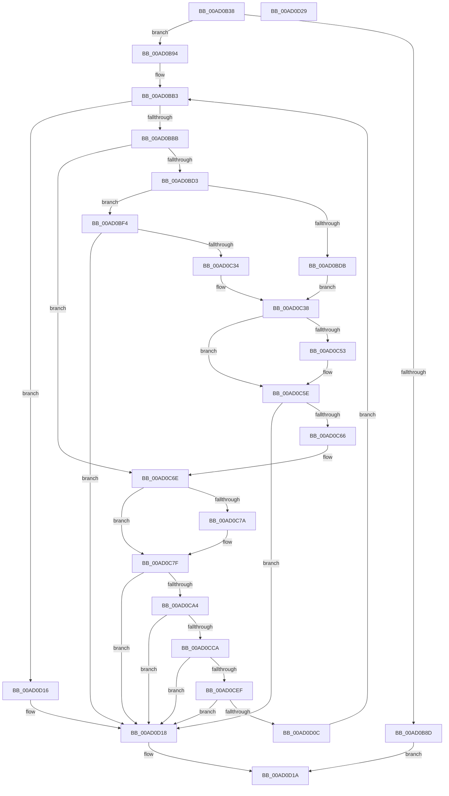

# AdtpBuildObjectTypeStrings

- RVA: `0x00AD0B38`–`0x00AD0D2A` (길이 `498` bytes)
- VA: `0x0000000140AD0B38`
- 실행 섹션: `PAGE`
- PDB 이름 있음: `예`; PDB Function 태그: `아니요`
- unwind 정보 RVA: `0x000BE964`
- 디코드: `142`개 명령, `498/498` bytes 표시
- 미해석 바이트: `0` (있으면 어셈블리에 `.byte`로 보존)

> 이 문서는 커널 이미지의 기계어와 PDB 기호를 분석해 생성했습니다. 4번과 5번은 함수 원형과 자료형을 바이너리 사용 방식에서 추정한 C 해석이며 원본 소스 복구 결과는 아닙니다.

## 1. Dependencies

- 직접 호출 지점: **11**; 고유 호출 대상: **7**
- 직접 호출자로 확인된 함수: **1**
- RIP 상대 이미지 참조: **5**

### Outgoing calls
- `0x00AD0B7C` → [RtlInitUnicodeString](../../text/42/RtlInitUnicodeString_function_0042A780.md) (function, `0x0042A780`)
- `0x00AD0BA7` → [qsort](../../text/50/qsort_function_005009F0.md) (function, `0x005009F0`)
- `0x00AD0BE6` → [RtlInitUnicodeString](../../text/42/RtlInitUnicodeString_function_0042A780.md) (function, `0x0042A780`)
- `0x00AD0C25` → [AdtpBuildAccessesString](../A8/AdtpBuildAccessesString_function_00A8898C.md) (function, `0x00A8898C`)
- `0x00AD0C47` → [AdtpAppendString](../82/AdtpAppendString_function_00822678.md) (function, `0x00822678`)
- `0x00AD0C59` → [ExFreePoolWithTag](../../poolcode/B8/ExFreePoolWithTag_function_00B82870.md) (function, `0x00B82870`)
- `0x00AD0C99` → [AdtpAppendZString](../82/AdtpAppendZString_function_0082282C.md) (function, `0x0082282C`)
- `0x00AD0CBF` → [AdtpBuildGuidString](../82/AdtpBuildGuidString_function_00821EF0.md) (function, `0x00821EF0`)
- `0x00AD0CD9` → [AdtpAppendString](../82/AdtpAppendString_function_00822678.md) (function, `0x00822678`)
- `0x00AD0CE6` → [ExFreePoolWithTag](../../poolcode/B8/ExFreePoolWithTag_function_00B82870.md) (function, `0x00B82870`)
- `0x00AD0D01` → [AdtpAppendZString](../82/AdtpAppendZString_function_0082282C.md) (function, `0x0082282C`)

### Direct callers
- [AdtpPackageParameters](../../text/45/AdtpPackageParameters_function_00459964.md) at `0x0045A1C2`

### Static image references
- `0x00AD0B67` → RVA `0x00013F90` (`.rdata`; read)
- `0x00AD0B97` → RVA `0x0069E070` (`CompareObjectTypes`; read)
- `0x00AD0BDB` → RVA `0x00041A98` (`.rdata`; read)
- `0x00AD0C8E` → RVA `0x0000C1F8` (`.rdata`; read)
- `0x00AD0CF7` → RVA `0x00041AA4` (`.rdata`; read)

## 2. Other-region calls and transfers

- 다른 실행 섹션으로 향하는 call: **5**
  - `0x00AD0B7C` → [RtlInitUnicodeString](../../text/42/RtlInitUnicodeString_function_0042A780.md) (`PAGE` → `.text`)
  - `0x00AD0BA7` → [qsort](../../text/50/qsort_function_005009F0.md) (`PAGE` → `.text`)
  - `0x00AD0BE6` → [RtlInitUnicodeString](../../text/42/RtlInitUnicodeString_function_0042A780.md) (`PAGE` → `.text`)
  - `0x00AD0C59` → [ExFreePoolWithTag](../../poolcode/B8/ExFreePoolWithTag_function_00B82870.md) (`PAGE` → `POOLCODE`)
  - `0x00AD0CE6` → [ExFreePoolWithTag](../../poolcode/B8/ExFreePoolWithTag_function_00B82870.md) (`PAGE` → `POOLCODE`)
- 별도 외부 분기/꼬리 이동을 확인하지 못했습니다.

## 3. Assembly (complete function range)

```asm
00AD0B38  44 89 4C 24 20                  mov dword ptr [rsp + 0x20], r9d
00AD0B3D  48 89 54 24 10                  mov qword ptr [rsp + 0x10], rdx
00AD0B42  48 89 4C 24 08                  mov qword ptr [rsp + 8], rcx
00AD0B47  55                              push rbp
00AD0B48  53                              push rbx
00AD0B49  56                              push rsi
00AD0B4A  57                              push rdi
00AD0B4B  41 54                           push r12
00AD0B4D  41 55                           push r13
00AD0B4F  41 56                           push r14
00AD0B51  48 8B EC                        mov rbp, rsp
00AD0B54  48 83 EC 70                     sub rsp, 0x70
00AD0B58  48 8B 4D 60                     mov rcx, qword ptr [rbp + 0x60]
00AD0B5C  48 8B F2                        mov rsi, rdx
00AD0B5F  0F 57 C0                        xorps xmm0, xmm0
00AD0B62  41 8B D9                        mov ebx, r9d
00AD0B65  33 FF                           xor edi, edi
00AD0B67  48 8D 15 22 34 54 FF            lea rdx, [rip - 0xabcbde]
00AD0B6E  0F 11 45 F0                     movups xmmword ptr [rbp - 0x10], xmm0
00AD0B72  40 88 7D E0                     mov byte ptr [rbp - 0x20], dil
00AD0B76  4D 8B F0                        mov r14, r8
00AD0B79  89 7D E4                        mov dword ptr [rbp - 0x1c], edi
00AD0B7C  E8 FF 9B 95 FF                  call 0x14042a780
00AD0B81  4C 8B 65 68                     mov r12, qword ptr [rbp + 0x68]
00AD0B85  41 88 3C 24                     mov byte ptr [r12], dil
00AD0B89  85 DB                           test ebx, ebx
00AD0B8B  75 07                           jne 0x140ad0b94
00AD0B8D  33 C0                           xor eax, eax
00AD0B8F  E9 86 01 00 00                  jmp 0x140ad0d1a
00AD0B94  48 8B D3                        mov rdx, rbx
00AD0B97  4C 8D 0D D2 D4 BC FF            lea r9, [rip - 0x432b2e]
00AD0B9E  41 B8 18 00 00 00               mov r8d, 0x18
00AD0BA4  49 8B CE                        mov rcx, r14
00AD0BA7  E8 44 FE A2 FF                  call 0x1405009f0
00AD0BAC  45 8B 6E 14                     mov r13d, dword ptr [r14 + 0x14]
00AD0BB0  41 FF CD                        dec r13d
00AD0BB3  3B FB                           cmp edi, ebx
00AD0BB5  0F 83 5B 01 00 00               jae 0x140ad0d16
00AD0BBB  8B C7                           mov eax, edi
00AD0BBD  48 8D 04 40                     lea rax, [rax + rax*2]
00AD0BC1  45 8B 44 C6 14                  mov r8d, dword ptr [r14 + rax*8 + 0x14]
00AD0BC6  48 89 45 E8                     mov qword ptr [rbp - 0x18], rax
00AD0BCA  45 3B C5                        cmp r8d, r13d
00AD0BCD  0F 84 9B 00 00 00               je 0x140ad0c6e
00AD0BD3  45 8B E8                        mov r13d, r8d
00AD0BD6  45 85 C0                        test r8d, r8d
00AD0BD9  75 19                           jne 0x140ad0bf4
00AD0BDB  48 8D 15 B6 0E 57 FF            lea rdx, [rip - 0xa8f14a]
00AD0BE2  48 8D 4D F0                     lea rcx, [rbp - 0x10]
00AD0BE6  E8 95 9B 95 FF                  call 0x14042a780
00AD0BEB  40 32 F6                        xor sil, sil
00AD0BEE  40 88 75 E0                     mov byte ptr [rbp - 0x20], sil
00AD0BF2  EB 44                           jmp 0x140ad0c38
00AD0BF4  48 8B 4D 40                     mov rcx, qword ptr [rbp + 0x40]
00AD0BF8  48 8D 45 E0                     lea rax, [rbp - 0x20]
00AD0BFC  48 89 44 24 40                  mov qword ptr [rsp + 0x40], rax
00AD0C01  41 B9 01 00 00 00               mov r9d, 1
00AD0C07  48 83 64 24 38 00               and qword ptr [rsp + 0x38], 0
00AD0C0D  48 8D 45 F0                     lea rax, [rbp - 0x10]
00AD0C11  48 83 64 24 30 00               and qword ptr [rsp + 0x30], 0
00AD0C17  48 8B D6                        mov rdx, rsi
00AD0C1A  48 83 64 24 28 00               and qword ptr [rsp + 0x28], 0
00AD0C20  48 89 44 24 20                  mov qword ptr [rsp + 0x20], rax
00AD0C25  E8 62 7D FB FF                  call 0x140a8898c
00AD0C2A  8B D8                           mov ebx, eax
00AD0C2C  85 C0                           test eax, eax
00AD0C2E  0F 88 E4 00 00 00               js 0x140ad0d18
00AD0C34  40 8A 75 E0                     mov sil, byte ptr [rbp - 0x20]
00AD0C38  48 8B 4D 60                     mov rcx, qword ptr [rbp + 0x60]
00AD0C3C  4C 8D 4D E4                     lea r9, [rbp - 0x1c]
00AD0C40  4C 8D 45 F0                     lea r8, [rbp - 0x10]
00AD0C44  49 8B D4                        mov rdx, r12
00AD0C47  E8 2C 1A D5 FF                  call 0x140822678
00AD0C4C  8B D8                           mov ebx, eax
00AD0C4E  40 84 F6                        test sil, sil
00AD0C51  74 0B                           je 0x140ad0c5e
00AD0C53  48 8B 4D F8                     mov rcx, qword ptr [rbp - 8]
00AD0C57  33 D2                           xor edx, edx
00AD0C59  E8 12 1C 0B 00                  call 0x140b82870
00AD0C5E  85 DB                           test ebx, ebx
00AD0C60  0F 88 B2 00 00 00               js 0x140ad0d18
00AD0C66  48 8B 45 E8                     mov rax, qword ptr [rbp - 0x18]
00AD0C6A  48 8B 75 48                     mov rsi, qword ptr [rbp + 0x48]
00AD0C6E  41 0F B7 44 C6 12               movzx eax, word ptr [r14 + rax*8 + 0x12]
00AD0C74  66 83 F8 04                     cmp ax, 4
00AD0C78  72 05                           jb 0x140ad0c7f
00AD0C7A  B8 03 00 00 00                  mov eax, 3
00AD0C7F  48 8B 4D 60                     mov rcx, qword ptr [rbp + 0x60]
00AD0C83  4C 8D 4D E4                     lea r9, [rbp - 0x1c]
00AD0C87  44 0F B7 C0                     movzx r8d, ax
00AD0C8B  49 8B D4                        mov rdx, r12
00AD0C8E  48 8D 05 63 B5 53 FF            lea rax, [rip - 0xac4a9d]
00AD0C95  4E 8B 04 C0                     mov r8, qword ptr [rax + r8*8]
00AD0C99  E8 8E 1B D5 FF                  call 0x14082282c
00AD0C9E  8B D8                           mov ebx, eax
00AD0CA0  85 C0                           test eax, eax
00AD0CA2  78 74                           js 0x140ad0d18
00AD0CA4  8B C7                           mov eax, edi
00AD0CA6  48 8D 55 F0                     lea rdx, [rbp - 0x10]
00AD0CAA  C6 45 E1 00                     mov byte ptr [rbp - 0x1f], 0
00AD0CAE  48 8D 0C 40                     lea rcx, [rax + rax*2]
00AD0CB2  48 8D 45 E1                     lea rax, [rbp - 0x1f]
00AD0CB6  49 8D 0C CE                     lea rcx, [r14 + rcx*8]
00AD0CBA  48 89 44 24 28                  mov qword ptr [rsp + 0x28], rax
00AD0CBF  E8 2C 12 D5 FF                  call 0x140821ef0
00AD0CC4  8B D8                           mov ebx, eax
00AD0CC6  85 C0                           test eax, eax
00AD0CC8  78 4E                           js 0x140ad0d18
00AD0CCA  48 8B 4D 60                     mov rcx, qword ptr [rbp + 0x60]
00AD0CCE  4C 8D 4D E4                     lea r9, [rbp - 0x1c]
00AD0CD2  4C 8D 45 F0                     lea r8, [rbp - 0x10]
00AD0CD6  49 8B D4                        mov rdx, r12
00AD0CD9  E8 9A 19 D5 FF                  call 0x140822678
00AD0CDE  48 8B 4D F8                     mov rcx, qword ptr [rbp - 8]
00AD0CE2  33 D2                           xor edx, edx
00AD0CE4  8B D8                           mov ebx, eax
00AD0CE6  E8 85 1B 0B 00                  call 0x140b82870
00AD0CEB  85 DB                           test ebx, ebx
00AD0CED  78 29                           js 0x140ad0d18
00AD0CEF  48 8B 4D 60                     mov rcx, qword ptr [rbp + 0x60]
00AD0CF3  4C 8D 4D E4                     lea r9, [rbp - 0x1c]
00AD0CF7  4C 8D 05 A6 0D 57 FF            lea r8, [rip - 0xa8f25a]
00AD0CFE  49 8B D4                        mov rdx, r12
00AD0D01  E8 26 1B D5 FF                  call 0x14082282c
00AD0D06  8B D8                           mov ebx, eax
00AD0D08  85 C0                           test eax, eax
00AD0D0A  78 0C                           js 0x140ad0d18
00AD0D0C  8B 5D 58                        mov ebx, dword ptr [rbp + 0x58]
00AD0D0F  FF C7                           inc edi
00AD0D11  E9 9D FE FF FF                  jmp 0x140ad0bb3
00AD0D16  33 DB                           xor ebx, ebx
00AD0D18  8B C3                           mov eax, ebx
00AD0D1A  48 83 C4 70                     add rsp, 0x70
00AD0D1E  41 5E                           pop r14
00AD0D20  41 5D                           pop r13
00AD0D22  41 5C                           pop r12
00AD0D24  5F                              pop rdi
00AD0D25  5E                              pop rsi
00AD0D26  5B                              pop rbx
00AD0D27  5D                              pop rbp
00AD0D28  C3                              ret
00AD0D29  CC                              int3
```

## 4. C-style interpretation (structured pseudocode)

```c
__int64 __fastcall AdtpBuildObjectTypeStrings(__int64 a1, __int64 a2, __int64 a3, int a4, __int64 a5, __int64 a6)
{
    __int64 result;
    __int64 v_r13;
    __int64 v_rbx;
    __int64 v_rdi;
    __int64 v_rsi;
    __int64 v_rsp;
    unsigned __int64 v_stack_m40;
    unsigned __int64 v_stack_m48;
    unsigned __int64 v_stack_m50;
    unsigned int v_stack_m54;
    unsigned __int8 v_stack_m57;
    unsigned __int8 v_stack_m58;
    unsigned __int64 v_stack_m68;
    unsigned __int64 v_stack_m70;
    unsigned __int64 v_stack_m78;
    unsigned __int64 v_stack_m80;
    unsigned __int64 v_stack_m88;
    unsigned __int64 v_stack_p10;
    unsigned int v_stack_p20;
    unsigned __int64 v_stack_p8;

    v_stack_p20 = a4;
    v_stack_p10 = a2;
    v_stack_p8 = a1;
    v_rsp = (v_rsp) - (112);
    v_rdi = 0;
    v_stack_m48 = v_xmm0;
    v_stack_m58 = 0;
    v_stack_m54 = 0;
    result = RtlInitUnicodeString(a5, v_rip - 11258846, a3, a4);
    *(unsigned __int8 *)(a6) = 0;
    if ((unsigned int)((unsigned int)(a4)) != 0) goto loc_00AD0B94;
    result = 0;
    goto loc_00AD0D1A;
loc_00AD0B94:
    result = qsort(a3, (unsigned int)(a4), 24, v_rip - 4401966);
    v_r13 = (unsigned int)(((unsigned int)(*(unsigned int *)(a3 + 20))) - 1);
loc_00AD0BB3:
    if (0 >= ((unsigned int)((unsigned int)(a4)))) goto loc_00AD0D16;
    v_stack_m50 = 0 + 0 * 2;
    if (((unsigned int)((unsigned int)(*(unsigned int *)(a3 + 0 + 0 * 2 * 8 + 20)))) == ((unsigned int)(v_r13))) goto loc_00AD0C6E;
    if ((unsigned int)((unsigned int)(*(unsigned int *)(a3 + 0 + 0 * 2 * 8 + 20))) != 0) goto loc_00AD0BF4;
    result = RtlInitUnicodeString(v_stack_m48, v_rip - 11071818, (unsigned int)(*(unsigned int *)(a3 + 0 + 0 * 2 * 8 + 20)), v_rip - 4401966);
    v_rsi = 0;
    v_stack_m58 = 0;
    goto loc_00AD0C38;
loc_00AD0BF4:
    v_stack_m68 = v_stack_m58;
    v_stack_m88 = v_stack_m48;
    result = AdtpBuildAccessesString(v_stack_p8, 0, (unsigned int)(*(unsigned int *)(a3 + 0 + 0 * 2 * 8 + 20)), 1);
    if (sign_flag) goto loc_00AD0D18;
loc_00AD0C38:
    result = AdtpAppendString(a5, a6, v_stack_m48, v_stack_m54);
    if ((unsigned __int8)(v_stack_m58) != 0) {
        a1 = v_stack_m40;
        a2 = 0;
        result = ExFreePoolWithTag(a1, a2, v_stack_m48, v_stack_m54);
    }
    if (sign_flag) goto loc_00AD0D18;
loc_00AD0C6E:
    result = *(unsigned __int16 *)(a3 + v_stack_m50 * 8 + 18);
    if (((unsigned __int16)(*(unsigned __int16 *)(a3 + v_stack_m50 * 8 + 18))) >= 4) {
        result = 3;
    }
    result = AdtpAppendZString(a5, a6, *(unsigned __int64 *)(v_rip - 11291293 + (unsigned __int16)(result) * 8), v_stack_m54);
    if (sign_flag) goto loc_00AD0D18;
    v_stack_m57 = 0;
    v_stack_m80 = v_stack_m57;
    result = AdtpBuildGuidString(a3 + 0 + 0 * 2 * 8, v_stack_m48, *(unsigned __int64 *)(v_rip - 11291293 + (unsigned __int16)(result) * 8), v_stack_m54);
    if (sign_flag) goto loc_00AD0D18;
    result = AdtpAppendString(a5, a6, v_stack_m48, v_stack_m54);
    a2 = 0;
    result = ExFreePoolWithTag(v_stack_m40, a2, v_stack_m48, v_stack_m54);
    if (sign_flag) goto loc_00AD0D18;
    result = AdtpAppendZString(a5, a6, v_rip - 11072090, v_stack_m54);
    if (sign_flag) goto loc_00AD0D18;
    v_rdi = (unsigned int)((v_rdi) + 1);
    goto loc_00AD0BB3;
loc_00AD0D16:
    v_rbx = 0;
loc_00AD0D18:
loc_00AD0D1A:
    v_rsp = (v_rsp) + (112);
    return 0;
}
```

## 5. (Beta) C Style

```c
int64_t AdtpBuildObjectTypeStrings(int64_t Arg1, int64_t Arg2, void *Arg3, int32_t Arg4, int64_t Arg5, void *Arg6)
{
    uint8_t *arg3 = (uint8_t *)Arg3;
    uint8_t *arg6 = (uint8_t *)Arg6;

    int64_t result;
    int64_t local_r13;
    int64_t local_rbx;
    int64_t local_rdi;
    int64_t local_rsi;
    int64_t local_rsp;
    uint64_t v_stack_m40;
    uint64_t v_stack_m48;
    uint64_t v_stack_m50;
    uint32_t v_stack_m54;
    uint8_t v_stack_m57;
    uint8_t v_stack_m58;
    uint64_t v_stack_m68;
    uint64_t v_stack_m70;
    uint64_t v_stack_m78;
    uint64_t v_stack_m80;
    uint64_t v_stack_m88;
    uint64_t v_stack_p10;
    uint32_t v_stack_p20;
    uint64_t v_stack_p8;

    v_stack_p20 = Arg4;
    v_stack_p10 = Arg2;
    v_stack_p8 = Arg1;
    local_rsp = (local_rsp) - (112);
    local_rdi = 0;
    v_stack_m48 = v_xmm0;
    v_stack_m58 = 0;
    v_stack_m54 = 0;
    result = RtlInitUnicodeString(Arg5, v_rip - 11258846, Arg3, Arg4);
    *(uint8_t *)(arg6) = 0;
    if ((uint32_t)((uint32_t)(Arg4)) != 0) goto loc_00AD0B94;
    result = 0;
    goto loc_00AD0D1A;
loc_00AD0B94:
    result = qsort(Arg3, (uint32_t)(Arg4), 24, v_rip - 4401966);
    local_r13 = (uint32_t)(((uint32_t)(*(uint32_t *)(arg3 + 0x14))) - 1);
loc_00AD0BB3:
    if (0 >= ((uint32_t)((uint32_t)(Arg4)))) goto loc_00AD0D16;
    v_stack_m50 = 0 + 0 * 2;
    if (((uint32_t)((uint32_t)(*(uint32_t *)(arg3 + 0x0 + 0x0 * 2 * 8 + 0x14)))) == ((uint32_t)(local_r13))) goto loc_00AD0C6E;
    if ((uint32_t)((uint32_t)(*(uint32_t *)(arg3 + 0x0 + 0x0 * 2 * 8 + 0x14))) != 0) goto loc_00AD0BF4;
    result = RtlInitUnicodeString(v_stack_m48, v_rip - 11071818, (uint32_t)(*(uint32_t *)(arg3 + 0x0 + 0x0 * 2 * 8 + 0x14)), v_rip - 4401966);
    local_rsi = 0;
    v_stack_m58 = 0;
    goto loc_00AD0C38;
loc_00AD0BF4:
    v_stack_m68 = v_stack_m58;
    v_stack_m88 = v_stack_m48;
    result = AdtpBuildAccessesString(v_stack_p8, 0, (uint32_t)(*(uint32_t *)(arg3 + 0x0 + 0x0 * 2 * 8 + 0x14)), 1);
    if (sign_flag) goto loc_00AD0D18;
loc_00AD0C38:
    result = AdtpAppendString(Arg5, Arg6, v_stack_m48, v_stack_m54);
    if ((uint8_t)(v_stack_m58) != 0) {
        Arg1 = v_stack_m40;
        Arg2 = 0;
        result = ExFreePoolWithTag(Arg1, Arg2, v_stack_m48, v_stack_m54);
    }
    if (sign_flag) goto loc_00AD0D18;
loc_00AD0C6E:
    result = *(uint16_t *)(arg3 + v_stack_m50 * 8 + 0x12);
    if (((uint16_t)(*(uint16_t *)(arg3 + v_stack_m50 * 8 + 0x12))) >= 4) {
        result = 3;
    }
    result = AdtpAppendZString(Arg5, Arg6, *(uint64_t *)(v_rip - 0xAC4A9D + (uint16_t)(result) * 8), v_stack_m54);
    if (sign_flag) goto loc_00AD0D18;
    v_stack_m57 = 0;
    v_stack_m80 = v_stack_m57;
    result = AdtpBuildGuidString(Arg3 + 0 + 0 * 2 * 8, v_stack_m48, *(uint64_t *)(v_rip - 0xAC4A9D + (uint16_t)(result) * 8), v_stack_m54);
    if (sign_flag) goto loc_00AD0D18;
    result = AdtpAppendString(Arg5, Arg6, v_stack_m48, v_stack_m54);
    Arg2 = 0;
    result = ExFreePoolWithTag(v_stack_m40, Arg2, v_stack_m48, v_stack_m54);
    if (sign_flag) goto loc_00AD0D18;
    result = AdtpAppendZString(Arg5, Arg6, v_rip - 11072090, v_stack_m54);
    if (sign_flag) goto loc_00AD0D18;
    local_rdi = (uint32_t)((local_rdi) + 1);
    goto loc_00AD0BB3;
loc_00AD0D16:
    local_rbx = 0;
loc_00AD0D18:
loc_00AD0D1A:
    local_rsp = (local_rsp) + (112);
    return 0;
}
```

### 관측된 메모리 오프셋

구조체 형식이 확인되지 않은 접근은 인자 기준의 오프셋으로만 기록했습니다.

| 기준 인자 | 오프셋 표현 | 폭 (bit) | 접근 |
|---|---:|---:|---|
| `Arg3` | `+ 0x0 + rcx*8` | `64` | `R` |
| `Arg3` | `+ 0x12 + rax*8` | `16` | `R` |
| `Arg3` | `+ 0x14` | `32` | `R` |
| `Arg3` | `+ 0x14 + rax*8` | `32` | `R` |
| `Arg6` | `+ 0x0` | `8` | `W` |

## 6. Execution-region graph

[열기: 2D/3D 그래프와 함수 탐색 컨트롤 패널](../../../control-panel.html?section=page&rva=0x00AD0B38&view=graph)

- 2D 그래프는 위에서 아래로 흐르고, 3D 그래프는 빈 공간을 드래그해 회전합니다. Shift+드래그는 이동, 휠은 확대·축소, 함수 노드 선택은 대상 보고서 이동입니다.

### Static fallback


