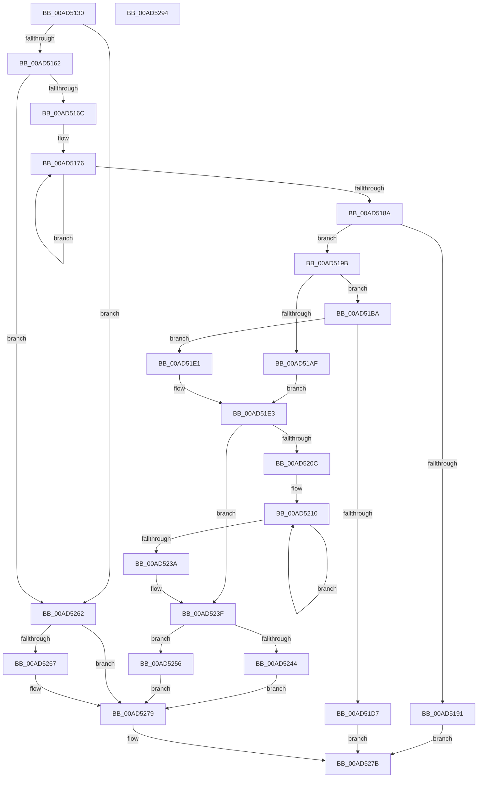

# AdtpBuildStringListString

- RVA: `0x00AD5130`–`0x00AD5295` (길이 `357` bytes)
- VA: `0x0000000140AD5130`
- 실행 섹션: `PAGE`
- PDB 이름 있음: `예`; PDB Function 태그: `아니요`
- unwind 정보 RVA: `0x00084C9C`
- 디코드: `102`개 명령, `357/357` bytes 표시
- 미해석 바이트: `0` (있으면 어셈블리에 `.byte`로 보존)

> 이 문서는 커널 이미지의 기계어와 PDB 기호를 분석해 생성했습니다. 4번과 5번은 함수 원형과 자료형을 바이너리 사용 방식에서 추정한 C 해석이며 원본 소스 복구 결과는 아닙니다.

## 1. Dependencies

- 직접 호출 지점: **3**; 고유 호출 대상: **3**
- 직접 호출자로 확인된 함수: **1**
- RIP 상대 이미지 참조: **2**

### Outgoing calls
- `0x00AD51CA` → [ExAllocatePool2](../../poolcode/B8/ExAllocatePool2_function_00B820F0.md) (function, `0x00B820F0`)
- `0x00AD521C` → [RtlAppendUnicodeToString](../../text/40/RtlAppendUnicodeToString_function_0040F990.md) (function, `0x0040F990`)
- `0x00AD5229` → [RtlAppendUnicodeStringToString](../../text/40/RtlAppendUnicodeStringToString_function_0040FA50.md) (function, `0x0040FA50`)

### Direct callers
- [AdtpPackageParameters](../../text/45/AdtpPackageParameters_function_00459964.md) at `0x0045A228`

### Static image references
- `0x00AD5210` → RVA `0x00041988` (`.rdata`; read)
- `0x00AD5267` → RVA `0x0001E0B0` (`.rdata`; read)

## 2. Other-region calls and transfers

- 다른 실행 섹션으로 향하는 call: **3**
  - `0x00AD51CA` → [ExAllocatePool2](../../poolcode/B8/ExAllocatePool2_function_00B820F0.md) (`PAGE` → `POOLCODE`)
  - `0x00AD521C` → [RtlAppendUnicodeToString](../../text/40/RtlAppendUnicodeToString_function_0040F990.md) (`PAGE` → `.text`)
  - `0x00AD5229` → [RtlAppendUnicodeStringToString](../../text/40/RtlAppendUnicodeStringToString_function_0040FA50.md) (`PAGE` → `.text`)
- 별도 외부 분기/꼬리 이동을 확인하지 못했습니다.

## 3. Assembly (complete function range)

```asm
00AD5130  48 8B C4                        mov rax, rsp
00AD5133  48 89 58 08                     mov qword ptr [rax + 8], rbx
00AD5137  48 89 68 10                     mov qword ptr [rax + 0x10], rbp
00AD513B  48 89 70 18                     mov qword ptr [rax + 0x18], rsi
00AD513F  57                              push rdi
00AD5140  41 56                           push r14
00AD5142  41 57                           push r15
00AD5144  48 83 EC 30                     sub rsp, 0x30
00AD5148  45 33 FF                        xor r15d, r15d
00AD514B  49 8B D8                        mov rbx, r8
00AD514E  44 89 78 DC                     mov dword ptr [rax - 0x24], r15d
00AD5152  48 8B F1                        mov rsi, rcx
00AD5155  41 8D 7F 02                     lea edi, [r15 + 2]
00AD5159  48 85 C9                        test rcx, rcx
00AD515C  0F 84 00 01 00 00               je 0x140ad5262
00AD5162  8B 01                           mov eax, dword ptr [rcx]
00AD5164  85 C0                           test eax, eax
00AD5166  0F 84 F6 00 00 00               je 0x140ad5262
00AD516C  48 8B 49 08                     mov rcx, qword ptr [rcx + 8]
00AD5170  8B D0                           mov edx, eax
00AD5172  48 83 C1 08                     add rcx, 8
00AD5176  0F B7 01                        movzx eax, word ptr [rcx]
00AD5179  48 8D 49 18                     lea rcx, [rcx + 0x18]
00AD517D  83 C0 08                        add eax, 8
00AD5180  03 F8                           add edi, eax
00AD5182  8B C7                           mov eax, edi
00AD5184  48 83 EA 01                     sub rdx, 1
00AD5188  75 EC                           jne 0x140ad5176
00AD518A  3D FF FF 00 00                  cmp eax, 0xffff
00AD518F  76 0A                           jbe 0x140ad519b
00AD5191  B8 0D 00 00 C0                  mov eax, 0xc000000d
00AD5196  E9 E0 00 00 00                  jmp 0x140ad527b
00AD519B  48 8B 4C 24 70                  mov rcx, qword ptr [rsp + 0x70]
00AD51A0  D1 EF                           shr edi, 1
00AD51A2  8B 01                           mov eax, dword ptr [rcx]
00AD51A4  8D 14 38                        lea edx, [rax + rdi]
00AD51A7  81 FA 00 04 00 00               cmp edx, 0x400
00AD51AD  73 0B                           jae 0x140ad51ba
00AD51AF  89 11                           mov dword ptr [rcx], edx
00AD51B1  49 8D 2C 41                     lea rbp, [r9 + rax*2]
00AD51B5  41 8A CF                        mov cl, r15b
00AD51B8  EB 29                           jmp 0x140ad51e3
00AD51BA  8B D7                           mov edx, edi
00AD51BC  B9 00 01 00 00                  mov ecx, 0x100
00AD51C1  48 03 D2                        add rdx, rdx
00AD51C4  41 B8 53 65 41 6B               mov r8d, 0x6b416553
00AD51CA  E8 21 CF 0A 00                  call 0x140b820f0
00AD51CF  48 8B E8                        mov rbp, rax
00AD51D2  48 85 C0                        test rax, rax
00AD51D5  75 0A                           jne 0x140ad51e1
00AD51D7  B8 17 00 00 C0                  mov eax, 0xc0000017
00AD51DC  E9 9A 00 00 00                  jmp 0x140ad527b
00AD51E1  B1 01                           mov cl, 1
00AD51E3  48 8B 44 24 78                  mov rax, qword ptr [rsp + 0x78]
00AD51E8  66 03 FF                        add di, di
00AD51EB  45 8B F7                        mov r14d, r15d
00AD51EE  88 08                           mov byte ptr [rax], cl
00AD51F0  41 0F B7 C7                     movzx eax, r15w
00AD51F4  66 89 7C 24 22                  mov word ptr [rsp + 0x22], di
00AD51F9  48 8B 7E 08                     mov rdi, qword ptr [rsi + 8]
00AD51FD  66 89 44 24 20                  mov word ptr [rsp + 0x20], ax
00AD5202  48 89 6C 24 28                  mov qword ptr [rsp + 0x28], rbp
00AD5207  44 39 3E                        cmp dword ptr [rsi], r15d
00AD520A  76 33                           jbe 0x140ad523f
00AD520C  48 83 C7 08                     add rdi, 8
00AD5210  48 8D 15 71 C7 56 FF            lea rdx, [rip - 0xa9388f]
00AD5217  48 8D 4C 24 20                  lea rcx, [rsp + 0x20]
00AD521C  E8 6F A7 93 FF                  call 0x14040f990
00AD5221  48 8B D7                        mov rdx, rdi
00AD5224  48 8D 4C 24 20                  lea rcx, [rsp + 0x20]
00AD5229  E8 22 A8 93 FF                  call 0x14040fa50
00AD522E  41 FF C6                        inc r14d
00AD5231  48 83 C7 18                     add rdi, 0x18
00AD5235  44 3B 36                        cmp r14d, dword ptr [rsi]
00AD5238  72 D6                           jb 0x140ad5210
00AD523A  0F B7 44 24 20                  movzx eax, word ptr [rsp + 0x20]
00AD523F  48 85 DB                        test rbx, rbx
00AD5242  74 12                           je 0x140ad5256
00AD5244  0F B7 C0                        movzx eax, ax
00AD5247  83 C0 02                        add eax, 2
00AD524A  48 89 2B                        mov qword ptr [rbx], rbp
00AD524D  89 43 08                        mov dword ptr [rbx + 8], eax
00AD5250  44 89 7B 0C                     mov dword ptr [rbx + 0xc], r15d
00AD5254  EB 23                           jmp 0x140ad5279
00AD5256  0F 10 44 24 20                  movups xmm0, xmmword ptr [rsp + 0x20]
00AD525B  F3 41 0F 7F 07                  movdqu xmmword ptr [r15], xmm0
00AD5260  EB 17                           jmp 0x140ad5279
00AD5262  48 85 DB                        test rbx, rbx
00AD5265  74 12                           je 0x140ad5279
00AD5267  48 8D 05 42 8E 54 FF            lea rax, [rip - 0xab71be]
00AD526E  49 C7 40 08 04 00 00 00         mov qword ptr [r8 + 8], 4
00AD5276  49 89 00                        mov qword ptr [r8], rax
00AD5279  33 C0                           xor eax, eax
00AD527B  48 8B 5C 24 50                  mov rbx, qword ptr [rsp + 0x50]
00AD5280  48 8B 6C 24 58                  mov rbp, qword ptr [rsp + 0x58]
00AD5285  48 8B 74 24 60                  mov rsi, qword ptr [rsp + 0x60]
00AD528A  48 83 C4 30                     add rsp, 0x30
00AD528E  41 5F                           pop r15
00AD5290  41 5E                           pop r14
00AD5292  5F                              pop rdi
00AD5293  C3                              ret
00AD5294  CC                              int3
```

## 4. C-style interpretation (structured pseudocode)

```c
__int64 __fastcall AdtpBuildStringListString(__int64 a1, __int64 a2, __int64 a3, __int64 a4, __int64 a5, __int64 a6)
{
    __int64 result;
    __int64 v_r14;
    __int64 v_r15;
    __int64 v_rdi;
    __int64 v_rsp;
    unsigned __int64 v_stack_m20;
    unsigned __int16 v_stack_m26;
    unsigned __int16 v_stack_m28;
    unsigned __int64 v_stack_p10;
    unsigned __int64 v_stack_p18;
    unsigned __int64 v_stack_p8;

    *(unsigned __int64 *)(v_rsp + 8) = v_rbx;
    *(unsigned __int64 *)(v_rsp + 16) = v_rbp;
    *(unsigned __int64 *)(v_rsp + 24) = v_rsi;
    v_rsp = (v_rsp) - (48);
    v_r15 = 0;
    *(unsigned int *)(v_rsp - 36) = 0;
    if (a1 == 0) goto loc_00AD5262;
    if ((unsigned int)((unsigned int)(*(unsigned int *)(a1))) == 0) goto loc_00AD5262;
    a1 = (*(unsigned __int64 *)(a1 + 8)) + (8);
loc_00AD5176:
    result = (unsigned int)((*(unsigned __int16 *)(a1)) + (8));
    v_rdi = (unsigned int)((v_r15 + 2) + ((unsigned int)(result)));
    a2 = ((unsigned int)((unsigned int)((unsigned int)(*(unsigned int *)(a1))))) - (1);
    if (condition_is_not_equal) goto loc_00AD5176;
    if (((unsigned int)((unsigned int)((unsigned int)(v_rdi)))) <= 0xFFFFULL) goto loc_00AD519B;
    goto loc_00AD527B;
loc_00AD519B:
    v_rdi = (unsigned int)((v_rdi) >> (1));
    if (((unsigned int)((unsigned int)(*(unsigned int *)(a5)) + v_rdi * 1)) >= 0x400ULL) goto loc_00AD51BA;
    *(unsigned int *)(a5) = (unsigned int)((unsigned int)(*(unsigned int *)(a5)) + v_rdi * 1);
    goto loc_00AD51E3;
loc_00AD51BA:
    a2 = ((unsigned int)((unsigned int)(v_rdi))) + ((unsigned int)((unsigned int)(v_rdi)));
    result = ExAllocatePool2(256, a2, (unsigned int)(0x6B416553ULL), a4);
    if (result != 0) goto loc_00AD51E1;
    goto loc_00AD527B;
loc_00AD51E1:
loc_00AD51E3:
    v_rdi = (unsigned __int16)((v_rdi) + ((unsigned __int16)(v_rdi)));
    *(unsigned __int8 *)(a6) = 1;
    v_stack_m26 = (unsigned __int16)(v_rdi);
    v_stack_m28 = 0;
    v_stack_m20 = result;
    if ((*(unsigned int *)(a1)) <= 0) goto loc_00AD523F;
    v_rdi = (*(unsigned __int64 *)(a1 + 8)) + (8);
loc_00AD5210:
    result = RtlAppendUnicodeToString(v_stack_m28, v_rip - 11090063, (unsigned int)(0x6B416553ULL), a4);
    result = RtlAppendUnicodeStringToString(v_stack_m28, v_rdi, (unsigned int)(0x6B416553ULL), a4);
    v_r14 = (unsigned int)((0) + 1);
    v_rdi = (v_rdi) + (24);
    if (((unsigned int)(v_r14)) < (*(unsigned int *)(a1))) goto loc_00AD5210;
loc_00AD523F:
    if (a3 == 0) goto loc_00AD5256;
    result = (unsigned int)(((unsigned __int16)(v_stack_m28)) + (2));
    *(unsigned __int64 *)(a3) = result;
    *(unsigned int *)(a3 + 8) = (unsigned int)(result);
    *(unsigned int *)(a3 + 12) = 0;
    goto loc_00AD5279;
loc_00AD5256:
    *(unsigned __int64 *)(v_r15) = v_xmm0;
    goto loc_00AD5279;
loc_00AD5262:
    if (a3 != 0) {
        result = v_rip - 11235774;
        *(unsigned __int64 *)((unsigned int)(0x6B416553ULL) + 8) = 4;
        *(unsigned __int64 *)((unsigned int)(0x6B416553ULL)) = result;
    }
    result = 0;
loc_00AD527B:
    v_rsp = (v_rsp) + (48);
    return result;
}
```

## 5. (Beta) C Style

```c
int64_t AdtpBuildStringListString(void *Arg1, int64_t Arg2, void *Arg3, void *Arg4, void *Arg5, void *Arg6)
{
    uint8_t *arg1 = (uint8_t *)Arg1;
    uint8_t *arg3 = (uint8_t *)Arg3;
    uint8_t *arg4 = (uint8_t *)Arg4;
    uint8_t *arg5 = (uint8_t *)Arg5;
    uint8_t *arg6 = (uint8_t *)Arg6;

    int64_t result;
    int64_t local_r14;
    int64_t local_r15;
    int64_t local_rdi;
    int64_t local_rsp;
    uint64_t v_stack_m20;
    uint16_t v_stack_m26;
    uint16_t v_stack_m28;
    uint64_t v_stack_p10;
    uint64_t v_stack_p18;
    uint64_t v_stack_p8;

    *(uint64_t *)(local_rsp + 0x8) = local_rbx;
    *(uint64_t *)(local_rsp + 0x10) = local_rbp;
    *(uint64_t *)(local_rsp + 0x18) = local_rsi;
    local_rsp = (local_rsp) - (48);
    local_r15 = 0;
    *(uint32_t *)(local_rsp - 0x24) = 0;
    if (Arg1 == NULL) goto loc_00AD5262;
    if ((uint32_t)((uint32_t)(*(uint32_t *)(arg1))) == 0) goto loc_00AD5262;
    Arg1 = (*(uint64_t *)(arg1 + 0x8)) + (8);
loc_00AD5176:
    result = (uint32_t)((*(uint16_t *)(arg1)) + (8));
    local_rdi = (uint32_t)((local_r15 + 2) + ((uint32_t)(result)));
    Arg2 = ((uint32_t)((uint32_t)((uint32_t)(*(uint32_t *)(arg1))))) - (1);
    if (condition_is_not_equal) goto loc_00AD5176;
    if (((uint32_t)((uint32_t)((uint32_t)(local_rdi)))) <= 0xFFFFULL) goto loc_00AD519B;
    goto loc_00AD527B;
loc_00AD519B:
    local_rdi = (uint32_t)((local_rdi) >> (1));
    if (((uint32_t)((uint32_t)(*(uint32_t *)(arg5)) + local_rdi * 1)) >= 0x400ULL) goto loc_00AD51BA;
    *(uint32_t *)(arg5) = (uint32_t)((uint32_t)(*(uint32_t *)(arg5)) + local_rdi * 1);
    goto loc_00AD51E3;
loc_00AD51BA:
    Arg2 = ((uint32_t)((uint32_t)(local_rdi))) + ((uint32_t)((uint32_t)(local_rdi)));
    result = ExAllocatePool2(256, Arg2, (uint32_t)(0x6B416553ULL), Arg4);
    if (result != 0) goto loc_00AD51E1;
    goto loc_00AD527B;
loc_00AD51E1:
loc_00AD51E3:
    local_rdi = (uint16_t)((local_rdi) + ((uint16_t)(local_rdi)));
    *(uint8_t *)(arg6) = 1;
    v_stack_m26 = (uint16_t)(local_rdi);
    v_stack_m28 = 0;
    v_stack_m20 = result;
    if ((*(uint32_t *)(arg1)) <= 0) goto loc_00AD523F;
    local_rdi = (*(uint64_t *)(arg1 + 0x8)) + (8);
loc_00AD5210:
    result = RtlAppendUnicodeToString(v_stack_m28, v_rip - 11090063, (uint32_t)(0x6B416553ULL), Arg4);
    result = RtlAppendUnicodeStringToString(v_stack_m28, local_rdi, (uint32_t)(0x6B416553ULL), Arg4);
    local_r14 = (uint32_t)((0) + 1);
    local_rdi = (local_rdi) + (24);
    if (((uint32_t)(local_r14)) < (*(uint32_t *)(arg1))) goto loc_00AD5210;
loc_00AD523F:
    if (Arg3 == NULL) goto loc_00AD5256;
    result = (uint32_t)(((uint16_t)(v_stack_m28)) + (2));
    *(uint64_t *)(arg3) = result;
    *(uint32_t *)(arg3 + 0x8) = (uint32_t)(result);
    *(uint32_t *)(arg3 + 0xC) = 0;
    goto loc_00AD5279;
loc_00AD5256:
    *(uint64_t *)(local_r15) = v_xmm0;
    goto loc_00AD5279;
loc_00AD5262:
    if (Arg3 != NULL) {
        result = v_rip - 11235774;
        *(uint64_t *)((uint32_t)(0x6B416553ULL) + 0x8) = 4;
        *(uint64_t *)((uint32_t)(0x6B416553ULL)) = result;
    }
    result = 0;
loc_00AD527B:
    local_rsp = (local_rsp) + (48);
    return result;
}
```

### 관측된 메모리 오프셋

구조체 형식이 확인되지 않은 접근은 인자 기준의 오프셋으로만 기록했습니다.

| 기준 인자 | 오프셋 표현 | 폭 (bit) | 접근 |
|---|---:|---:|---|
| `Arg1` | `+ 0x0` | `32` | `R` |
| `Arg1` | `+ 0x8` | `64` | `R` |
| `Arg3` | `+ 0x0` | `64` | `W` |
| `Arg3` | `+ 0x8` | `64` | `W` |
| `Arg4` | `+ 0x0 + rax*2` | `64` | `R` |
| `Arg5` | `+ 0x0` | `32` | `R` |
| `Arg5` | `+ 0x0` | `32` | `W` |
| `Arg6` | `+ 0x0` | `8` | `W` |

## 6. Execution-region graph

[열기: 2D/3D 그래프와 함수 탐색 컨트롤 패널](../../../control-panel.html?section=page&rva=0x00AD5130&view=graph)

- 2D 그래프는 위에서 아래로 흐르고, 3D 그래프는 빈 공간을 드래그해 회전합니다. Shift+드래그는 이동, 휠은 확대·축소, 함수 노드 선택은 대상 보고서 이동입니다.

### Static fallback


