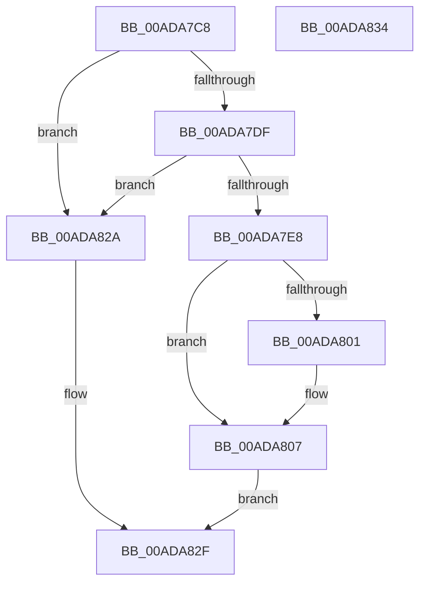

# AlpcpValidateDataInformation

- RVA: `0x00ADA7C8`–`0x00ADA835` (길이 `109` bytes)
- VA: `0x0000000140ADA7C8`
- 실행 섹션: `PAGE`
- PDB 이름 있음: `예`; PDB Function 태그: `아니요`
- unwind 정보 RVA: `0x0005C788`
- 디코드: `32`개 명령, `109/109` bytes 표시
- 미해석 바이트: `0` (있으면 어셈블리에 `.byte`로 보존)

> 이 문서는 커널 이미지의 기계어와 PDB 기호를 분석해 생성했습니다. 4번과 5번은 함수 원형과 자료형을 바이너리 사용 방식에서 추정한 C 해석이며 원본 소스 복구 결과는 아닙니다.

## 1. Dependencies

- 직접 호출 지점: **1**; 고유 호출 대상: **1**
- 직접 호출자로 확인된 함수: **2**
- RIP 상대 이미지 참조: **0**

### Outgoing calls
- `0x00ADA801` → [ExRaiseDatatypeMisalignment](../89/ExRaiseDatatypeMisalignment_function_00899FD0.md) (function, `0x00899FD0`)

### Direct callers
- [AlpcpSendMessage](../88/AlpcpSendMessage_function_0088BD40.md) at `0x0088BF4C`
- [AlpcpReplyLegacySynchronousRequest](../9F/AlpcpReplyLegacySynchronousRequest_function_009F5CF0.md) at `0x009F5DCA`

### Static image references
- 디코드된 RIP-relative 메모리 참조가 없습니다.

## 2. Other-region calls and transfers

- 다른 실행 섹션으로 향하는 call: **0**
- 별도 외부 분기/꼬리 이동을 확인하지 못했습니다.

## 3. Assembly (complete function range)

```asm
00ADA7C8  48 83 EC 28                     sub rsp, 0x28
00ADA7CC  44 0F B7 42 06                  movzx r8d, word ptr [rdx + 6]
00ADA7D1  4C 8B D1                        mov r10, rcx
00ADA7D4  44 0F B7 4A 02                  movzx r9d, word ptr [rdx + 2]
00ADA7D9  41 83 F8 28                     cmp r8d, 0x28
00ADA7DD  72 4B                           jb 0x140ada82a
00ADA7DF  49 8D 41 E8                     lea rax, [r9 - 0x18]
00ADA7E3  4C 3B C0                        cmp r8, rax
00ADA7E6  77 42                           ja 0x140ada82a
00ADA7E8  66 45 2B C8                     sub r9w, r8w
00ADA7EC  4D 03 C2                        add r8, r10
00ADA7EF  41 0F B7 C9                     movzx ecx, r9w
00ADA7F3  48 83 E9 08                     sub rcx, 8
00ADA7F7  48 C1 E9 04                     shr rcx, 4
00ADA7FB  41 F6 C0 03                     test r8b, 3
00ADA7FF  74 06                           je 0x140ada807
00ADA801  E8 CA F7 DB FF                  call 0x140899fd0
00ADA806  CC                              int3
00ADA807  48 BA 00 00 FF FF FF 7F 00 00   movabs rdx, 0x7fffffff0000
00ADA811  90                              nop
00ADA812  4C 3B C2                        cmp r8, rdx
00ADA815  49 8B C0                        mov rax, r8
00ADA818  48 0F 43 C2                     cmovae rax, rdx
00ADA81C  8A 00                           mov al, byte ptr [rax]
00ADA81E  41 3B 08                        cmp ecx, dword ptr [r8]
00ADA821  1B C0                           sbb eax, eax
00ADA823  25 0D 00 00 C0                  and eax, 0xc000000d
00ADA828  EB 05                           jmp 0x140ada82f
00ADA82A  B8 0D 00 00 C0                  mov eax, 0xc000000d
00ADA82F  48 83 C4 28                     add rsp, 0x28
00ADA833  C3                              ret
00ADA834  CC                              int3
```

## 4. C-style interpretation (structured pseudocode)

```c
__int64 __fastcall AlpcpValidateDataInformation(__int64 a1, __int64 a2)
{
    __int64 result;
    __int64 v_rsp;

    v_rsp = (v_rsp) - (40);
    if (((unsigned int)(*(unsigned __int16 *)(a2 + 6))) < 40) goto loc_00ADA82A;
    if ((*(unsigned __int16 *)(a2 + 6)) > (*(unsigned __int16 *)(a2 + 2) - 24)) goto loc_00ADA82A;
    a4 = (unsigned __int16)((*(unsigned __int16 *)(a2 + 2)) - ((unsigned __int16)(*(unsigned __int16 *)(a2 + 6))));
    a3 = (*(unsigned __int16 *)(a2 + 6)) + (a1);
    a1 = ((unsigned __int16)(a4)) - (8);
    a1 = (a1) >> (4);
    result = *(unsigned __int16 *)(a2 + 2) - 24;
    if ((((unsigned __int8)(a3)) & (3)) != 0) {
        result = ExRaiseDatatypeMisalignment(a1, a2, a3, a4);
    }
    if (a3 >= a2) { a3 = a2; }
    result = (unsigned int)((*(unsigned __int8 *)(a3)) & (0xC000000DULL));
    goto loc_00ADA82F;
loc_00ADA82A:
loc_00ADA82F:
    v_rsp = (v_rsp) + (40);
    return (unsigned int)(0xC000000DULL);
}
```

## 5. (Beta) C Style

```c
int64_t AlpcpValidateDataInformation(int64_t Arg1, void *Arg2)
{
    uint8_t *arg2 = (uint8_t *)Arg2;

    int64_t result;
    int64_t local_rsp;

    local_rsp = (local_rsp) - (40);
    if (((uint32_t)(*(uint16_t *)(arg2 + 0x6))) < 40) goto loc_00ADA82A;
    if ((*(uint16_t *)(arg2 + 0x6)) > (*(uint16_t *)(arg2 + 0x2) - 24)) goto loc_00ADA82A;
    a4 = (uint16_t)((*(uint16_t *)(arg2 + 0x2)) - ((uint16_t)(*(uint16_t *)(arg2 + 0x6))));
    a3 = (*(uint16_t *)(arg2 + 0x6)) + (Arg1);
    Arg1 = ((uint16_t)(a4)) - (8);
    Arg1 = (Arg1) >> (4);
    result = *(uint16_t *)(arg2 + 0x2) - 24;
    if ((((uint8_t)(a3)) & (3)) != 0) {
        result = ExRaiseDatatypeMisalignment(Arg1, Arg2, a3, a4);
    }
    if (a3 >= Arg2) { a3 = Arg2; }
    result = (uint32_t)((*(uint8_t *)(a3)) & (0xC000000DULL));
    goto loc_00ADA82F;
loc_00ADA82A:
loc_00ADA82F:
    local_rsp = (local_rsp) + (40);
    return (uint32_t)(0xC000000DULL);
}
```

### 관측된 메모리 오프셋

구조체 형식이 확인되지 않은 접근은 인자 기준의 오프셋으로만 기록했습니다.

| 기준 인자 | 오프셋 표현 | 폭 (bit) | 접근 |
|---|---:|---:|---|
| `Arg2` | `+ 0x2` | `16` | `R` |
| `Arg2` | `+ 0x6` | `16` | `R` |

## 6. Execution-region graph

[열기: 2D/3D 그래프와 함수 탐색 컨트롤 패널](../../../control-panel.html?section=page&rva=0x00ADA7C8&view=graph)

- 2D 그래프는 위에서 아래로 흐르고, 3D 그래프는 빈 공간을 드래그해 회전합니다. Shift+드래그는 이동, 휠은 확대·축소, 함수 노드 선택은 대상 보고서 이동입니다.

### Static fallback


