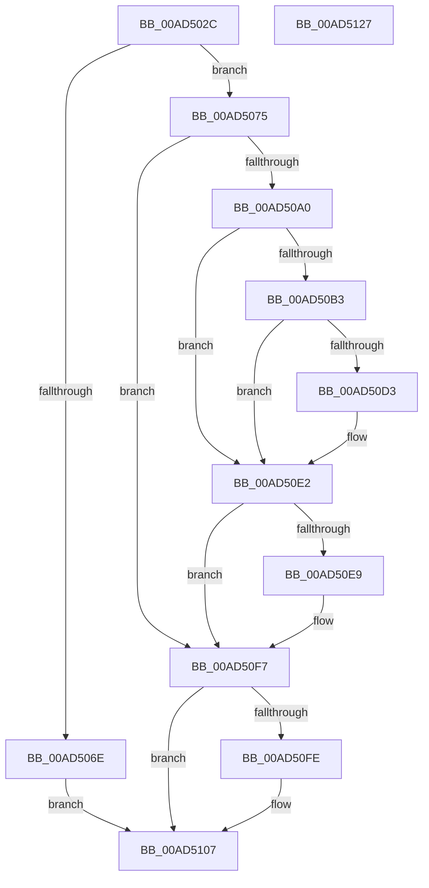

# BiBindEfiEntryToBcdObject

- RVA: `0x00AD502C`–`0x00AD5128` (길이 `252` bytes)
- VA: `0x0000000140AD502C`
- 실행 섹션: `PAGE`
- PDB 이름 있음: `예`; PDB Function 태그: `아니요`
- unwind 정보 RVA: `0x000BED3C`
- 디코드: `69`개 명령, `252/252` bytes 표시
- 미해석 바이트: `0` (있으면 어셈블리에 `.byte`로 보존)

> 이 문서는 커널 이미지의 기계어와 PDB 기호를 분석해 생성했습니다. 4번과 5번은 함수 원형과 자료형을 바이너리 사용 방식에서 추정한 C 해석이며 원본 소스 복구 결과는 아닙니다.

## 1. Dependencies

- 직접 호출 지점: **7**; 고유 호출 대상: **7**
- 직접 호출자로 확인된 함수: **1**
- RIP 상대 이미지 참조: **1**

### Outgoing calls
- `0x00AD5095` → [BiCreateObject](../A3/BiCreateObject_function_00A3D92C.md) (function, `0x00A3D92C`)
- `0x00AD50A8` → [BiGetKeyName](../A3/BiGetKeyName_function_00A3EF04.md) (function, `0x00A3EF04`)
- `0x00AD50BB` → [RtlInitUnicodeString](../../text/42/RtlInitUnicodeString_function_0042A780.md) (function, `0x0042A780`)
- `0x00AD50C8` → [RtlGUIDFromString](../8F/RtlGUIDFromString_function_008F1EF0.md) (function, `0x008F1EF0`)
- `0x00AD50F2` → [ExFreePoolWithTag](../../poolcode/B8/ExFreePoolWithTag_function_00B82870.md) (function, `0x00B82870`)
- `0x00AD5102` → [BcdCloseObject](../A3/BcdCloseObject_function_00A3FB08.md) (function, `0x00A3FB08`)
- `0x00AD5110` → [_security_check_cookie](../../text/6A/_security_check_cookie_function_006AC640.md) (function, `0x006AC640`)

### Direct callers
- [BiBindEfiEntries](../AB/BiBindEfiEntries_function_00AB09C4.md) at `0x00AB0ABF`

### Static image references
- `0x00AD503E` → RVA `0x00E0A740` (`.data`; read)

## 2. Other-region calls and transfers

- 다른 실행 섹션으로 향하는 call: **3**
  - `0x00AD50BB` → [RtlInitUnicodeString](../../text/42/RtlInitUnicodeString_function_0042A780.md) (`PAGE` → `.text`)
  - `0x00AD50F2` → [ExFreePoolWithTag](../../poolcode/B8/ExFreePoolWithTag_function_00B82870.md) (`PAGE` → `POOLCODE`)
  - `0x00AD5110` → [_security_check_cookie](../../text/6A/_security_check_cookie_function_006AC640.md) (`PAGE` → `.text`)
- 별도 외부 분기/꼬리 이동을 확인하지 못했습니다.

## 3. Assembly (complete function range)

```asm
00AD502C  48 89 5C 24 18                  mov qword ptr [rsp + 0x18], rbx
00AD5031  4C 89 74 24 20                  mov qword ptr [rsp + 0x20], r14
00AD5036  55                              push rbp
00AD5037  48 8B EC                        mov rbp, rsp
00AD503A  48 83 EC 70                     sub rsp, 0x70
00AD503E  48 8B 05 FB 56 33 00            mov rax, qword ptr [rip + 0x3356fb]
00AD5045  48 33 C4                        xor rax, rsp
00AD5048  48 89 45 F8                     mov qword ptr [rbp - 8], rax
00AD504C  48 83 65 C0 00                  and qword ptr [rbp - 0x40], 0
00AD5051  0F 57 C0                        xorps xmm0, xmm0
00AD5054  48 83 65 C8 00                  and qword ptr [rbp - 0x38], 0
00AD5059  0F 57 C9                        xorps xmm1, xmm1
00AD505C  8B 42 30                        mov eax, dword ptr [rdx + 0x30]
00AD505F  4C 8B F2                        mov r14, rdx
00AD5062  0F 11 45 E8                     movups xmmword ptr [rbp - 0x18], xmm0
00AD5066  0F 11 4D D8                     movups xmmword ptr [rbp - 0x28], xmm1
00AD506A  A8 04                           test al, 4
00AD506C  74 07                           je 0x140ad5075
00AD506E  33 DB                           xor ebx, ebx
00AD5070  E9 92 00 00 00                  jmp 0x140ad5107
00AD5075  41 B9 01 00 00 00               mov r9d, 1
00AD507B  C7 45 D4 FF FF 1F 10            mov dword ptr [rbp - 0x2c], 0x101fffff
00AD5082  48 8D 45 C8                     lea rax, [rbp - 0x38]
00AD5086  44 89 4D D0                     mov dword ptr [rbp - 0x30], r9d
00AD508A  4C 8D 45 D0                     lea r8, [rbp - 0x30]
00AD508E  48 89 44 24 20                  mov qword ptr [rsp + 0x20], rax
00AD5093  33 D2                           xor edx, edx
00AD5095  E8 92 88 F6 FF                  call 0x140a3d92c
00AD509A  8B D8                           mov ebx, eax
00AD509C  85 C0                           test eax, eax
00AD509E  78 57                           js 0x140ad50f7
00AD50A0  48 8B 4D C8                     mov rcx, qword ptr [rbp - 0x38]
00AD50A4  48 8D 55 C0                     lea rdx, [rbp - 0x40]
00AD50A8  E8 57 9E F6 FF                  call 0x140a3ef04
00AD50AD  8B D8                           mov ebx, eax
00AD50AF  85 C0                           test eax, eax
00AD50B1  78 2F                           js 0x140ad50e2
00AD50B3  48 8B 55 C0                     mov rdx, qword ptr [rbp - 0x40]
00AD50B7  48 8D 4D D8                     lea rcx, [rbp - 0x28]
00AD50BB  E8 C0 56 95 FF                  call 0x14042a780
00AD50C0  48 8D 55 E8                     lea rdx, [rbp - 0x18]
00AD50C4  48 8D 4D D8                     lea rcx, [rbp - 0x28]
00AD50C8  E8 23 CE E1 FF                  call 0x1408f1ef0
00AD50CD  8B D8                           mov ebx, eax
00AD50CF  85 C0                           test eax, eax
00AD50D1  78 0F                           js 0x140ad50e2
00AD50D3  0F 10 45 E8                     movups xmm0, xmmword ptr [rbp - 0x18]
00AD50D7  41 83 4E 30 04                  or dword ptr [r14 + 0x30], 4
00AD50DC  F3 41 0F 7F 46 10               movdqu xmmword ptr [r14 + 0x10], xmm0
00AD50E2  48 83 7D C0 00                  cmp qword ptr [rbp - 0x40], 0
00AD50E7  74 0E                           je 0x140ad50f7
00AD50E9  48 8B 4D C0                     mov rcx, qword ptr [rbp - 0x40]
00AD50ED  BA 42 43 44 4B                  mov edx, 0x4b444342
00AD50F2  E8 79 D7 0A 00                  call 0x140b82870
00AD50F7  48 83 7D C8 00                  cmp qword ptr [rbp - 0x38], 0
00AD50FC  74 09                           je 0x140ad5107
00AD50FE  48 8B 4D C8                     mov rcx, qword ptr [rbp - 0x38]
00AD5102  E8 01 AA F6 FF                  call 0x140a3fb08
00AD5107  8B C3                           mov eax, ebx
00AD5109  48 8B 4D F8                     mov rcx, qword ptr [rbp - 8]
00AD510D  48 33 CC                        xor rcx, rsp
00AD5110  E8 2B 75 BD FF                  call 0x1406ac640
00AD5115  4C 8D 5C 24 70                  lea r11, [rsp + 0x70]
00AD511A  49 8B 5B 20                     mov rbx, qword ptr [r11 + 0x20]
00AD511E  4D 8B 73 28                     mov r14, qword ptr [r11 + 0x28]
00AD5122  49 8B E3                        mov rsp, r11
00AD5125  5D                              pop rbp
00AD5126  C3                              ret
00AD5127  CC                              int3
```

## 4. C-style interpretation (structured pseudocode)

```c
__int64 __fastcall BiBindEfiEntryToBcdObject(__int64 a1, __int64 a2)
{
    __int64 result;
    __int64 v_rbx;
    __int64 v_rsp;
    unsigned __int64 v_stack_m10;
    unsigned __int64 v_stack_m20;
    unsigned __int64 v_stack_m30;
    unsigned int v_stack_m34;
    unsigned int v_stack_m38;
    unsigned __int64 v_stack_m40;
    unsigned __int64 v_stack_m48;
    unsigned __int64 v_stack_m58;
    unsigned __int64 v_stack_m8;
    unsigned __int64 v_stack_p18;
    unsigned __int64 v_stack_p20;

    v_stack_p18 = v_rbx;
    v_stack_p20 = v_r14;
    v_rsp = (v_rsp) - (112);
    result = (*(unsigned __int64 *)(v_rip + 3364603)) ^ (v_rsp);
    v_stack_m10 = result;
    v_stack_m20 = v_xmm0;
    v_stack_m30 = v_xmm1;
    if ((((unsigned __int8)((unsigned int)(*(unsigned int *)(a2 + 48)))) & (4)) == 0) goto loc_00AD5075;
    v_rbx = 0;
    goto loc_00AD5107;
loc_00AD5075:
    v_stack_m34 = 0x101FFFFFULL;
    v_stack_m38 = 1;
    v_stack_m58 = v_stack_m40;
    a2 = 0;
    result = BiCreateObject(a1, a2, v_stack_m38, 1);
    if (sign_flag) goto loc_00AD50F7;
    result = BiGetKeyName(v_stack_m40, v_stack_m48, v_stack_m38, 1);
    if (sign_flag) goto loc_00AD50E2;
    result = RtlInitUnicodeString(v_stack_m30, v_stack_m48, v_stack_m38, 1);
    result = RtlGUIDFromString(v_stack_m30, v_stack_m20, v_stack_m38, 1);
    if (!(sign_flag)) {
        *(unsigned __int64 *)(a2 + 16) = v_xmm0;
    }
    if (v_stack_m48 != 0) {
        a1 = v_stack_m48;
        a2 = 0x4B444342ULL;
        result = ExFreePoolWithTag(a1, a2, v_stack_m38, 1);
    }
    if (v_stack_m40 != 0) {
        a1 = v_stack_m40;
        result = BcdCloseObject(a1, a2, v_stack_m38, 1);
    }
    a1 = (v_stack_m10) ^ (v_rsp);
    result = _security_check_cookie(a1, a2, v_stack_m38, 1);
    return result;
}
```

## 5. (Beta) C Style

```c
int64_t BiBindEfiEntryToBcdObject(int64_t Arg1, void *Arg2)
{
    uint8_t *arg2 = (uint8_t *)Arg2;

    int64_t result;
    int64_t local_rbx;
    int64_t local_rsp;
    uint64_t v_stack_m10;
    uint64_t v_stack_m20;
    uint64_t v_stack_m30;
    uint32_t v_stack_m34;
    uint32_t v_stack_m38;
    uint64_t v_stack_m40;
    uint64_t v_stack_m48;
    uint64_t v_stack_m58;
    uint64_t v_stack_m8;
    uint64_t v_stack_p18;
    uint64_t v_stack_p20;

    v_stack_p18 = local_rbx;
    v_stack_p20 = local_r14;
    local_rsp = (local_rsp) - (112);
    result = (*(uint64_t *)(v_rip + 0x3356FB)) ^ (local_rsp);
    v_stack_m10 = result;
    v_stack_m20 = v_xmm0;
    v_stack_m30 = v_xmm1;
    if ((((uint8_t)((uint32_t)(*(uint32_t *)(arg2 + 0x30)))) & (4)) == 0) goto loc_00AD5075;
    local_rbx = 0;
    goto loc_00AD5107;
loc_00AD5075:
    v_stack_m34 = 0x101FFFFFULL;
    v_stack_m38 = 1;
    v_stack_m58 = v_stack_m40;
    Arg2 = 0;
    result = BiCreateObject(Arg1, Arg2, v_stack_m38, 1);
    if (sign_flag) goto loc_00AD50F7;
    result = BiGetKeyName(v_stack_m40, v_stack_m48, v_stack_m38, 1);
    if (sign_flag) goto loc_00AD50E2;
    result = RtlInitUnicodeString(v_stack_m30, v_stack_m48, v_stack_m38, 1);
    result = RtlGUIDFromString(v_stack_m30, v_stack_m20, v_stack_m38, 1);
    if (!(sign_flag)) {
        *(uint64_t *)(arg2 + 0x10) = v_xmm0;
    }
    if (v_stack_m48 != 0) {
        Arg1 = v_stack_m48;
        Arg2 = 0x4B444342ULL;
        result = ExFreePoolWithTag(Arg1, Arg2, v_stack_m38, 1);
    }
    if (v_stack_m40 != 0) {
        Arg1 = v_stack_m40;
        result = BcdCloseObject(Arg1, Arg2, v_stack_m38, 1);
    }
    Arg1 = (v_stack_m10) ^ (local_rsp);
    result = _security_check_cookie(Arg1, Arg2, v_stack_m38, 1);
    return result;
}
```

### 관측된 메모리 오프셋

구조체 형식이 확인되지 않은 접근은 인자 기준의 오프셋으로만 기록했습니다.

| 기준 인자 | 오프셋 표현 | 폭 (bit) | 접근 |
|---|---:|---:|---|
| `Arg2` | `+ 0x10` | `128` | `W` |
| `Arg2` | `+ 0x30` | `32` | `R` |
| `Arg2` | `+ 0x30` | `32` | `R/W` |

## 6. Execution-region graph

[열기: 2D/3D 그래프와 함수 탐색 컨트롤 패널](../../../control-panel.html?section=page&rva=0x00AD502C&view=graph)

- 2D 그래프는 위에서 아래로 흐르고, 3D 그래프는 빈 공간을 드래그해 회전합니다. Shift+드래그는 이동, 휠은 확대·축소, 함수 노드 선택은 대상 보고서 이동입니다.

### Static fallback


