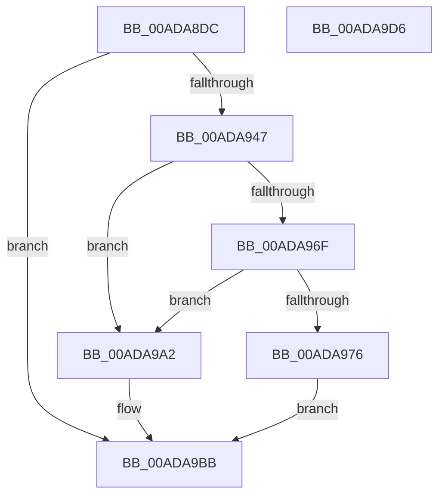

# CmFcpCreateAlpcSectionView

- RVA: `0x00ADA8DC`–`0x00ADA9D7` (길이 `251` bytes)
- VA: `0x0000000140ADA8DC`
- 실행 섹션: `PAGE`
- PDB 이름 있음: `예`; PDB Function 태그: `아니요`
- unwind 정보 RVA: `0x00093E28`
- 디코드: `71`개 명령, `251/251` bytes 표시
- 미해석 바이트: `0` (있으면 어셈블리에 `.byte`로 보존)

> 이 문서는 커널 이미지의 기계어와 PDB 기호를 분석해 생성했습니다. 4번과 5번은 함수 원형과 자료형을 바이너리 사용 방식에서 추정한 C 해석이며 원본 소스 복구 결과는 아닙니다.

## 1. Dependencies

- 직접 호출 지점: **5**; 고유 호출 대상: **5**
- 직접 호출자로 확인된 함수: **1**
- RIP 상대 이미지 참조: **0**

### Outgoing calls
- `0x00ADA912` → [AlpcGetMessageAttribute](../../text/45/AlpcGetMessageAttribute_function_00450010.md) (function, `0x00450010`)
- `0x00ADA93C` → [ZwAlpcCreatePortSection](../../text/6A/ZwAlpcCreatePortSection_function_006AE090.md) (function, `0x006AE090`)
- `0x00ADA964` → [ZwAlpcCreateSectionView](../../text/6A/ZwAlpcCreateSectionView_function_006AE0D0.md) (function, `0x006AE0D0`)
- `0x00ADA98B` → [memcpy](../../text/6C/memcpy_function_006C6840.md) (function, `0x006C6840`)
- `0x00ADA9AC` → [ZwAlpcDeletePortSection](../../text/6A/ZwAlpcDeletePortSection_function_006AE110.md) (function, `0x006AE110`)

### Direct callers
- [CmFcpSendFeatureUsageReportAlpcMessage](../../text/4C/CmFcpSendFeatureUsageReportAlpcMessage_function_004CD2CC.md) at `0x004CD340`

### Static image references
- 디코드된 RIP-relative 메모리 참조가 없습니다.

## 2. Other-region calls and transfers

- 다른 실행 섹션으로 향하는 call: **5**
  - `0x00ADA912` → [AlpcGetMessageAttribute](../../text/45/AlpcGetMessageAttribute_function_00450010.md) (`PAGE` → `.text`)
  - `0x00ADA93C` → [ZwAlpcCreatePortSection](../../text/6A/ZwAlpcCreatePortSection_function_006AE090.md) (`PAGE` → `.text`)
  - `0x00ADA964` → [ZwAlpcCreateSectionView](../../text/6A/ZwAlpcCreateSectionView_function_006AE0D0.md) (`PAGE` → `.text`)
  - `0x00ADA98B` → [memcpy](../../text/6C/memcpy_function_006C6840.md) (`PAGE` → `.text`)
  - `0x00ADA9AC` → [ZwAlpcDeletePortSection](../../text/6A/ZwAlpcDeletePortSection_function_006AE110.md) (`PAGE` → `.text`)
- 별도 외부 분기/꼬리 이동을 확인하지 못했습니다.

## 3. Assembly (complete function range)

```asm
00ADA8DC  48 8B C4                        mov rax, rsp
00ADA8DF  48 89 58 08                     mov qword ptr [rax + 8], rbx
00ADA8E3  48 89 68 10                     mov qword ptr [rax + 0x10], rbp
00ADA8E7  48 89 70 18                     mov qword ptr [rax + 0x18], rsi
00ADA8EB  57                              push rdi
00ADA8EC  41 56                           push r14
00ADA8EE  41 57                           push r15
00ADA8F0  48 83 EC 40                     sub rsp, 0x40
00ADA8F4  48 83 60 E0 00                  and qword ptr [rax - 0x20], 0
00ADA8F9  4C 8B FA                        mov r15, rdx
00ADA8FC  48 83 60 D8 00                  and qword ptr [rax - 0x28], 0
00ADA901  48 8B F1                        mov rsi, rcx
00ADA904  BA 00 00 00 40                  mov edx, 0x40000000
00ADA909  49 8B C9                        mov rcx, r9
00ADA90C  49 8B E9                        mov rbp, r9
00ADA90F  4D 8B F0                        mov r14, r8
00ADA912  E8 F9 56 97 FF                  call 0x140450010
00ADA917  48 8B D8                        mov rbx, rax
00ADA91A  4D 8B CE                        mov r9, r14
00ADA91D  48 8D 44 24 38                  lea rax, [rsp + 0x38]
00ADA922  45 33 C0                        xor r8d, r8d
00ADA925  48 89 44 24 28                  mov qword ptr [rsp + 0x28], rax
00ADA92A  BA 00 00 04 00                  mov edx, 0x40000
00ADA92F  48 8D 44 24 30                  lea rax, [rsp + 0x30]
00ADA934  48 8B CE                        mov rcx, rsi
00ADA937  48 89 44 24 20                  mov qword ptr [rsp + 0x20], rax
00ADA93C  E8 4F 37 BD FF                  call 0x1406ae090
00ADA941  8B F8                           mov edi, eax
00ADA943  85 C0                           test eax, eax
00ADA945  78 74                           js 0x140ada9bb
00ADA947  83 23 00                        and dword ptr [rbx], 0
00ADA94A  4C 8B C3                        mov r8, rbx
00ADA94D  48 8B 44 24 30                  mov rax, qword ptr [rsp + 0x30]
00ADA952  33 D2                           xor edx, edx
00ADA954  48 83 63 10 00                  and qword ptr [rbx + 0x10], 0
00ADA959  48 8B CE                        mov rcx, rsi
00ADA95C  48 89 43 08                     mov qword ptr [rbx + 8], rax
00ADA960  4C 89 73 18                     mov qword ptr [rbx + 0x18], r14
00ADA964  E8 67 37 BD FF                  call 0x1406ae0d0
00ADA969  8B F8                           mov edi, eax
00ADA96B  85 C0                           test eax, eax
00ADA96D  78 33                           js 0x140ada9a2
00ADA96F  48 83 7B 10 00                  cmp qword ptr [rbx + 0x10], 0
00ADA974  74 2C                           je 0x140ada9a2
00ADA976  C7 03 00 00 06 00               mov dword ptr [rbx], 0x60000
00ADA97C  4D 8B C6                        mov r8, r14
00ADA97F  0F BA 6D 04 1E                  bts dword ptr [rbp + 4], 0x1e
00ADA984  49 8B D7                        mov rdx, r15
00ADA987  48 8B 4B 10                     mov rcx, qword ptr [rbx + 0x10]
00ADA98B  E8 B0 BE BE FF                  call 0x1406c6840
00ADA990  48 8B 8C 24 80 00 00 00         mov rcx, qword ptr [rsp + 0x80]
00ADA998  48 8B 44 24 30                  mov rax, qword ptr [rsp + 0x30]
00ADA99D  48 89 01                        mov qword ptr [rcx], rax
00ADA9A0  EB 19                           jmp 0x140ada9bb
00ADA9A2  4C 8B 44 24 30                  mov r8, qword ptr [rsp + 0x30]
00ADA9A7  33 D2                           xor edx, edx
00ADA9A9  48 8B CE                        mov rcx, rsi
00ADA9AC  E8 5F 37 BD FF                  call 0x1406ae110
00ADA9B1  0F 57 C0                        xorps xmm0, xmm0
00ADA9B4  0F 11 03                        movups xmmword ptr [rbx], xmm0
00ADA9B7  0F 11 43 10                     movups xmmword ptr [rbx + 0x10], xmm0
00ADA9BB  48 8B 5C 24 60                  mov rbx, qword ptr [rsp + 0x60]
00ADA9C0  8B C7                           mov eax, edi
00ADA9C2  48 8B 6C 24 68                  mov rbp, qword ptr [rsp + 0x68]
00ADA9C7  48 8B 74 24 70                  mov rsi, qword ptr [rsp + 0x70]
00ADA9CC  48 83 C4 40                     add rsp, 0x40
00ADA9D0  41 5F                           pop r15
00ADA9D2  41 5E                           pop r14
00ADA9D4  5F                              pop rdi
00ADA9D5  C3                              ret
00ADA9D6  CC                              int3
```

## 4. C-style interpretation (structured pseudocode)

```c
__int64 __fastcall CmFcpCreateAlpcSectionView(__int64 a1, __int64 a2, __int64 a3, __int64 a4, __int64 a5)
{
    __int64 result;
    __int64 v_rsp;
    unsigned __int64 v_stack_m20;
    unsigned __int64 v_stack_m28;
    unsigned __int64 v_stack_m30;
    unsigned __int64 v_stack_m38;
    unsigned __int64 v_stack_p10;
    unsigned __int64 v_stack_p18;
    unsigned __int64 v_stack_p8;

    *(unsigned __int64 *)(v_rsp + 8) = v_rbx;
    *(unsigned __int64 *)(v_rsp + 16) = v_rbp;
    *(unsigned __int64 *)(v_rsp + 24) = v_rsi;
    v_rsp = (v_rsp) - (64);
    result = AlpcGetMessageAttribute(a4, (unsigned int)(0x40000000ULL), a3, a4);
    a3 = 0;
    v_stack_m30 = v_stack_m20;
    v_stack_m38 = v_stack_m28;
    result = ZwAlpcCreatePortSection(a1, (unsigned int)(0x40000ULL), a3, a3);
    if (sign_flag) goto loc_00ADA9BB;
    a2 = 0;
    *(unsigned __int64 *)(result + 8) = v_stack_m28;
    *(unsigned __int64 *)(result + 24) = 0;
    result = ZwAlpcCreateSectionView(a1, a2, result, a3);
    if (sign_flag) goto loc_00ADA9A2;
    if ((*(unsigned __int64 *)(result + 16)) == 0) goto loc_00ADA9A2;
    *(unsigned int *)(result) = 0x60000ULL;
    result = memcpy(*(unsigned __int64 *)(result + 16), 0, 0, a3);
    *(unsigned __int64 *)(a5) = v_stack_m28;
    goto loc_00ADA9BB;
loc_00ADA9A2:
    a2 = 0;
    result = ZwAlpcDeletePortSection(a1, a2, v_stack_m28, a3);
    *(unsigned __int64 *)(result) = v_xmm0;
    *(unsigned __int64 *)(result + 16) = v_xmm0;
loc_00ADA9BB:
    v_rsp = (v_rsp) + (64);
    return (unsigned int)((unsigned int)((unsigned int)((unsigned int)(result))));
}
```

## 5. (Beta) C Style

```c
int64_t CmFcpCreateAlpcSectionView(int64_t Arg1, int64_t Arg2, int64_t Arg3, void *Arg4, void *Arg5)
{
    uint8_t *arg4 = (uint8_t *)Arg4;
    uint8_t *arg5 = (uint8_t *)Arg5;

    int64_t result;
    int64_t local_rsp;
    uint64_t v_stack_m20;
    uint64_t v_stack_m28;
    uint64_t v_stack_m30;
    uint64_t v_stack_m38;
    uint64_t v_stack_p10;
    uint64_t v_stack_p18;
    uint64_t v_stack_p8;

    *(uint64_t *)(local_rsp + 0x8) = local_rbx;
    *(uint64_t *)(local_rsp + 0x10) = local_rbp;
    *(uint64_t *)(local_rsp + 0x18) = local_rsi;
    local_rsp = (local_rsp) - (64);
    result = AlpcGetMessageAttribute(Arg4, (uint32_t)(0x40000000ULL), Arg3, Arg4);
    Arg3 = 0;
    v_stack_m30 = v_stack_m20;
    v_stack_m38 = v_stack_m28;
    result = ZwAlpcCreatePortSection(Arg1, (uint32_t)(0x40000ULL), Arg3, Arg3);
    if (sign_flag) goto loc_00ADA9BB;
    Arg2 = 0;
    *(uint64_t *)(result + 0x8) = v_stack_m28;
    *(uint64_t *)(result + 0x18) = 0;
    result = ZwAlpcCreateSectionView(Arg1, Arg2, result, Arg3);
    if (sign_flag) goto loc_00ADA9A2;
    if ((*(uint64_t *)(result + 0x10)) == 0) goto loc_00ADA9A2;
    *(uint32_t *)(result) = 0x60000ULL;
    result = memcpy(*(uint64_t *)(result + 0x10), 0, 0, Arg3);
    *(uint64_t *)(arg5) = v_stack_m28;
    goto loc_00ADA9BB;
loc_00ADA9A2:
    Arg2 = 0;
    result = ZwAlpcDeletePortSection(Arg1, Arg2, v_stack_m28, Arg3);
    *(uint64_t *)(result) = v_xmm0;
    *(uint64_t *)(result + 0x10) = v_xmm0;
loc_00ADA9BB:
    local_rsp = (local_rsp) + (64);
    return (uint32_t)((uint32_t)((uint32_t)((uint32_t)(result))));
}
```

### 관측된 메모리 오프셋

구조체 형식이 확인되지 않은 접근은 인자 기준의 오프셋으로만 기록했습니다.

| 기준 인자 | 오프셋 표현 | 폭 (bit) | 접근 |
|---|---:|---:|---|
| `Arg4` | `+ 0x4` | `32` | `R/W` |
| `Arg5` | `+ 0x0` | `64` | `W` |

## 6. Execution-region graph

[열기: 2D/3D 그래프와 함수 탐색 컨트롤 패널](../../../control-panel.html?section=page&rva=0x00ADA8DC&view=graph)

- 2D 그래프는 위에서 아래로 흐르고, 3D 그래프는 빈 공간을 드래그해 회전합니다. Shift+드래그는 이동, 휠은 확대·축소, 함수 노드 선택은 대상 보고서 이동입니다.

### Static fallback


