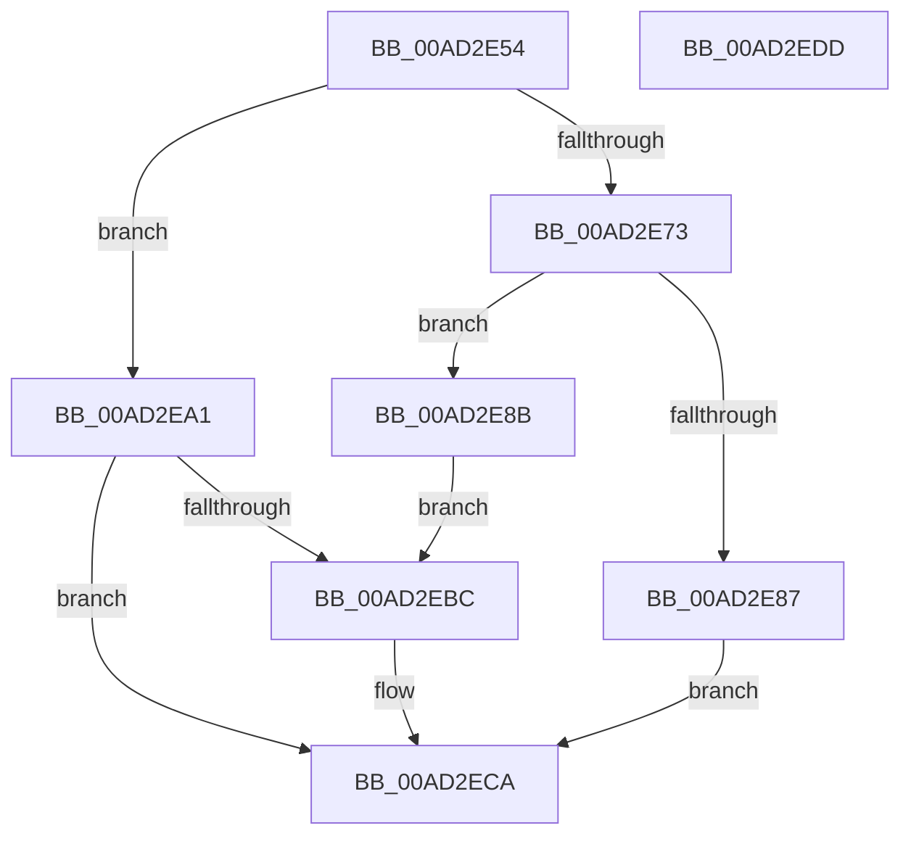

# CmFcpManagerAllocateUsageProviderSubscription

- RVA: `0x00AD2E54`–`0x00AD2EDE` (길이 `138` bytes)
- VA: `0x0000000140AD2E54`
- 실행 섹션: `PAGE`
- PDB 이름 있음: `예`; PDB Function 태그: `아니요`
- unwind 정보 RVA: `0x00060BC4`
- 디코드: `40`개 명령, `138/138` bytes 표시
- 미해석 바이트: `0` (있으면 어셈블리에 `.byte`로 보존)

> 이 문서는 커널 이미지의 기계어와 PDB 기호를 분석해 생성했습니다. 4번과 5번은 함수 원형과 자료형을 바이너리 사용 방식에서 추정한 C 해석이며 원본 소스 복구 결과는 아닙니다.

## 1. Dependencies

- 직접 호출 지점: **2**; 고유 호출 대상: **2**
- 직접 호출자로 확인된 함수: **1**
- RIP 상대 이미지 참조: **3**

### Outgoing calls
- `0x00AD2EAF` → [ExAllocatePool2](../../poolcode/B8/ExAllocatePool2_function_00B820F0.md) (function, `0x00B820F0`)
- `0x00AD2EC5` → [CmFcpInitializeFeatureUsageProviderSubscription](../7F/CmFcpInitializeFeatureUsageProviderSubscription_function_007F530C.md) (function, `0x007F530C`)

### Direct callers
- [CmFcManagerRegisterFeatureUsageProvider](../7F/CmFcManagerRegisterFeatureUsageProvider_function_007F48D4.md) at `0x007F48EF`

### Static image references
- `0x00AD2E63` → RVA `0x00EF747A` (`.data`; read)
- `0x00AD2E78` → RVA `0x00EF7860` (`.data`; read/write)
- `0x00AD2E95` → RVA `0x00EF76B0` (`.data`; read)

## 2. Other-region calls and transfers

- 다른 실행 섹션으로 향하는 call: **1**
  - `0x00AD2EAF` → [ExAllocatePool2](../../poolcode/B8/ExAllocatePool2_function_00B820F0.md) (`PAGE` → `POOLCODE`)
- 별도 외부 분기/꼬리 이동을 확인하지 못했습니다.

## 3. Assembly (complete function range)

```asm
00AD2E54  48 89 5C 24 08                  mov qword ptr [rsp + 8], rbx
00AD2E59  48 89 74 24 10                  mov qword ptr [rsp + 0x10], rsi
00AD2E5E  57                              push rdi
00AD2E5F  48 83 EC 20                     sub rsp, 0x20
00AD2E63  8A 05 11 46 42 00               mov al, byte ptr [rip + 0x424611]
00AD2E69  49 8B F8                        mov rdi, r8
00AD2E6C  48 8B F2                        mov rsi, rdx
00AD2E6F  84 C0                           test al, al
00AD2E71  75 2E                           jne 0x140ad2ea1
00AD2E73  B8 01 00 00 00                  mov eax, 1
00AD2E78  F0 0F C1 05 E0 49 42 00         lock xadd dword ptr [rip + 0x4249e0], eax
00AD2E80  FF C0                           inc eax
00AD2E82  83 F8 03                        cmp eax, 3
00AD2E85  76 04                           jbe 0x140ad2e8b
00AD2E87  33 DB                           xor ebx, ebx
00AD2E89  EB 3F                           jmp 0x140ad2eca
00AD2E8B  FF C8                           dec eax
00AD2E8D  48 8D 1C C0                     lea rbx, [rax + rax*8]
00AD2E91  48 C1 E3 04                     shl rbx, 4
00AD2E95  48 8D 05 14 48 42 00            lea rax, [rip + 0x424814]
00AD2E9C  48 03 D8                        add rbx, rax
00AD2E9F  EB 1B                           jmp 0x140ad2ebc
00AD2EA1  BA 90 00 00 00                  mov edx, 0x90
00AD2EA6  41 B8 43 6D 46 63               mov r8d, 0x63466d43
00AD2EAC  8D 4A B0                        lea ecx, [rdx - 0x50]
00AD2EAF  E8 3C F2 0A 00                  call 0x140b820f0
00AD2EB4  48 8B D8                        mov rbx, rax
00AD2EB7  48 85 C0                        test rax, rax
00AD2EBA  74 0E                           je 0x140ad2eca
00AD2EBC  4C 8B CF                        mov r9, rdi
00AD2EBF  4C 8B C6                        mov r8, rsi
00AD2EC2  48 8B CB                        mov rcx, rbx
00AD2EC5  E8 42 24 D2 FF                  call 0x1407f530c
00AD2ECA  48 8B 74 24 38                  mov rsi, qword ptr [rsp + 0x38]
00AD2ECF  48 8B C3                        mov rax, rbx
00AD2ED2  48 8B 5C 24 30                  mov rbx, qword ptr [rsp + 0x30]
00AD2ED7  48 83 C4 20                     add rsp, 0x20
00AD2EDB  5F                              pop rdi
00AD2EDC  C3                              ret
00AD2EDD  CC                              int3
```

## 4. C-style interpretation (structured pseudocode)

```c
__int64 __fastcall CmFcpManagerAllocateUsageProviderSubscription(__int64 a1, __int64 a2, __int64 a3)
{
    __int64 result;
    __int64 v_rbx;
    __int64 v_rsp;
    unsigned __int64 v_stack_p10;
    unsigned __int64 v_stack_p8;

    v_stack_p8 = v_rbx;
    v_stack_p10 = v_rsi;
    v_rsp = (v_rsp) - (32);
    if ((unsigned __int8)(*(unsigned __int8 *)(v_rip + 4343313)) != 0) goto loc_00AD2EA1;
    result = (unsigned int)((1) + 1);
    if (((unsigned int)(result)) <= 3) goto loc_00AD2E8B;
    v_rbx = 0;
    goto loc_00AD2ECA;
loc_00AD2E8B:
    result = (unsigned int)((result) - 1);
    v_rbx = (result + result * 8) << (4);
    v_rbx = (v_rbx) + (v_rip + 4343828);
    goto loc_00AD2EBC;
loc_00AD2EA1:
    result = ExAllocatePool2(144 - 80, 144, (unsigned int)(0x63466D43ULL), a4);
    if (result != 0) {
        a4 = a3;
        a3 = a2;
        a1 = result;
        result = CmFcpInitializeFeatureUsageProviderSubscription(a1, 144, a3, a4);
    }
    v_rsp = (v_rsp) + (32);
    return result;
}
```

## 5. (Beta) C Style

```c
int64_t CmFcpManagerAllocateUsageProviderSubscription(int64_t Arg1, int64_t Arg2, int64_t Arg3)
{
    int64_t result;
    int64_t local_rbx;
    int64_t local_rsp;
    uint64_t v_stack_p10;
    uint64_t v_stack_p8;

    v_stack_p8 = local_rbx;
    v_stack_p10 = local_rsi;
    local_rsp = (local_rsp) - (32);
    if ((uint8_t)(*(uint8_t *)(v_rip + 0x424611)) != 0) goto loc_00AD2EA1;
    result = (uint32_t)((1) + 1);
    if (((uint32_t)(result)) <= 3) goto loc_00AD2E8B;
    local_rbx = 0;
    goto loc_00AD2ECA;
loc_00AD2E8B:
    result = (uint32_t)((result) - 1);
    local_rbx = (result + result * 8) << (4);
    local_rbx = (local_rbx) + (v_rip + 4343828);
    goto loc_00AD2EBC;
loc_00AD2EA1:
    result = ExAllocatePool2(144 - 80, 144, (uint32_t)(0x63466D43ULL), a4);
    if (result != 0) {
        a4 = Arg3;
        Arg3 = Arg2;
        Arg1 = result;
        result = CmFcpInitializeFeatureUsageProviderSubscription(Arg1, 144, Arg3, a4);
    }
    local_rsp = (local_rsp) + (32);
    return result;
}
```

## 6. Execution-region graph

[열기: 2D/3D 그래프와 함수 탐색 컨트롤 패널](../../../control-panel.html?section=page&rva=0x00AD2E54&view=graph)

- 2D 그래프는 위에서 아래로 흐르고, 3D 그래프는 빈 공간을 드래그해 회전합니다. Shift+드래그는 이동, 휠은 확대·축소, 함수 노드 선택은 대상 보고서 이동입니다.

### Static fallback


