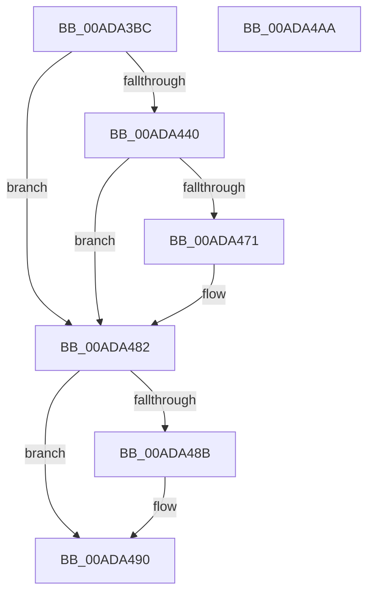

# CmFcpManagerCreateSection

- RVA: `0x00ADA3BC`–`0x00ADA4AB` (길이 `239` bytes)
- VA: `0x0000000140ADA3BC`
- 실행 섹션: `PAGE`
- PDB 이름 있음: `예`; PDB Function 태그: `아니요`
- unwind 정보 RVA: `0x000BF3FC`
- 디코드: `63`개 명령, `239/239` bytes 표시
- 미해석 바이트: `0` (있으면 어셈블리에 `.byte`로 보존)

> 이 문서는 커널 이미지의 기계어와 PDB 기호를 분석해 생성했습니다. 4번과 5번은 함수 원형과 자료형을 바이너리 사용 방식에서 추정한 C 해석이며 원본 소스 복구 결과는 아닙니다.

## 1. Dependencies

- 직접 호출 지점: **3**; 고유 호출 대상: **3**
- 직접 호출자로 확인된 함수: **4**
- RIP 상대 이미지 참조: **1**

### Outgoing calls
- `0x00ADA435` → [ZwCreateSection](../../text/6A/ZwCreateSection_function_006ADA10.md) (function, `0x006ADA10`)
- `0x00ADA466` → [ObReferenceObjectByHandle](../86/ObReferenceObjectByHandle_function_00868DB0.md) (function, `0x00868DB0`)
- `0x00ADA48B` → [ZwClose](../../text/6A/ZwClose_function_006AD2B0.md) (function, `0x006AD2B0`)

### Direct callers
- [CmFcManagerOverwriteFeatureConfigurationSection](../7F/CmFcManagerOverwriteFeatureConfigurationSection_function_007F4450.md) at `0x007F4717`
- [CmFcManagerUpdateFeatureConfigurations](../7F/CmFcManagerUpdateFeatureConfigurations_function_007F4CF4.md) at `0x007F4EEF`
- [CmFcManagerUpdateFeatureConfigurations](../7F/CmFcManagerUpdateFeatureConfigurations_function_007F4CF4.md) at `0x007F5005`
- [CmFcpManagerCreateSectionFromBuffer](../7F/CmFcpManagerCreateSectionFromBuffer_function_007F5438.md) at `0x007F5480`
- [sub_00B3AEBA](../B3/Unknown_function_00B3AEBA.md) at `0x00B3AED9`

### Static image references
- `0x00ADA440` → RVA `0x00FC6BD8` (`ALMOSTRO`; read)

## 2. Other-region calls and transfers

- 다른 실행 섹션으로 향하는 call: **2**
  - `0x00ADA435` → [ZwCreateSection](../../text/6A/ZwCreateSection_function_006ADA10.md) (`PAGE` → `.text`)
  - `0x00ADA48B` → [ZwClose](../../text/6A/ZwClose_function_006AD2B0.md) (`PAGE` → `.text`)
- 별도 외부 분기/꼬리 이동을 확인하지 못했습니다.

## 3. Assembly (complete function range)

```asm
00ADA3BC  48 8B C4                        mov rax, rsp
00ADA3BF  48 89 58 10                     mov qword ptr [rax + 0x10], rbx
00ADA3C3  48 89 70 20                     mov qword ptr [rax + 0x20], rsi
00ADA3C7  55                              push rbp
00ADA3C8  57                              push rdi
00ADA3C9  41 56                           push r14
00ADA3CB  48 8B EC                        mov rbp, rsp
00ADA3CE  48 81 EC 80 00 00 00            sub rsp, 0x80
00ADA3D5  48 83 60 98 00                  and qword ptr [rax - 0x68], 0
00ADA3DA  49 8B F9                        mov rdi, r9
00ADA3DD  83 65 E4 00                     and dword ptr [rbp - 0x1c], 0
00ADA3E1  4C 8D 4D C0                     lea r9, [rbp - 0x40]
00ADA3E5  48 83 65 20 00                  and qword ptr [rbp + 0x20], 0
00ADA3EA  4C 8B F2                        mov r14, rdx
00ADA3ED  48 83 65 D0 00                  and qword ptr [rbp - 0x30], 0
00ADA3F2  48 8B F1                        mov rsi, rcx
00ADA3F5  48 83 65 D8 00                  and qword ptr [rbp - 0x28], 0
00ADA3FA  BA 06 00 00 00                  mov edx, 6
00ADA3FF  48 83 65 F0 00                  and qword ptr [rbp - 0x10], 0
00ADA404  4C 89 45 E8                     mov qword ptr [rbp - 0x18], r8
00ADA408  4C 8D 45 C8                     lea r8, [rbp - 0x38]
00ADA40C  48 89 4D C0                     mov qword ptr [rbp - 0x40], rcx
00ADA410  48 8D 4D 20                     lea rcx, [rbp + 0x20]
00ADA414  C7 40 90 00 00 00 08            mov dword ptr [rax - 0x70], 0x8000000
00ADA41B  48 C7 45 C8 30 00 00 00         mov qword ptr [rbp - 0x38], 0x30
00ADA423  83 65 CC 00                     and dword ptr [rbp - 0x34], 0
00ADA427  C7 40 88 04 00 00 00            mov dword ptr [rax - 0x78], 4
00ADA42E  C7 45 E0 00 02 00 00            mov dword ptr [rbp - 0x20], 0x200
00ADA435  E8 D6 35 BD FF                  call 0x1406ada10
00ADA43A  8B D8                           mov ebx, eax
00ADA43C  85 C0                           test eax, eax
00ADA43E  78 42                           js 0x140ada482
00ADA440  4C 8B 05 91 C7 4E 00            mov r8, qword ptr [rip + 0x4ec791]
00ADA447  48 8D 45 30                     lea rax, [rbp + 0x30]
00ADA44B  48 83 64 24 28 00               and qword ptr [rsp + 0x28], 0
00ADA451  45 33 C9                        xor r9d, r9d
00ADA454  48 8B 4D 20                     mov rcx, qword ptr [rbp + 0x20]
00ADA458  48 83 65 30 00                  and qword ptr [rbp + 0x30], 0
00ADA45D  48 89 44 24 20                  mov qword ptr [rsp + 0x20], rax
00ADA462  41 8D 51 06                     lea edx, [r9 + 6]
00ADA466  E8 45 E9 D8 FF                  call 0x140868db0
00ADA46B  8B D8                           mov ebx, eax
00ADA46D  85 C0                           test eax, eax
00ADA46F  78 11                           js 0x140ada482
00ADA471  48 8B 45 30                     mov rax, qword ptr [rbp + 0x30]
00ADA475  33 DB                           xor ebx, ebx
00ADA477  48 89 47 08                     mov qword ptr [rdi + 8], rax
00ADA47B  4C 89 37                        mov qword ptr [rdi], r14
00ADA47E  48 89 77 10                     mov qword ptr [rdi + 0x10], rsi
00ADA482  48 8B 4D 20                     mov rcx, qword ptr [rbp + 0x20]
00ADA486  48 85 C9                        test rcx, rcx
00ADA489  74 05                           je 0x140ada490
00ADA48B  E8 20 2E BD FF                  call 0x1406ad2b0
00ADA490  4C 8D 9C 24 80 00 00 00         lea r11, [rsp + 0x80]
00ADA498  8B C3                           mov eax, ebx
00ADA49A  49 8B 5B 28                     mov rbx, qword ptr [r11 + 0x28]
00ADA49E  49 8B 73 38                     mov rsi, qword ptr [r11 + 0x38]
00ADA4A2  49 8B E3                        mov rsp, r11
00ADA4A5  41 5E                           pop r14
00ADA4A7  5F                              pop rdi
00ADA4A8  5D                              pop rbp
00ADA4A9  C3                              ret
00ADA4AA  CC                              int3
```

## 4. C-style interpretation (structured pseudocode)

```c
__int64 __fastcall CmFcpManagerCreateSection(__int64 a1, __int64 a2, __int64 a3, __int64 a4)
{
    __int64 result;
    __int64 v_rbx;
    __int64 v_rsp;
    unsigned __int64 v_stack_m18;
    unsigned __int64 v_stack_m28;
    unsigned __int64 v_stack_m30;
    unsigned int v_stack_m34;
    unsigned int v_stack_m38;
    unsigned __int64 v_stack_m40;
    unsigned __int64 v_stack_m48;
    unsigned int v_stack_m4C;
    unsigned __int64 v_stack_m50;
    unsigned __int64 v_stack_m58;
    unsigned __int64 v_stack_m70;
    unsigned __int64 v_stack_m78;
    unsigned __int64 v_stack_p18;
    unsigned __int64 v_stack_p8;

    *(unsigned __int64 *)(v_rsp + 16) = v_rbx;
    *(unsigned __int64 *)(v_rsp + 32) = v_rsi;
    v_rsp = (v_rsp) - (128);
    v_stack_m30 = a3;
    v_stack_m58 = a1;
    *(unsigned int *)(v_rsp - 112) = 0x8000000ULL;
    v_stack_m50 = 48;
    *(unsigned int *)(v_rsp - 120) = 4;
    v_stack_m38 = 512;
    result = ZwCreateSection(v_stack_p8, 6, v_stack_m50, v_stack_m58);
    if (sign_flag) goto loc_00ADA482;
    a4 = 0;
    v_stack_m78 = v_stack_p18;
    result = ObReferenceObjectByHandle(v_stack_p8, a4 + 6, *(unsigned __int64 *)(v_rip + 5162897), a4);
    v_rbx = (unsigned int)((unsigned int)(result));
    if (!(sign_flag)) {
        result = v_stack_p18;
        v_rbx = 0;
        *(unsigned __int64 *)(a4 + 8) = result;
        *(unsigned __int64 *)(a4) = a2;
        *(unsigned __int64 *)(a4 + 16) = a1;
    }
    if (v_stack_p8 != 0) {
        result = ZwClose(v_stack_p8, a4 + 6, *(unsigned __int64 *)(v_rip + 5162897), a4);
    }
    return 0;
}
```

## 5. (Beta) C Style

```c
int64_t CmFcpManagerCreateSection(int64_t Arg1, int64_t Arg2, int64_t Arg3, void *Arg4)
{
    uint8_t *arg4 = (uint8_t *)Arg4;

    int64_t result;
    int64_t local_rbx;
    int64_t local_rsp;
    uint64_t v_stack_m18;
    uint64_t v_stack_m28;
    uint64_t v_stack_m30;
    uint32_t v_stack_m34;
    uint32_t v_stack_m38;
    uint64_t v_stack_m40;
    uint64_t v_stack_m48;
    uint32_t v_stack_m4C;
    uint64_t v_stack_m50;
    uint64_t v_stack_m58;
    uint64_t v_stack_m70;
    uint64_t v_stack_m78;
    uint64_t v_stack_p18;
    uint64_t v_stack_p8;

    *(uint64_t *)(local_rsp + 0x10) = local_rbx;
    *(uint64_t *)(local_rsp + 0x20) = local_rsi;
    local_rsp = (local_rsp) - (128);
    v_stack_m30 = Arg3;
    v_stack_m58 = Arg1;
    *(uint32_t *)(local_rsp - 0x70) = 0x8000000ULL;
    v_stack_m50 = 48;
    *(uint32_t *)(local_rsp - 0x78) = 4;
    v_stack_m38 = 512;
    result = ZwCreateSection(v_stack_p8, 6, v_stack_m50, v_stack_m58);
    if (sign_flag) goto loc_00ADA482;
    Arg4 = 0;
    v_stack_m78 = v_stack_p18;
    result = ObReferenceObjectByHandle(v_stack_p8, Arg4 + 6, *(uint64_t *)(v_rip + 0x4EC791), Arg4);
    local_rbx = (uint32_t)((uint32_t)(result));
    if (!(sign_flag)) {
        result = v_stack_p18;
        local_rbx = 0;
        *(uint64_t *)(arg4 + 0x8) = result;
        *(uint64_t *)(arg4) = Arg2;
        *(uint64_t *)(arg4 + 0x10) = Arg1;
    }
    if (v_stack_p8 != 0) {
        result = ZwClose(v_stack_p8, Arg4 + 6, *(uint64_t *)(v_rip + 0x4EC791), Arg4);
    }
    return 0;
}
```

### 관측된 메모리 오프셋

구조체 형식이 확인되지 않은 접근은 인자 기준의 오프셋으로만 기록했습니다.

| 기준 인자 | 오프셋 표현 | 폭 (bit) | 접근 |
|---|---:|---:|---|
| `Arg4` | `+ 0x0` | `64` | `W` |
| `Arg4` | `+ 0x8` | `64` | `W` |
| `Arg4` | `+ 0x10` | `64` | `W` |

## 6. Execution-region graph

[열기: 2D/3D 그래프와 함수 탐색 컨트롤 패널](../../../control-panel.html?section=page&rva=0x00ADA3BC&view=graph)

- 2D 그래프는 위에서 아래로 흐르고, 3D 그래프는 빈 공간을 드래그해 회전합니다. Shift+드래그는 이동, 휠은 확대·축소, 함수 노드 선택은 대상 보고서 이동입니다.

### Static fallback


