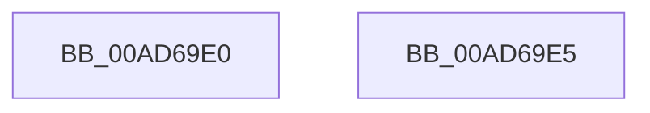

# CmSiRWLockInitialize

- RVA: `0x00AD69E0`–`0x00AD69E6` (길이 `6` bytes)
- VA: `0x0000000140AD69E0`
- 실행 섹션: `PAGE`
- PDB 이름 있음: `예`; PDB Function 태그: `아니요`
- unwind 정보 RVA: `0x000DB714`
- 디코드: `3`개 명령, `6/6` bytes 표시
- 미해석 바이트: `0` (있으면 어셈블리에 `.byte`로 보존)

> 이 문서는 커널 이미지의 기계어와 PDB 기호를 분석해 생성했습니다. 4번과 5번은 함수 원형과 자료형을 바이너리 사용 방식에서 추정한 C 해석이며 원본 소스 복구 결과는 아닙니다.

## 1. Dependencies

- 직접 호출 지점: **0**; 고유 호출 대상: **0**
- 직접 호출자로 확인된 함수: **10**
- RIP 상대 이미지 참조: **0**

### Outgoing calls
- 직접 디코드된 call 명령이 없습니다.

### Direct callers
- [SleepstudyHelperCreateLibraryEx](../../text/4B/SleepstudyHelperCreateLibraryEx_function_004BAE50.md) at `0x004BAEE4`
- [RTLP_FLS_CALLBACK_ENTRY::RTLP_FLS_CALLBACK_ENTRY](../../text/5F/RTLP_FLS_CALLBACK_ENTRY_RTLP_FLS_CALLBACK_ENTRY_function_005F0558.md) at `0x005F055C`
- [RtlHpHeapManagerInitialize](../../text/5F/RtlHpHeapManagerInitialize_function_005F0B20.md) at `0x005F0C24`
- [RtlpHpHeapCreate](../../text/60/RtlpHpHeapCreate_function_00602FDC.md) at `0x006032CD`
- [DbgkpInitializePhase0](../../init/C2/DbgkpInitializePhase0_function_00C26268.md) at `0x00C26381`
- [SshInitialize](../../init/C4/SshInitialize_function_00C4465C.md) at `0x00C44671`
- [SshInitialize](../../init/C4/SshInitialize_function_00C4465C.md) at `0x00C446AB`
- [SshpSessionManagerInitialize](../../init/C4/SshpSessionManagerInitialize_function_00C44820.md) at `0x00C4482B`
- [SshpAlpcInitialize](../../init/C4/SshpAlpcInitialize_function_00C448B4.md) at `0x00C44929`
- [CmFcManagerInitialize](../../init/C5/CmFcManagerInitialize_function_00C5D93C.md) at `0x00C5D964`
- [CmFcManagerInitialize](../../init/C5/CmFcManagerInitialize_function_00C5D93C.md) at `0x00C5D970`
- [CmFcManagerInitialize](../../init/C5/CmFcManagerInitialize_function_00C5D93C.md) at `0x00C5D9E7`
- [CmFcManagerInitialize](../../init/C5/CmFcManagerInitialize_function_00C5D93C.md) at `0x00C5DA4E`
- [CmFcManagerInitialize](../../init/C5/CmFcManagerInitialize_function_00C5D93C.md) at `0x00C5DA84`
- [CmFcManagerInitialize](../../init/C5/CmFcManagerInitialize_function_00C5D93C.md) at `0x00C5DB01`
- [PspInitPhase0](../../init/C7/PspInitPhase0_function_00C77E2C.md) at `0x00C7803A`
- [PspInitPhase0](../../init/C7/PspInitPhase0_function_00C77E2C.md) at `0x00C78052`
- [PspInitPhase0](../../init/C7/PspInitPhase0_function_00C77E2C.md) at `0x00C7806A`
- [PspInitPhase0](../../init/C7/PspInitPhase0_function_00C77E2C.md) at `0x00C787F1`
- [PspInitPhase0](../../init/C7/PspInitPhase0_function_00C77E2C.md) at `0x00C787FD`

### Static image references
- 디코드된 RIP-relative 메모리 참조가 없습니다.

## 2. Other-region calls and transfers

- 다른 실행 섹션으로 향하는 call: **0**
- 별도 외부 분기/꼬리 이동을 확인하지 못했습니다.

## 3. Assembly (complete function range)

```asm
00AD69E0  48 83 21 00                     and qword ptr [rcx], 0
00AD69E4  C3                              ret
00AD69E5  CC                              int3
```

## 4. C-style interpretation (structured pseudocode)

```c
void __fastcall CmSiRWLockInitialize(__int64 a1)
{
    return;
}
```

## 5. (Beta) C Style

```c
void CmSiRWLockInitialize(void *Arg1)
{
    uint8_t *arg1 = (uint8_t *)Arg1;

    return;
}
```

### 관측된 메모리 오프셋

구조체 형식이 확인되지 않은 접근은 인자 기준의 오프셋으로만 기록했습니다.

| 기준 인자 | 오프셋 표현 | 폭 (bit) | 접근 |
|---|---:|---:|---|
| `Arg1` | `+ 0x0` | `64` | `R/W` |

## 6. Execution-region graph

[열기: 2D/3D 그래프와 함수 탐색 컨트롤 패널](../../../control-panel.html?section=page&rva=0x00AD69E0&view=graph)

- 2D 그래프는 위에서 아래로 흐르고, 3D 그래프는 빈 공간을 드래그해 회전합니다. Shift+드래그는 이동, 휠은 확대·축소, 함수 노드 선택은 대상 보고서 이동입니다.

### Static fallback


