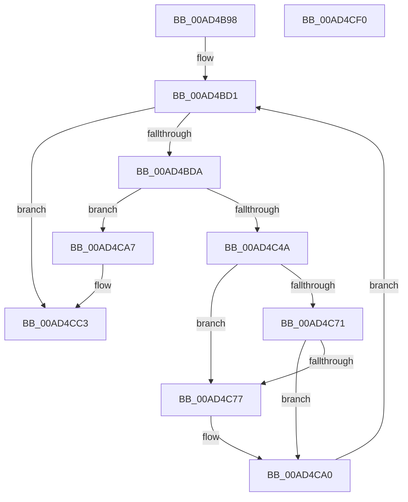

# CmpMachineHiveListInitialize

- RVA: `0x00AD4B98`–`0x00AD4CF1` (길이 `345` bytes)
- VA: `0x0000000140AD4B98`
- 실행 섹션: `PAGE`
- PDB 이름 있음: `예`; PDB Function 태그: `아니요`
- unwind 정보 RVA: `0x000BECFC`
- 디코드: `86`개 명령, `345/345` bytes 표시
- 미해석 바이트: `0` (있으면 어셈블리에 `.byte`로 보존)

> 이 문서는 커널 이미지의 기계어와 PDB 기호를 분석해 생성했습니다. 4번과 5번은 함수 원형과 자료형을 바이너리 사용 방식에서 추정한 C 해석이며 원본 소스 복구 결과는 아닙니다.

## 1. Dependencies

- 직접 호출 지점: **9**; 고유 호출 대상: **7**
- 직접 호출자로 확인된 함수: **1**
- RIP 상대 이미지 참조: **3**

### Outgoing calls
- `0x00AD4BF6` → [KeInitializeEvent](../../text/40/KeInitializeEvent_function_0040DD10.md) (function, `0x0040DD10`)
- `0x00AD4C06` → [KeInitializeEvent](../../text/40/KeInitializeEvent_function_0040DD10.md) (function, `0x0040DD10`)
- `0x00AD4C2A` → [CmpBuildMachineHiveMountPoint](../7D/CmpBuildMachineHiveMountPoint_function_007D9F00.md) (function, `0x007D9F00`)
- `0x00AD4C3D` → [ExAllocatePool2](../../poolcode/B8/ExAllocatePool2_function_00B820F0.md) (function, `0x00B820F0`)
- `0x00AD4C68` → [CmpQueryHiveRedirectionFileList](../87/CmpQueryHiveRedirectionFileList_function_00879094.md) (function, `0x00879094`)
- `0x00AD4C90` → [RtlAppendUnicodeToString](../../text/40/RtlAppendUnicodeToString_function_0040F990.md) (function, `0x0040F990`)
- `0x00AD4C9B` → [RtlAppendUnicodeToString](../../text/40/RtlAppendUnicodeToString_function_0040F990.md) (function, `0x0040F990`)
- `0x00AD4CBD` → [KeBugCheckEx](../../text/4F/KeBugCheckEx_function_004FD660.md) (function, `0x004FD660`)
- `0x00AD4CCE` → [_security_check_cookie](../../text/6A/_security_check_cookie_function_006AC640.md) (function, `0x006AC640`)

### Direct callers
- [CmInitSystem2](../../init/C6/CmInitSystem2_function_00C6FDD8.md) at `0x00C6FE41`

### Static image references
- `0x00AD4BB3` → RVA `0x00E0A740` (`.data`; read)
- `0x00AD4BDA` → RVA `0x00E098A0` (`.data`; read)
- `0x00AD4C7A` → RVA `0x00B097B0` (` ?? ::NNGAKEGL::`string'`; read)

## 2. Other-region calls and transfers

- 다른 실행 섹션으로 향하는 call: **7**
  - `0x00AD4BF6` → [KeInitializeEvent](../../text/40/KeInitializeEvent_function_0040DD10.md) (`PAGE` → `.text`)
  - `0x00AD4C06` → [KeInitializeEvent](../../text/40/KeInitializeEvent_function_0040DD10.md) (`PAGE` → `.text`)
  - `0x00AD4C3D` → [ExAllocatePool2](../../poolcode/B8/ExAllocatePool2_function_00B820F0.md) (`PAGE` → `POOLCODE`)
  - `0x00AD4C90` → [RtlAppendUnicodeToString](../../text/40/RtlAppendUnicodeToString_function_0040F990.md) (`PAGE` → `.text`)
  - `0x00AD4C9B` → [RtlAppendUnicodeToString](../../text/40/RtlAppendUnicodeToString_function_0040F990.md) (`PAGE` → `.text`)
  - `0x00AD4CBD` → [KeBugCheckEx](../../text/4F/KeBugCheckEx_function_004FD660.md) (`PAGE` → `.text`)
  - `0x00AD4CCE` → [_security_check_cookie](../../text/6A/_security_check_cookie_function_006AC640.md) (`PAGE` → `.text`)
- 별도 외부 분기/꼬리 이동을 확인하지 못했습니다.

## 3. Assembly (complete function range)

```asm
00AD4B98  48 89 5C 24 08                  mov qword ptr [rsp + 8], rbx
00AD4B9D  48 89 6C 24 10                  mov qword ptr [rsp + 0x10], rbp
00AD4BA2  48 89 74 24 18                  mov qword ptr [rsp + 0x18], rsi
00AD4BA7  57                              push rdi
00AD4BA8  41 56                           push r14
00AD4BAA  41 57                           push r15
00AD4BAC  48 81 EC D0 00 00 00            sub rsp, 0xd0
00AD4BB3  48 8B 05 86 5B 33 00            mov rax, qword ptr [rip + 0x335b86]
00AD4BBA  48 33 C4                        xor rax, rsp
00AD4BBD  48 89 84 24 C0 00 00 00         mov qword ptr [rsp + 0xc0], rax
00AD4BC5  33 FF                           xor edi, edi
00AD4BC7  41 BF 80 00 00 00               mov r15d, 0x80
00AD4BCD  44 8D 77 02                     lea r14d, [rdi + 2]
00AD4BD1  83 FF 07                        cmp edi, 7
00AD4BD4  0F 83 E9 00 00 00               jae 0x140ad4cc3
00AD4BDA  48 8D 05 BF 4C 33 00            lea rax, [rip + 0x334cbf]
00AD4BE1  8B DF                           mov ebx, edi
00AD4BE3  48 69 F3 B8 00 00 00            imul rsi, rbx, 0xb8
00AD4BEA  45 33 C0                        xor r8d, r8d
00AD4BED  33 D2                           xor edx, edx
00AD4BEF  48 03 F0                        add rsi, rax
00AD4BF2  48 8D 4E 40                     lea rcx, [rsi + 0x40]
00AD4BF6  E8 15 91 93 FF                  call 0x14040dd10
00AD4BFB  45 33 C0                        xor r8d, r8d
00AD4BFE  48 8D 4E 58                     lea rcx, [rsi + 0x58]
00AD4C02  41 8D 50 01                     lea edx, [r8 + 1]
00AD4C06  E8 05 91 93 FF                  call 0x14040dd10
00AD4C0B  0F 57 C0                        xorps xmm0, xmm0
00AD4C0E  48 8D 44 24 40                  lea rax, [rsp + 0x40]
00AD4C13  0F 11 44 24 30                  movups xmmword ptr [rsp + 0x30], xmm0
00AD4C18  48 8D 54 24 30                  lea rdx, [rsp + 0x30]
00AD4C1D  66 44 89 7C 24 32               mov word ptr [rsp + 0x32], r15w
00AD4C23  8B CF                           mov ecx, edi
00AD4C25  48 89 44 24 38                  mov qword ptr [rsp + 0x38], rax
00AD4C2A  E8 D1 52 D0 FF                  call 0x1407d9f00
00AD4C2F  41 B8 43 4D 36 32               mov r8d, 0x32364d43
00AD4C35  49 8B D7                        mov rdx, r15
00AD4C38  B9 00 01 00 00                  mov ecx, 0x100
00AD4C3D  E8 AE D4 0A 00                  call 0x140b820f0
00AD4C42  48 8B E8                        mov rbp, rax
00AD4C45  48 85 C0                        test rax, rax
00AD4C48  74 5D                           je 0x140ad4ca7
00AD4C4A  48 8D 9E A8 00 00 00            lea rbx, [rsi + 0xa8]
00AD4C51  0F 57 C0                        xorps xmm0, xmm0
00AD4C54  0F 11 03                        movups xmmword ptr [rbx], xmm0
00AD4C57  48 8B D3                        mov rdx, rbx
00AD4C5A  66 44 89 7B 02                  mov word ptr [rbx + 2], r15w
00AD4C5F  48 8D 4C 24 30                  lea rcx, [rsp + 0x30]
00AD4C64  48 89 43 08                     mov qword ptr [rbx + 8], rax
00AD4C68  E8 27 44 DA FF                  call 0x140879094
00AD4C6D  84 C0                           test al, al
00AD4C6F  74 06                           je 0x140ad4c77
00AD4C71  66 44 39 33                     cmp word ptr [rbx], r14w
00AD4C75  75 29                           jne 0x140ad4ca0
00AD4C77  0F 57 C0                        xorps xmm0, xmm0
00AD4C7A  48 8D 15 2F 4B 03 00            lea rdx, [rip + 0x34b2f]
00AD4C81  0F 11 03                        movups xmmword ptr [rbx], xmm0
00AD4C84  48 8B CB                        mov rcx, rbx
00AD4C87  66 44 89 7B 02                  mov word ptr [rbx + 2], r15w
00AD4C8C  48 89 6B 08                     mov qword ptr [rbx + 8], rbp
00AD4C90  E8 FB AC 93 FF                  call 0x14040f990
00AD4C95  48 8B 16                        mov rdx, qword ptr [rsi]
00AD4C98  48 8B CB                        mov rcx, rbx
00AD4C9B  E8 F0 AC 93 FF                  call 0x14040f990
00AD4CA0  FF C7                           inc edi
00AD4CA2  E9 2A FF FF FF                  jmp 0x140ad4bd1
00AD4CA7  48 83 64 24 20 00               and qword ptr [rsp + 0x20], 0
00AD4CAD  41 B8 05 00 00 00               mov r8d, 5
00AD4CB3  4C 8B CB                        mov r9, rbx
00AD4CB6  49 8B D6                        mov rdx, r14
00AD4CB9  41 8D 48 6F                     lea ecx, [r8 + 0x6f]
00AD4CBD  E8 9E 89 A2 FF                  call 0x1404fd660
00AD4CC2  CC                              int3
00AD4CC3  48 8B 8C 24 C0 00 00 00         mov rcx, qword ptr [rsp + 0xc0]
00AD4CCB  48 33 CC                        xor rcx, rsp
00AD4CCE  E8 6D 79 BD FF                  call 0x1406ac640
00AD4CD3  4C 8D 9C 24 D0 00 00 00         lea r11, [rsp + 0xd0]
00AD4CDB  49 8B 5B 20                     mov rbx, qword ptr [r11 + 0x20]
00AD4CDF  49 8B 6B 28                     mov rbp, qword ptr [r11 + 0x28]
00AD4CE3  49 8B 73 30                     mov rsi, qword ptr [r11 + 0x30]
00AD4CE7  49 8B E3                        mov rsp, r11
00AD4CEA  41 5F                           pop r15
00AD4CEC  41 5E                           pop r14
00AD4CEE  5F                              pop rdi
00AD4CEF  C3                              ret
00AD4CF0  CC                              int3
```

## 4. C-style interpretation (structured pseudocode)

```c
__int64 __fastcall CmpMachineHiveListInitialize(__int64 a1, int a2, int a3)
{
    __int64 result;
    __int64 v_rdi;
    __int64 v_rsi;
    __int64 v_rsp;
    unsigned __int64 v_stack_m18;
    unsigned __int64 v_stack_m28;
    unsigned __int64 v_stack_mA8;
    unsigned __int64 v_stack_mB0;
    unsigned __int16 v_stack_mB6;
    unsigned __int64 v_stack_mB8;
    unsigned __int64 v_stack_mC8;
    unsigned __int64 v_stack_p10;
    unsigned __int64 v_stack_p18;
    unsigned __int64 v_stack_p8;

    v_stack_p8 = v_rbx;
    v_stack_p10 = v_rbp;
    v_stack_p18 = v_rsi;
    v_rsp = (v_rsp) - (208);
    result = (*(unsigned __int64 *)(v_rip + 3365766)) ^ (v_rsp);
    v_stack_m28 = result;
    v_rdi = 0;
loc_00AD4BD1:
    if (0 >= 7) goto loc_00AD4CC3;
    v_rsi = (v_rsi) * (0);
    a3 = 0;
    a2 = 0;
    v_rsi = (v_rsi) + (v_rip + 3361983);
    result = KeInitializeEvent(v_rsi + 64, a2, a3, a4);
    a3 = 0;
    result = KeInitializeEvent(v_rsi + 88, a3 + 1, a3, a4);
    v_stack_mB8 = v_xmm0;
    v_stack_mB6 = 128;
    v_stack_mB0 = v_stack_mA8;
    result = CmpBuildMachineHiveMountPoint(0, v_stack_mB8, a3, a4);
    result = ExAllocatePool2(256, 128, (unsigned int)(0x32364D43ULL), a4);
    if (result == 0) goto loc_00AD4CA7;
    *(unsigned __int64 *)(v_rsi + 168) = v_xmm0;
    *(unsigned __int16 *)(v_rsi + 168 + 2) = 128;
    *(unsigned __int64 *)(v_rsi + 168 + 8) = result;
    result = CmpQueryHiveRedirectionFileList(v_stack_mB8, v_rsi + 168, (unsigned int)(0x32364D43ULL), a4);
    if ((unsigned __int8)(result) == 0) goto loc_00AD4C77;
    if ((*(unsigned __int16 *)(v_rsi + 168)) == ((unsigned __int16)(v_rdi + 2))) {
        a2 = v_rip + 215855;
        *(unsigned __int64 *)(v_rsi + 168) = v_xmm0;
        a1 = v_rsi + 168;
        *(unsigned __int16 *)(v_rsi + 168 + 2) = 128;
        *(unsigned __int64 *)(v_rsi + 168 + 8) = result;
        result = RtlAppendUnicodeToString(a1, a2, (unsigned int)(0x32364D43ULL), a4);
        a2 = *(unsigned __int64 *)(v_rsi);
        a1 = v_rsi + 168;
        result = RtlAppendUnicodeToString(a1, a2, (unsigned int)(0x32364D43ULL), a4);
    }
    v_rdi = (unsigned int)((v_rdi) + 1);
    goto loc_00AD4BD1;
loc_00AD4CA7:
    result = KeBugCheckEx(5 + 111, v_rdi + 2, 5, v_rsi + 168);
loc_00AD4CC3:
    a1 = (v_stack_m28) ^ (v_rsp);
    result = _security_check_cookie(a1, v_rdi + 2, 5, v_rsi + 168);
    return result;
}
```

## 5. (Beta) C Style

```c
int64_t CmpMachineHiveListInitialize(int64_t Arg1, int32_t Arg2, int32_t Arg3)
{
    int64_t result;
    int64_t local_rdi;
    int64_t local_rsi;
    int64_t local_rsp;
    uint64_t v_stack_m18;
    uint64_t v_stack_m28;
    uint64_t v_stack_mA8;
    uint64_t v_stack_mB0;
    uint16_t v_stack_mB6;
    uint64_t v_stack_mB8;
    uint64_t v_stack_mC8;
    uint64_t v_stack_p10;
    uint64_t v_stack_p18;
    uint64_t v_stack_p8;

    v_stack_p8 = local_rbx;
    v_stack_p10 = local_rbp;
    v_stack_p18 = local_rsi;
    local_rsp = (local_rsp) - (208);
    result = (*(uint64_t *)(v_rip + 0x335B86)) ^ (local_rsp);
    v_stack_m28 = result;
    local_rdi = 0;
loc_00AD4BD1:
    if (0 >= 7) goto loc_00AD4CC3;
    local_rsi = (local_rsi) * (0);
    Arg3 = 0;
    Arg2 = 0;
    local_rsi = (local_rsi) + (v_rip + 3361983);
    result = KeInitializeEvent(local_rsi + 64, Arg2, Arg3, a4);
    Arg3 = 0;
    result = KeInitializeEvent(local_rsi + 88, Arg3 + 1, Arg3, a4);
    v_stack_mB8 = v_xmm0;
    v_stack_mB6 = 128;
    v_stack_mB0 = v_stack_mA8;
    result = CmpBuildMachineHiveMountPoint(0, v_stack_mB8, Arg3, a4);
    result = ExAllocatePool2(256, 128, (uint32_t)(0x32364D43ULL), a4);
    if (result == 0) goto loc_00AD4CA7;
    *(uint64_t *)(local_rsi + 0xA8) = v_xmm0;
    *(uint16_t *)(local_rsi + 0xA8 + 0x2) = 128;
    *(uint64_t *)(local_rsi + 0xA8 + 0x8) = result;
    result = CmpQueryHiveRedirectionFileList(v_stack_mB8, local_rsi + 168, (uint32_t)(0x32364D43ULL), a4);
    if ((uint8_t)(result) == 0) goto loc_00AD4C77;
    if ((*(uint16_t *)(local_rsi + 0xA8)) == ((uint16_t)(local_rdi + 2))) {
        Arg2 = v_rip + 215855;
        *(uint64_t *)(local_rsi + 0xA8) = v_xmm0;
        Arg1 = local_rsi + 168;
        *(uint16_t *)(local_rsi + 0xA8 + 0x2) = 128;
        *(uint64_t *)(local_rsi + 0xA8 + 0x8) = result;
        result = RtlAppendUnicodeToString(Arg1, Arg2, (uint32_t)(0x32364D43ULL), a4);
        Arg2 = *(uint64_t *)(local_rsi);
        Arg1 = local_rsi + 168;
        result = RtlAppendUnicodeToString(Arg1, Arg2, (uint32_t)(0x32364D43ULL), a4);
    }
    local_rdi = (uint32_t)((local_rdi) + 1);
    goto loc_00AD4BD1;
loc_00AD4CA7:
    result = KeBugCheckEx(5 + 111, local_rdi + 2, 5, local_rsi + 168);
loc_00AD4CC3:
    Arg1 = (v_stack_m28) ^ (local_rsp);
    result = _security_check_cookie(Arg1, local_rdi + 2, 5, local_rsi + 168);
    return result;
}
```

## 6. Execution-region graph

[열기: 2D/3D 그래프와 함수 탐색 컨트롤 패널](../../../control-panel.html?section=page&rva=0x00AD4B98&view=graph)

- 2D 그래프는 위에서 아래로 흐르고, 3D 그래프는 빈 공간을 드래그해 회전합니다. Shift+드래그는 이동, 휠은 확대·축소, 함수 노드 선택은 대상 보고서 이동입니다.

### Static fallback


