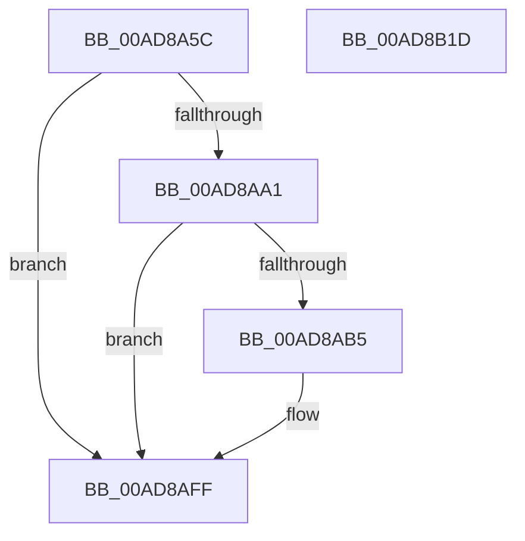

# CmpTraceHiveSaveStart

- RVA: `0x00AD8A5C`–`0x00AD8B1E` (길이 `194` bytes)
- VA: `0x0000000140AD8A5C`
- 실행 섹션: `PAGE`
- PDB 이름 있음: `예`; PDB Function 태그: `아니요`
- unwind 정보 RVA: `0x000BF160`
- 디코드: `51`개 명령, `194/194` bytes 표시
- 미해석 바이트: `0` (있으면 어셈블리에 `.byte`로 보존)

> 이 문서는 커널 이미지의 기계어와 PDB 기호를 분석해 생성했습니다. 4번과 5번은 함수 원형과 자료형을 바이너리 사용 방식에서 추정한 C 해석이며 원본 소스 복구 결과는 아닙니다.

## 1. Dependencies

- 직접 호출 지점: **5**; 고유 호출 대상: **5**
- 직접 호출자로 확인된 함수: **1**
- RIP 상대 이미지 참조: **3**

### Outgoing calls
- `0x00AD8A96` → [EtwEventEnabled](../../text/39/EtwEventEnabled_function_00392450.md) (function, `0x00392450`)
- `0x00AD8AA8` → [CmpConstructName](../85/CmpConstructName_function_00856BE0.md) (function, `0x00856BE0`)
- `0x00AD8AED` → [EtwWrite](../../text/41/EtwWrite_function_0041C720.md) (function, `0x0041C720`)
- `0x00AD8AFA` → [CmpFreePoolWithTag](../../text/44/CmpFreePoolWithTag_function_004489E0.md) (function, `0x004489E0`)
- `0x00AD8B06` → [_security_check_cookie](../../text/6A/_security_check_cookie_function_006AC640.md) (function, `0x006AC640`)

### Direct callers
- [CmSaveKey](../7D/CmSaveKey_function_007DDBDC.md) at `0x007DDD07`

### Static image references
- `0x00AD8A6E` → RVA `0x00E0A740` (`.data`; read)
- `0x00AD8A7C` → RVA `0x0001ED60` (`.rdata`; read)
- `0x00AD8A8A` → RVA `0x00FD8018` (`PAGEDATA`; read)

## 2. Other-region calls and transfers

- 다른 실행 섹션으로 향하는 call: **4**
  - `0x00AD8A96` → [EtwEventEnabled](../../text/39/EtwEventEnabled_function_00392450.md) (`PAGE` → `.text`)
  - `0x00AD8AED` → [EtwWrite](../../text/41/EtwWrite_function_0041C720.md) (`PAGE` → `.text`)
  - `0x00AD8AFA` → [CmpFreePoolWithTag](../../text/44/CmpFreePoolWithTag_function_004489E0.md) (`PAGE` → `.text`)
  - `0x00AD8B06` → [_security_check_cookie](../../text/6A/_security_check_cookie_function_006AC640.md) (`PAGE` → `.text`)
- 별도 외부 분기/꼬리 이동을 확인하지 못했습니다.

## 3. Assembly (complete function range)

```asm
00AD8A5C  48 89 5C 24 10                  mov qword ptr [rsp + 0x10], rbx
00AD8A61  48 89 7C 24 18                  mov qword ptr [rsp + 0x18], rdi
00AD8A66  55                              push rbp
00AD8A67  48 8B EC                        mov rbp, rsp
00AD8A6A  48 83 EC 70                     sub rsp, 0x70
00AD8A6E  48 8B 05 CB 1C 33 00            mov rax, qword ptr [rip + 0x331ccb]
00AD8A75  48 33 C4                        xor rax, rsp
00AD8A78  48 89 45 F8                     mov qword ptr [rbp - 8], rax
00AD8A7C  0F 10 05 DD 62 54 FF            movups xmm0, xmmword ptr [rip - 0xab9d23]
00AD8A83  48 8B D9                        mov rbx, rcx
00AD8A86  48 8D 55 C8                     lea rdx, [rbp - 0x38]
00AD8A8A  48 8B 0D 87 F5 4F 00            mov rcx, qword ptr [rip + 0x4ff587]
00AD8A91  F3 0F 7F 45 C8                  movdqu xmmword ptr [rbp - 0x38], xmm0
00AD8A96  E8 B5 99 8B FF                  call 0x140392450
00AD8A9B  33 FF                           xor edi, edi
00AD8A9D  84 C0                           test al, al
00AD8A9F  74 5E                           je 0x140ad8aff
00AD8AA1  48 8B CB                        mov rcx, rbx
00AD8AA4  66 89 7D C0                     mov word ptr [rbp - 0x40], di
00AD8AA8  E8 33 E1 D7 FF                  call 0x140856be0
00AD8AAD  48 8B D8                        mov rbx, rax
00AD8AB0  48 85 C0                        test rax, rax
00AD8AB3  74 4A                           je 0x140ad8aff
00AD8AB5  0F B7 10                        movzx edx, word ptr [rax]
00AD8AB8  44 8D 4F 02                     lea r9d, [rdi + 2]
00AD8ABC  48 8B 48 08                     mov rcx, qword ptr [rax + 8]
00AD8AC0  45 33 C0                        xor r8d, r8d
00AD8AC3  48 8D 45 C0                     lea rax, [rbp - 0x40]
00AD8AC7  48 89 4D D8                     mov qword ptr [rbp - 0x28], rcx
00AD8ACB  48 8B 0D 46 F5 4F 00            mov rcx, qword ptr [rip + 0x4ff546]
00AD8AD2  48 89 45 E8                     mov qword ptr [rbp - 0x18], rax
00AD8AD6  48 8D 45 D8                     lea rax, [rbp - 0x28]
00AD8ADA  89 55 E0                        mov dword ptr [rbp - 0x20], edx
00AD8ADD  48 8D 55 C8                     lea rdx, [rbp - 0x38]
00AD8AE1  48 89 44 24 20                  mov qword ptr [rsp + 0x20], rax
00AD8AE6  89 7D E4                        mov dword ptr [rbp - 0x1c], edi
00AD8AE9  4C 89 4D F0                     mov qword ptr [rbp - 0x10], r9
00AD8AED  E8 2E 3C 94 FF                  call 0x14041c720
00AD8AF2  BA 43 4D 4E 62                  mov edx, 0x624e4d43
00AD8AF7  48 8B CB                        mov rcx, rbx
00AD8AFA  E8 E1 FE 96 FF                  call 0x1404489e0
00AD8AFF  48 8B 4D F8                     mov rcx, qword ptr [rbp - 8]
00AD8B03  48 33 CC                        xor rcx, rsp
00AD8B06  E8 35 3B BD FF                  call 0x1406ac640
00AD8B0B  4C 8D 5C 24 70                  lea r11, [rsp + 0x70]
00AD8B10  49 8B 5B 18                     mov rbx, qword ptr [r11 + 0x18]
00AD8B14  49 8B 7B 20                     mov rdi, qword ptr [r11 + 0x20]
00AD8B18  49 8B E3                        mov rsp, r11
00AD8B1B  5D                              pop rbp
00AD8B1C  C3                              ret
00AD8B1D  CC                              int3
```

## 4. C-style interpretation (structured pseudocode)

```c
__int64 __fastcall CmpTraceHiveSaveStart(__int64 a1, __int64 a2, int a3)
{
    __int64 result;
    __int64 v_rdi;
    __int64 v_rsp;
    unsigned __int64 v_stack_m10;
    unsigned __int64 v_stack_m18;
    unsigned __int64 v_stack_m20;
    unsigned int v_stack_m24;
    unsigned int v_stack_m28;
    unsigned __int64 v_stack_m30;
    unsigned __int64 v_stack_m40;
    unsigned __int16 v_stack_m48;
    unsigned __int64 v_stack_m58;
    unsigned __int64 v_stack_m8;
    unsigned __int64 v_stack_p10;
    unsigned __int64 v_stack_p18;

    v_stack_p10 = v_rbx;
    v_stack_p18 = v_rdi;
    v_rsp = (v_rsp) - (112);
    result = (*(unsigned __int64 *)(v_rip + 3349707)) ^ (v_rsp);
    v_stack_m10 = result;
    v_stack_m40 = v_xmm0;
    result = EtwEventEnabled(*(unsigned __int64 *)(v_rip + 5240199), v_stack_m40, a3, a4);
    v_rdi = 0;
    if ((unsigned __int8)(result) == 0) goto loc_00AD8AFF;
    v_stack_m48 = 0;
    result = CmpConstructName(a1, v_stack_m40, a3, a4);
    if (result != 0) {
        a2 = *(unsigned __int16 *)(result);
        a4 = v_rdi + 2;
        a1 = *(unsigned __int64 *)(result + 8);
        a3 = 0;
        result = v_stack_m48;
        v_stack_m30 = a1;
        a1 = *(unsigned __int64 *)(v_rip + 5240134);
        v_stack_m20 = result;
        result = v_stack_m30;
        v_stack_m28 = (unsigned int)(a2);
        a2 = v_stack_m40;
        v_stack_m58 = result;
        v_stack_m24 = 0;
        v_stack_m18 = a4;
        result = EtwWrite(a1, a2, a3, a4);
        a2 = 0x624E4D43ULL;
        a1 = result;
        result = CmpFreePoolWithTag(a1, a2, a3, a4);
    }
    a1 = (v_stack_m10) ^ (v_rsp);
    result = _security_check_cookie(a1, a2, a3, a4);
    return result;
}
```

## 5. (Beta) C Style

```c
int64_t CmpTraceHiveSaveStart(int64_t Arg1, int64_t Arg2, int32_t Arg3)
{
    int64_t result;
    int64_t local_rdi;
    int64_t local_rsp;
    uint64_t v_stack_m10;
    uint64_t v_stack_m18;
    uint64_t v_stack_m20;
    uint32_t v_stack_m24;
    uint32_t v_stack_m28;
    uint64_t v_stack_m30;
    uint64_t v_stack_m40;
    uint16_t v_stack_m48;
    uint64_t v_stack_m58;
    uint64_t v_stack_m8;
    uint64_t v_stack_p10;
    uint64_t v_stack_p18;

    v_stack_p10 = local_rbx;
    v_stack_p18 = local_rdi;
    local_rsp = (local_rsp) - (112);
    result = (*(uint64_t *)(v_rip + 0x331CCB)) ^ (local_rsp);
    v_stack_m10 = result;
    v_stack_m40 = v_xmm0;
    result = EtwEventEnabled(*(uint64_t *)(v_rip + 0x4FF587), v_stack_m40, Arg3, a4);
    local_rdi = 0;
    if ((uint8_t)(result) == 0) goto loc_00AD8AFF;
    v_stack_m48 = 0;
    result = CmpConstructName(Arg1, v_stack_m40, Arg3, a4);
    if (result != 0) {
        Arg2 = *(uint16_t *)(result);
        a4 = local_rdi + 2;
        Arg1 = *(uint64_t *)(result + 0x8);
        Arg3 = 0;
        result = v_stack_m48;
        v_stack_m30 = Arg1;
        Arg1 = *(uint64_t *)(v_rip + 0x4FF546);
        v_stack_m20 = result;
        result = v_stack_m30;
        v_stack_m28 = (uint32_t)(Arg2);
        Arg2 = v_stack_m40;
        v_stack_m58 = result;
        v_stack_m24 = 0;
        v_stack_m18 = a4;
        result = EtwWrite(Arg1, Arg2, Arg3, a4);
        Arg2 = 0x624E4D43ULL;
        Arg1 = result;
        result = CmpFreePoolWithTag(Arg1, Arg2, Arg3, a4);
    }
    Arg1 = (v_stack_m10) ^ (local_rsp);
    result = _security_check_cookie(Arg1, Arg2, Arg3, a4);
    return result;
}
```

## 6. Execution-region graph

[열기: 2D/3D 그래프와 함수 탐색 컨트롤 패널](../../../control-panel.html?section=page&rva=0x00AD8A5C&view=graph)

- 2D 그래프는 위에서 아래로 흐르고, 3D 그래프는 빈 공간을 드래그해 회전합니다. Shift+드래그는 이동, 휠은 확대·축소, 함수 노드 선택은 대상 보고서 이동입니다.

### Static fallback


