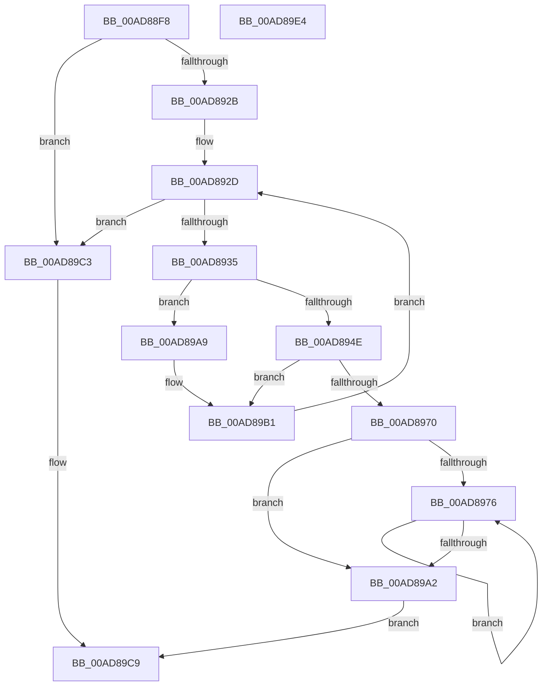

# EtwpCCSwapStart

- RVA: `0x00AD88F8`–`0x00AD89E5` (길이 `237` bytes)
- VA: `0x0000000140AD88F8`
- 실행 섹션: `PAGE`
- PDB 이름 있음: `예`; PDB Function 태그: `아니요`
- unwind 정보 RVA: `0x0008FC44`
- 디코드: `57`개 명령, `237/237` bytes 표시
- 미해석 바이트: `0` (있으면 어셈블리에 `.byte`로 보존)

> 이 문서는 커널 이미지의 기계어와 PDB 기호를 분석해 생성했습니다. 4번과 5번은 함수 원형과 자료형을 바이너리 사용 방식에서 추정한 C 해석이며 원본 소스 복구 결과는 아닙니다.

## 1. Dependencies

- 직접 호출 지점: **4**; 고유 호출 대상: **3**
- 직접 호출자로 확인된 함수: **1**
- RIP 상대 이미지 참조: **2**

### Outgoing calls
- `0x00AD8937` → [KeGetPrcb](../../text/2D/KeGetPrcb_function_002D85D0.md) (function, `0x002D85D0`)
- `0x00AD895E` → [ExAllocatePool2](../../poolcode/B8/ExAllocatePool2_function_00B820F0.md) (function, `0x00B820F0`)
- `0x00AD8978` → [KeGetPrcb](../../text/2D/KeGetPrcb_function_002D85D0.md) (function, `0x002D85D0`)
- `0x00AD898E` → [ExFreePoolWithTag](../../poolcode/B8/ExFreePoolWithTag_function_00B82870.md) (function, `0x00B82870`)

### Direct callers
- [EtwpUpdateSelectedGroupMasks](../../text/49/EtwpUpdateSelectedGroupMasks_function_0049B114.md) at `0x0049B4E0`

### Static image references
- `0x00AD8911` → RVA `0x00FC6A80` (`ALMOSTRO`; read)
- `0x00AD8917` → RVA `0x00E68520` (`.data`; read)

## 2. Other-region calls and transfers

- 다른 실행 섹션으로 향하는 call: **4**
  - `0x00AD8937` → [KeGetPrcb](../../text/2D/KeGetPrcb_function_002D85D0.md) (`PAGE` → `.text`)
  - `0x00AD895E` → [ExAllocatePool2](../../poolcode/B8/ExAllocatePool2_function_00B820F0.md) (`PAGE` → `POOLCODE`)
  - `0x00AD8978` → [KeGetPrcb](../../text/2D/KeGetPrcb_function_002D85D0.md) (`PAGE` → `.text`)
  - `0x00AD898E` → [ExFreePoolWithTag](../../poolcode/B8/ExFreePoolWithTag_function_00B82870.md) (`PAGE` → `POOLCODE`)
- 별도 외부 분기/꼬리 이동을 확인하지 못했습니다.

## 3. Assembly (complete function range)

```asm
00AD88F8  48 8B C4                        mov rax, rsp
00AD88FB  48 89 58 08                     mov qword ptr [rax + 8], rbx
00AD88FF  48 89 68 10                     mov qword ptr [rax + 0x10], rbp
00AD8903  48 89 70 18                     mov qword ptr [rax + 0x18], rsi
00AD8907  48 89 78 20                     mov qword ptr [rax + 0x20], rdi
00AD890B  41 57                           push r15
00AD890D  48 83 EC 20                     sub rsp, 0x20
00AD8911  8B 2D 69 E1 4E 00               mov ebp, dword ptr [rip + 0x4ee169]
00AD8917  4C 8D 3D 02 FC 38 00            lea r15, [rip + 0x38fc02]
00AD891E  8B F9                           mov edi, ecx
00AD8920  41 83 3C BF 00                  cmp dword ptr [r15 + rdi*4], 0
00AD8925  0F 85 98 00 00 00               jne 0x140ad89c3
00AD892B  33 F6                           xor esi, esi
00AD892D  3B F5                           cmp esi, ebp
00AD892F  0F 83 8E 00 00 00               jae 0x140ad89c3
00AD8935  8B CE                           mov ecx, esi
00AD8937  E8 94 FC 7F FF                  call 0x1402d85d0
00AD893C  48 8B 98 A8 8B 00 00            mov rbx, qword ptr [rax + 0x8ba8]
00AD8943  48 83 BC FB 98 01 00 00 00      cmp qword ptr [rbx + rdi*8 + 0x198], 0
00AD894C  75 5B                           jne 0x140ad89a9
00AD894E  BA 00 04 00 00                  mov edx, 0x400
00AD8953  B9 40 00 00 00                  mov ecx, 0x40
00AD8958  41 B8 43 43 73 77               mov r8d, 0x77734343
00AD895E  E8 8D 97 0A 00                  call 0x140b820f0
00AD8963  48 89 84 FB 98 01 00 00         mov qword ptr [rbx + rdi*8 + 0x198], rax
00AD896B  48 85 C0                        test rax, rax
00AD896E  75 41                           jne 0x140ad89b1
00AD8970  33 ED                           xor ebp, ebp
00AD8972  85 F6                           test esi, esi
00AD8974  74 2C                           je 0x140ad89a2
00AD8976  8B CD                           mov ecx, ebp
00AD8978  E8 53 FC 7F FF                  call 0x1402d85d0
00AD897D  33 D2                           xor edx, edx
00AD897F  48 8B 98 A8 8B 00 00            mov rbx, qword ptr [rax + 0x8ba8]
00AD8986  48 8B 8C FB 98 01 00 00         mov rcx, qword ptr [rbx + rdi*8 + 0x198]
00AD898E  E8 DD 9E 0A 00                  call 0x140b82870
00AD8993  48 83 A4 FB 98 01 00 00 00      and qword ptr [rbx + rdi*8 + 0x198], 0
00AD899C  FF C5                           inc ebp
00AD899E  3B EE                           cmp ebp, esi
00AD89A0  72 D4                           jb 0x140ad8976
00AD89A2  B8 17 00 00 C0                  mov eax, 0xc0000017
00AD89A7  EB 20                           jmp 0x140ad89c9
00AD89A9  C6 84 1F 90 01 00 00 00         mov byte ptr [rdi + rbx + 0x190], 0
00AD89B1  48 8B 84 FB 98 01 00 00         mov rax, qword ptr [rbx + rdi*8 + 0x198]
00AD89B9  83 20 00                        and dword ptr [rax], 0
00AD89BC  FF C6                           inc esi
00AD89BE  E9 6A FF FF FF                  jmp 0x140ad892d
00AD89C3  41 FF 04 BF                     inc dword ptr [r15 + rdi*4]
00AD89C7  33 C0                           xor eax, eax
00AD89C9  48 8B 5C 24 30                  mov rbx, qword ptr [rsp + 0x30]
00AD89CE  48 8B 6C 24 38                  mov rbp, qword ptr [rsp + 0x38]
00AD89D3  48 8B 74 24 40                  mov rsi, qword ptr [rsp + 0x40]
00AD89D8  48 8B 7C 24 48                  mov rdi, qword ptr [rsp + 0x48]
00AD89DD  48 83 C4 20                     add rsp, 0x20
00AD89E1  41 5F                           pop r15
00AD89E3  C3                              ret
00AD89E4  CC                              int3
```

## 4. C-style interpretation (structured pseudocode)

```c
__int64 __fastcall EtwpCCSwapStart(int a1)
{
    __int64 result;
    __int64 v_rbp;
    __int64 v_rsi;
    __int64 v_rsp;
    unsigned __int64 v_stack_p10;
    unsigned __int64 v_stack_p18;
    unsigned __int64 v_stack_p20;
    unsigned __int64 v_stack_p8;

    *(unsigned __int64 *)(v_rsp + 8) = v_rbx;
    *(unsigned __int64 *)(v_rsp + 16) = v_rbp;
    *(unsigned __int64 *)(v_rsp + 24) = v_rsi;
    *(unsigned __int64 *)(v_rsp + 32) = v_rdi;
    v_rsp = (v_rsp) - (32);
    if ((*(unsigned int *)(v_rip + 3734530 + (unsigned int)(a1) * 4)) != 0) goto loc_00AD89C3;
    v_rsi = 0;
loc_00AD892D:
    if (0 >= ((unsigned int)((unsigned int)(*(unsigned int *)(v_rip + 5169513))))) goto loc_00AD89C3;
    result = KeGetPrcb(0, a2, a3, a4);
    if ((*(unsigned __int64 *)(*(unsigned __int64 *)(result + 35752) + (unsigned int)(a1) * 8 + 408)) != 0) goto loc_00AD89A9;
    result = ExAllocatePool2(64, (unsigned int)(0x400ULL), (unsigned int)(0x77734343ULL), a4);
    *(unsigned __int64 *)(*(unsigned __int64 *)(result + 35752) + (unsigned int)(a1) * 8 + 408) = result;
    if (result != 0) goto loc_00AD89B1;
    v_rbp = 0;
    if (0 == 0) goto loc_00AD89A2;
loc_00AD8976:
    result = KeGetPrcb(0, (unsigned int)(0x400ULL), (unsigned int)(0x77734343ULL), a4);
    a2 = 0;
    result = ExFreePoolWithTag(*(unsigned __int64 *)(*(unsigned __int64 *)(result + 35752) + (unsigned int)(a1) * 8 + 408), a2, (unsigned int)(0x77734343ULL), a4);
    v_rbp = (unsigned int)((v_rbp) + 1);
    if (((unsigned int)(v_rbp)) < 0) goto loc_00AD8976;
loc_00AD89A2:
    goto loc_00AD89C9;
loc_00AD89A9:
    *(unsigned __int8 *)((unsigned int)(a1) + *(unsigned __int64 *)(result + 35752) * 1 + 400) = 0;
loc_00AD89B1:
    v_rsi = (unsigned int)((v_rsi) + 1);
    goto loc_00AD892D;
loc_00AD89C3:
    result = 0;
loc_00AD89C9:
    v_rsp = (v_rsp) + (32);
    return result;
}
```

## 5. (Beta) C Style

```c
int64_t EtwpCCSwapStart(void *Arg1)
{
    uint8_t *arg1 = (uint8_t *)Arg1;

    int64_t result;
    int64_t local_rbp;
    int64_t local_rsi;
    int64_t local_rsp;
    uint64_t v_stack_p10;
    uint64_t v_stack_p18;
    uint64_t v_stack_p20;
    uint64_t v_stack_p8;

    *(uint64_t *)(local_rsp + 0x8) = local_rbx;
    *(uint64_t *)(local_rsp + 0x10) = local_rbp;
    *(uint64_t *)(local_rsp + 0x18) = local_rsi;
    *(uint64_t *)(local_rsp + 0x20) = local_rdi;
    local_rsp = (local_rsp) - (32);
    if ((*(uint32_t *)(v_rip + 0x38FC02 + (uint32_t)(arg1) * 4)) != 0) goto loc_00AD89C3;
    local_rsi = 0;
loc_00AD892D:
    if (0 >= ((uint32_t)((uint32_t)(*(uint32_t *)(v_rip + 0x4EE169))))) goto loc_00AD89C3;
    result = KeGetPrcb(0, a2, a3, a4);
    if ((*(uint64_t *)(*(uint64_t *)(result + 0x8BA8) + (uint32_t)(arg1) * 8 + 0x198)) != 0) goto loc_00AD89A9;
    result = ExAllocatePool2(64, (uint32_t)(0x400ULL), (uint32_t)(0x77734343ULL), a4);
    *(uint64_t *)(*(uint64_t *)(result + 0x8BA8) + (uint32_t)(arg1) * 8 + 0x198) = result;
    if (result != 0) goto loc_00AD89B1;
    local_rbp = 0;
    if (0 == 0) goto loc_00AD89A2;
loc_00AD8976:
    result = KeGetPrcb(0, (uint32_t)(0x400ULL), (uint32_t)(0x77734343ULL), a4);
    a2 = 0;
    result = ExFreePoolWithTag(*(uint64_t *)(*(uint64_t *)(result + 0x8BA8) + (uint32_t)(arg1) * 8 + 0x198), a2, (uint32_t)(0x77734343ULL), a4);
    local_rbp = (uint32_t)((local_rbp) + 1);
    if (((uint32_t)(local_rbp)) < 0) goto loc_00AD8976;
loc_00AD89A2:
    goto loc_00AD89C9;
loc_00AD89A9:
    *(uint8_t *)((uint32_t)(arg1) + *(uint64_t *)(result + 0x8BA8) * 1 + 0x190) = 0;
loc_00AD89B1:
    local_rsi = (uint32_t)((local_rsi) + 1);
    goto loc_00AD892D;
loc_00AD89C3:
    result = 0;
loc_00AD89C9:
    local_rsp = (local_rsp) + (32);
    return result;
}
```

### 관측된 메모리 오프셋

구조체 형식이 확인되지 않은 접근은 인자 기준의 오프셋으로만 기록했습니다.

| 기준 인자 | 오프셋 표현 | 폭 (bit) | 접근 |
|---|---:|---:|---|
| `Arg1` | `+ 0x190 + rbx*1` | `8` | `W` |

## 6. Execution-region graph

[열기: 2D/3D 그래프와 함수 탐색 컨트롤 패널](../../../control-panel.html?section=page&rva=0x00AD88F8&view=graph)

- 2D 그래프는 위에서 아래로 흐르고, 3D 그래프는 빈 공간을 드래그해 회전합니다. Shift+드래그는 이동, 휠은 확대·축소, 함수 노드 선택은 대상 보고서 이동입니다.

### Static fallback


