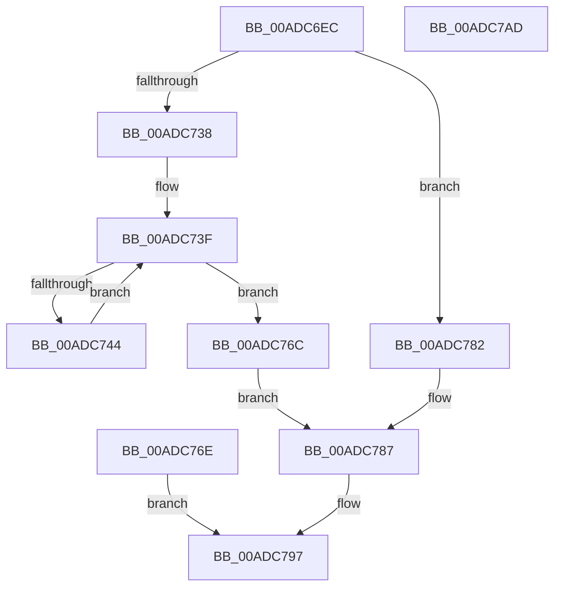

# EtwpGetPmcProfileSource

- RVA: `0x00ADC6EC`–`0x00ADC7AE` (길이 `194` bytes)
- VA: `0x0000000140ADC6EC`
- 실행 섹션: `PAGE`
- PDB 이름 있음: `예`; PDB Function 태그: `아니요`
- unwind 정보 RVA: `0x000BF67C`
- 디코드: `52`개 명령, `194/194` bytes 표시
- 미해석 바이트: `0` (있으면 어셈블리에 `.byte`로 보존)

> 이 문서는 커널 이미지의 기계어와 PDB 기호를 분석해 생성했습니다. 4번과 5번은 함수 원형과 자료형을 바이너리 사용 방식에서 추정한 C 해석이며 원본 소스 복구 결과는 아닙니다.

## 1. Dependencies

- 직접 호출 지점: **3**; 고유 호출 대상: **2**
- 직접 호출자로 확인된 함수: **1**
- RIP 상대 이미지 참조: **3**

### Outgoing calls
- `0x00ADC71E` → [KeWaitForSingleObject](../../text/20/KeWaitForSingleObject_function_0020E6B0.md) (function, `0x0020E6B0`)
- `0x00ADC779` → [KeReleaseMutex](../../text/39/KeReleaseMutex_function_00396810.md) (function, `0x00396810`)
- `0x00ADC790` → [KeReleaseMutex](../../text/39/KeReleaseMutex_function_00396810.md) (function, `0x00396810`)

### Direct callers
- [EtwQueryPerformanceTraceInformation](../AF/EtwQueryPerformanceTraceInformation_function_00AF28A4.md) at `0x00AF2D5F`

### Static image references
- `0x00ADC717` → RVA `0x00EFF7A0` (`.data`; read)
- `0x00ADC723` → RVA `0x00EFF290` (`.data`; read)
- `0x00ADC74E` → RVA `0x00EFF298` (`.data`; read)

## 2. Other-region calls and transfers

- 다른 실행 섹션으로 향하는 call: **3**
  - `0x00ADC71E` → [KeWaitForSingleObject](../../text/20/KeWaitForSingleObject_function_0020E6B0.md) (`PAGE` → `.text`)
  - `0x00ADC779` → [KeReleaseMutex](../../text/39/KeReleaseMutex_function_00396810.md) (`PAGE` → `.text`)
  - `0x00ADC790` → [KeReleaseMutex](../../text/39/KeReleaseMutex_function_00396810.md) (`PAGE` → `.text`)
- 별도 외부 분기/꼬리 이동을 확인하지 못했습니다.

## 3. Assembly (complete function range)

```asm
00ADC6EC  48 8B C4                        mov rax, rsp
00ADC6EF  48 89 58 08                     mov qword ptr [rax + 8], rbx
00ADC6F3  48 89 70 10                     mov qword ptr [rax + 0x10], rsi
00ADC6F7  48 89 78 18                     mov qword ptr [rax + 0x18], rdi
00ADC6FB  41 56                           push r14
00ADC6FD  48 83 EC 40                     sub rsp, 0x40
00ADC701  49 8B D8                        mov rbx, r8
00ADC704  8B FA                           mov edi, edx
00ADC706  4C 8B F1                        mov r14, rcx
00ADC709  33 F6                           xor esi, esi
00ADC70B  48 89 70 D8                     mov qword ptr [rax - 0x28], rsi
00ADC70F  45 33 C9                        xor r9d, r9d
00ADC712  45 33 C0                        xor r8d, r8d
00ADC715  33 D2                           xor edx, edx
00ADC717  48 8D 0D 82 30 42 00            lea rcx, [rip + 0x423082]
00ADC71E  E8 8D 1F 73 FF                  call 0x14020e6b0
00ADC723  44 8B 0D 66 2B 42 00            mov r9d, dword ptr [rip + 0x422b66]
00ADC72A  42 8D 04 8D 10 00 00 00         lea eax, [r9*4 + 0x10]
00ADC732  89 03                           mov dword ptr [rbx], eax
00ADC734  3B F8                           cmp edi, eax
00ADC736  77 4A                           ja 0x140adc782
00ADC738  44 8B C6                        mov r8d, esi
00ADC73B  89 74 24 30                     mov dword ptr [rsp + 0x30], esi
00ADC73F  45 3B C1                        cmp r8d, r9d
00ADC742  73 28                           jae 0x140adc76c
00ADC744  41 8B D0                        mov edx, r8d
00ADC747  48 69 CA 68 02 00 00            imul rcx, rdx, 0x268
00ADC74E  48 8B 05 43 2B 42 00            mov rax, qword ptr [rip + 0x422b43]
00ADC755  0F BF 8C 01 60 02 00 00         movsx ecx, word ptr [rcx + rax + 0x260]
00ADC75D  41 89 4C 96 10                  mov dword ptr [r14 + rdx*4 + 0x10], ecx
00ADC762  41 FF C0                        inc r8d
00ADC765  44 89 44 24 30                  mov dword ptr [rsp + 0x30], r8d
00ADC76A  EB D3                           jmp 0x140adc73f
00ADC76C  EB 19                           jmp 0x140adc787
00ADC76E  8B D8                           mov ebx, eax
00ADC770  33 D2                           xor edx, edx
00ADC772  48 8D 0D 27 30 42 00            lea rcx, [rip + 0x423027]
00ADC779  E8 92 A0 8B FF                  call 0x140396810
00ADC77E  8B C3                           mov eax, ebx
00ADC780  EB 15                           jmp 0x140adc797
00ADC782  BE 23 00 00 C0                  mov esi, 0xc0000023
00ADC787  33 D2                           xor edx, edx
00ADC789  48 8D 0D 10 30 42 00            lea rcx, [rip + 0x423010]
00ADC790  E8 7B A0 8B FF                  call 0x140396810
00ADC795  8B C6                           mov eax, esi
00ADC797  48 8B 5C 24 50                  mov rbx, qword ptr [rsp + 0x50]
00ADC79C  48 8B 74 24 58                  mov rsi, qword ptr [rsp + 0x58]
00ADC7A1  48 8B 7C 24 60                  mov rdi, qword ptr [rsp + 0x60]
00ADC7A6  48 83 C4 40                     add rsp, 0x40
00ADC7AA  41 5E                           pop r14
00ADC7AC  C3                              ret
00ADC7AD  CC                              int3
```

## 4. C-style interpretation (structured pseudocode)

```c
__int64 __fastcall EtwpGetPmcProfileSource(__int64 a1, int a2, __int64 a3, int a4)
{
    __int64 result;
    __int64 v_rsi;
    __int64 v_rsp;
    unsigned int v_stack_m18;
    unsigned __int64 v_stack_p10;
    unsigned __int64 v_stack_p18;
    unsigned __int64 v_stack_p8;

    *(unsigned __int64 *)(v_rsp + 8) = v_rbx;
    *(unsigned __int64 *)(v_rsp + 16) = v_rsi;
    *(unsigned __int64 *)(v_rsp + 24) = v_rdi;
    v_rsp = (v_rsp) - (64);
    v_rsi = 0;
    *(unsigned __int64 *)(v_rsp - 40) = 0;
    a4 = 0;
    a3 = 0;
    a2 = 0;
    result = KeWaitForSingleObject(v_rip + 4337794, a2, a3, a4);
    *(unsigned int *)(a3) = (unsigned int)((unsigned int)(*(unsigned int *)(v_rip + 4336486)) * 4 + 16);
    if (((unsigned int)((unsigned int)(a2))) > ((unsigned int)((unsigned int)(*(unsigned int *)(v_rip + 4336486)) * 4 + 16))) goto loc_00ADC782;
    v_stack_m18 = 0;
loc_00ADC73F:
    if (0 >= ((unsigned int)((unsigned int)(*(unsigned int *)(v_rip + 4336486))))) goto loc_00ADC76C;
    a1 = (v_rip + 4337794) * (0);
    *(unsigned int *)(a1 + 0 * 4 + 16) = (unsigned int)((__int16)(*(unsigned __int16 *)(a1 + *(unsigned __int64 *)(v_rip + 4336451) * 1 + 608)));
    a3 = (unsigned int)((0) + 1);
    v_stack_m18 = (unsigned int)(a3);
    goto loc_00ADC73F;
loc_00ADC76C:
    goto loc_00ADC787;
loc_00ADC782:
loc_00ADC787:
    a2 = 0;
    result = KeReleaseMutex(v_rip + 4337680, a2, a3, (unsigned int)(*(unsigned int *)(v_rip + 4336486)));
loc_00ADC797:
    v_rsp = (v_rsp) + (64);
    return (unsigned int)((unsigned int)((unsigned int)(0xC0000023ULL)));
}
```

## 5. (Beta) C Style

```c
int64_t EtwpGetPmcProfileSource(void *Arg1, int32_t Arg2, void *Arg3, int32_t Arg4)
{
    uint8_t *arg1 = (uint8_t *)Arg1;
    uint8_t *arg3 = (uint8_t *)Arg3;

    int64_t result;
    int64_t local_rsi;
    int64_t local_rsp;
    uint32_t v_stack_m18;
    uint64_t v_stack_p10;
    uint64_t v_stack_p18;
    uint64_t v_stack_p8;

    *(uint64_t *)(local_rsp + 0x8) = local_rbx;
    *(uint64_t *)(local_rsp + 0x10) = local_rsi;
    *(uint64_t *)(local_rsp + 0x18) = local_rdi;
    local_rsp = (local_rsp) - (64);
    local_rsi = 0;
    *(uint64_t *)(local_rsp - 0x28) = 0;
    Arg4 = 0;
    Arg3 = 0;
    Arg2 = 0;
    result = KeWaitForSingleObject(v_rip + 4337794, Arg2, Arg3, Arg4);
    *(uint32_t *)(arg3) = (uint32_t)((uint32_t)(*(uint32_t *)(v_rip + 0x422B66)) * 4 + 16);
    if (((uint32_t)((uint32_t)(Arg2))) > ((uint32_t)((uint32_t)(*(uint32_t *)(v_rip + 0x422B66)) * 4 + 16))) goto loc_00ADC782;
    v_stack_m18 = 0;
loc_00ADC73F:
    if (0 >= ((uint32_t)((uint32_t)(*(uint32_t *)(v_rip + 0x422B66))))) goto loc_00ADC76C;
    Arg1 = (v_rip + 4337794) * (0);
    *(uint32_t *)(arg1 + 0x0 * 4 + 0x10) = (uint32_t)((int16_t)(*(uint16_t *)(arg1 + *(uint64_t *)(v_rip + 0x422B43) * 1 + 0x260)));
    Arg3 = (uint32_t)((0) + 1);
    v_stack_m18 = (uint32_t)(Arg3);
    goto loc_00ADC73F;
loc_00ADC76C:
    goto loc_00ADC787;
loc_00ADC782:
loc_00ADC787:
    Arg2 = 0;
    result = KeReleaseMutex(v_rip + 4337680, Arg2, Arg3, (uint32_t)(*(uint32_t *)(v_rip + 0x422B66)));
loc_00ADC797:
    local_rsp = (local_rsp) + (64);
    return (uint32_t)((uint32_t)((uint32_t)(0xC0000023ULL)));
}
```

### 관측된 메모리 오프셋

구조체 형식이 확인되지 않은 접근은 인자 기준의 오프셋으로만 기록했습니다.

| 기준 인자 | 오프셋 표현 | 폭 (bit) | 접근 |
|---|---:|---:|---|
| `Arg1` | `+ 0x10 + rdx*4` | `32` | `W` |
| `Arg3` | `+ 0x0` | `32` | `W` |

## 6. Execution-region graph

[열기: 2D/3D 그래프와 함수 탐색 컨트롤 패널](../../../control-panel.html?section=page&rva=0x00ADC6EC&view=graph)

- 2D 그래프는 위에서 아래로 흐르고, 3D 그래프는 빈 공간을 드래그해 회전합니다. Shift+드래그는 이동, 휠은 확대·축소, 함수 노드 선택은 대상 보고서 이동입니다.

### Static fallback


