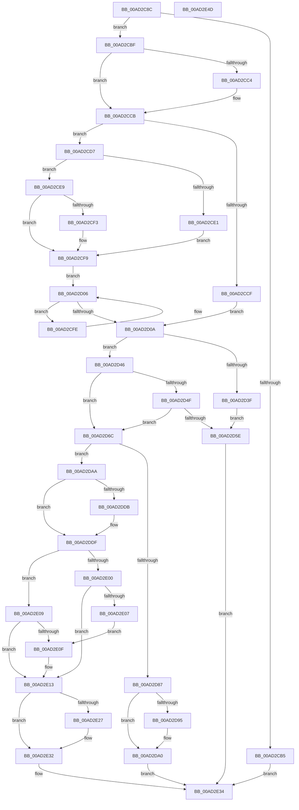

# ExEnableHandleTracing

- RVA: `0x00AD2C8C`–`0x00AD2E4E` (길이 `450` bytes)
- VA: `0x0000000140AD2C8C`
- 실행 섹션: `PAGE`
- PDB 이름 있음: `예`; PDB Function 태그: `아니요`
- unwind 정보 RVA: `0x00060300`
- 디코드: `128`개 명령, `450/450` bytes 표시
- 미해석 바이트: `0` (있으면 어셈블리에 `.byte`로 보존)

> 이 문서는 커널 이미지의 기계어와 PDB 기호를 분석해 생성했습니다. 4번과 5번은 함수 원형과 자료형을 바이너리 사용 방식에서 추정한 C 해석이며 원본 소스 복구 결과는 아닙니다.

## 1. Dependencies

- 직접 호출 지점: **8**; 고유 호출 대상: **8**
- 직접 호출자로 확인된 함수: **1**
- RIP 상대 이미지 참조: **5**

### Outgoing calls
- `0x00AD2D25` → [MmGetMaximumNonPagedPoolInBytes](../../text/4B/MmGetMaximumNonPagedPoolInBytes_function_004BA168.md) (function, `0x004BA168`)
- `0x00AD2D55` → [PsChargeProcessNonPagedPoolQuota](../../text/2A/PsChargeProcessNonPagedPoolQuota_function_002A7B80.md) (function, `0x002A7B80`)
- `0x00AD2D7A` → [ExAllocatePool2](../../poolcode/B8/ExAllocatePool2_function_00B820F0.md) (function, `0x00B820F0`)
- `0x00AD2D9B` → [PsReturnProcessNonPagedPoolQuota](../../text/41/PsReturnProcessNonPagedPoolQuota_function_0041C200.md) (function, `0x0041C200`)
- `0x00AD2DD1` → [KeInitializeEvent](../../text/40/KeInitializeEvent_function_0040DD10.md) (function, `0x0040DD10`)
- `0x00AD2DEE` → [ExpLockHandleTableExclusive](../../text/45/ExpLockHandleTableExclusive_function_00458B08.md) (function, `0x00458B08`)
- `0x00AD2E1D` → [ExpUnlockHandleTableExclusive](../../text/46/ExpUnlockHandleTableExclusive_function_004608A8.md) (function, `0x004608A8`)
- `0x00AD2E2D` → [ExDereferenceHandleDebugInfo](../A1/ExDereferenceHandleDebugInfo_function_00A17430.md) (function, `0x00A17430`)

### Direct callers
- [PsSetProcessHandleTracingInformation](../78/PsSetProcessHandleTracingInformation_function_00781BB8.md) at `0x00781BE7`

### Static image references
- `0x00AD2CC4` → RVA `0x00B4AF64` (`ExHandleTraceDbDefaultBitMaskFlags`; read)
- `0x00AD2CCF` → RVA `0x00B4AF60` (`ExHandleTraceDbDefaultStacks`; read)
- `0x00AD2CD7` → RVA `0x00B4AE54` (`ExHandleTraceDbMinStacks`; read)
- `0x00AD2CE9` → RVA `0x00B4AE50` (`ExHandleTraceDbMaxStacks`; read)
- `0x00AD2D1A` → RVA `0x00FD9BB0` (`PAGEDATA`; read/write)

## 2. Other-region calls and transfers

- 다른 실행 섹션으로 향하는 call: **7**
  - `0x00AD2D25` → [MmGetMaximumNonPagedPoolInBytes](../../text/4B/MmGetMaximumNonPagedPoolInBytes_function_004BA168.md) (`PAGE` → `.text`)
  - `0x00AD2D55` → [PsChargeProcessNonPagedPoolQuota](../../text/2A/PsChargeProcessNonPagedPoolQuota_function_002A7B80.md) (`PAGE` → `.text`)
  - `0x00AD2D7A` → [ExAllocatePool2](../../poolcode/B8/ExAllocatePool2_function_00B820F0.md) (`PAGE` → `POOLCODE`)
  - `0x00AD2D9B` → [PsReturnProcessNonPagedPoolQuota](../../text/41/PsReturnProcessNonPagedPoolQuota_function_0041C200.md) (`PAGE` → `.text`)
  - `0x00AD2DD1` → [KeInitializeEvent](../../text/40/KeInitializeEvent_function_0040DD10.md) (`PAGE` → `.text`)
  - `0x00AD2DEE` → [ExpLockHandleTableExclusive](../../text/45/ExpLockHandleTableExclusive_function_00458B08.md) (`PAGE` → `.text`)
  - `0x00AD2E1D` → [ExpUnlockHandleTableExclusive](../../text/46/ExpUnlockHandleTableExclusive_function_004608A8.md) (`PAGE` → `.text`)
- 별도 외부 분기/꼬리 이동을 확인하지 못했습니다.

## 3. Assembly (complete function range)

```asm
00AD2C8C  48 89 5C 24 08                  mov qword ptr [rsp + 8], rbx
00AD2C91  48 89 6C 24 10                  mov qword ptr [rsp + 0x10], rbp
00AD2C96  48 89 74 24 18                  mov qword ptr [rsp + 0x18], rsi
00AD2C9B  57                              push rdi
00AD2C9C  41 56                           push r14
00AD2C9E  41 57                           push r15
00AD2CA0  48 83 EC 20                     sub rsp, 0x20
00AD2CA4  45 8B F8                        mov r15d, r8d
00AD2CA7  8B DA                           mov ebx, edx
00AD2CA9  48 8B F9                        mov rdi, rcx
00AD2CAC  41 F7 C0 F0 FF FF FF            test r8d, 0xfffffff0
00AD2CB3  74 0A                           je 0x140ad2cbf
00AD2CB5  B8 0D 00 00 C0                  mov eax, 0xc000000d
00AD2CBA  E9 75 01 00 00                  jmp 0x140ad2e34
00AD2CBF  45 85 C0                        test r8d, r8d
00AD2CC2  75 07                           jne 0x140ad2ccb
00AD2CC4  44 8B 3D 99 82 07 00            mov r15d, dword ptr [rip + 0x78299]
00AD2CCB  85 D2                           test edx, edx
00AD2CCD  75 08                           jne 0x140ad2cd7
00AD2CCF  8B 1D 8B 82 07 00               mov ebx, dword ptr [rip + 0x7828b]
00AD2CD5  EB 33                           jmp 0x140ad2d0a
00AD2CD7  8B 05 77 81 07 00               mov eax, dword ptr [rip + 0x78177]
00AD2CDD  3B D0                           cmp edx, eax
00AD2CDF  73 08                           jae 0x140ad2ce9
00AD2CE1  8B 1D 6D 81 07 00               mov ebx, dword ptr [rip + 0x7816d]
00AD2CE7  EB 10                           jmp 0x140ad2cf9
00AD2CE9  8B 05 61 81 07 00               mov eax, dword ptr [rip + 0x78161]
00AD2CEF  3B D0                           cmp edx, eax
00AD2CF1  76 06                           jbe 0x140ad2cf9
00AD2CF3  8B 1D 57 81 07 00               mov ebx, dword ptr [rip + 0x78157]
00AD2CF9  8D 43 FF                        lea eax, [rbx - 1]
00AD2CFC  EB 08                           jmp 0x140ad2d06
00AD2CFE  8D 43 FF                        lea eax, [rbx - 1]
00AD2D01  0B C3                           or eax, ebx
00AD2D03  8D 58 01                        lea ebx, [rax + 1]
00AD2D06  85 C3                           test ebx, eax
00AD2D08  75 F4                           jne 0x140ad2cfe
00AD2D0A  8B C3                           mov eax, ebx
00AD2D0C  4C 8D 34 80                     lea r14, [rax + rax*4]
00AD2D10  8B C3                           mov eax, ebx
00AD2D12  49 C1 E6 05                     shl r14, 5
00AD2D16  49 83 C6 50                     add r14, 0x50
00AD2D1A  F0 0F C1 05 8E 6E 50 00         lock xadd dword ptr [rip + 0x506e8e], eax
00AD2D22  48 63 D0                        movsxd rdx, eax
00AD2D25  E8 3E 74 9E FF                  call 0x1404ba168
00AD2D2A  48 8D 0C 80                     lea rcx, [rax + rax*4]
00AD2D2E  48 8D 04 92                     lea rax, [rdx + rdx*4]
00AD2D32  48 C1 E9 04                     shr rcx, 4
00AD2D36  48 C1 E0 05                     shl rax, 5
00AD2D3A  48 3B C1                        cmp rax, rcx
00AD2D3D  76 07                           jbe 0x140ad2d46
00AD2D3F  B8 9A 00 00 C0                  mov eax, 0xc000009a
00AD2D44  EB 18                           jmp 0x140ad2d5e
00AD2D46  48 8B 6F 10                     mov rbp, qword ptr [rdi + 0x10]
00AD2D4A  48 85 ED                        test rbp, rbp
00AD2D4D  74 1D                           je 0x140ad2d6c
00AD2D4F  49 8B D6                        mov rdx, r14
00AD2D52  48 8B CD                        mov rcx, rbp
00AD2D55  E8 26 4E 7D FF                  call 0x1402a7b80
00AD2D5A  85 C0                           test eax, eax
00AD2D5C  79 0E                           jns 0x140ad2d6c
00AD2D5E  F7 DB                           neg ebx
00AD2D60  F0 01 1D 49 6E 50 00            lock add dword ptr [rip + 0x506e49], ebx
00AD2D67  E9 C8 00 00 00                  jmp 0x140ad2e34
00AD2D6C  41 B8 4F 62 74 64               mov r8d, 0x6474624f
00AD2D72  49 8B D6                        mov rdx, r14
00AD2D75  B9 40 00 00 00                  mov ecx, 0x40
00AD2D7A  E8 71 F3 0A 00                  call 0x140b820f0
00AD2D7F  48 8B F0                        mov rsi, rax
00AD2D82  48 85 C0                        test rax, rax
00AD2D85  75 23                           jne 0x140ad2daa
00AD2D87  F7 DB                           neg ebx
00AD2D89  F0 01 1D 20 6E 50 00            lock add dword ptr [rip + 0x506e20], ebx
00AD2D90  48 85 ED                        test rbp, rbp
00AD2D93  74 0B                           je 0x140ad2da0
00AD2D95  49 8B D6                        mov rdx, r14
00AD2D98  48 8B CD                        mov rcx, rbp
00AD2D9B  E8 60 94 94 FF                  call 0x14041c200
00AD2DA0  B8 9A 00 00 C0                  mov eax, 0xc000009a
00AD2DA5  E9 8A 00 00 00                  jmp 0x140ad2e34
00AD2DAA  89 58 04                        mov dword ptr [rax + 4], ebx
00AD2DAD  48 8D 48 28                     lea rcx, [rax + 0x28]
00AD2DB1  44 89 78 08                     mov dword ptr [rax + 8], r15d
00AD2DB5  41 BE 01 00 00 00               mov r14d, 1
00AD2DBB  44 89 30                        mov dword ptr [rax], r14d
00AD2DBE  41 8B D6                        mov edx, r14d
00AD2DC1  48 83 60 18 00                  and qword ptr [rax + 0x18], 0
00AD2DC6  45 33 C0                        xor r8d, r8d
00AD2DC9  83 60 20 00                     and dword ptr [rax + 0x20], 0
00AD2DCD  44 89 70 10                     mov dword ptr [rax + 0x10], r14d
00AD2DD1  E8 3A AF 93 FF                  call 0x14040dd10
00AD2DD6  48 85 ED                        test rbp, rbp
00AD2DD9  74 04                           je 0x140ad2ddf
00AD2DDB  44 08 77 2C                     or byte ptr [rdi + 0x2c], r14b
00AD2DDF  65 48 8B 2C 25 88 01 00 00      mov rbp, qword ptr gs:[0x188]
00AD2DE8  48 8B CF                        mov rcx, rdi
00AD2DEB  48 8B D5                        mov rdx, rbp
00AD2DEE  E8 15 5D 98 FF                  call 0x140458b08
00AD2DF3  48 8B 5F 60                     mov rbx, qword ptr [rdi + 0x60]
00AD2DF7  48 89 77 60                     mov qword ptr [rdi + 0x60], rsi
00AD2DFB  48 85 DB                        test rbx, rbx
00AD2DFE  74 09                           je 0x140ad2e09
00AD2E00  8B 43 08                        mov eax, dword ptr [rbx + 8]
00AD2E03  A8 08                           test al, 8
00AD2E05  74 0C                           je 0x140ad2e13
00AD2E07  EB 06                           jmp 0x140ad2e0f
00AD2E09  F6 47 2C 02                     test byte ptr [rdi + 0x2c], 2
00AD2E0D  74 04                           je 0x140ad2e13
00AD2E0F  83 4E 08 08                     or dword ptr [rsi + 8], 8
00AD2E13  80 4F 2C 02                     or byte ptr [rdi + 0x2c], 2
00AD2E17  48 8B D5                        mov rdx, rbp
00AD2E1A  48 8B CF                        mov rcx, rdi
00AD2E1D  E8 86 DA 98 FF                  call 0x1404608a8
00AD2E22  48 85 DB                        test rbx, rbx
00AD2E25  74 0B                           je 0x140ad2e32
00AD2E27  48 8B D3                        mov rdx, rbx
00AD2E2A  48 8B CF                        mov rcx, rdi
00AD2E2D  E8 FE 45 F4 FF                  call 0x140a17430
00AD2E32  33 C0                           xor eax, eax
00AD2E34  48 8B 5C 24 40                  mov rbx, qword ptr [rsp + 0x40]
00AD2E39  48 8B 6C 24 48                  mov rbp, qword ptr [rsp + 0x48]
00AD2E3E  48 8B 74 24 50                  mov rsi, qword ptr [rsp + 0x50]
00AD2E43  48 83 C4 20                     add rsp, 0x20
00AD2E47  41 5F                           pop r15
00AD2E49  41 5E                           pop r14
00AD2E4B  5F                              pop rdi
00AD2E4C  C3                              ret
00AD2E4D  CC                              int3
```

## 4. C-style interpretation (structured pseudocode)

```c
__int64 __fastcall ExEnableHandleTracing(__int64 a1, int a2, int a3)
{
    __int64 result;
    __int64 v_r14;
    __int64 v_r15;
    __int64 v_rbx;
    __int64 v_rsp;
    unsigned __int64 v_stack_p10;
    unsigned __int64 v_stack_p18;
    unsigned __int64 v_stack_p8;

    v_stack_p8 = v_rbx;
    v_stack_p10 = v_rbp;
    v_stack_p18 = v_rsi;
    v_rsp = (v_rsp) - (32);
    if (((a3) & (0xFFFFFFF0ULL)) == 0) goto loc_00AD2CBF;
    goto loc_00AD2E34;
loc_00AD2CBF:
    v_r15 = (unsigned int)(a3);
    if (a3 == 0) {
        v_r15 = *(unsigned int *)(v_rip + 492185);
    }
    if (a2 != 0) goto loc_00AD2CD7;
    goto loc_00AD2D0A;
loc_00AD2CD7:
    if (a2 >= ((unsigned int)((unsigned int)(*(unsigned int *)(v_rip + 491895))))) goto loc_00AD2CE9;
    goto loc_00AD2CF9;
loc_00AD2CE9:
    v_rbx = (unsigned int)(*(unsigned int *)(v_rip + 491885));
    if (a2 >= = ((unsigned int)((unsigned int)(*(unsigned int *)(v_rip + 491873))))) {
        v_rbx = *(unsigned int *)(v_rip + 491863);
    }
    goto loc_00AD2D06;
loc_00AD2CFE:
    result = (unsigned int)((v_rbx - 1) | ((unsigned int)(v_rbx)));
loc_00AD2D06:
    if ((((unsigned int)(result + 1)) & ((unsigned int)(result))) != 0) goto loc_00AD2CFE;
loc_00AD2D0A:
    v_r14 = ((unsigned int)((unsigned int)(result + 1)) + (unsigned int)((unsigned int)(result + 1)) * 4) << (5);
    v_r14 = (v_r14) + (80);
    result = MmGetMaximumNonPagedPoolInBytes(a1, (int)((unsigned int)((unsigned int)((unsigned int)(result + 1)))), a3, a4);
    a1 = (result + result * 4) >> (4);
    result = ((int)((unsigned int)((unsigned int)((unsigned int)(result + 1)))) + (int)((unsigned int)((unsigned int)((unsigned int)(result + 1)))) * 4) << (5);
    if (result <= a1) goto loc_00AD2D46;
    goto loc_00AD2D5E;
loc_00AD2D46:
    if (*(unsigned __int64 *)(a1 + 16) == 0) goto loc_00AD2D6C;
    result = PsChargeProcessNonPagedPoolQuota(*(unsigned __int64 *)(a1 + 16), v_r14, a3, a4);
    if (!sign_flag) goto loc_00AD2D6C;
loc_00AD2D5E:
    v_rbx = (unsigned int)(-(result + 1));
    goto loc_00AD2E34;
loc_00AD2D6C:
    result = ExAllocatePool2(64, v_r14, (unsigned int)(0x6474624FULL), a4);
    if (result != 0) goto loc_00AD2DAA;
    v_rbx = (unsigned int)(-(v_rbx));
    if (*(unsigned __int64 *)(a1 + 16) != 0) {
        a2 = v_r14;
        a1 = *(unsigned __int64 *)(a1 + 16);
        result = PsReturnProcessNonPagedPoolQuota(a1, a2, (unsigned int)(0x6474624FULL), a4);
    }
    goto loc_00AD2E34;
loc_00AD2DAA:
    *(unsigned int *)((unsigned int)(0xC000009AULL) + 4) = (unsigned int)(v_rbx);
    *(unsigned int *)((unsigned int)(0xC000009AULL) + 8) = (unsigned int)(v_r15);
    *(unsigned int *)((unsigned int)(0xC000009AULL)) = 1;
    a3 = 0;
    *(unsigned int *)((unsigned int)(0xC000009AULL) + 16) = 1;
    result = KeInitializeEvent((unsigned int)(0xC000009AULL) + 40, 1, a3, a4);
    if (*(unsigned __int64 *)(a1 + 16) != 0) {
    }
    result = ExpLockHandleTableExclusive(a1, *(unsigned __int64 *)(gs_base + (0 + 392)), a3, a4);
    *(unsigned __int64 *)(a1 + 96) = result;
    if (*(unsigned __int64 *)(a1 + 96) == 0) goto loc_00AD2E09;
    if ((((unsigned __int8)((unsigned int)(*(unsigned int *)(*(unsigned __int64 *)(a1 + 96) + 8)))) & (8)) == 0) goto loc_00AD2E13;
    goto loc_00AD2E0F;
loc_00AD2E09:
    if (((*(unsigned __int8 *)(a1 + 44)) & (2)) != 0) {
    }
    result = ExpUnlockHandleTableExclusive(a1, *(unsigned __int64 *)(gs_base + (0 + 392)), a3, a4);
    if (*(unsigned __int64 *)(a1 + 96) != 0) {
        a2 = *(unsigned __int64 *)(a1 + 96);
        a1 = a1;
        result = ExDereferenceHandleDebugInfo(a1, a2, a3, a4);
    }
    result = 0;
loc_00AD2E34:
    v_rsp = (v_rsp) + (32);
    return result;
}
```

## 5. (Beta) C Style

```c
int64_t ExEnableHandleTracing(void *Arg1, int32_t Arg2, int32_t Arg3)
{
    uint8_t *arg1 = (uint8_t *)Arg1;

    int64_t result;
    int64_t local_r14;
    int64_t local_r15;
    int64_t local_rbx;
    int64_t local_rsp;
    uint64_t v_stack_p10;
    uint64_t v_stack_p18;
    uint64_t v_stack_p8;

    v_stack_p8 = local_rbx;
    v_stack_p10 = local_rbp;
    v_stack_p18 = local_rsi;
    local_rsp = (local_rsp) - (32);
    if (((Arg3) & (0xFFFFFFF0ULL)) == 0) goto loc_00AD2CBF;
    goto loc_00AD2E34;
loc_00AD2CBF:
    local_r15 = (uint32_t)(Arg3);
    if (Arg3 == 0) {
        local_r15 = *(uint32_t *)(v_rip + 0x78299);
    }
    if (Arg2 != 0) goto loc_00AD2CD7;
    goto loc_00AD2D0A;
loc_00AD2CD7:
    if (Arg2 >= ((uint32_t)((uint32_t)(*(uint32_t *)(v_rip + 0x78177))))) goto loc_00AD2CE9;
    goto loc_00AD2CF9;
loc_00AD2CE9:
    local_rbx = (uint32_t)(*(uint32_t *)(v_rip + 0x7816D));
    if (Arg2 >= = ((uint32_t)((uint32_t)(*(uint32_t *)(v_rip + 0x78161))))) {
        local_rbx = *(uint32_t *)(v_rip + 0x78157);
    }
    goto loc_00AD2D06;
loc_00AD2CFE:
    result = (uint32_t)((local_rbx - 1) | ((uint32_t)(local_rbx)));
loc_00AD2D06:
    if ((((uint32_t)(result + 1)) & ((uint32_t)(result))) != 0) goto loc_00AD2CFE;
loc_00AD2D0A:
    local_r14 = ((uint32_t)((uint32_t)(result + 1)) + (uint32_t)((uint32_t)(result + 1)) * 4) << (5);
    local_r14 = (local_r14) + (80);
    result = MmGetMaximumNonPagedPoolInBytes(Arg1, (int32_t)((uint32_t)((uint32_t)((uint32_t)(result + 1)))), Arg3, a4);
    Arg1 = (result + result * 4) >> (4);
    result = ((int32_t)((uint32_t)((uint32_t)((uint32_t)(result + 1)))) + (int32_t)((uint32_t)((uint32_t)((uint32_t)(result + 1)))) * 4) << (5);
    if (result <= Arg1) goto loc_00AD2D46;
    goto loc_00AD2D5E;
loc_00AD2D46:
    if (*(uint64_t *)(arg1 + 0x10) == 0) goto loc_00AD2D6C;
    result = PsChargeProcessNonPagedPoolQuota(*(uint64_t *)(arg1 + 0x10), local_r14, Arg3, a4);
    if (!sign_flag) goto loc_00AD2D6C;
loc_00AD2D5E:
    local_rbx = (uint32_t)(-(result + 1));
    goto loc_00AD2E34;
loc_00AD2D6C:
    result = ExAllocatePool2(64, local_r14, (uint32_t)(0x6474624FULL), a4);
    if (result != 0) goto loc_00AD2DAA;
    local_rbx = (uint32_t)(-(local_rbx));
    if (*(uint64_t *)(arg1 + 0x10) != 0) {
        Arg2 = local_r14;
        Arg1 = *(uint64_t *)(arg1 + 0x10);
        result = PsReturnProcessNonPagedPoolQuota(Arg1, Arg2, (uint32_t)(0x6474624FULL), a4);
    }
    goto loc_00AD2E34;
loc_00AD2DAA:
    *(uint32_t *)((uint32_t)(0xC000009AULL) + 0x4) = (uint32_t)(local_rbx);
    *(uint32_t *)((uint32_t)(0xC000009AULL) + 0x8) = (uint32_t)(local_r15);
    *(uint32_t *)((uint32_t)(0xC000009AULL)) = 1;
    Arg3 = 0;
    *(uint32_t *)((uint32_t)(0xC000009AULL) + 0x10) = 1;
    result = KeInitializeEvent((uint32_t)(0xC000009AULL) + 40, 1, Arg3, a4);
    if (*(uint64_t *)(arg1 + 0x10) != 0) {
    }
    result = ExpLockHandleTableExclusive(Arg1, *(uint64_t *)(gs_base + (0 + 0x188)), Arg3, a4);
    *(uint64_t *)(arg1 + 0x60) = result;
    if (*(uint64_t *)(arg1 + 0x60) == 0) goto loc_00AD2E09;
    if ((((uint8_t)((uint32_t)(*(uint32_t *)(*(uint64_t *)(arg1 + 0x60) + 0x8)))) & (8)) == 0) goto loc_00AD2E13;
    goto loc_00AD2E0F;
loc_00AD2E09:
    if (((*(uint8_t *)(arg1 + 0x2C)) & (2)) != 0) {
    }
    result = ExpUnlockHandleTableExclusive(Arg1, *(uint64_t *)(gs_base + (0 + 0x188)), Arg3, a4);
    if (*(uint64_t *)(arg1 + 0x60) != 0) {
        Arg2 = *(uint64_t *)(arg1 + 0x60);
        Arg1 = Arg1;
        result = ExDereferenceHandleDebugInfo(Arg1, Arg2, Arg3, a4);
    }
    result = 0;
loc_00AD2E34:
    local_rsp = (local_rsp) + (32);
    return result;
}
```

### 관측된 메모리 오프셋

구조체 형식이 확인되지 않은 접근은 인자 기준의 오프셋으로만 기록했습니다.

| 기준 인자 | 오프셋 표현 | 폭 (bit) | 접근 |
|---|---:|---:|---|
| `Arg1` | `+ 0x10` | `64` | `R` |
| `Arg1` | `+ 0x2C` | `8` | `R` |
| `Arg1` | `+ 0x2C` | `8` | `R/W` |
| `Arg1` | `+ 0x60` | `64` | `R` |
| `Arg1` | `+ 0x60` | `64` | `W` |

## 6. Execution-region graph

[열기: 2D/3D 그래프와 함수 탐색 컨트롤 패널](../../../control-panel.html?section=page&rva=0x00AD2C8C&view=graph)

- 2D 그래프는 위에서 아래로 흐르고, 3D 그래프는 빈 공간을 드래그해 회전합니다. Shift+드래그는 이동, 휠은 확대·축소, 함수 노드 선택은 대상 보고서 이동입니다.

### Static fallback


