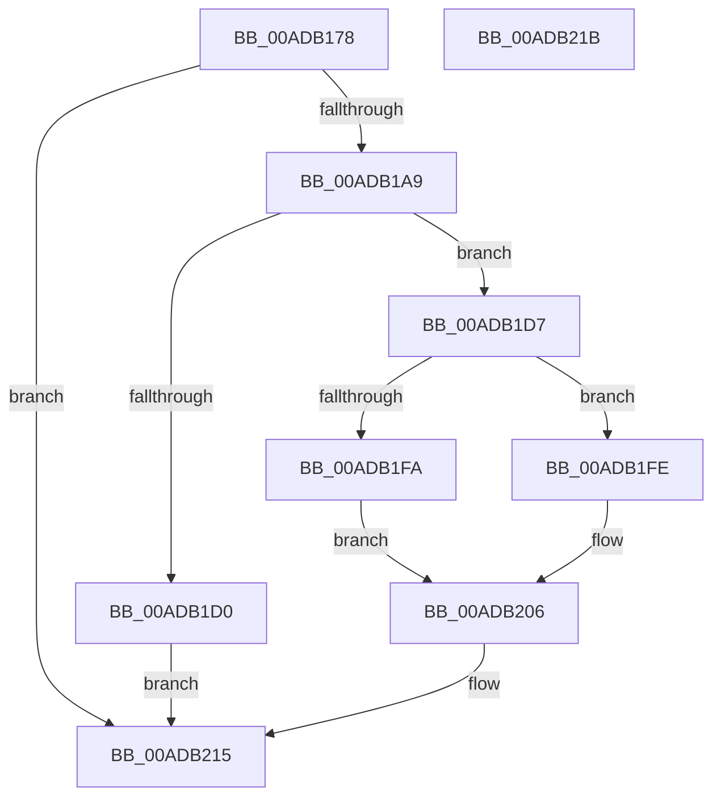

# ExInitializeNls

- RVA: `0x00ADB178`–`0x00ADB21C` (길이 `164` bytes)
- VA: `0x0000000140ADB178`
- 실행 섹션: `PAGE`
- PDB 이름 있음: `예`; PDB Function 태그: `아니요`
- unwind 정보 RVA: `0x000BF520`
- 디코드: `44`개 명령, `164/164` bytes 표시
- 미해석 바이트: `0` (있으면 어셈블리에 `.byte`로 보존)

> 이 문서는 커널 이미지의 기계어와 PDB 기호를 분석해 생성했습니다. 4번과 5번은 함수 원형과 자료형을 바이너리 사용 방식에서 추정한 C 해석이며 원본 소스 복구 결과는 아닙니다.

## 1. Dependencies

- 직접 호출 지점: **7**; 고유 호출 대상: **7**
- 직접 호출자로 확인된 함수: **2**
- RIP 상대 이미지 참조: **1**

### Outgoing calls
- `0x00ADB1A0` → [ZwCreateDirectoryObject](../../text/6A/ZwCreateDirectoryObject_function_006AE650.md) (function, `0x006AE650`)
- `0x00ADB1AE` → [ZwClose](../../text/6A/ZwClose_function_006AD2B0.md) (function, `0x006AD2B0`)
- `0x00ADB1C3` → [ExAllocatePool2](../../poolcode/B8/ExAllocatePool2_function_00B820F0.md) (function, `0x00B820F0`)
- `0x00ADB1DB` → [PsGetCurrentServerSiloGlobals](../../text/2F/PsGetCurrentServerSiloGlobals_function_002FE1F0.md) (function, `0x002FE1F0`)
- `0x00ADB1F1` → [RtlpQueryNlsSystemCodePages](../78/RtlpQueryNlsSystemCodePages_function_0078C33C.md) (function, `0x0078C33C`)
- `0x00ADB209` → [RtlpInitCodePageTables](../78/RtlpInitCodePageTables_function_0078C0F4.md) (function, `0x0078C0F4`)
- `0x00ADB20E` → [RtlpInitUppercaseTables](../78/RtlpInitUppercaseTables_function_0078C29C.md) (function, `0x0078C29C`)

### Direct callers
- [PspInitializeServerSiloDeferred](../77/PspInitializeServerSiloDeferred_function_0077FEE0.md) at `0x00780032`
- [Phase1InitializationIoReady](../../init/C7/Phase1InitializationIoReady_function_00C70458.md) at `0x00C7047F`

### Static image references
- `0x00ADB185` → RVA `0x00B4CEA0` (`NlsDirectoryAttributes`; read)

## 2. Other-region calls and transfers

- 다른 실행 섹션으로 향하는 call: **4**
  - `0x00ADB1A0` → [ZwCreateDirectoryObject](../../text/6A/ZwCreateDirectoryObject_function_006AE650.md) (`PAGE` → `.text`)
  - `0x00ADB1AE` → [ZwClose](../../text/6A/ZwClose_function_006AD2B0.md) (`PAGE` → `.text`)
  - `0x00ADB1C3` → [ExAllocatePool2](../../poolcode/B8/ExAllocatePool2_function_00B820F0.md) (`PAGE` → `POOLCODE`)
  - `0x00ADB1DB` → [PsGetCurrentServerSiloGlobals](../../text/2F/PsGetCurrentServerSiloGlobals_function_002FE1F0.md) (`PAGE` → `.text`)
- 별도 외부 분기/꼬리 이동을 확인하지 못했습니다.

## 3. Assembly (complete function range)

```asm
00ADB178  48 8B C4                        mov rax, rsp
00ADB17B  53                              push rbx
00ADB17C  48 83 EC 20                     sub rsp, 0x20
00ADB180  48 83 60 18 00                  and qword ptr [rax + 0x18], 0
00ADB185  4C 8D 05 14 1D 07 00            lea r8, [rip + 0x71d14]
00ADB18C  BB E9 FD 00 00                  mov ebx, 0xfde9
00ADB191  48 8D 48 18                     lea rcx, [rax + 0x18]
00ADB195  BA 0F 00 0F 00                  mov edx, 0xf000f
00ADB19A  89 58 08                        mov dword ptr [rax + 8], ebx
00ADB19D  89 58 10                        mov dword ptr [rax + 0x10], ebx
00ADB1A0  E8 AB 34 BD FF                  call 0x1406ae650
00ADB1A5  85 C0                           test eax, eax
00ADB1A7  78 6C                           js 0x140adb215
00ADB1A9  48 8B 4C 24 40                  mov rcx, qword ptr [rsp + 0x40]
00ADB1AE  E8 FD 20 BD FF                  call 0x1406ad2b0
00ADB1B3  BA 10 00 00 00                  mov edx, 0x10
00ADB1B8  B9 00 01 00 00                  mov ecx, 0x100
00ADB1BD  41 B8 4E 6C 73 58               mov r8d, 0x58736c4e
00ADB1C3  E8 28 6F 0A 00                  call 0x140b820f0
00ADB1C8  48 8B D0                        mov rdx, rax
00ADB1CB  48 85 C0                        test rax, rax
00ADB1CE  75 07                           jne 0x140adb1d7
00ADB1D0  B8 17 00 00 C0                  mov eax, 0xc0000017
00ADB1D5  EB 3E                           jmp 0x140adb215
00ADB1D7  48 83 20 00                     and qword ptr [rax], 0
00ADB1DB  E8 10 30 82 FF                  call 0x1402fe1f0
00ADB1E0  48 8D 4C 24 30                  lea rcx, [rsp + 0x30]
00ADB1E5  48 89 90 00 04 00 00            mov qword ptr [rax + 0x400], rdx
00ADB1EC  48 8D 54 24 38                  lea rdx, [rsp + 0x38]
00ADB1F1  E8 46 11 CB FF                  call 0x14078c33c
00ADB1F6  85 C0                           test eax, eax
00ADB1F8  79 04                           jns 0x140adb1fe
00ADB1FA  8B D3                           mov edx, ebx
00ADB1FC  EB 08                           jmp 0x140adb206
00ADB1FE  8B 5C 24 30                     mov ebx, dword ptr [rsp + 0x30]
00ADB202  8B 54 24 38                     mov edx, dword ptr [rsp + 0x38]
00ADB206  0F B7 CB                        movzx ecx, bx
00ADB209  E8 E6 0E CB FF                  call 0x14078c0f4
00ADB20E  E8 89 10 CB FF                  call 0x14078c29c
00ADB213  33 C0                           xor eax, eax
00ADB215  48 83 C4 20                     add rsp, 0x20
00ADB219  5B                              pop rbx
00ADB21A  C3                              ret
00ADB21B  CC                              int3
```

## 4. C-style interpretation (structured pseudocode)

```c
__int64 __fastcall ExInitializeNls(void)
{
    __int64 result;
    __int64 v_rsp;
    unsigned __int64 v_stack_p10;
    unsigned __int64 v_stack_p18;
    unsigned __int64 v_stack_p8;

    v_rsp = (v_rsp) - (32);
    *(unsigned int *)(v_rsp + 8) = (unsigned int)((unsigned int)(0xFDE9ULL));
    *(unsigned int *)(v_rsp + 16) = (unsigned int)((unsigned int)(0xFDE9ULL));
    result = ZwCreateDirectoryObject(v_rsp + 24, (unsigned int)(0xF000FULL), v_rip + 466196, a4);
    if (sign_flag) goto loc_00ADB215;
    result = ZwClose(v_stack_p18, (unsigned int)(0xF000FULL), v_rip + 466196, a4);
    result = ExAllocatePool2(256, 16, (unsigned int)(0x58736C4EULL), a4);
    if (result != 0) goto loc_00ADB1D7;
    goto loc_00ADB215;
loc_00ADB1D7:
    result = PsGetCurrentServerSiloGlobals(256, result, (unsigned int)(0x58736C4EULL), a4);
    *(unsigned __int64 *)(result + 1024) = result;
    result = RtlpQueryNlsSystemCodePages(v_stack_p8, v_stack_p10, (unsigned int)(0x58736C4EULL), a4);
    if (!sign_flag) goto loc_00ADB1FE;
    goto loc_00ADB206;
loc_00ADB1FE:
loc_00ADB206:
    result = RtlpInitCodePageTables((unsigned __int16)((unsigned int)(v_stack_p8)), (unsigned int)(v_stack_p10), (unsigned int)(0x58736C4EULL), a4);
    result = RtlpInitUppercaseTables((unsigned __int16)((unsigned int)(v_stack_p8)), (unsigned int)(v_stack_p10), (unsigned int)(0x58736C4EULL), a4);
    result = 0;
loc_00ADB215:
    v_rsp = (v_rsp) + (32);
    return result;
}
```

## 5. (Beta) C Style

```c
void ExInitializeNls(void)
{
    int64_t result;
    int64_t local_rsp;
    uint64_t v_stack_p10;
    uint64_t v_stack_p18;
    uint64_t v_stack_p8;

    local_rsp = (local_rsp) - (32);
    *(uint32_t *)(local_rsp + 0x8) = (uint32_t)((uint32_t)(0xFDE9ULL));
    *(uint32_t *)(local_rsp + 0x10) = (uint32_t)((uint32_t)(0xFDE9ULL));
    result = ZwCreateDirectoryObject(local_rsp + 24, (uint32_t)(0xF000FULL), v_rip + 466196, a4);
    if (sign_flag) goto loc_00ADB215;
    result = ZwClose(v_stack_p18, (uint32_t)(0xF000FULL), v_rip + 466196, a4);
    result = ExAllocatePool2(256, 16, (uint32_t)(0x58736C4EULL), a4);
    if (result != 0) goto loc_00ADB1D7;
    goto loc_00ADB215;
loc_00ADB1D7:
    result = PsGetCurrentServerSiloGlobals(256, result, (uint32_t)(0x58736C4EULL), a4);
    *(uint64_t *)(result + 0x400) = result;
    result = RtlpQueryNlsSystemCodePages(v_stack_p8, v_stack_p10, (uint32_t)(0x58736C4EULL), a4);
    if (!sign_flag) goto loc_00ADB1FE;
    goto loc_00ADB206;
loc_00ADB1FE:
loc_00ADB206:
    result = RtlpInitCodePageTables((uint16_t)((uint32_t)(v_stack_p8)), (uint32_t)(v_stack_p10), (uint32_t)(0x58736C4EULL), a4);
    result = RtlpInitUppercaseTables((uint16_t)((uint32_t)(v_stack_p8)), (uint32_t)(v_stack_p10), (uint32_t)(0x58736C4EULL), a4);
    result = 0;
loc_00ADB215:
    local_rsp = (local_rsp) + (32);
    return result;
}
```

## 6. Execution-region graph

[열기: 2D/3D 그래프와 함수 탐색 컨트롤 패널](../../../control-panel.html?section=page&rva=0x00ADB178&view=graph)

- 2D 그래프는 위에서 아래로 흐르고, 3D 그래프는 빈 공간을 드래그해 회전합니다. Shift+드래그는 이동, 휠은 확대·축소, 함수 노드 선택은 대상 보고서 이동입니다.

### Static fallback


