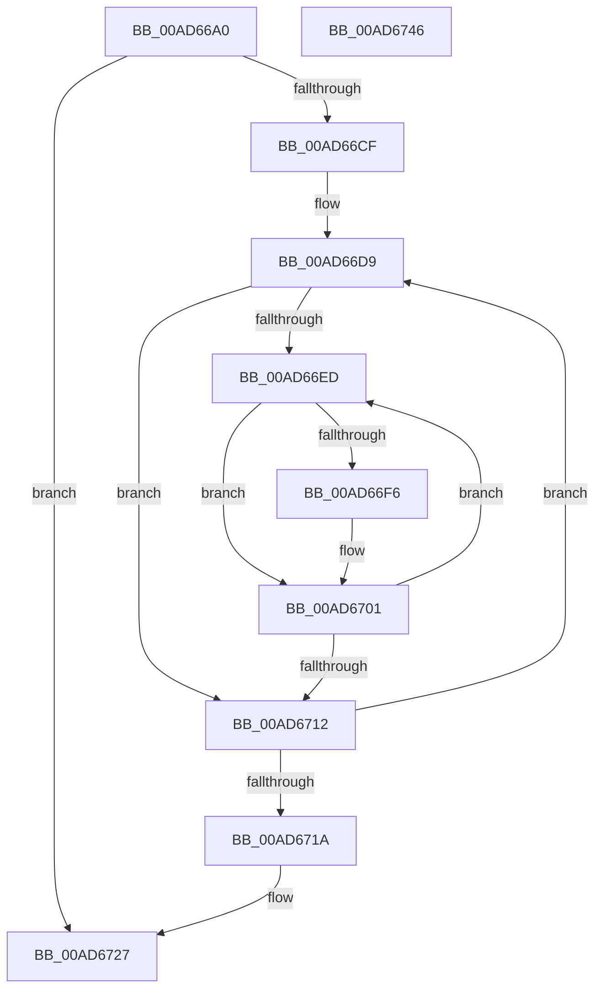

# ExStopRecordingIRTimerExpiries

- RVA: `0x00AD66A0`–`0x00AD6747` (길이 `167` bytes)
- VA: `0x0000000140AD66A0`
- 실행 섹션: `PAGE`
- PDB 이름 있음: `예`; PDB Function 태그: `아니요`
- unwind 정보 RVA: `0x0005FEF8`
- 디코드: `51`개 명령, `167/167` bytes 표시
- 미해석 바이트: `0` (있으면 어셈블리에 `.byte`로 보존)

> 이 문서는 커널 이미지의 기계어와 PDB 기호를 분석해 생성했습니다. 4번과 5번은 함수 원형과 자료형을 바이너리 사용 방식에서 추정한 C 해석이며 원본 소스 복구 결과는 아닙니다.

## 1. Dependencies

- 직접 호출 지점: **3**; 고유 호출 대상: **3**
- 직접 호출자로 확인된 함수: **1**
- RIP 상대 이미지 참조: **1**

### Outgoing calls
- `0x00AD66DB` → [ExpGetIRTimerDesc](../../text/4E/ExpGetIRTimerDesc_function_004E3D04.md) (function, `0x004E3D04`)
- `0x00AD66FC` → [PoDiagTraceIRTimerSleepStudyRundown](../../text/4E/PoDiagTraceIRTimerSleepStudyRundown_function_004E05A8.md) (function, `0x004E05A8`)
- `0x00AD6722` → [ExFreePoolWithTag](../../poolcode/B8/ExFreePoolWithTag_function_00B82870.md) (function, `0x00B82870`)

### Direct callers
- [PopCaptureSleepStudyStatistics](../../text/43/PopCaptureSleepStudyStatistics_function_004399F4.md) at `0x00439F3C`

### Static image references
- `0x00AD66C3` → RVA `0x00EFAB80` (`.data`; read/write)

## 2. Other-region calls and transfers

- 다른 실행 섹션으로 향하는 call: **3**
  - `0x00AD66DB` → [ExpGetIRTimerDesc](../../text/4E/ExpGetIRTimerDesc_function_004E3D04.md) (`PAGE` → `.text`)
  - `0x00AD66FC` → [PoDiagTraceIRTimerSleepStudyRundown](../../text/4E/PoDiagTraceIRTimerSleepStudyRundown_function_004E05A8.md) (`PAGE` → `.text`)
  - `0x00AD6722` → [ExFreePoolWithTag](../../poolcode/B8/ExFreePoolWithTag_function_00B82870.md) (`PAGE` → `POOLCODE`)
- 별도 외부 분기/꼬리 이동을 확인하지 못했습니다.

## 3. Assembly (complete function range)

```asm
00AD66A0  48 8B C4                        mov rax, rsp
00AD66A3  48 89 58 08                     mov qword ptr [rax + 8], rbx
00AD66A7  48 89 68 10                     mov qword ptr [rax + 0x10], rbp
00AD66AB  48 89 70 18                     mov qword ptr [rax + 0x18], rsi
00AD66AF  48 89 78 20                     mov qword ptr [rax + 0x20], rdi
00AD66B3  41 54                           push r12
00AD66B5  41 56                           push r14
00AD66B7  41 57                           push r15
00AD66B9  48 83 EC 20                     sub rsp, 0x20
00AD66BD  45 33 FF                        xor r15d, r15d
00AD66C0  41 8B DF                        mov ebx, r15d
00AD66C3  48 87 1D B6 44 42 00            xchg qword ptr [rip + 0x4244b6], rbx
00AD66CA  48 85 DB                        test rbx, rbx
00AD66CD  74 58                           je 0x140ad6727
00AD66CF  41 8B EF                        mov ebp, r15d
00AD66D2  45 8D 67 01                     lea r12d, [r15 + 1]
00AD66D6  41 8B FF                        mov edi, r15d
00AD66D9  8B CF                           mov ecx, edi
00AD66DB  E8 24 D6 A0 FF                  call 0x1404e3d04
00AD66E0  4C 8B F0                        mov r14, rax
00AD66E3  41 0F B7 F7                     movzx esi, r15w
00AD66E7  44 38 78 10                     cmp byte ptr [rax + 0x10], r15b
00AD66EB  76 25                           jbe 0x140ad6712
00AD66ED  8B CD                           mov ecx, ebp
00AD66EF  8B 0C 8B                        mov ecx, dword ptr [rbx + rcx*4]
00AD66F2  85 C9                           test ecx, ecx
00AD66F4  74 0B                           je 0x140ad6701
00AD66F6  4D 8B 06                        mov r8, qword ptr [r14]
00AD66F9  0F B7 D6                        movzx edx, si
00AD66FC  E8 A7 9E A0 FF                  call 0x1404e05a8
00AD6701  41 0F B6 46 10                  movzx eax, byte ptr [r14 + 0x10]
00AD6706  41 03 EC                        add ebp, r12d
00AD6709  66 41 03 F4                     add si, r12w
00AD670D  66 3B F0                        cmp si, ax
00AD6710  72 DB                           jb 0x140ad66ed
00AD6712  41 03 FC                        add edi, r12d
00AD6715  83 FF 14                        cmp edi, 0x14
00AD6718  72 BF                           jb 0x140ad66d9
00AD671A  BA 45 78 54 69                  mov edx, 0x69547845
00AD671F  48 8B CB                        mov rcx, rbx
00AD6722  E8 49 C1 0A 00                  call 0x140b82870
00AD6727  48 8B 5C 24 40                  mov rbx, qword ptr [rsp + 0x40]
00AD672C  48 8B 6C 24 48                  mov rbp, qword ptr [rsp + 0x48]
00AD6731  48 8B 74 24 50                  mov rsi, qword ptr [rsp + 0x50]
00AD6736  48 8B 7C 24 58                  mov rdi, qword ptr [rsp + 0x58]
00AD673B  48 83 C4 20                     add rsp, 0x20
00AD673F  41 5F                           pop r15
00AD6741  41 5E                           pop r14
00AD6743  41 5C                           pop r12
00AD6745  C3                              ret
00AD6746  CC                              int3
```

## 4. C-style interpretation (structured pseudocode)

```c
__int64 __fastcall ExStopRecordingIRTimerExpiries(void)
{
    __int64 result;
    __int64 v_r15;
    __int64 v_rbp;
    __int64 v_rdi;
    __int64 v_rsi;
    __int64 v_rsp;
    unsigned __int64 v_stack_p10;
    unsigned __int64 v_stack_p18;
    unsigned __int64 v_stack_p20;
    unsigned __int64 v_stack_p8;

    *(unsigned __int64 *)(v_rsp + 8) = v_rbx;
    *(unsigned __int64 *)(v_rsp + 16) = v_rbp;
    *(unsigned __int64 *)(v_rsp + 24) = v_rsi;
    *(unsigned __int64 *)(v_rsp + 32) = v_rdi;
    v_rsp = (v_rsp) - (32);
    v_r15 = 0;
    if (0 == 0) goto loc_00AD6727;
loc_00AD66D9:
    result = ExpGetIRTimerDesc(0, a2, a3, a4);
    if ((*(unsigned __int8 *)(result + 16)) <= 0) goto loc_00AD6712;
loc_00AD66ED:
    if ((unsigned int)((unsigned int)(*(unsigned int *)(0 + 0 * 4))) != 0) {
        a3 = *(unsigned __int64 *)(result);
        a2 = 0;
        result = PoDiagTraceIRTimerSleepStudyRundown((unsigned int)(*(unsigned int *)(0 + 0 * 4)), a2, a3, a4);
    }
    v_rbp = (unsigned int)((0) + ((unsigned int)(v_r15 + 1)));
    v_rsi = (unsigned __int16)((0) + ((unsigned __int16)(v_r15 + 1)));
    if (((unsigned __int16)(v_rsi)) < ((unsigned __int16)(*(unsigned __int8 *)(result + 16)))) goto loc_00AD66ED;
loc_00AD6712:
    v_rdi = (unsigned int)((0) + ((unsigned int)(v_r15 + 1)));
    if (((unsigned int)(v_rdi)) < 20) goto loc_00AD66D9;
    result = ExFreePoolWithTag(0, (unsigned int)(0x69547845ULL), a3, a4);
loc_00AD6727:
    v_rsp = (v_rsp) + (32);
    return result;
}
```

## 5. (Beta) C Style

```c
void ExStopRecordingIRTimerExpiries(void)
{
    int64_t result;
    int64_t local_r15;
    int64_t local_rbp;
    int64_t local_rdi;
    int64_t local_rsi;
    int64_t local_rsp;
    uint64_t v_stack_p10;
    uint64_t v_stack_p18;
    uint64_t v_stack_p20;
    uint64_t v_stack_p8;

    *(uint64_t *)(local_rsp + 0x8) = local_rbx;
    *(uint64_t *)(local_rsp + 0x10) = local_rbp;
    *(uint64_t *)(local_rsp + 0x18) = local_rsi;
    *(uint64_t *)(local_rsp + 0x20) = local_rdi;
    local_rsp = (local_rsp) - (32);
    local_r15 = 0;
    if (0 == 0) goto loc_00AD6727;
loc_00AD66D9:
    result = ExpGetIRTimerDesc(0, a2, a3, a4);
    if ((*(uint8_t *)(result + 0x10)) <= 0) goto loc_00AD6712;
loc_00AD66ED:
    if ((uint32_t)((uint32_t)(*(uint32_t *)(0 + 0x0 * 4))) != 0) {
        a3 = *(uint64_t *)(result);
        a2 = 0;
        result = PoDiagTraceIRTimerSleepStudyRundown((uint32_t)(*(uint32_t *)(0 + 0x0 * 4)), a2, a3, a4);
    }
    local_rbp = (uint32_t)((0) + ((uint32_t)(local_r15 + 1)));
    local_rsi = (uint16_t)((0) + ((uint16_t)(local_r15 + 1)));
    if (((uint16_t)(local_rsi)) < ((uint16_t)(*(uint8_t *)(result + 0x10)))) goto loc_00AD66ED;
loc_00AD6712:
    local_rdi = (uint32_t)((0) + ((uint32_t)(local_r15 + 1)));
    if (((uint32_t)(local_rdi)) < 20) goto loc_00AD66D9;
    result = ExFreePoolWithTag(0, (uint32_t)(0x69547845ULL), a3, a4);
loc_00AD6727:
    local_rsp = (local_rsp) + (32);
    return result;
}
```

## 6. Execution-region graph

[열기: 2D/3D 그래프와 함수 탐색 컨트롤 패널](../../../control-panel.html?section=page&rva=0x00AD66A0&view=graph)

- 2D 그래프는 위에서 아래로 흐르고, 3D 그래프는 빈 공간을 드래그해 회전합니다. Shift+드래그는 이동, 휠은 확대·축소, 함수 노드 선택은 대상 보고서 이동입니다.

### Static fallback


