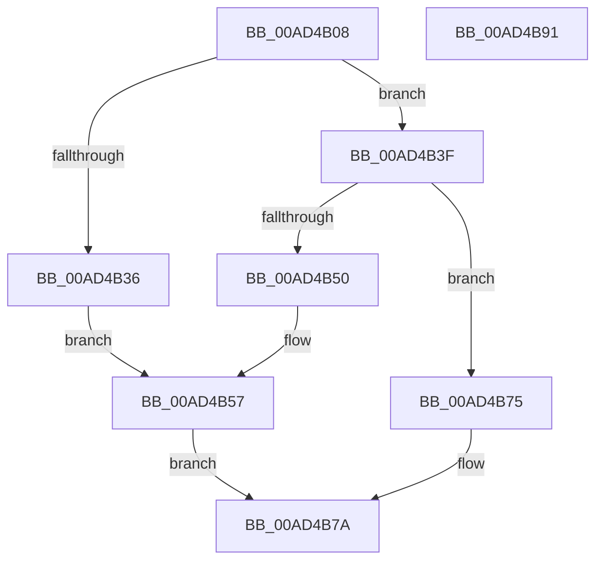

# ExpQueryCrossVmEvent

- RVA: `0x00AD4B08`–`0x00AD4B92` (길이 `138` bytes)
- VA: `0x0000000140AD4B08`
- 실행 섹션: `PAGE`
- PDB 이름 있음: `예`; PDB Function 태그: `아니요`
- unwind 정보 RVA: `0x0005C954`
- 디코드: `37`개 명령, `138/138` bytes 표시
- 미해석 바이트: `0` (있으면 어셈블리에 `.byte`로 보존)

> 이 문서는 커널 이미지의 기계어와 PDB 기호를 분석해 생성했습니다. 4번과 5번은 함수 원형과 자료형을 바이너리 사용 방식에서 추정한 C 해석이며 원본 소스 복구 결과는 아닙니다.

## 1. Dependencies

- 직접 호출 지점: **4**; 고유 호출 대상: **3**
- 직접 호출자로 확인된 함수: **1**
- RIP 상대 이미지 참조: **2**

### Outgoing calls
- `0x00AD4B2C` → [ExGetExtensionTable](../../text/42/ExGetExtensionTable_function_00428814.md) (function, `0x00428814`)
- `0x00AD4B46` → [ExGetExtensionTable](../../text/42/ExGetExtensionTable_function_00428814.md) (function, `0x00428814`)
- `0x00AD4B64` → [guard_dispatch_icall](../../text/6B/guard_dispatch_icall_function_006BAAD0.md) (function, `0x006BAAD0`)
- `0x00AD4B6E` → [ExReleaseExtensionTable](../../text/45/ExReleaseExtensionTable_function_00456DC0.md) (function, `0x00456DC0`)

### Direct callers
- [NtQueryEvent](../8E/NtQueryEvent_function_008E8F90.md) at `0x008E9171`

### Static image references
- `0x00AD4B22` → RVA `0x00EFA120` (`.data`; read)
- `0x00AD4B3F` → RVA `0x00EFA118` (`.data`; read)

## 2. Other-region calls and transfers

- 다른 실행 섹션으로 향하는 call: **4**
  - `0x00AD4B2C` → [ExGetExtensionTable](../../text/42/ExGetExtensionTable_function_00428814.md) (`PAGE` → `.text`)
  - `0x00AD4B46` → [ExGetExtensionTable](../../text/42/ExGetExtensionTable_function_00428814.md) (`PAGE` → `.text`)
  - `0x00AD4B64` → [guard_dispatch_icall](../../text/6B/guard_dispatch_icall_function_006BAAD0.md) (`PAGE` → `.text`)
  - `0x00AD4B6E` → [ExReleaseExtensionTable](../../text/45/ExReleaseExtensionTable_function_00456DC0.md) (`PAGE` → `.text`)
- 별도 외부 분기/꼬리 이동을 확인하지 못했습니다.

## 3. Assembly (complete function range)

```asm
00AD4B08  48 89 5C 24 08                  mov qword ptr [rsp + 8], rbx
00AD4B0D  48 89 6C 24 10                  mov qword ptr [rsp + 0x10], rbp
00AD4B12  48 89 74 24 18                  mov qword ptr [rsp + 0x18], rsi
00AD4B17  57                              push rdi
00AD4B18  48 83 EC 20                     sub rsp, 0x20
00AD4B1C  48 8B E9                        mov rbp, rcx
00AD4B1F  49 8B D8                        mov rbx, r8
00AD4B22  48 8B 0D F7 55 42 00            mov rcx, qword ptr [rip + 0x4255f7]
00AD4B29  48 8B F2                        mov rsi, rdx
00AD4B2C  E8 E3 3C 95 FF                  call 0x140428814
00AD4B31  48 85 C0                        test rax, rax
00AD4B34  74 09                           je 0x140ad4b3f
00AD4B36  48 8B 3D E3 55 42 00            mov rdi, qword ptr [rip + 0x4255e3]
00AD4B3D  EB 18                           jmp 0x140ad4b57
00AD4B3F  48 8B 0D D2 55 42 00            mov rcx, qword ptr [rip + 0x4255d2]
00AD4B46  E8 C9 3C 95 FF                  call 0x140428814
00AD4B4B  48 85 C0                        test rax, rax
00AD4B4E  74 25                           je 0x140ad4b75
00AD4B50  48 8B 3D C1 55 42 00            mov rdi, qword ptr [rip + 0x4255c1]
00AD4B57  48 8B 40 10                     mov rax, qword ptr [rax + 0x10]
00AD4B5B  4C 8B C3                        mov r8, rbx
00AD4B5E  48 8B D6                        mov rdx, rsi
00AD4B61  48 8B CD                        mov rcx, rbp
00AD4B64  E8 67 5F BE FF                  call 0x1406baad0
00AD4B69  8B D8                           mov ebx, eax
00AD4B6B  48 8B CF                        mov rcx, rdi
00AD4B6E  E8 4D 22 98 FF                  call 0x140456dc0
00AD4B73  EB 05                           jmp 0x140ad4b7a
00AD4B75  BB 02 00 00 C0                  mov ebx, 0xc0000002
00AD4B7A  48 8B 6C 24 38                  mov rbp, qword ptr [rsp + 0x38]
00AD4B7F  8B C3                           mov eax, ebx
00AD4B81  48 8B 5C 24 30                  mov rbx, qword ptr [rsp + 0x30]
00AD4B86  48 8B 74 24 40                  mov rsi, qword ptr [rsp + 0x40]
00AD4B8B  48 83 C4 20                     add rsp, 0x20
00AD4B8F  5F                              pop rdi
00AD4B90  C3                              ret
00AD4B91  CC                              int3
```

## 4. C-style interpretation (structured pseudocode)

```c
__int64 __fastcall ExpQueryCrossVmEvent(__int64 a1, __int64 a2, __int64 a3)
{
    __int64 result;
    __int64 v_rsp;
    unsigned __int64 v_stack_p10;
    unsigned __int64 v_stack_p18;
    unsigned __int64 v_stack_p8;

    v_stack_p8 = v_rbx;
    v_stack_p10 = v_rbp;
    v_stack_p18 = v_rsi;
    v_rsp = (v_rsp) - (32);
    result = ExGetExtensionTable(*(unsigned __int64 *)(v_rip + 4347383), a2, a3, a4);
    if (result == 0) goto loc_00AD4B3F;
    goto loc_00AD4B57;
loc_00AD4B3F:
    result = ExGetExtensionTable(*(unsigned __int64 *)(v_rip + 4347346), a2, a3, a4);
    if (result == 0) goto loc_00AD4B75;
loc_00AD4B57:
    result = guard_dispatch_icall(a1, a2, a3, a4);
    result = ExReleaseExtensionTable(*(unsigned __int64 *)(v_rip + 4347329), a2, a3, a4);
    goto loc_00AD4B7A;
loc_00AD4B75:
loc_00AD4B7A:
    v_rsp = (v_rsp) + (32);
    return (unsigned int)((unsigned int)((unsigned int)(0xC0000002ULL)));
}
```

## 5. (Beta) C Style

```c
int64_t ExpQueryCrossVmEvent(int64_t Arg1, int64_t Arg2, int64_t Arg3)
{
    int64_t result;
    int64_t local_rsp;
    uint64_t v_stack_p10;
    uint64_t v_stack_p18;
    uint64_t v_stack_p8;

    v_stack_p8 = local_rbx;
    v_stack_p10 = local_rbp;
    v_stack_p18 = local_rsi;
    local_rsp = (local_rsp) - (32);
    result = ExGetExtensionTable(*(uint64_t *)(v_rip + 0x4255F7), Arg2, Arg3, a4);
    if (result == 0) goto loc_00AD4B3F;
    goto loc_00AD4B57;
loc_00AD4B3F:
    result = ExGetExtensionTable(*(uint64_t *)(v_rip + 0x4255D2), Arg2, Arg3, a4);
    if (result == 0) goto loc_00AD4B75;
loc_00AD4B57:
    result = guard_dispatch_icall(Arg1, Arg2, Arg3, a4);
    result = ExReleaseExtensionTable(*(uint64_t *)(v_rip + 0x4255C1), Arg2, Arg3, a4);
    goto loc_00AD4B7A;
loc_00AD4B75:
loc_00AD4B7A:
    local_rsp = (local_rsp) + (32);
    return (uint32_t)((uint32_t)((uint32_t)(0xC0000002ULL)));
}
```

## 6. Execution-region graph

[열기: 2D/3D 그래프와 함수 탐색 컨트롤 패널](../../../control-panel.html?section=page&rva=0x00AD4B08&view=graph)

- 2D 그래프는 위에서 아래로 흐르고, 3D 그래프는 빈 공간을 드래그해 회전합니다. Shift+드래그는 이동, 휠은 확대·축소, 함수 노드 선택은 대상 보고서 이동입니다.

### Static fallback


