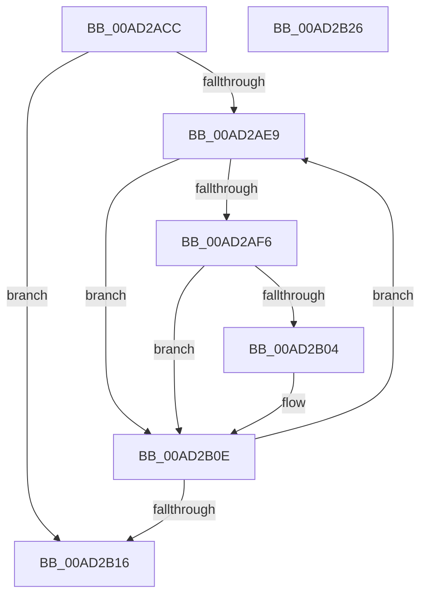

# FsRtlCheckNotifyForDelete

- RVA: `0x00AD2ACC`–`0x00AD2B27` (길이 `91` bytes)
- VA: `0x0000000140AD2ACC`
- 실행 섹션: `PAGE`
- PDB 이름 있음: `예`; PDB Function 태그: `아니요`
- unwind 정보 RVA: `0x00060BC4`
- 디코드: `27`개 명령, `91/91` bytes 표시
- 미해석 바이트: `0` (있으면 어셈블리에 `.byte`로 보존)

> 이 문서는 커널 이미지의 기계어와 PDB 기호를 분석해 생성했습니다. 4번과 5번은 함수 원형과 자료형을 바이너리 사용 방식에서 추정한 C 해석이며 원본 소스 복구 결과는 아닙니다.

## 1. Dependencies

- 직접 호출 지점: **1**; 고유 호출 대상: **1**
- 직접 호출자로 확인된 함수: **1**
- RIP 상대 이미지 참조: **0**

### Outgoing calls
- `0x00AD2B09` → [FsRtlNotifyCompleteIrpList](../A1/FsRtlNotifyCompleteIrpList_function_00A1F98C.md) (function, `0x00A1F98C`)

### Direct callers
- [FsRtlNotifyFilterChangeDirectory](../AA/FsRtlNotifyFilterChangeDirectory_function_00AAB9E0.md) at `0x00AABA54`

### Static image references
- 디코드된 RIP-relative 메모리 참조가 없습니다.

## 2. Other-region calls and transfers

- 다른 실행 섹션으로 향하는 call: **0**
- 별도 외부 분기/꼬리 이동을 확인하지 못했습니다.

## 3. Assembly (complete function range)

```asm
00AD2ACC  48 89 5C 24 08                  mov qword ptr [rsp + 8], rbx
00AD2AD1  48 89 74 24 10                  mov qword ptr [rsp + 0x10], rsi
00AD2AD6  57                              push rdi
00AD2AD7  48 83 EC 20                     sub rsp, 0x20
00AD2ADB  48 8B 19                        mov rbx, qword ptr [rcx]
00AD2ADE  48 8B F2                        mov rsi, rdx
00AD2AE1  48 8B F9                        mov rdi, rcx
00AD2AE4  48 3B D9                        cmp rbx, rcx
00AD2AE7  74 2D                           je 0x140ad2b16
00AD2AE9  48 8D 4B E0                     lea rcx, [rbx - 0x20]
00AD2AED  48 39 B1 80 00 00 00            cmp qword ptr [rcx + 0x80], rsi
00AD2AF4  75 18                           jne 0x140ad2b0e
00AD2AF6  66 83 49 48 20                  or word ptr [rcx + 0x48], 0x20
00AD2AFB  48 8D 41 30                     lea rax, [rcx + 0x30]
00AD2AFF  48 39 00                        cmp qword ptr [rax], rax
00AD2B02  74 0A                           je 0x140ad2b0e
00AD2B04  BA 56 00 00 C0                  mov edx, 0xc0000056
00AD2B09  E8 7E CE F4 FF                  call 0x140a1f98c
00AD2B0E  48 8B 1B                        mov rbx, qword ptr [rbx]
00AD2B11  48 3B DF                        cmp rbx, rdi
00AD2B14  75 D3                           jne 0x140ad2ae9
00AD2B16  48 8B 5C 24 30                  mov rbx, qword ptr [rsp + 0x30]
00AD2B1B  48 8B 74 24 38                  mov rsi, qword ptr [rsp + 0x38]
00AD2B20  48 83 C4 20                     add rsp, 0x20
00AD2B24  5F                              pop rdi
00AD2B25  C3                              ret
00AD2B26  CC                              int3
```

## 4. C-style interpretation (structured pseudocode)

```c
__int64 __fastcall FsRtlCheckNotifyForDelete(__int64 a1, __int64 a2)
{
    __int64 result;
    __int64 v_rsp;
    unsigned __int64 v_stack_p10;
    unsigned __int64 v_stack_p8;

    v_stack_p8 = v_rbx;
    v_stack_p10 = v_rsi;
    v_rsp = (v_rsp) - (32);
    if ((*(unsigned __int64 *)(a1)) == a1) goto loc_00AD2B16;
loc_00AD2AE9:
    if ((*(unsigned __int64 *)(*(unsigned __int64 *)(a1) - 32 + 128)) != a2) goto loc_00AD2B0E;
    result = *(unsigned __int64 *)(a1) - 32 + 48;
    if ((*(unsigned __int64 *)(*(unsigned __int64 *)(a1) - 32 + 48)) != (*(unsigned __int64 *)(a1) - 32 + 48)) {
        a2 = 0xC0000056ULL;
        result = FsRtlNotifyCompleteIrpList(*(unsigned __int64 *)(a1) - 32, a2, a3, a4);
    }
    if ((*(unsigned __int64 *)(*(unsigned __int64 *)(a1))) != a1) goto loc_00AD2AE9;
loc_00AD2B16:
    v_rsp = (v_rsp) + (32);
    return result;
}
```

## 5. (Beta) C Style

```c
int64_t FsRtlCheckNotifyForDelete(void *Arg1, int64_t Arg2)
{
    uint8_t *arg1 = (uint8_t *)Arg1;

    int64_t result;
    int64_t local_rsp;
    uint64_t v_stack_p10;
    uint64_t v_stack_p8;

    v_stack_p8 = local_rbx;
    v_stack_p10 = local_rsi;
    local_rsp = (local_rsp) - (32);
    if ((*(uint64_t *)(arg1)) == Arg1) goto loc_00AD2B16;
loc_00AD2AE9:
    if ((*(uint64_t *)(*(uint64_t *)(arg1) - 0x20 + 0x80)) != Arg2) goto loc_00AD2B0E;
    result = *(uint64_t *)(arg1) - 32 + 48;
    if ((*(uint64_t *)(*(uint64_t *)(arg1) - 0x20 + 0x30)) != (*(uint64_t *)(arg1) - 32 + 48)) {
        Arg2 = 0xC0000056ULL;
        result = FsRtlNotifyCompleteIrpList(*(uint64_t *)(arg1) - 32, Arg2, a3, a4);
    }
    if ((*(uint64_t *)(*(uint64_t *)(arg1))) != Arg1) goto loc_00AD2AE9;
loc_00AD2B16:
    local_rsp = (local_rsp) + (32);
    return result;
}
```

### 관측된 메모리 오프셋

구조체 형식이 확인되지 않은 접근은 인자 기준의 오프셋으로만 기록했습니다.

| 기준 인자 | 오프셋 표현 | 폭 (bit) | 접근 |
|---|---:|---:|---|
| `Arg1` | `+ 0x0` | `64` | `R` |

## 6. Execution-region graph

[열기: 2D/3D 그래프와 함수 탐색 컨트롤 패널](../../../control-panel.html?section=page&rva=0x00AD2ACC&view=graph)

- 2D 그래프는 위에서 아래로 흐르고, 3D 그래프는 빈 공간을 드래그해 회전합니다. Shift+드래그는 이동, 휠은 확대·축소, 함수 노드 선택은 대상 보고서 이동입니다.

### Static fallback


