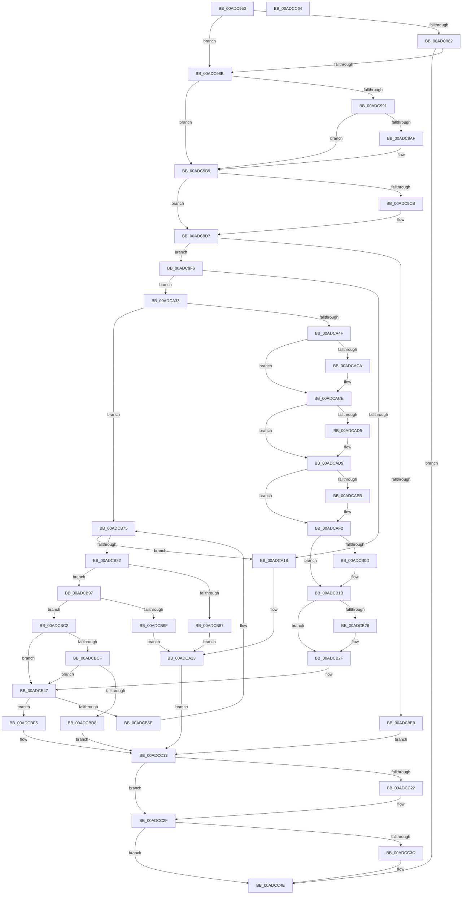

# FsRtlNotifyFilterChangeDirectoryLite

- RVA: `0x00ADC950`–`0x00ADCC65` (길이 `789` bytes)
- VA: `0x0000000140ADC950`
- 실행 섹션: `PAGE`
- PDB 이름 있음: `예`; PDB Function 태그: `아니요`
- unwind 정보 RVA: `0x000C629C`
- 디코드: `197`개 명령, `789/789` bytes 표시
- 미해석 바이트: `0` (있으면 어셈블리에 `.byte`로 보존)

> 이 문서는 커널 이미지의 기계어와 PDB 기호를 분석해 생성했습니다. 4번과 5번은 함수 원형과 자료형을 바이너리 사용 방식에서 추정한 C 해석이며 원본 소스 복구 결과는 아닙니다.

## 1. Dependencies

- 직접 호출 지점: **14**; 고유 호출 대상: **14**
- 직접 호출자로 확인된 함수: **0**
- RIP 상대 이미지 참조: **0**

### Outgoing calls
- `0x00ADC99C` → [FsRtlNotifyInitializeSync](../A7/FsRtlNotifyInitializeSync_function_00A7BDE0.md) (function, `0x00A7BDE0`)
- `0x00ADC9B4` → [FsRtlNotifyUninitializeSync](../A8/FsRtlNotifyUninitializeSync_function_00A8A410.md) (function, `0x00A8A410`)
- `0x00ADC9CB` → [ExAcquireFastMutexUnsafe](../../text/3F/ExAcquireFastMutexUnsafe_function_003F3720.md) (function, `0x003F3720`)
- `0x00ADC9EC` → [FsRtlCheckNotifyForDeleteLite](../71/FsRtlCheckNotifyForDeleteLite_function_00716CDC.md) (function, `0x00716CDC`)
- `0x00ADCA29` → [IofCompleteRequest](../../text/29/IofCompleteRequest_function_0029B5C0.md) (function, `0x0029B5C0`)
- `0x00ADCA39` → [FsRtlIsNotifyOnList](../A3/FsRtlIsNotifyOnList_function_00A328E0.md) (function, `0x00A328E0`)
- `0x00ADCA5F` → [ExAllocatePool2](../../poolcode/B8/ExAllocatePool2_function_00B820F0.md) (function, `0x00B820F0`)
- `0x00ADCB04` → [Feature_4131803451__private_IsEnabledDeviceUsageNoInline](../../text/58/Feature_4131803451__private_IsEnabledDeviceUsageNoInline_function_0058336C.md) (function, `0x0058336C`)
- `0x00ADCB16` → [ObfReferenceObjectWithTag](../../text/21/ObfReferenceObjectWithTag_function_00210710.md) (function, `0x00210710`)
- `0x00ADCBEE` → [FsRtlNotifyCompleteIrp](../A1/FsRtlNotifyCompleteIrp_function_00A1FA28.md) (function, `0x00A1FA28`)
- `0x00ADCC0D` → [FsRtlNotifySetCancelRoutine](../../text/27/FsRtlNotifySetCancelRoutine_function_0027239C.md) (function, `0x0027239C`)
- `0x00ADCC2A` → [ExReleaseFastMutexUnsafe](../../text/25/ExReleaseFastMutexUnsafe_function_002503A0.md) (function, `0x002503A0`)
- `0x00ADCC3F` → [SeReleaseSubjectContext](../86/SeReleaseSubjectContext_function_0086B710.md) (function, `0x0086B710`)
- `0x00ADCC49` → [ExFreePoolWithTag](../../poolcode/B8/ExFreePoolWithTag_function_00B82870.md) (function, `0x00B82870`)

### Direct callers
- 이 함수 시작 RVA로 연결되는 직접 call은 확인되지 않았습니다. 간접 호출은 완전히 역산할 수 없습니다.

### Static image references
- 디코드된 RIP-relative 메모리 참조가 없습니다.

## 2. Other-region calls and transfers

- 다른 실행 섹션으로 향하는 call: **8**
  - `0x00ADC9CB` → [ExAcquireFastMutexUnsafe](../../text/3F/ExAcquireFastMutexUnsafe_function_003F3720.md) (`PAGE` → `.text`)
  - `0x00ADCA29` → [IofCompleteRequest](../../text/29/IofCompleteRequest_function_0029B5C0.md) (`PAGE` → `.text`)
  - `0x00ADCA5F` → [ExAllocatePool2](../../poolcode/B8/ExAllocatePool2_function_00B820F0.md) (`PAGE` → `POOLCODE`)
  - `0x00ADCB04` → [Feature_4131803451__private_IsEnabledDeviceUsageNoInline](../../text/58/Feature_4131803451__private_IsEnabledDeviceUsageNoInline_function_0058336C.md) (`PAGE` → `.text`)
  - `0x00ADCB16` → [ObfReferenceObjectWithTag](../../text/21/ObfReferenceObjectWithTag_function_00210710.md) (`PAGE` → `.text`)
  - `0x00ADCC0D` → [FsRtlNotifySetCancelRoutine](../../text/27/FsRtlNotifySetCancelRoutine_function_0027239C.md) (`PAGE` → `.text`)
  - `0x00ADCC2A` → [ExReleaseFastMutexUnsafe](../../text/25/ExReleaseFastMutexUnsafe_function_002503A0.md) (`PAGE` → `.text`)
  - `0x00ADCC49` → [ExFreePoolWithTag](../../poolcode/B8/ExFreePoolWithTag_function_00B82870.md) (`PAGE` → `POOLCODE`)
- 별도 외부 분기/꼬리 이동을 확인하지 못했습니다.

## 3. Assembly (complete function range)

```asm
00ADC950  48 89 5C 24 18                  mov qword ptr [rsp + 0x18], rbx
00ADC955  44 89 4C 24 20                  mov dword ptr [rsp + 0x20], r9d
00ADC95A  48 89 4C 24 08                  mov qword ptr [rsp + 8], rcx
00ADC95F  57                              push rdi
00ADC960  41 54                           push r12
00ADC962  41 55                           push r13
00ADC964  41 56                           push r14
00ADC966  41 57                           push r15
00ADC968  48 83 EC 40                     sub rsp, 0x40
00ADC96C  4D 8B E0                        mov r12, r8
00ADC96F  4C 8B EA                        mov r13, rdx
00ADC972  4C 8B F1                        mov r14, rcx
00ADC975  48 8B BC 24 98 00 00 00         mov rdi, qword ptr [rsp + 0x98]
00ADC97D  48 39 12                        cmp qword ptr [rdx], rdx
00ADC980  75 09                           jne 0x140adc98b
00ADC982  48 85 FF                        test rdi, rdi
00ADC985  0F 84 C3 02 00 00               je 0x140adcc4e
00ADC98B  48 83 39 00                     cmp qword ptr [rcx], 0
00ADC98F  75 28                           jne 0x140adc9b9
00ADC991  48 83 64 24 78 00               and qword ptr [rsp + 0x78], 0
00ADC997  48 8D 4C 24 78                  lea rcx, [rsp + 0x78]
00ADC99C  E8 3F F4 F9 FF                  call 0x140a7bde0
00ADC9A1  48 8B 4C 24 78                  mov rcx, qword ptr [rsp + 0x78]
00ADC9A6  33 C0                           xor eax, eax
00ADC9A8  F0 49 0F B1 0E                  lock cmpxchg qword ptr [r14], rcx
00ADC9AD  74 0A                           je 0x140adc9b9
00ADC9AF  48 8D 4C 24 78                  lea rcx, [rsp + 0x78]
00ADC9B4  E8 57 DA FA FF                  call 0x140a8a410
00ADC9B9  65 48 8B 1C 25 88 01 00 00      mov rbx, qword ptr gs:[0x188]
00ADC9C2  49 8B 0E                        mov rcx, qword ptr [r14]
00ADC9C5  48 3B 59 38                     cmp rbx, qword ptr [rcx + 0x38]
00ADC9C9  74 0C                           je 0x140adc9d7
00ADC9CB  E8 50 6D 91 FF                  call 0x1403f3720
00ADC9D0  49 8B 06                        mov rax, qword ptr [r14]
00ADC9D3  48 89 58 38                     mov qword ptr [rax + 0x38], rbx
00ADC9D7  49 8B 06                        mov rax, qword ptr [r14]
00ADC9DA  41 B9 01 00 00 00               mov r9d, 1
00ADC9E0  44 01 48 40                     add dword ptr [rax + 0x40], r9d
00ADC9E4  48 85 FF                        test rdi, rdi
00ADC9E7  75 0D                           jne 0x140adc9f6
00ADC9E9  49 8B CD                        mov rcx, r13
00ADC9EC  E8 EB A2 C3 FF                  call 0x140716cdc
00ADC9F1  E9 1D 02 00 00                  jmp 0x140adcc13
00ADC9F6  4C 8B BF B8 00 00 00            mov r15, qword ptr [rdi + 0xb8]
00ADC9FD  4C 89 7C 24 38                  mov qword ptr [rsp + 0x38], r15
00ADCA02  83 67 30 00                     and dword ptr [rdi + 0x30], 0
00ADCA06  48 83 67 38 00                  and qword ptr [rdi + 0x38], 0
00ADCA0B  49 8B 47 30                     mov rax, qword ptr [r15 + 0x30]
00ADCA0F  F7 40 50 00 40 00 00            test dword ptr [rax + 0x50], 0x4000
00ADCA16  74 1B                           je 0x140adca33
00ADCA18  45 08 4F 03                     or byte ptr [r15 + 3], r9b
00ADCA1C  C7 47 30 0B 01 00 00            mov dword ptr [rdi + 0x30], 0x10b
00ADCA23  41 8A D1                        mov dl, r9b
00ADCA26  48 8B CF                        mov rcx, rdi
00ADCA29  E8 92 EB 7B FF                  call 0x14029b5c0
00ADCA2E  E9 E0 01 00 00                  jmp 0x140adcc13
00ADCA33  49 8B D4                        mov rdx, r12
00ADCA36  49 8B CD                        mov rcx, r13
00ADCA39  E8 A2 5E F5 FF                  call 0x140a328e0
00ADCA3E  48 8B D8                        mov rbx, rax
00ADCA41  48 89 44 24 30                  mov qword ptr [rsp + 0x30], rax
00ADCA46  48 85 C0                        test rax, rax
00ADCA49  0F 85 26 01 00 00               jne 0x140adcb75
00ADCA4F  BA 80 00 00 00                  mov edx, 0x80
00ADCA54  B9 20 01 00 00                  mov ecx, 0x120
00ADCA59  41 B8 46 53 72 4E               mov r8d, 0x4e725346
00ADCA5F  E8 8C 56 0A 00                  call 0x140b820f0
00ADCA64  48 8B D8                        mov rbx, rax
00ADCA67  48 89 44 24 30                  mov qword ptr [rsp + 0x30], rax
00ADCA6C  0F B7 40 48                     movzx eax, word ptr [rax + 0x48]
00ADCA70  66 83 C8 40                     or ax, 0x40
00ADCA74  66 89 43 48                     mov word ptr [rbx + 0x48], ax
00ADCA78  49 8B 06                        mov rax, qword ptr [r14]
00ADCA7B  48 89 03                        mov qword ptr [rbx], rax
00ADCA7E  4C 89 63 08                     mov qword ptr [rbx + 8], r12
00ADCA82  48 8B 84 24 A0 00 00 00         mov rax, qword ptr [rsp + 0xa0]
00ADCA8A  48 89 43 10                     mov qword ptr [rbx + 0x10], rax
00ADCA8E  48 8B 84 24 A8 00 00 00         mov rax, qword ptr [rsp + 0xa8]
00ADCA96  48 89 43 18                     mov qword ptr [rbx + 0x18], rax
00ADCA9A  48 83 A4 24 A8 00 00 00 00      and qword ptr [rsp + 0xa8], 0
00ADCAA3  48 8B 84 24 B0 00 00 00         mov rax, qword ptr [rsp + 0xb0]
00ADCAAB  48 89 43 40                     mov qword ptr [rbx + 0x40], rax
00ADCAAF  48 8D 43 30                     lea rax, [rbx + 0x30]
00ADCAB3  48 89 40 08                     mov qword ptr [rax + 8], rax
00ADCAB7  48 89 00                        mov qword ptr [rax], rax
00ADCABA  8B 8C 24 88 00 00 00            mov ecx, dword ptr [rsp + 0x88]
00ADCAC1  B8 01 00 00 00                  mov eax, 1
00ADCAC6  84 C8                           test al, cl
00ADCAC8  74 04                           je 0x140adcace
00ADCACA  66 09 43 48                     or word ptr [rbx + 0x48], ax
00ADCACE  41 80 7F 01 03                  cmp byte ptr [r15 + 1], 3
00ADCAD3  75 04                           jne 0x140adcad9
00ADCAD5  41 8B 47 18                     mov eax, dword ptr [r15 + 0x18]
00ADCAD9  89 43 74                        mov dword ptr [rbx + 0x74], eax
00ADCADC  8B 84 24 90 00 00 00            mov eax, dword ptr [rsp + 0x90]
00ADCAE3  89 43 4C                        mov dword ptr [rbx + 0x4c], eax
00ADCAE6  F6 C1 02                        test cl, 2
00ADCAE9  75 07                           jne 0x140adcaf2
00ADCAEB  41 8B 47 08                     mov eax, dword ptr [r15 + 8]
00ADCAEF  89 43 60                        mov dword ptr [rbx + 0x60], eax
00ADCAF2  48 8B 87 98 00 00 00            mov rax, qword ptr [rdi + 0x98]
00ADCAF9  48 8B 88 20 02 00 00            mov rcx, qword ptr [rax + 0x220]
00ADCB00  48 89 4B 78                     mov qword ptr [rbx + 0x78], rcx
00ADCB04  E8 63 68 AA FF                  call 0x14058336c
00ADCB09  85 C0                           test eax, eax
00ADCB0B  74 0E                           je 0x140adcb1b
00ADCB0D  BA 46 73 4E 74                  mov edx, 0x744e7346
00ADCB12  48 8B 4B 78                     mov rcx, qword ptr [rbx + 0x78]
00ADCB16  E8 F5 3B 73 FF                  call 0x140210710
00ADCB1B  48 8D 43 20                     lea rax, [rbx + 0x20]
00ADCB1F  49 8B 4D 08                     mov rcx, qword ptr [r13 + 8]
00ADCB23  4C 39 29                        cmp qword ptr [rcx], r13
00ADCB26  74 07                           je 0x140adcb2f
00ADCB28  B9 03 00 00 00                  mov ecx, 3
00ADCB2D  CD 29                           int 0x29
00ADCB2F  4C 89 28                        mov qword ptr [rax], r13
00ADCB32  48 89 48 08                     mov qword ptr [rax + 8], rcx
00ADCB36  48 89 01                        mov qword ptr [rcx], rax
00ADCB39  49 89 45 08                     mov qword ptr [r13 + 8], rax
00ADCB3D  41 B9 01 00 00 00               mov r9d, 1
00ADCB43  44 89 4B 70                     mov dword ptr [rbx + 0x70], r9d
00ADCB47  48 89 5F 38                     mov qword ptr [rdi + 0x38], rbx
00ADCB4B  48 8B 87 B8 00 00 00            mov rax, qword ptr [rdi + 0xb8]
00ADCB52  44 08 48 03                     or byte ptr [rax + 3], r9b
00ADCB56  48 8D 87 A8 00 00 00            lea rax, [rdi + 0xa8]
00ADCB5D  48 8D 4B 30                     lea rcx, [rbx + 0x30]
00ADCB61  48 8B 51 08                     mov rdx, qword ptr [rcx + 8]
00ADCB65  48 39 0A                        cmp qword ptr [rdx], rcx
00ADCB68  0F 84 87 00 00 00               je 0x140adcbf5
00ADCB6E  B9 03 00 00 00                  mov ecx, 3
00ADCB73  CD 29                           int 0x29
00ADCB75  0F B7 48 48                     movzx ecx, word ptr [rax + 0x48]
00ADCB79  F6 C1 04                        test cl, 4
00ADCB7C  0F 85 96 FE FF FF               jne 0x140adca18
00ADCB82  F6 C1 20                        test cl, 0x20
00ADCB85  74 10                           je 0x140adcb97
00ADCB87  45 08 4F 03                     or byte ptr [r15 + 3], r9b
00ADCB8B  C7 47 30 56 00 00 C0            mov dword ptr [rdi + 0x30], 0xc0000056
00ADCB92  E9 8C FE FF FF                  jmp 0x140adca23
00ADCB97  8A C1                           mov al, cl
00ADCB99  24 0A                           and al, 0xa
00ADCB9B  3C 02                           cmp al, 2
00ADCB9D  75 23                           jne 0x140adcbc2
00ADCB9F  B8 FD FF 00 00                  mov eax, 0xfffd
00ADCBA4  66 23 C8                        and cx, ax
00ADCBA7  66 89 4B 48                     mov word ptr [rbx + 0x48], cx
00ADCBAB  48 8B 87 B8 00 00 00            mov rax, qword ptr [rdi + 0xb8]
00ADCBB2  44 08 48 03                     or byte ptr [rax + 3], r9b
00ADCBB6  C7 47 30 0C 01 00 00            mov dword ptr [rdi + 0x30], 0x10c
00ADCBBD  E9 61 FE FF FF                  jmp 0x140adca23
00ADCBC2  44 8B 43 68                     mov r8d, dword ptr [rbx + 0x68]
00ADCBC6  45 85 C0                        test r8d, r8d
00ADCBC9  0F 84 78 FF FF FF               je 0x140adcb47
00ADCBCF  F6 C1 08                        test cl, 8
00ADCBD2  0F 85 6F FF FF FF               jne 0x140adcb47
00ADCBD8  83 63 68 00                     and dword ptr [rbx + 0x68], 0
00ADCBDC  83 63 6C 00                     and dword ptr [rbx + 0x6c], 0
00ADCBE0  83 64 24 20 00                  and dword ptr [rsp + 0x20], 0
00ADCBE5  45 33 C9                        xor r9d, r9d
00ADCBE8  48 8B D3                        mov rdx, rbx
00ADCBEB  48 8B CF                        mov rcx, rdi
00ADCBEE  E8 35 2E F4 FF                  call 0x140a1fa28
00ADCBF3  EB 1E                           jmp 0x140adcc13
00ADCBF5  48 89 08                        mov qword ptr [rax], rcx
00ADCBF8  48 89 50 08                     mov qword ptr [rax + 8], rdx
00ADCBFC  48 89 02                        mov qword ptr [rdx], rax
00ADCBFF  48 89 41 08                     mov qword ptr [rcx + 8], rax
00ADCC03  F0 44 01 4B 70                  lock add dword ptr [rbx + 0x70], r9d
00ADCC08  33 D2                           xor edx, edx
00ADCC0A  48 8B CF                        mov rcx, rdi
00ADCC0D  E8 8A 57 79 FF                  call 0x14027239c
00ADCC12  90                              nop
00ADCC13  49 8B 06                        mov rax, qword ptr [r14]
00ADCC16  FF 48 40                        dec dword ptr [rax + 0x40]
00ADCC19  49 8B 06                        mov rax, qword ptr [r14]
00ADCC1C  83 78 40 00                     cmp dword ptr [rax + 0x40], 0
00ADCC20  75 0D                           jne 0x140adcc2f
00ADCC22  48 83 60 38 00                  and qword ptr [rax + 0x38], 0
00ADCC27  49 8B 0E                        mov rcx, qword ptr [r14]
00ADCC2A  E8 71 37 77 FF                  call 0x1402503a0
00ADCC2F  48 8B 9C 24 A8 00 00 00         mov rbx, qword ptr [rsp + 0xa8]
00ADCC37  48 85 DB                        test rbx, rbx
00ADCC3A  74 12                           je 0x140adcc4e
00ADCC3C  48 8B CB                        mov rcx, rbx
00ADCC3F  E8 CC EA D8 FF                  call 0x14086b710
00ADCC44  33 D2                           xor edx, edx
00ADCC46  48 8B CB                        mov rcx, rbx
00ADCC49  E8 22 5C 0A 00                  call 0x140b82870
00ADCC4E  48 8B 9C 24 80 00 00 00         mov rbx, qword ptr [rsp + 0x80]
00ADCC56  48 83 C4 40                     add rsp, 0x40
00ADCC5A  41 5F                           pop r15
00ADCC5C  41 5E                           pop r14
00ADCC5E  41 5D                           pop r13
00ADCC60  41 5C                           pop r12
00ADCC62  5F                              pop rdi
00ADCC63  C3                              ret
00ADCC64  CC                              int3
```

## 4. C-style interpretation (structured pseudocode)

```c
__int64 __fastcall FsRtlNotifyFilterChangeDirectoryLite(__int64 a1, __int64 a2, __int64 a3, int a4, unsigned int a5, __int64 a6, __int64 a7, __int64 a8, __int64 a9)
{
    __int64 result;
    __int64 v_rsp;
    unsigned __int64 v_stack_m30;
    unsigned __int64 v_stack_m38;
    unsigned int v_stack_m48;
    unsigned __int64 v_stack_p10;
    unsigned __int64 v_stack_p18;
    unsigned int v_stack_p20;
    unsigned __int64 v_stack_p8;

    v_stack_p18 = v_rbx;
    v_stack_p20 = a4;
    v_stack_p8 = a1;
    v_rsp = (v_rsp) - (64);
    if ((*(unsigned __int64 *)(a2)) != a2) goto loc_00ADC98B;
    if (a6 == 0) goto loc_00ADCC4E;
loc_00ADC98B:
    if ((*(unsigned __int64 *)(a1)) != 0) goto loc_00ADC9B9;
    result = FsRtlNotifyInitializeSync(v_stack_p10, a2, a3, a4);
    result = 0;
    if (!(condition_is_equal)) {
        a1 = v_stack_p10;
        result = FsRtlNotifyUninitializeSync(a1, a2, a3, a4);
    }
    if ((*(unsigned __int64 *)(gs_base + (0 + 392))) != (*(unsigned __int64 *)(*(unsigned __int64 *)(a1) + 56))) {
        result = ExAcquireFastMutexUnsafe(*(unsigned __int64 *)(a1), a2, a3, a4);
        result = *(unsigned __int64 *)(a1);
        *(unsigned __int64 *)(result + 56) = *(unsigned __int64 *)(gs_base + (0 + 392));
    }
    if (a6 != 0) goto loc_00ADC9F6;
    result = FsRtlCheckNotifyForDeleteLite(a2, a2, a3, 1);
    goto loc_00ADCC13;
loc_00ADC9F6:
    v_stack_m30 = *(unsigned __int64 *)(a6 + 184);
    if (((*(unsigned int *)(*(unsigned __int64 *)(*(unsigned __int64 *)(a6 + 184) + 48) + 80)) & (0x4000ULL)) == 0) goto loc_00ADCA33;
loc_00ADCA18:
    *(unsigned int *)(a6 + 48) = 267;
loc_00ADCA23:
    result = IofCompleteRequest(a6, 1, a3, 1);
    goto loc_00ADCC13;
loc_00ADCA33:
    result = FsRtlIsNotifyOnList(a2, a3, a3, 1);
    v_stack_m38 = result;
    if (result != 0) goto loc_00ADCB75;
    result = ExAllocatePool2(288, 128, (unsigned int)(0x4E725346ULL), 1);
    v_stack_m38 = result;
    result = (unsigned __int16)((*(unsigned __int16 *)(result + 72)) | (64));
    *(unsigned __int16 *)(result + 72) = (unsigned __int16)(result);
    *(unsigned __int64 *)(result) = *(unsigned __int64 *)(a1);
    *(unsigned __int64 *)(result + 8) = a3;
    *(unsigned __int64 *)(result + 16) = a7;
    *(unsigned __int64 *)(result + 24) = a8;
    *(unsigned __int64 *)(result + 64) = a9;
    *(unsigned __int64 *)(result + 48 + 8) = result + 48;
    *(unsigned __int64 *)(result + 48) = result + 48;
    if (((1) & ((unsigned __int8)((unsigned int)(v_stack_p20)))) != 0) {
    }
    result = 1;
    if ((*(unsigned __int8 *)(*(unsigned __int64 *)(a6 + 184) + 1)) == 3) {
        result = *(unsigned int *)(*(unsigned __int64 *)(a6 + 184) + 24);
    }
    *(unsigned int *)(result + 116) = (unsigned int)(result);
    *(unsigned int *)(result + 76) = (unsigned int)((unsigned int)(a5));
    result = (unsigned int)(a5);
    if ((((unsigned __int8)((unsigned int)(v_stack_p20))) & (2)) == 0) {
        result = *(unsigned int *)(*(unsigned __int64 *)(a6 + 184) + 8);
        *(unsigned int *)(result + 96) = (unsigned int)(result);
    }
    *(unsigned __int64 *)(result + 120) = *(unsigned __int64 *)(*(unsigned __int64 *)(a6 + 152) + 544);
    result = Feature_4131803451__private_IsEnabledDeviceUsageNoInline(*(unsigned __int64 *)(*(unsigned __int64 *)(a6 + 152) + 544), 128, (unsigned int)(0x4E725346ULL), 1);
    if ((unsigned int)(result) != 0) {
        a2 = 0x744E7346ULL;
        a1 = *(unsigned __int64 *)(result + 120);
        result = ObfReferenceObjectWithTag(a1, a2, (unsigned int)(0x4E725346ULL), 1);
    }
    if ((*(unsigned __int64 *)(*(unsigned __int64 *)(a2 + 8))) != a2) {
        a1 = 3;
    }
    *(unsigned __int64 *)(result + 32) = a2;
    *(unsigned __int64 *)(result + 32 + 8) = a1;
    *(unsigned __int64 *)(a1) = result + 32;
    *(unsigned __int64 *)(a2 + 8) = result + 32;
    *(unsigned int *)(result + 112) = 1;
loc_00ADCB47:
    *(unsigned __int64 *)(a6 + 56) = result;
    if ((*(unsigned __int64 *)(*(unsigned __int64 *)(result + 48 + 8))) == (result + 48)) goto loc_00ADCBF5;
loc_00ADCB75:
    if ((((unsigned __int8)(*(unsigned __int16 *)(a6 + 168 + 72))) & (4)) != 0) goto loc_00ADCA18;
    if ((((unsigned __int8)(*(unsigned __int16 *)(a6 + 168 + 72))) & (32)) == 0) goto loc_00ADCB97;
    *(unsigned int *)(a6 + 48) = 0xC0000056ULL;
    goto loc_00ADCA23;
loc_00ADCB97:
    result = (unsigned __int8)(((unsigned __int8)(*(unsigned __int16 *)(a6 + 168 + 72))) & (10));
    if (((unsigned __int8)(result)) != 2) goto loc_00ADCBC2;
    a1 = (unsigned __int16)((*(unsigned __int16 *)(a6 + 168 + 72)) & ((unsigned __int16)((unsigned int)(0xFFFDULL))));
    *(unsigned __int16 *)(result + 72) = (unsigned __int16)(a1);
    *(unsigned int *)(a6 + 48) = 268;
    goto loc_00ADCA23;
loc_00ADCBC2:
    if ((unsigned int)((unsigned int)(*(unsigned int *)(result + 104))) == 0) goto loc_00ADCB47;
    if ((((unsigned __int8)(a1)) & (8)) != 0) goto loc_00ADCB47;
    a4 = 0;
    result = FsRtlNotifyCompleteIrp(a6, result, (unsigned int)(*(unsigned int *)(result + 104)), a4);
    goto loc_00ADCC13;
loc_00ADCBF5:
    *(unsigned __int64 *)(result) = a6;
    *(unsigned __int64 *)(result + 8) = result;
    *(unsigned __int64 *)(result) = result;
    *(unsigned __int64 *)(a6 + 8) = result;
    a2 = 0;
    result = FsRtlNotifySetCancelRoutine(a6, a2, (unsigned int)(*(unsigned int *)(result + 104)), a4);
loc_00ADCC13:
    result = *(unsigned __int64 *)(a1);
    if ((*(unsigned int *)(*(unsigned __int64 *)(a1) + 64)) == 0) {
        a1 = *(unsigned __int64 *)(a1);
        result = ExReleaseFastMutexUnsafe(a1, a2, (unsigned int)(*(unsigned int *)(result + 104)), a4);
    }
    if (a8 != 0) {
        a1 = a8;
        result = SeReleaseSubjectContext(a1, a2, (unsigned int)(*(unsigned int *)(result + 104)), a4);
        a2 = 0;
        a1 = a8;
        result = ExFreePoolWithTag(a1, a2, (unsigned int)(*(unsigned int *)(result + 104)), a4);
    }
    v_rsp = (v_rsp) + (64);
    return result;
}
```

## 5. (Beta) C Style

```c
int64_t FsRtlNotifyFilterChangeDirectoryLite(void *Arg1, void *Arg2, int64_t Arg3, int32_t Arg4, uint32_t Arg5, int64_t Arg6, int64_t Arg7, int64_t Arg8, int64_t Arg9)
{
    uint8_t *arg1 = (uint8_t *)Arg1;
    uint8_t *arg2 = (uint8_t *)Arg2;

    int64_t result;
    int64_t local_rsp;
    uint64_t v_stack_m30;
    uint64_t v_stack_m38;
    uint32_t v_stack_m48;
    uint64_t v_stack_p10;
    uint64_t v_stack_p18;
    uint32_t v_stack_p20;
    uint64_t v_stack_p8;

    v_stack_p18 = local_rbx;
    v_stack_p20 = Arg4;
    v_stack_p8 = Arg1;
    local_rsp = (local_rsp) - (64);
    if ((*(uint64_t *)(arg2)) != Arg2) goto loc_00ADC98B;
    if (Arg6 == 0) goto loc_00ADCC4E;
loc_00ADC98B:
    if ((*(uint64_t *)(arg1)) != 0) goto loc_00ADC9B9;
    result = FsRtlNotifyInitializeSync(v_stack_p10, Arg2, Arg3, Arg4);
    result = 0;
    if (!(condition_is_equal)) {
        Arg1 = v_stack_p10;
        result = FsRtlNotifyUninitializeSync(Arg1, Arg2, Arg3, Arg4);
    }
    if ((*(uint64_t *)(gs_base + (0 + 0x188))) != (*(uint64_t *)(*(uint64_t *)(arg1) + 0x38))) {
        result = ExAcquireFastMutexUnsafe(*(uint64_t *)(arg1), Arg2, Arg3, Arg4);
        result = *(uint64_t *)(arg1);
        *(uint64_t *)(result + 0x38) = *(uint64_t *)(gs_base + (0 + 0x188));
    }
    if (Arg6 != 0) goto loc_00ADC9F6;
    result = FsRtlCheckNotifyForDeleteLite(Arg2, Arg2, Arg3, 1);
    goto loc_00ADCC13;
loc_00ADC9F6:
    v_stack_m30 = *(uint64_t *)(Arg6 + 0xB8);
    if (((*(uint32_t *)(*(uint64_t *)(*(uint64_t *)(Arg6 + 0xB8) + 0x30) + 0x50)) & (0x4000ULL)) == 0) goto loc_00ADCA33;
loc_00ADCA18:
    *(uint32_t *)(Arg6 + 0x30) = 267;
loc_00ADCA23:
    result = IofCompleteRequest(Arg6, 1, Arg3, 1);
    goto loc_00ADCC13;
loc_00ADCA33:
    result = FsRtlIsNotifyOnList(Arg2, Arg3, Arg3, 1);
    v_stack_m38 = result;
    if (result != 0) goto loc_00ADCB75;
    result = ExAllocatePool2(288, 128, (uint32_t)(0x4E725346ULL), 1);
    v_stack_m38 = result;
    result = (uint16_t)((*(uint16_t *)(result + 0x48)) | (64));
    *(uint16_t *)(result + 0x48) = (uint16_t)(result);
    *(uint64_t *)(result) = *(uint64_t *)(arg1);
    *(uint64_t *)(result + 0x8) = Arg3;
    *(uint64_t *)(result + 0x10) = Arg7;
    *(uint64_t *)(result + 0x18) = Arg8;
    *(uint64_t *)(result + 0x40) = Arg9;
    *(uint64_t *)(result + 0x30 + 0x8) = result + 48;
    *(uint64_t *)(result + 0x30) = result + 48;
    if (((1) & ((uint8_t)((uint32_t)(v_stack_p20)))) != 0) {
    }
    result = 1;
    if ((*(uint8_t *)(*(uint64_t *)(Arg6 + 0xB8) + 0x1)) == 3) {
        result = *(uint32_t *)(*(uint64_t *)(Arg6 + 0xB8) + 0x18);
    }
    *(uint32_t *)(result + 0x74) = (uint32_t)(result);
    *(uint32_t *)(result + 0x4C) = (uint32_t)((uint32_t)(Arg5));
    result = (uint32_t)(Arg5);
    if ((((uint8_t)((uint32_t)(v_stack_p20))) & (2)) == 0) {
        result = *(uint32_t *)(*(uint64_t *)(Arg6 + 0xB8) + 0x8);
        *(uint32_t *)(result + 0x60) = (uint32_t)(result);
    }
    *(uint64_t *)(result + 0x78) = *(uint64_t *)(*(uint64_t *)(Arg6 + 0x98) + 0x220);
    result = Feature_4131803451__private_IsEnabledDeviceUsageNoInline(*(uint64_t *)(*(uint64_t *)(Arg6 + 0x98) + 0x220), 128, (uint32_t)(0x4E725346ULL), 1);
    if ((uint32_t)(result) != 0) {
        Arg2 = 0x744E7346ULL;
        Arg1 = *(uint64_t *)(result + 0x78);
        result = ObfReferenceObjectWithTag(Arg1, Arg2, (uint32_t)(0x4E725346ULL), 1);
    }
    if ((*(uint64_t *)(*(uint64_t *)(arg2 + 0x8))) != Arg2) {
        Arg1 = 3;
    }
    *(void **)(result + 0x20) = Arg2;
    *(void **)(result + 0x20 + 0x8) = Arg1;
    *(uint64_t *)(arg1) = result + 32;
    *(uint64_t *)(arg2 + 0x8) = result + 32;
    *(uint32_t *)(result + 0x70) = 1;
loc_00ADCB47:
    *(uint64_t *)(Arg6 + 0x38) = result;
    if ((*(uint64_t *)(*(uint64_t *)(result + 0x30 + 0x8))) == (result + 48)) goto loc_00ADCBF5;
loc_00ADCB75:
    if ((((uint8_t)(*(uint16_t *)(Arg6 + 0xA8 + 0x48))) & (4)) != 0) goto loc_00ADCA18;
    if ((((uint8_t)(*(uint16_t *)(Arg6 + 0xA8 + 0x48))) & (32)) == 0) goto loc_00ADCB97;
    *(uint32_t *)(Arg6 + 0x30) = 0xC0000056ULL;
    goto loc_00ADCA23;
loc_00ADCB97:
    result = (uint8_t)(((uint8_t)(*(uint16_t *)(Arg6 + 0xA8 + 0x48))) & (10));
    if (((uint8_t)(result)) != 2) goto loc_00ADCBC2;
    Arg1 = (uint16_t)((*(uint16_t *)(Arg6 + 0xA8 + 0x48)) & ((uint16_t)((uint32_t)(0xFFFDULL))));
    *(uint16_t *)(result + 0x48) = (uint16_t)(Arg1);
    *(uint32_t *)(Arg6 + 0x30) = 268;
    goto loc_00ADCA23;
loc_00ADCBC2:
    if ((uint32_t)((uint32_t)(*(uint32_t *)(result + 0x68))) == 0) goto loc_00ADCB47;
    if ((((uint8_t)(Arg1)) & (8)) != 0) goto loc_00ADCB47;
    Arg4 = 0;
    result = FsRtlNotifyCompleteIrp(Arg6, result, (uint32_t)(*(uint32_t *)(result + 0x68)), Arg4);
    goto loc_00ADCC13;
loc_00ADCBF5:
    *(uint64_t *)(result) = Arg6;
    *(uint64_t *)(result + 0x8) = result;
    *(uint64_t *)(result) = result;
    *(uint64_t *)(Arg6 + 0x8) = result;
    Arg2 = 0;
    result = FsRtlNotifySetCancelRoutine(Arg6, Arg2, (uint32_t)(*(uint32_t *)(result + 0x68)), Arg4);
loc_00ADCC13:
    result = *(uint64_t *)(arg1);
    if ((*(uint32_t *)(*(uint64_t *)(arg1) + 0x40)) == 0) {
        Arg1 = *(uint64_t *)(arg1);
        result = ExReleaseFastMutexUnsafe(Arg1, Arg2, (uint32_t)(*(uint32_t *)(result + 0x68)), Arg4);
    }
    if (Arg8 != 0) {
        Arg1 = Arg8;
        result = SeReleaseSubjectContext(Arg1, Arg2, (uint32_t)(*(uint32_t *)(result + 0x68)), Arg4);
        Arg2 = 0;
        Arg1 = Arg8;
        result = ExFreePoolWithTag(Arg1, Arg2, (uint32_t)(*(uint32_t *)(result + 0x68)), Arg4);
    }
    local_rsp = (local_rsp) + (64);
    return result;
}
```

### 관측된 메모리 오프셋

구조체 형식이 확인되지 않은 접근은 인자 기준의 오프셋으로만 기록했습니다.

| 기준 인자 | 오프셋 표현 | 폭 (bit) | 접근 |
|---|---:|---:|---|
| `Arg1` | `+ 0x0` | `64` | `R` |
| `Arg2` | `+ 0x0` | `64` | `R` |
| `Arg2` | `+ 0x8` | `64` | `R` |
| `Arg2` | `+ 0x8` | `64` | `W` |

## 6. Execution-region graph

[열기: 2D/3D 그래프와 함수 탐색 컨트롤 패널](../../../control-panel.html?section=page&rva=0x00ADC950&view=graph)

- 2D 그래프는 위에서 아래로 흐르고, 3D 그래프는 빈 공간을 드래그해 회전합니다. Shift+드래그는 이동, 휠은 확대·축소, 함수 노드 선택은 대상 보고서 이동입니다.

### Static fallback


