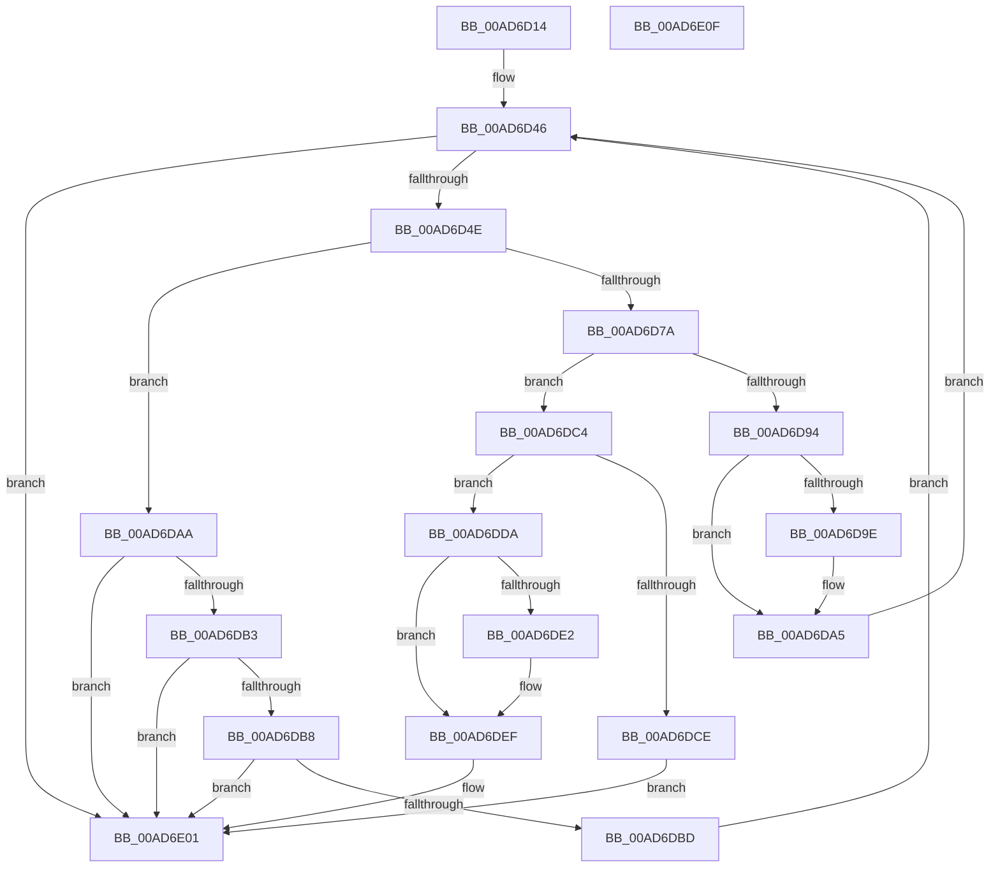

# HalpDmaGrowContiguousMapBuffers

- RVA: `0x00AD6D14`–`0x00AD6E10` (길이 `252` bytes)
- VA: `0x0000000140AD6D14`
- 실행 섹션: `PAGE`
- PDB 이름 있음: `예`; PDB Function 태그: `아니요`
- unwind 정보 RVA: `0x000BEFF4`
- 디코드: `73`개 명령, `252/252` bytes 표시
- 미해석 바이트: `0` (있으면 어셈블리에 `.byte`로 보존)

> 이 문서는 커널 이미지의 기계어와 PDB 기호를 분석해 생성했습니다. 4번과 5번은 함수 원형과 자료형을 바이너리 사용 방식에서 추정한 C 해석이며 원본 소스 복구 결과는 아닙니다.

## 1. Dependencies

- 직접 호출 지점: **7**; 고유 호출 대상: **6**
- 직접 호출자로 확인된 함수: **2**
- RIP 상대 이미지 참조: **0**

### Outgoing calls
- `0x00AD6D71` → [HalpDmaAllocateContiguousMemory](../../text/3E/HalpDmaAllocateContiguousMemory_function_003EBD0C.md) (function, `0x003EBD0C`)
- `0x00AD6D8A` → [HalpDmaCommitContiguousMapBuffers](../../text/55/HalpDmaCommitContiguousMapBuffers_function_00550A84.md) (function, `0x00550A84`)
- `0x00AD6DA0` → [ExFreePoolWithTag](../../poolcode/B8/ExFreePoolWithTag_function_00B82870.md) (function, `0x00B82870`)
- `0x00AD6DD3` → [MmFreeContiguousMemory](../../text/3F/MmFreeContiguousMemory_function_003F6F60.md) (function, `0x003F6F60`)
- `0x00AD6DEA` → [MmUnmapLockedPages](../../text/24/MmUnmapLockedPages_function_00246E60.md) (function, `0x00246E60`)
- `0x00AD6DF2` → [MmFreePagesFromMdl](../../text/3F/MmFreePagesFromMdl_function_003F82E0.md) (function, `0x003F82E0`)
- `0x00AD6DFC` → [ExFreePoolWithTag](../../poolcode/B8/ExFreePoolWithTag_function_00B82870.md) (function, `0x00B82870`)

### Direct callers
- [HalpGrowMapBufferWorker](../../text/4C/HalpGrowMapBufferWorker_function_004C09B0.md) at `0x004C09E0`
- [HalpAllocateMapRegisters](../70/HalpAllocateMapRegisters_function_00707640.md) at `0x007076F5`

### Static image references
- 디코드된 RIP-relative 메모리 참조가 없습니다.

## 2. Other-region calls and transfers

- 다른 실행 섹션으로 향하는 call: **7**
  - `0x00AD6D71` → [HalpDmaAllocateContiguousMemory](../../text/3E/HalpDmaAllocateContiguousMemory_function_003EBD0C.md) (`PAGE` → `.text`)
  - `0x00AD6D8A` → [HalpDmaCommitContiguousMapBuffers](../../text/55/HalpDmaCommitContiguousMapBuffers_function_00550A84.md) (`PAGE` → `.text`)
  - `0x00AD6DA0` → [ExFreePoolWithTag](../../poolcode/B8/ExFreePoolWithTag_function_00B82870.md) (`PAGE` → `POOLCODE`)
  - `0x00AD6DD3` → [MmFreeContiguousMemory](../../text/3F/MmFreeContiguousMemory_function_003F6F60.md) (`PAGE` → `.text`)
  - `0x00AD6DEA` → [MmUnmapLockedPages](../../text/24/MmUnmapLockedPages_function_00246E60.md) (`PAGE` → `.text`)
  - `0x00AD6DF2` → [MmFreePagesFromMdl](../../text/3F/MmFreePagesFromMdl_function_003F82E0.md) (`PAGE` → `.text`)
  - `0x00AD6DFC` → [ExFreePoolWithTag](../../poolcode/B8/ExFreePoolWithTag_function_00B82870.md) (`PAGE` → `POOLCODE`)
- 별도 외부 분기/꼬리 이동을 확인하지 못했습니다.

## 3. Assembly (complete function range)

```asm
00AD6D14  48 8B C4                        mov rax, rsp
00AD6D17  48 89 58 10                     mov qword ptr [rax + 0x10], rbx
00AD6D1B  55                              push rbp
00AD6D1C  56                              push rsi
00AD6D1D  41 56                           push r14
00AD6D1F  48 83 EC 30                     sub rsp, 0x30
00AD6D23  48 83 60 08 00                  and qword ptr [rax + 8], 0
00AD6D28  BE 10 00 00 00                  mov esi, 0x10
00AD6D2D  48 83 60 20 00                  and qword ptr [rax + 0x20], 0
00AD6D32  8B DA                           mov ebx, edx
00AD6D34  48 83 60 18 00                  and qword ptr [rax + 0x18], 0
00AD6D39  48 8B E9                        mov rbp, rcx
00AD6D3C  80 B9 99 00 00 00 00            cmp byte ptr [rcx + 0x99], 0
00AD6D43  0F 45 F2                        cmovne esi, edx
00AD6D46  85 DB                           test ebx, ebx
00AD6D48  0F 84 B3 00 00 00               je 0x140ad6e01
00AD6D4E  48 8D 44 24 60                  lea rax, [rsp + 0x60]
00AD6D53  3B DE                           cmp ebx, esi
00AD6D55  44 8B F3                        mov r14d, ebx
00AD6D58  48 89 44 24 20                  mov qword ptr [rsp + 0x20], rax
00AD6D5D  44 0F 43 F6                     cmovae r14d, esi
00AD6D61  4C 8D 4C 24 68                  lea r9, [rsp + 0x68]
00AD6D66  41 8B D6                        mov edx, r14d
00AD6D69  4C 8D 44 24 50                  lea r8, [rsp + 0x50]
00AD6D6E  48 8B CD                        mov rcx, rbp
00AD6D71  E8 96 4F 91 FF                  call 0x1403ebd0c
00AD6D76  85 C0                           test eax, eax
00AD6D78  74 30                           je 0x140ad6daa
00AD6D7A  4C 8B 44 24 68                  mov r8, qword ptr [rsp + 0x68]
00AD6D7F  44 8B C8                        mov r9d, eax
00AD6D82  48 8B 54 24 50                  mov rdx, qword ptr [rsp + 0x50]
00AD6D87  48 8B CD                        mov rcx, rbp
00AD6D8A  E8 F5 9C A7 FF                  call 0x140550a84
00AD6D8F  48 85 C0                        test rax, rax
00AD6D92  74 30                           je 0x140ad6dc4
00AD6D94  48 8B 4C 24 60                  mov rcx, qword ptr [rsp + 0x60]
00AD6D99  48 85 C9                        test rcx, rcx
00AD6D9C  74 07                           je 0x140ad6da5
00AD6D9E  33 D2                           xor edx, edx
00AD6DA0  E8 CB BA 0A 00                  call 0x140b82870
00AD6DA5  41 2B DE                        sub ebx, r14d
00AD6DA8  EB 9C                           jmp 0x140ad6d46
00AD6DAA  80 BD 99 00 00 00 00            cmp byte ptr [rbp + 0x99], 0
00AD6DB1  74 4E                           je 0x140ad6e01
00AD6DB3  83 FE 10                        cmp esi, 0x10
00AD6DB6  76 49                           jbe 0x140ad6e01
00AD6DB8  83 FB 10                        cmp ebx, 0x10
00AD6DBB  76 44                           jbe 0x140ad6e01
00AD6DBD  BE 10 00 00 00                  mov esi, 0x10
00AD6DC2  EB 82                           jmp 0x140ad6d46
00AD6DC4  48 8B 5C 24 60                  mov rbx, qword ptr [rsp + 0x60]
00AD6DC9  48 85 DB                        test rbx, rbx
00AD6DCC  75 0C                           jne 0x140ad6dda
00AD6DCE  48 8B 4C 24 50                  mov rcx, qword ptr [rsp + 0x50]
00AD6DD3  E8 88 01 92 FF                  call 0x1403f6f60
00AD6DD8  EB 27                           jmp 0x140ad6e01
00AD6DDA  48 83 7C 24 50 00               cmp qword ptr [rsp + 0x50], 0
00AD6DE0  74 0D                           je 0x140ad6def
00AD6DE2  48 8B 4C 24 50                  mov rcx, qword ptr [rsp + 0x50]
00AD6DE7  48 8B D3                        mov rdx, rbx
00AD6DEA  E8 71 00 77 FF                  call 0x140246e60
00AD6DEF  48 8B CB                        mov rcx, rbx
00AD6DF2  E8 E9 14 92 FF                  call 0x1403f82e0
00AD6DF7  33 D2                           xor edx, edx
00AD6DF9  48 8B CB                        mov rcx, rbx
00AD6DFC  E8 6F BA 0A 00                  call 0x140b82870
00AD6E01  48 8B 5C 24 58                  mov rbx, qword ptr [rsp + 0x58]
00AD6E06  48 83 C4 30                     add rsp, 0x30
00AD6E0A  41 5E                           pop r14
00AD6E0C  5E                              pop rsi
00AD6E0D  5D                              pop rbp
00AD6E0E  C3                              ret
00AD6E0F  CC                              int3
```

## 4. C-style interpretation (structured pseudocode)

```c
__int64 __fastcall HalpDmaGrowContiguousMapBuffers(__int64 a1, int a2)
{
    __int64 result;
    __int64 v_r14;
    __int64 v_rbx;
    __int64 v_rsi;
    __int64 v_rsp;
    unsigned __int64 v_stack_m28;
    unsigned __int64 v_stack_p10;
    unsigned __int64 v_stack_p18;
    unsigned __int64 v_stack_p20;
    unsigned __int64 v_stack_p8;

    *(unsigned __int64 *)(v_rsp + 16) = v_rbx;
    v_rsp = (v_rsp) - (48);
    v_rsi = 16;
    if ((*(unsigned __int8 *)(a1 + 153)) != 0) { v_rsi = a2; }
loc_00AD6D46:
    if ((unsigned int)((unsigned int)(a2)) == 0) goto loc_00AD6E01;
    v_stack_m28 = v_stack_p18;
    v_r14 = (unsigned int)((unsigned int)((unsigned int)(a2)));
    if (((unsigned int)((unsigned int)(a2))) >= ((unsigned int)(v_rsi))) { v_r14 = (unsigned int)(v_rsi); }
    result = HalpDmaAllocateContiguousMemory(a1, (unsigned int)((unsigned int)(v_r14)), v_stack_p8, v_stack_p20);
    if ((unsigned int)(result) == 0) goto loc_00AD6DAA;
    result = HalpDmaCommitContiguousMapBuffers(a1, v_stack_p8, v_stack_p20, (unsigned int)((unsigned int)(result)));
    if (result == 0) goto loc_00AD6DC4;
    if (v_stack_p18 != 0) {
        a2 = 0;
        result = ExFreePoolWithTag(v_stack_p18, a2, v_stack_p20, (unsigned int)((unsigned int)(result)));
    }
    v_rbx = (unsigned int)(((unsigned int)(a2)) - ((unsigned int)(v_r14)));
    goto loc_00AD6D46;
loc_00AD6DAA:
    if ((*(unsigned __int8 *)(a1 + 153)) == 0) goto loc_00AD6E01;
    if (((unsigned int)(v_rsi)) <= 16) goto loc_00AD6E01;
    if (((unsigned int)(v_rbx)) <= 16) goto loc_00AD6E01;
    goto loc_00AD6D46;
loc_00AD6DC4:
    if (v_stack_p18 != 0) goto loc_00AD6DDA;
    result = MmFreeContiguousMemory(v_stack_p8, a2, v_stack_p20, (unsigned int)((unsigned int)(result)));
    goto loc_00AD6E01;
loc_00AD6DDA:
    if (v_stack_p8 != 0) {
        a1 = v_stack_p8;
        a2 = v_stack_p18;
        result = MmUnmapLockedPages(a1, a2, v_stack_p20, (unsigned int)((unsigned int)(result)));
    }
    result = MmFreePagesFromMdl(v_stack_p18, a2, v_stack_p20, (unsigned int)((unsigned int)(result)));
    a2 = 0;
    result = ExFreePoolWithTag(v_stack_p18, a2, v_stack_p20, (unsigned int)((unsigned int)(result)));
loc_00AD6E01:
    v_rsp = (v_rsp) + (48);
    return result;
}
```

## 5. (Beta) C Style

```c
int64_t HalpDmaGrowContiguousMapBuffers(void *Arg1, int32_t Arg2)
{
    uint8_t *arg1 = (uint8_t *)Arg1;

    int64_t result;
    int64_t local_r14;
    int64_t local_rbx;
    int64_t local_rsi;
    int64_t local_rsp;
    uint64_t v_stack_m28;
    uint64_t v_stack_p10;
    uint64_t v_stack_p18;
    uint64_t v_stack_p20;
    uint64_t v_stack_p8;

    *(uint64_t *)(local_rsp + 0x10) = local_rbx;
    local_rsp = (local_rsp) - (48);
    local_rsi = 16;
    if ((*(uint8_t *)(arg1 + 0x99)) != 0) { local_rsi = Arg2; }
loc_00AD6D46:
    if ((uint32_t)((uint32_t)(Arg2)) == 0) goto loc_00AD6E01;
    v_stack_m28 = v_stack_p18;
    local_r14 = (uint32_t)((uint32_t)((uint32_t)(Arg2)));
    if (((uint32_t)((uint32_t)(Arg2))) >= ((uint32_t)(local_rsi))) { local_r14 = (uint32_t)(local_rsi); }
    result = HalpDmaAllocateContiguousMemory(Arg1, (uint32_t)((uint32_t)(local_r14)), v_stack_p8, v_stack_p20);
    if ((uint32_t)(result) == 0) goto loc_00AD6DAA;
    result = HalpDmaCommitContiguousMapBuffers(Arg1, v_stack_p8, v_stack_p20, (uint32_t)((uint32_t)(result)));
    if (result == 0) goto loc_00AD6DC4;
    if (v_stack_p18 != 0) {
        Arg2 = 0;
        result = ExFreePoolWithTag(v_stack_p18, Arg2, v_stack_p20, (uint32_t)((uint32_t)(result)));
    }
    local_rbx = (uint32_t)(((uint32_t)(Arg2)) - ((uint32_t)(local_r14)));
    goto loc_00AD6D46;
loc_00AD6DAA:
    if ((*(uint8_t *)(arg1 + 0x99)) == 0) goto loc_00AD6E01;
    if (((uint32_t)(local_rsi)) <= 16) goto loc_00AD6E01;
    if (((uint32_t)(local_rbx)) <= 16) goto loc_00AD6E01;
    goto loc_00AD6D46;
loc_00AD6DC4:
    if (v_stack_p18 != 0) goto loc_00AD6DDA;
    result = MmFreeContiguousMemory(v_stack_p8, Arg2, v_stack_p20, (uint32_t)((uint32_t)(result)));
    goto loc_00AD6E01;
loc_00AD6DDA:
    if (v_stack_p8 != 0) {
        Arg1 = v_stack_p8;
        Arg2 = v_stack_p18;
        result = MmUnmapLockedPages(Arg1, Arg2, v_stack_p20, (uint32_t)((uint32_t)(result)));
    }
    result = MmFreePagesFromMdl(v_stack_p18, Arg2, v_stack_p20, (uint32_t)((uint32_t)(result)));
    Arg2 = 0;
    result = ExFreePoolWithTag(v_stack_p18, Arg2, v_stack_p20, (uint32_t)((uint32_t)(result)));
loc_00AD6E01:
    local_rsp = (local_rsp) + (48);
    return result;
}
```

### 관측된 메모리 오프셋

구조체 형식이 확인되지 않은 접근은 인자 기준의 오프셋으로만 기록했습니다.

| 기준 인자 | 오프셋 표현 | 폭 (bit) | 접근 |
|---|---:|---:|---|
| `Arg1` | `+ 0x99` | `8` | `R` |

## 6. Execution-region graph

[열기: 2D/3D 그래프와 함수 탐색 컨트롤 패널](../../../control-panel.html?section=page&rva=0x00AD6D14&view=graph)

- 2D 그래프는 위에서 아래로 흐르고, 3D 그래프는 빈 공간을 드래그해 회전합니다. Shift+드래그는 이동, 휠은 확대·축소, 함수 노드 선택은 대상 보고서 이동입니다.

### Static fallback


