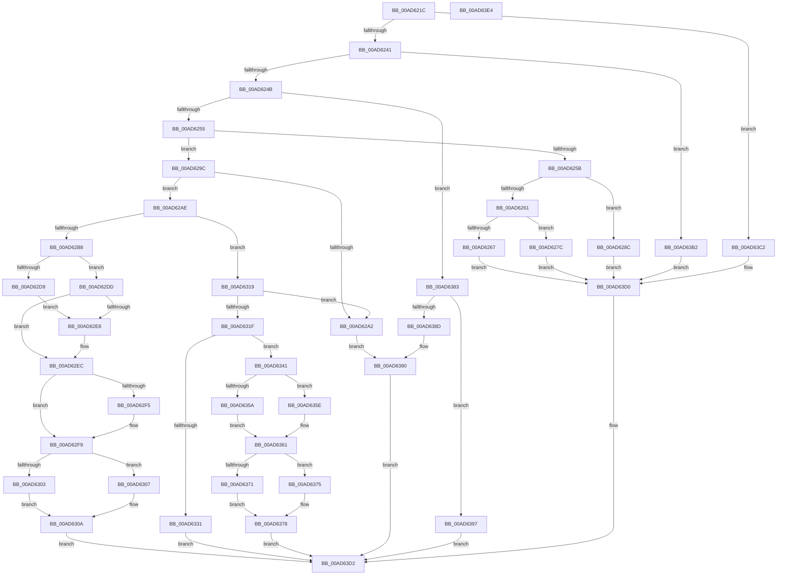

# HalpQueryProfileInformation

- RVA: `0x00AD621C`–`0x00AD63E5` (길이 `457` bytes)
- VA: `0x0000000140AD621C`
- 실행 섹션: `PAGE`
- PDB 이름 있음: `예`; PDB Function 태그: `아니요`
- unwind 정보 RVA: `0x000B6B54`
- 디코드: `129`개 명령, `457/457` bytes 표시
- 미해석 바이트: `0` (있으면 어셈블리에 `.byte`로 보존)

> 이 문서는 커널 이미지의 기계어와 PDB 기호를 분석해 생성했습니다. 4번과 5번은 함수 원형과 자료형을 바이너리 사용 방식에서 추정한 C 해석이며 원본 소스 복구 결과는 아닙니다.

## 1. Dependencies

- 직접 호출 지점: **6**; 고유 호출 대상: **6**
- 직접 호출자로 확인된 함수: **1**
- RIP 상대 이미지 참조: **3**

### Outgoing calls
- `0x00AD6272` → [guard_dispatch_icall](../../text/6B/guard_dispatch_icall_function_006BAAD0.md) (function, `0x006BAAD0`)
- `0x00AD6282` → [HalpCollectProfileOwnershipStatus](../../text/54/HalpCollectProfileOwnershipStatus_function_00546D34.md) (function, `0x00546D34`)
- `0x00AD6292` → [HalpCollectProfileCorruptionStatus](../../text/4C/HalpCollectProfileCorruptionStatus_function_004C9AFC.md) (function, `0x004C9AFC`)
- `0x00AD6328` → [KeQueryActiveProcessorCountEx](../../text/24/KeQueryActiveProcessorCountEx_function_00249EF0.md) (function, `0x00249EF0`)
- `0x00AD63BB` → [HalpQueryProfileSourceList](../../text/2D/HalpQueryProfileSourceList_function_002D1370.md) (function, `0x002D1370`)
- `0x00AD63CB` → [HalpQueryProfileSource](../../text/4C/HalpQueryProfileSource_function_004C6DBC.md) (function, `0x004C6DBC`)

### Direct callers
- [HaliQuerySystemInformation](../../pagelk/B7/HaliQuerySystemInformation_function_00B7A990.md) at `0x00B7AAA9`

### Static image references
- `0x00AD6267` → RVA `0x00E03B20` (`.data`; read)
- `0x00AD62BF` → RVA `0x00FC8C40` (`ALMOSTRO`; read)
- `0x00AD6397` → RVA `0x000071E0` (`.rdata`; read)

## 2. Other-region calls and transfers

- 다른 실행 섹션으로 향하는 call: **6**
  - `0x00AD6272` → [guard_dispatch_icall](../../text/6B/guard_dispatch_icall_function_006BAAD0.md) (`PAGE` → `.text`)
  - `0x00AD6282` → [HalpCollectProfileOwnershipStatus](../../text/54/HalpCollectProfileOwnershipStatus_function_00546D34.md) (`PAGE` → `.text`)
  - `0x00AD6292` → [HalpCollectProfileCorruptionStatus](../../text/4C/HalpCollectProfileCorruptionStatus_function_004C9AFC.md) (`PAGE` → `.text`)
  - `0x00AD6328` → [KeQueryActiveProcessorCountEx](../../text/24/KeQueryActiveProcessorCountEx_function_00249EF0.md) (`PAGE` → `.text`)
  - `0x00AD63BB` → [HalpQueryProfileSourceList](../../text/2D/HalpQueryProfileSourceList_function_002D1370.md) (`PAGE` → `.text`)
  - `0x00AD63CB` → [HalpQueryProfileSource](../../text/4C/HalpQueryProfileSource_function_004C6DBC.md) (`PAGE` → `.text`)
- 별도 외부 분기/꼬리 이동을 확인하지 못했습니다.

## 3. Assembly (complete function range)

```asm
00AD621C  48 89 5C 24 08                  mov qword ptr [rsp + 8], rbx
00AD6221  48 89 6C 24 10                  mov qword ptr [rsp + 0x10], rbp
00AD6226  56                              push rsi
00AD6227  48 83 EC 30                     sub rsp, 0x30
00AD622B  44 8B D1                        mov r10d, ecx
00AD622E  49 8B D9                        mov rbx, r9
00AD6231  49 8B F0                        mov rsi, r8
00AD6234  44 8B DA                        mov r11d, edx
00AD6237  41 83 EA 01                     sub r10d, 1
00AD623B  0F 84 81 01 00 00               je 0x140ad63c2
00AD6241  41 83 EA 13                     sub r10d, 0x13
00AD6245  0F 84 67 01 00 00               je 0x140ad63b2
00AD624B  41 83 EA 18                     sub r10d, 0x18
00AD624F  0F 84 2E 01 00 00               je 0x140ad6383
00AD6255  41 83 EA 01                     sub r10d, 1
00AD6259  74 41                           je 0x140ad629c
00AD625B  41 83 EA 07                     sub r10d, 7
00AD625F  74 2B                           je 0x140ad628c
00AD6261  41 83 FA 01                     cmp r10d, 1
00AD6265  74 15                           je 0x140ad627c
00AD6267  48 8B 05 B2 D8 32 00            mov rax, qword ptr [rip + 0x32d8b2]
00AD626E  48 8B 40 20                     mov rax, qword ptr [rax + 0x20]
00AD6272  E8 59 48 BE FF                  call 0x1406baad0
00AD6277  E9 54 01 00 00                  jmp 0x140ad63d0
00AD627C  4C 8B C3                        mov r8, rbx
00AD627F  48 8B CE                        mov rcx, rsi
00AD6282  E8 AD 0A A7 FF                  call 0x140546d34
00AD6287  E9 44 01 00 00                  jmp 0x140ad63d0
00AD628C  4C 8B C3                        mov r8, rbx
00AD628F  48 8B CE                        mov rcx, rsi
00AD6292  E8 65 38 9F FF                  call 0x1404c9afc
00AD6297  E9 34 01 00 00                  jmp 0x140ad63d0
00AD629C  41 83 FB 04                     cmp r11d, 4
00AD62A0  73 0C                           jae 0x140ad62ae
00AD62A2  41 C7 01 0C 00 00 00            mov dword ptr [r9], 0xc
00AD62A9  E9 E2 00 00 00                  jmp 0x140ad6390
00AD62AE  65 8B 04 25 A4 01 00 00         mov eax, dword ptr gs:[0x1a4]
00AD62B6  75 61                           jne 0x140ad6319
00AD62B8  41 C7 01 04 00 00 00            mov dword ptr [r9], 4
00AD62BF  48 8D 15 7A 29 4F 00            lea rdx, [rip + 0x4f297a]
00AD62C6  4C 8B 14 C2                     mov r10, qword ptr [rdx + rax*8]
00AD62CA  33 C9                           xor ecx, ecx
00AD62CC  49 8B 42 58                     mov rax, qword ptr [r10 + 0x58]
00AD62D0  4C 8D 40 18                     lea r8, [rax + 0x18]
00AD62D4  48 85 C0                        test rax, rax
00AD62D7  75 04                           jne 0x140ad62dd
00AD62D9  8B D1                           mov edx, ecx
00AD62DB  EB 0B                           jmp 0x140ad62e8
00AD62DD  8B 50 04                        mov edx, dword ptr [rax + 4]
00AD62E0  44 8B C9                        mov r9d, ecx
00AD62E3  4D 85 C0                        test r8, r8
00AD62E6  74 04                           je 0x140ad62ec
00AD62E8  45 8B 48 04                     mov r9d, dword ptr [r8 + 4]
00AD62EC  44 8B C1                        mov r8d, ecx
00AD62EF  48 83 C0 30                     add rax, 0x30
00AD62F3  74 04                           je 0x140ad62f9
00AD62F5  44 8B 40 04                     mov r8d, dword ptr [rax + 4]
00AD62F9  49 8B 42 58                     mov rax, qword ptr [r10 + 0x58]
00AD62FD  48 83 C0 48                     add rax, 0x48
00AD6301  75 04                           jne 0x140ad6307
00AD6303  8B C1                           mov eax, ecx
00AD6305  EB 03                           jmp 0x140ad630a
00AD6307  8B 40 04                        mov eax, dword ptr [rax + 4]
00AD630A  41 03 C0                        add eax, r8d
00AD630D  41 03 C1                        add eax, r9d
00AD6310  03 C2                           add eax, edx
00AD6312  89 06                           mov dword ptr [rsi], eax
00AD6314  E9 B9 00 00 00                  jmp 0x140ad63d2
00AD6319  41 83 FB 0C                     cmp r11d, 0xc
00AD631D  72 83                           jb 0x140ad62a2
00AD631F  41 8B 68 08                     mov ebp, dword ptr [r8 + 8]
00AD6323  B9 FF FF 00 00                  mov ecx, 0xffff
00AD6328  E8 C3 3B 77 FF                  call 0x140249ef0
00AD632D  3B E8                           cmp ebp, eax
00AD632F  72 10                           jb 0x140ad6341
00AD6331  C7 03 0C 00 00 00               mov dword ptr [rbx], 0xc
00AD6337  B9 0D 00 00 C0                  mov ecx, 0xc000000d
00AD633C  E9 91 00 00 00                  jmp 0x140ad63d2
00AD6341  0F AE E8                        lfence
00AD6344  48 8D 15 F5 28 4F 00            lea rdx, [rip + 0x4f28f5]
00AD634B  33 C9                           xor ecx, ecx
00AD634D  48 8B 04 EA                     mov rax, qword ptr [rdx + rbp*8]
00AD6351  48 8B 40 58                     mov rax, qword ptr [rax + 0x58]
00AD6355  48 85 C0                        test rax, rax
00AD6358  75 04                           jne 0x140ad635e
00AD635A  8B C1                           mov eax, ecx
00AD635C  EB 03                           jmp 0x140ad6361
00AD635E  8B 40 04                        mov eax, dword ptr [rax + 4]
00AD6361  89 06                           mov dword ptr [rsi], eax
00AD6363  48 8B 04 EA                     mov rax, qword ptr [rdx + rbp*8]
00AD6367  48 8B 40 58                     mov rax, qword ptr [rax + 0x58]
00AD636B  48 83 C0 18                     add rax, 0x18
00AD636F  75 04                           jne 0x140ad6375
00AD6371  8B C1                           mov eax, ecx
00AD6373  EB 03                           jmp 0x140ad6378
00AD6375  8B 40 04                        mov eax, dword ptr [rax + 4]
00AD6378  89 46 04                        mov dword ptr [rsi + 4], eax
00AD637B  C7 03 0C 00 00 00               mov dword ptr [rbx], 0xc
00AD6381  EB 4F                           jmp 0x140ad63d2
00AD6383  B9 01 00 00 00                  mov ecx, 1
00AD6388  44 3B D9                        cmp r11d, ecx
00AD638B  73 0A                           jae 0x140ad6397
00AD638D  41 89 09                        mov dword ptr [r9], ecx
00AD6390  B9 04 00 00 C0                  mov ecx, 0xc0000004
00AD6395  EB 3B                           jmp 0x140ad63d2
00AD6397  48 8D 05 42 0E 53 FF            lea rax, [rip - 0xacf1be]
00AD639E  48 39 05 7B D7 32 00            cmp qword ptr [rip + 0x32d77b], rax
00AD63A5  0F 94 C0                        sete al
00AD63A8  41 88 00                        mov byte ptr [r8], al
00AD63AB  41 89 09                        mov dword ptr [r9], ecx
00AD63AE  33 C9                           xor ecx, ecx
00AD63B0  EB 20                           jmp 0x140ad63d2
00AD63B2  4C 8B C3                        mov r8, rbx
00AD63B5  48 8B D6                        mov rdx, rsi
00AD63B8  41 8B CB                        mov ecx, r11d
00AD63BB  E8 B0 AF 7F FF                  call 0x1402d1370
00AD63C0  EB 0E                           jmp 0x140ad63d0
00AD63C2  4C 8B C3                        mov r8, rbx
00AD63C5  48 8B D6                        mov rdx, rsi
00AD63C8  41 8B CB                        mov ecx, r11d
00AD63CB  E8 EC 09 9F FF                  call 0x1404c6dbc
00AD63D0  8B C8                           mov ecx, eax
00AD63D2  48 8B 5C 24 40                  mov rbx, qword ptr [rsp + 0x40]
00AD63D7  8B C1                           mov eax, ecx
00AD63D9  48 8B 6C 24 48                  mov rbp, qword ptr [rsp + 0x48]
00AD63DE  48 83 C4 30                     add rsp, 0x30
00AD63E2  5E                              pop rsi
00AD63E3  C3                              ret
00AD63E4  CC                              int3
```

## 4. C-style interpretation (structured pseudocode)

```c
__int64 __fastcall HalpQueryProfileInformation(int a1, int a2, __int64 a3, __int64 a4)
{
    __int64 result;
    __int64 v_r10;
    __int64 v_rsp;
    unsigned __int64 v_stack_p10;
    unsigned __int64 v_stack_p8;

    v_stack_p8 = v_rbx;
    v_stack_p10 = v_rbp;
    v_rsp = (v_rsp) - (48);
    v_r10 = (unsigned int)(((unsigned int)(a1)) - (1));
    if (condition_is_equal) goto loc_00AD63C2;
    v_r10 = (unsigned int)((v_r10) - (19));
    if (condition_is_equal) goto loc_00AD63B2;
    v_r10 = (unsigned int)((v_r10) - (24));
    if (condition_is_equal) goto loc_00AD6383;
    v_r10 = (unsigned int)((v_r10) - (1));
    if (condition_is_equal) goto loc_00AD629C;
    v_r10 = (unsigned int)((v_r10) - (7));
    if (condition_is_equal) goto loc_00AD628C;
    if (((unsigned int)(v_r10)) == 1) goto loc_00AD627C;
    result = guard_dispatch_icall(a1, a2, a3, a4);
    goto loc_00AD63D0;
loc_00AD627C:
    result = HalpCollectProfileOwnershipStatus(a3, a2, a4, a4);
    goto loc_00AD63D0;
loc_00AD628C:
    result = HalpCollectProfileCorruptionStatus(a3, a2, a4, a4);
    goto loc_00AD63D0;
loc_00AD629C:
    if (((unsigned int)((unsigned int)(a2))) >= 4) goto loc_00AD62AE;
loc_00AD62A2:
    *(unsigned int *)(a4) = 12;
    goto loc_00AD6390;
loc_00AD62AE:
    if (((unsigned int)((unsigned int)(a2))) != 4) goto loc_00AD6319;
    *(unsigned int *)(a4) = 4;
    a1 = 0;
    if (*(unsigned __int64 *)(*(unsigned __int64 *)(v_rip + 5187962 + (unsigned int)(*(unsigned int *)(gs_base + (0 + 420))) * 8) + 88) != 0) goto loc_00AD62DD;
    goto loc_00AD62E8;
loc_00AD62DD:
    if (*(unsigned __int64 *)(*(unsigned __int64 *)(v_rip + 5187962 + (unsigned int)(*(unsigned int *)(gs_base + (0 + 420))) * 8) + 88) + 24 != 0) {
        a4 = *(unsigned int *)(*(unsigned __int64 *)(*(unsigned __int64 *)(v_rip + 5187962 + (unsigned int)(*(unsigned int *)(gs_base + (0 + 420))) * 8) + 88) + 24 + 4);
    }
    result = (*(unsigned __int64 *)(*(unsigned __int64 *)(v_rip + 5187962 + (unsigned int)(*(unsigned int *)(gs_base + (0 + 420))) * 8) + 88)) + (48);
    if (!(condition_is_equal)) {
        a3 = *(unsigned int *)(result + 4);
    }
    result = (*(unsigned __int64 *)(*(unsigned __int64 *)(v_rip + 5187962 + (unsigned int)(*(unsigned int *)(gs_base + (0 + 420))) * 8) + 88)) + (72);
    if (condition_is_not_equal) goto loc_00AD6307;
    goto loc_00AD630A;
loc_00AD6307:
loc_00AD630A:
    result = (unsigned int)(((unsigned int)(*(unsigned int *)(0 + 4))) + ((unsigned int)(a3)));
    result = (unsigned int)((result) + ((unsigned int)(a4)));
    result = (unsigned int)((result) + ((unsigned int)((unsigned int)(*(unsigned int *)(*(unsigned __int64 *)(*(unsigned __int64 *)(v_rip + 5187962 + (unsigned int)(*(unsigned int *)(gs_base + (0 + 420))) * 8) + 88) + 4)))));
    *(unsigned int *)(a3) = (unsigned int)(result);
    goto loc_00AD63D2;
loc_00AD6319:
    if (((unsigned int)((unsigned int)(a2))) < 12) goto loc_00AD62A2;
    result = KeQueryActiveProcessorCountEx((unsigned int)(0xFFFFULL), (unsigned int)(*(unsigned int *)(*(unsigned __int64 *)(*(unsigned __int64 *)(v_rip + 5187962 + (unsigned int)(*(unsigned int *)(gs_base + (0 + 420))) * 8) + 88) + 4)), a3, a4);
    if (((unsigned int)((unsigned int)(*(unsigned int *)(a3 + 8)))) < ((unsigned int)(result))) goto loc_00AD6341;
    *(unsigned int *)(a4) = 12;
    goto loc_00AD63D2;
loc_00AD6341:
    a1 = 0;
    if (*(unsigned __int64 *)(*(unsigned __int64 *)(v_rip + 5187829 + (unsigned int)(*(unsigned int *)(a3 + 8)) * 8) + 88) != 0) goto loc_00AD635E;
    goto loc_00AD6361;
loc_00AD635E:
loc_00AD6361:
    *(unsigned int *)(a3) = (unsigned int)((unsigned int)(*(unsigned int *)(0 + 4)));
    result = (*(unsigned __int64 *)(*(unsigned __int64 *)(v_rip + 5187829 + (unsigned int)(*(unsigned int *)(a3 + 8)) * 8) + 88)) + (24);
    if (condition_is_not_equal) goto loc_00AD6375;
    goto loc_00AD6378;
loc_00AD6375:
loc_00AD6378:
    *(unsigned int *)(a3 + 4) = (unsigned int)((unsigned int)(*(unsigned int *)(0 + 4)));
    *(unsigned int *)(a4) = 12;
    goto loc_00AD63D2;
loc_00AD6383:
    if (((unsigned int)((unsigned int)(a2))) >= 1) goto loc_00AD6397;
    *(unsigned int *)(a4) = 1;
loc_00AD6390:
    goto loc_00AD63D2;
loc_00AD6397:
    result = ((*(unsigned __int64 *)(v_rip + 3331963)) == (v_rip - 11334078)) ? 1 : 0;
    *(unsigned __int8 *)(a3) = (unsigned __int8)(result);
    *(unsigned int *)(a4) = (unsigned int)((unsigned int)(0xC0000004ULL));
    a1 = 0;
    goto loc_00AD63D2;
loc_00AD63B2:
    result = HalpQueryProfileSourceList((unsigned int)((unsigned int)((unsigned int)(a2))), a3, a4, a4);
    goto loc_00AD63D0;
loc_00AD63C2:
    result = HalpQueryProfileSource((unsigned int)((unsigned int)((unsigned int)(a2))), a3, a4, a4);
loc_00AD63D0:
loc_00AD63D2:
    v_rsp = (v_rsp) + (48);
    return (unsigned int)((unsigned int)((unsigned int)((unsigned int)(result))));
}
```

## 5. (Beta) C Style

```c
int64_t HalpQueryProfileInformation(int32_t Arg1, int32_t Arg2, void *Arg3, void *Arg4)
{
    uint8_t *arg3 = (uint8_t *)Arg3;
    uint8_t *arg4 = (uint8_t *)Arg4;

    int64_t result;
    int64_t local_r10;
    int64_t local_rsp;
    uint64_t v_stack_p10;
    uint64_t v_stack_p8;

    v_stack_p8 = local_rbx;
    v_stack_p10 = local_rbp;
    local_rsp = (local_rsp) - (48);
    local_r10 = (uint32_t)(((uint32_t)(Arg1)) - (1));
    if (condition_is_equal) goto loc_00AD63C2;
    local_r10 = (uint32_t)((local_r10) - (19));
    if (condition_is_equal) goto loc_00AD63B2;
    local_r10 = (uint32_t)((local_r10) - (24));
    if (condition_is_equal) goto loc_00AD6383;
    local_r10 = (uint32_t)((local_r10) - (1));
    if (condition_is_equal) goto loc_00AD629C;
    local_r10 = (uint32_t)((local_r10) - (7));
    if (condition_is_equal) goto loc_00AD628C;
    if (((uint32_t)(local_r10)) == 1) goto loc_00AD627C;
    result = guard_dispatch_icall(Arg1, Arg2, Arg3, Arg4);
    goto loc_00AD63D0;
loc_00AD627C:
    result = HalpCollectProfileOwnershipStatus(Arg3, Arg2, Arg4, Arg4);
    goto loc_00AD63D0;
loc_00AD628C:
    result = HalpCollectProfileCorruptionStatus(Arg3, Arg2, Arg4, Arg4);
    goto loc_00AD63D0;
loc_00AD629C:
    if (((uint32_t)((uint32_t)(Arg2))) >= 4) goto loc_00AD62AE;
loc_00AD62A2:
    *(uint32_t *)(arg4) = 12;
    goto loc_00AD6390;
loc_00AD62AE:
    if (((uint32_t)((uint32_t)(Arg2))) != 4) goto loc_00AD6319;
    *(uint32_t *)(arg4) = 4;
    Arg1 = 0;
    if (*(uint64_t *)(*(uint64_t *)(v_rip + 0x4F297A + (uint32_t)(*(uint32_t *)(gs_base + (0 + 0x1A4))) * 8) + 0x58) != 0) goto loc_00AD62DD;
    goto loc_00AD62E8;
loc_00AD62DD:
    if (*(uint64_t *)(*(uint64_t *)(v_rip + 0x4F297A + (uint32_t)(*(uint32_t *)(gs_base + (0 + 0x1A4))) * 8) + 0x58) + 24 != 0) {
        Arg4 = *(uint32_t *)(*(uint64_t *)(*(uint64_t *)(v_rip + 0x4F297A + (uint32_t)(*(uint32_t *)(gs_base + (0 + 0x1A4))) * 8) + 0x58) + 0x18 + 0x4);
    }
    result = (*(uint64_t *)(*(uint64_t *)(v_rip + 0x4F297A + (uint32_t)(*(uint32_t *)(gs_base + (0 + 0x1A4))) * 8) + 0x58)) + (48);
    if (!(condition_is_equal)) {
        Arg3 = *(uint32_t *)(result + 0x4);
    }
    result = (*(uint64_t *)(*(uint64_t *)(v_rip + 0x4F297A + (uint32_t)(*(uint32_t *)(gs_base + (0 + 0x1A4))) * 8) + 0x58)) + (72);
    if (condition_is_not_equal) goto loc_00AD6307;
    goto loc_00AD630A;
loc_00AD6307:
loc_00AD630A:
    result = (uint32_t)(((uint32_t)(*(uint32_t *)(0 + 0x4))) + ((uint32_t)(Arg3)));
    result = (uint32_t)((result) + ((uint32_t)(Arg4)));
    result = (uint32_t)((result) + ((uint32_t)((uint32_t)(*(uint32_t *)(*(uint64_t *)(*(uint64_t *)(v_rip + 0x4F297A + (uint32_t)(*(uint32_t *)(gs_base + (0 + 0x1A4))) * 8) + 0x58) + 0x4)))));
    *(uint32_t *)(arg3) = (uint32_t)(result);
    goto loc_00AD63D2;
loc_00AD6319:
    if (((uint32_t)((uint32_t)(Arg2))) < 12) goto loc_00AD62A2;
    result = KeQueryActiveProcessorCountEx((uint32_t)(0xFFFFULL), (uint32_t)(*(uint32_t *)(*(uint64_t *)(*(uint64_t *)(v_rip + 0x4F297A + (uint32_t)(*(uint32_t *)(gs_base + (0 + 0x1A4))) * 8) + 0x58) + 0x4)), Arg3, Arg4);
    if (((uint32_t)((uint32_t)(*(uint32_t *)(arg3 + 0x8)))) < ((uint32_t)(result))) goto loc_00AD6341;
    *(uint32_t *)(arg4) = 12;
    goto loc_00AD63D2;
loc_00AD6341:
    Arg1 = 0;
    if (*(uint64_t *)(*(uint64_t *)(v_rip + 0x4F28F5 + (uint32_t)(*(uint32_t *)(arg3 + 0x8)) * 8) + 0x58) != 0) goto loc_00AD635E;
    goto loc_00AD6361;
loc_00AD635E:
loc_00AD6361:
    *(uint32_t *)(arg3) = (uint32_t)((uint32_t)(*(uint32_t *)(0 + 0x4)));
    result = (*(uint64_t *)(*(uint64_t *)(v_rip + 0x4F28F5 + (uint32_t)(*(uint32_t *)(arg3 + 0x8)) * 8) + 0x58)) + (24);
    if (condition_is_not_equal) goto loc_00AD6375;
    goto loc_00AD6378;
loc_00AD6375:
loc_00AD6378:
    *(uint32_t *)(arg3 + 0x4) = (uint32_t)((uint32_t)(*(uint32_t *)(0 + 0x4)));
    *(uint32_t *)(arg4) = 12;
    goto loc_00AD63D2;
loc_00AD6383:
    if (((uint32_t)((uint32_t)(Arg2))) >= 1) goto loc_00AD6397;
    *(uint32_t *)(arg4) = 1;
loc_00AD6390:
    goto loc_00AD63D2;
loc_00AD6397:
    result = ((*(uint64_t *)(v_rip + 0x32D77B)) == (v_rip - 11334078)) ? 1 : 0;
    *(uint8_t *)(arg3) = (uint8_t)(result);
    *(uint32_t *)(arg4) = (uint32_t)((uint32_t)(0xC0000004ULL));
    Arg1 = 0;
    goto loc_00AD63D2;
loc_00AD63B2:
    result = HalpQueryProfileSourceList((uint32_t)((uint32_t)((uint32_t)(Arg2))), Arg3, Arg4, Arg4);
    goto loc_00AD63D0;
loc_00AD63C2:
    result = HalpQueryProfileSource((uint32_t)((uint32_t)((uint32_t)(Arg2))), Arg3, Arg4, Arg4);
loc_00AD63D0:
loc_00AD63D2:
    local_rsp = (local_rsp) + (48);
    return (uint32_t)((uint32_t)((uint32_t)((uint32_t)(result))));
}
```

### 관측된 메모리 오프셋

구조체 형식이 확인되지 않은 접근은 인자 기준의 오프셋으로만 기록했습니다.

| 기준 인자 | 오프셋 표현 | 폭 (bit) | 접근 |
|---|---:|---:|---|
| `Arg3` | `+ 0x0` | `8` | `W` |
| `Arg3` | `+ 0x0` | `32` | `W` |
| `Arg3` | `+ 0x4` | `32` | `W` |
| `Arg3` | `+ 0x8` | `32` | `R` |
| `Arg4` | `+ 0x0` | `32` | `W` |

## 6. Execution-region graph

[열기: 2D/3D 그래프와 함수 탐색 컨트롤 패널](../../../control-panel.html?section=page&rva=0x00AD621C&view=graph)

- 2D 그래프는 위에서 아래로 흐르고, 3D 그래프는 빈 공간을 드래그해 회전합니다. Shift+드래그는 이동, 휠은 확대·축소, 함수 노드 선택은 대상 보고서 이동입니다.

### Static fallback


