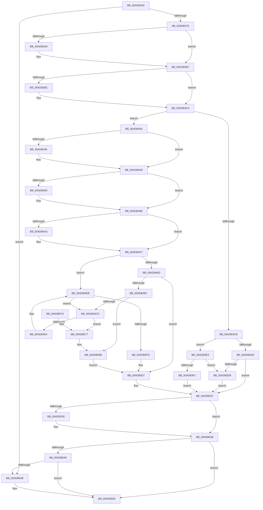

# HalpRequestPmuAccess

- RVA: `0x00ADB340`–`0x00ADB5A2` (길이 `610` bytes)
- VA: `0x0000000140ADB340`
- 실행 섹션: `PAGE`
- PDB 이름 있음: `예`; PDB Function 태그: `아니요`
- unwind 정보 RVA: `0x000BF52C`
- 디코드: `145`개 명령, `610/610` bytes 표시
- 미해석 바이트: `0` (있으면 어셈블리에 `.byte`로 보존)

> 이 문서는 커널 이미지의 기계어와 PDB 기호를 분석해 생성했습니다. 4번과 5번은 함수 원형과 자료형을 바이너리 사용 방식에서 추정한 C 해석이며 원본 소스 복구 결과는 아닙니다.

## 1. Dependencies

- 직접 호출 지점: **17**; 고유 호출 대상: **11**
- 직접 호출자로 확인된 함수: **3**
- RIP 상대 이미지 참조: **14**

### Outgoing calls
- `0x00ADB399` → [KeAbPreAcquire](../../text/21/KeAbPreAcquire_function_00210230.md) (function, `0x00210230`)
- `0x00ADB3B2` → [ExfAcquirePushLockExclusiveEx](../../text/20/ExfAcquirePushLockExclusiveEx_function_0020FC90.md) (function, `0x0020FC90`)
- `0x00ADB3E3` → [PsGetCurrentThreadId](../../text/43/PsGetCurrentThreadId_function_00439680.md) (function, `0x00439680`)
- `0x00ADB41E` → [PsGetCurrentThreadId](../../text/43/PsGetCurrentThreadId_function_00439680.md) (function, `0x00439680`)
- `0x00ADB42E` → [ExAcquireRundownProtection](../../text/21/ExAcquireRundownProtection_function_00216620.md) (function, `0x00216620`)
- `0x00ADB448` → [ExfTryToWakePushLock](../../text/26/ExfTryToWakePushLock_function_00265DD0.md) (function, `0x00265DD0`)
- `0x00ADB450` → [KeAbPostRelease](../../text/2E/KeAbPostRelease_function_002E1600.md) (function, `0x002E1600`)
- `0x00ADB455` → [KeLeaveCriticalRegion](../../text/25/KeLeaveCriticalRegion_function_0025D8B0.md) (function, `0x0025D8B0`)
- `0x00ADB462` → [HalpPmuArbiterNotifyActor](../70/HalpPmuArbiterNotifyActor_function_00707B54.md) (function, `0x00707B54`)
- `0x00ADB480` → [KeAbPreAcquire](../../text/21/KeAbPreAcquire_function_00210230.md) (function, `0x00210230`)
- `0x00ADB499` → [ExfAcquirePushLockExclusiveEx](../../text/20/ExfAcquirePushLockExclusiveEx_function_0020FC90.md) (function, `0x0020FC90`)
- `0x00ADB4B7` → [HalpPmuArbiterUpdateActiveActorTime](../70/HalpPmuArbiterUpdateActiveActorTime_function_00707DB4.md) (function, `0x00707DB4`)
- `0x00ADB51A` → [ExReleaseRundownProtection](../../text/34/ExReleaseRundownProtection_function_00349E80.md) (function, `0x00349E80`)
- `0x00ADB533` → [ExfTryToWakePushLock](../../text/26/ExfTryToWakePushLock_function_00265DD0.md) (function, `0x00265DD0`)
- `0x00ADB53B` → [KeAbPostRelease](../../text/2E/KeAbPostRelease_function_002E1600.md) (function, `0x002E1600`)
- `0x00ADB540` → [KeLeaveCriticalRegion](../../text/25/KeLeaveCriticalRegion_function_0025D8B0.md) (function, `0x0025D8B0`)
- `0x00ADB54E` → [HalpAcquirePmuAccessRequest](../../text/54/HalpAcquirePmuAccessRequest_function_00546CE0.md) (function, `0x00546CE0`)

### Direct callers
- [HalpAllocatePmcCounterSetEx](../../text/4C/HalpAllocatePmcCounterSetEx_function_004C5E70.md) at `0x004C5EDC`
- [HalAllocateHardwareCounters](../70/HalAllocateHardwareCounters_function_00707050.md) at `0x007070AB`
- [HalpPmuArbiterPeriodicWorkItem](../70/HalpPmuArbiterPeriodicWorkItem_function_00707B90.md) at `0x00707C9E`

### Static image references
- `0x00ADB35D` → RVA `0x00FC2B50` (`.data`; read)
- `0x00ADB37E` → RVA `0x00FC2B40` (`.data`; read)
- `0x00ADB3E8` → RVA `0x00FC2BA0` (`.data`; read)
- `0x00ADB3F1` → RVA `0x00FC2B50` (`.data`; write)
- `0x00ADB403` → RVA `0x00FC2BB0` (`.data`; read)
- `0x00ADB418` → RVA `0x00FC2BA8` (`.data`; write)
- `0x00ADB427` → RVA `0x00FC2BA0` (`.data`; write)
- `0x00ADB436` → RVA `0x00FC2B40` (`.data`; read/write)
- `0x00ADB4CD` → RVA `0x00FC2B60` (`.data`; read)
- `0x00ADB4D4` → RVA `0x00FC2B58` (`.data`; read)
- `0x00ADB507` → RVA `0x00FC2BA8` (`.data`; read/write)
- `0x00ADB512` → RVA `0x00FC2BA0` (`.data`; read/write)
- `0x00ADB581` → RVA `0x00FC2B60` (`.data`; write)
- `0x00ADB58B` → RVA `0x00FC2BB0` (`.data`; write)

## 2. Other-region calls and transfers

- 다른 실행 섹션으로 향하는 call: **15**
  - `0x00ADB399` → [KeAbPreAcquire](../../text/21/KeAbPreAcquire_function_00210230.md) (`PAGE` → `.text`)
  - `0x00ADB3B2` → [ExfAcquirePushLockExclusiveEx](../../text/20/ExfAcquirePushLockExclusiveEx_function_0020FC90.md) (`PAGE` → `.text`)
  - `0x00ADB3E3` → [PsGetCurrentThreadId](../../text/43/PsGetCurrentThreadId_function_00439680.md) (`PAGE` → `.text`)
  - `0x00ADB41E` → [PsGetCurrentThreadId](../../text/43/PsGetCurrentThreadId_function_00439680.md) (`PAGE` → `.text`)
  - `0x00ADB42E` → [ExAcquireRundownProtection](../../text/21/ExAcquireRundownProtection_function_00216620.md) (`PAGE` → `.text`)
  - `0x00ADB448` → [ExfTryToWakePushLock](../../text/26/ExfTryToWakePushLock_function_00265DD0.md) (`PAGE` → `.text`)
  - `0x00ADB450` → [KeAbPostRelease](../../text/2E/KeAbPostRelease_function_002E1600.md) (`PAGE` → `.text`)
  - `0x00ADB455` → [KeLeaveCriticalRegion](../../text/25/KeLeaveCriticalRegion_function_0025D8B0.md) (`PAGE` → `.text`)
  - `0x00ADB480` → [KeAbPreAcquire](../../text/21/KeAbPreAcquire_function_00210230.md) (`PAGE` → `.text`)
  - `0x00ADB499` → [ExfAcquirePushLockExclusiveEx](../../text/20/ExfAcquirePushLockExclusiveEx_function_0020FC90.md) (`PAGE` → `.text`)
  - `0x00ADB51A` → [ExReleaseRundownProtection](../../text/34/ExReleaseRundownProtection_function_00349E80.md) (`PAGE` → `.text`)
  - `0x00ADB533` → [ExfTryToWakePushLock](../../text/26/ExfTryToWakePushLock_function_00265DD0.md) (`PAGE` → `.text`)
  - `0x00ADB53B` → [KeAbPostRelease](../../text/2E/KeAbPostRelease_function_002E1600.md) (`PAGE` → `.text`)
  - `0x00ADB540` → [KeLeaveCriticalRegion](../../text/25/KeLeaveCriticalRegion_function_0025D8B0.md) (`PAGE` → `.text`)
  - `0x00ADB54E` → [HalpAcquirePmuAccessRequest](../../text/54/HalpAcquirePmuAccessRequest_function_00546CE0.md) (`PAGE` → `.text`)
- 별도 외부 분기/꼬리 이동을 확인하지 못했습니다.

## 3. Assembly (complete function range)

```asm
00ADB340  48 8B C4                        mov rax, rsp
00ADB343  48 89 58 08                     mov qword ptr [rax + 8], rbx
00ADB347  48 89 68 10                     mov qword ptr [rax + 0x10], rbp
00ADB34B  48 89 70 18                     mov qword ptr [rax + 0x18], rsi
00ADB34F  48 89 78 20                     mov qword ptr [rax + 0x20], rdi
00ADB353  41 54                           push r12
00ADB355  41 56                           push r14
00ADB357  41 57                           push r15
00ADB359  48 83 EC 20                     sub rsp, 0x20
00ADB35D  8B 05 ED 77 4E 00               mov eax, dword ptr [rip + 0x4e77ed]
00ADB363  45 32 FF                        xor r15b, r15b
00ADB366  33 F6                           xor esi, esi
00ADB368  FF C8                           dec eax
00ADB36A  A9 FD FF FF FF                  test eax, 0xfffffffd
00ADB36F  0F 84 D9 01 00 00               je 0x140adb54e
00ADB375  65 48 8B 04 25 88 01 00 00      mov rax, qword ptr gs:[0x188]
00ADB37E  48 8D 3D BB 77 4E 00            lea rdi, [rip + 0x4e77bb]
00ADB385  48 83 CB FF                     or rbx, 0xffffffffffffffff
00ADB389  45 33 C0                        xor r8d, r8d
00ADB38C  33 D2                           xor edx, edx
00ADB38E  48 8B CF                        mov rcx, rdi
00ADB391  66 01 98 E4 01 00 00            add word ptr [rax + 0x1e4], bx
00ADB398  90                              nop
00ADB399  E8 92 4E 73 FF                  call 0x140210230
00ADB39E  F0 48 0F BA 2F 00               lock bts qword ptr [rdi], 0
00ADB3A4  48 8B E8                        mov rbp, rax
00ADB3A7  73 0E                           jae 0x140adb3b7
00ADB3A9  4C 8B C7                        mov r8, rdi
00ADB3AC  48 8B D0                        mov rdx, rax
00ADB3AF  48 8B CF                        mov rcx, rdi
00ADB3B2  E8 D9 48 73 FF                  call 0x14020fc90
00ADB3B7  48 85 ED                        test rbp, rbp
00ADB3BA  74 04                           je 0x140adb3c0
00ADB3BC  C6 45 0A 01                     mov byte ptr [rbp + 0xa], 1
00ADB3C0  8B 0D 8A 77 4E 00               mov ecx, dword ptr [rip + 0x4e778a]
00ADB3C6  83 E9 02                        sub ecx, 2
00ADB3C9  74 38                           je 0x140adb403
00ADB3CB  83 E9 02                        sub ecx, 2
00ADB3CE  74 13                           je 0x140adb3e3
00ADB3D0  83 F9 01                        cmp ecx, 1
00ADB3D3  0F 85 46 01 00 00               jne 0x140adb51f
00ADB3D9  BE 11 00 00 80                  mov esi, 0x80000011
00ADB3DE  E9 3C 01 00 00                  jmp 0x140adb51f
00ADB3E3  E8 98 E2 95 FF                  call 0x140439680
00ADB3E8  48 39 05 B1 77 4E 00            cmp qword ptr [rip + 0x4e77b1], rax
00ADB3EF  75 E8                           jne 0x140adb3d9
00ADB3F1  C7 05 55 77 4E 00 05 00 00 00   mov dword ptr [rip + 0x4e7755], 5
00ADB3FB  41 B7 01                        mov r15b, 1
00ADB3FE  E9 1C 01 00 00                  jmp 0x140adb51f
00ADB403  4C 8B 35 A6 77 4E 00            mov r14, qword ptr [rip + 0x4e77a6]
00ADB40A  C7 05 3C 77 4E 00 04 00 00 00   mov dword ptr [rip + 0x4e773c], 4
00ADB414  41 8B 46 20                     mov eax, dword ptr [r14 + 0x20]
00ADB418  89 05 8A 77 4E 00               mov dword ptr [rip + 0x4e778a], eax
00ADB41E  E8 5D E2 95 FF                  call 0x140439680
00ADB423  49 8D 4E 30                     lea rcx, [r14 + 0x30]
00ADB427  48 89 05 72 77 4E 00            mov qword ptr [rip + 0x4e7772], rax
00ADB42E  E8 ED B1 73 FF                  call 0x140216620
00ADB433  48 8B C3                        mov rax, rbx
00ADB436  F0 48 0F C1 05 01 77 4E 00      lock xadd qword ptr [rip + 0x4e7701], rax
00ADB43F  24 06                           and al, 6
00ADB441  3C 02                           cmp al, 2
00ADB443  75 08                           jne 0x140adb44d
00ADB445  48 8B CF                        mov rcx, rdi
00ADB448  E8 83 A9 78 FF                  call 0x140265dd0
00ADB44D  48 8B CF                        mov rcx, rdi
00ADB450  E8 AB 61 80 FF                  call 0x1402e1600
00ADB455  E8 56 24 78 FF                  call 0x14025d8b0
00ADB45A  BA 01 00 00 00                  mov edx, 1
00ADB45F  49 8B CE                        mov rcx, r14
00ADB462  E8 ED C6 C2 FF                  call 0x140707b54
00ADB467  65 48 8B 04 25 88 01 00 00      mov rax, qword ptr gs:[0x188]
00ADB470  45 33 C0                        xor r8d, r8d
00ADB473  33 D2                           xor edx, edx
00ADB475  48 8B CF                        mov rcx, rdi
00ADB478  66 01 98 E4 01 00 00            add word ptr [rax + 0x1e4], bx
00ADB47F  90                              nop
00ADB480  E8 AB 4D 73 FF                  call 0x140210230
00ADB485  F0 48 0F BA 2F 00               lock bts qword ptr [rdi], 0
00ADB48B  48 8B E8                        mov rbp, rax
00ADB48E  73 0E                           jae 0x140adb49e
00ADB490  4C 8B C7                        mov r8, rdi
00ADB493  48 8B D0                        mov rdx, rax
00ADB496  48 8B CF                        mov rcx, rdi
00ADB499  E8 F2 47 73 FF                  call 0x14020fc90
00ADB49E  48 85 ED                        test rbp, rbp
00ADB4A1  74 04                           je 0x140adb4a7
00ADB4A3  C6 45 0A 01                     mov byte ptr [rbp + 0xa], 1
00ADB4A7  8B 0D A3 76 4E 00               mov ecx, dword ptr [rip + 0x4e76a3]
00ADB4AD  83 E9 04                        sub ecx, 4
00ADB4B0  74 39                           je 0x140adb4eb
00ADB4B2  83 F9 01                        cmp ecx, 1
00ADB4B5  75 50                           jne 0x140adb507
00ADB4B7  E8 F8 C8 C2 FF                  call 0x140707db4
00ADB4BC  48 8B 05 ED 76 4E 00            mov rax, qword ptr [rip + 0x4e76ed]
00ADB4C3  40 38 70 38                     cmp byte ptr [rax + 0x38], sil
00ADB4C7  0F 85 BB 00 00 00               jne 0x140adb588
00ADB4CD  48 8B 0D 8C 76 4E 00            mov rcx, qword ptr [rip + 0x4e768c]
00ADB4D4  48 8D 05 7D 76 4E 00            lea rax, [rip + 0x4e767d]
00ADB4DB  48 39 01                        cmp qword ptr [rcx], rax
00ADB4DE  0F 84 93 00 00 00               je 0x140adb577
00ADB4E4  B9 03 00 00 00                  mov ecx, 3
00ADB4E9  CD 29                           int 0x29
00ADB4EB  48 8B 05 BE 76 4E 00            mov rax, qword ptr [rip + 0x4e76be]
00ADB4F2  BE 11 00 00 80                  mov esi, 0x80000011
00ADB4F7  44 38 78 38                     cmp byte ptr [rax + 0x38], r15b
00ADB4FB  75 D0                           jne 0x140adb4cd
00ADB4FD  C7 05 49 76 4E 00 02 00 00 00   mov dword ptr [rip + 0x4e7649], 2
00ADB507  83 25 9A 76 4E 00 00            and dword ptr [rip + 0x4e769a], 0
00ADB50E  49 8D 4E 30                     lea rcx, [r14 + 0x30]
00ADB512  48 83 25 86 76 4E 00 00         and qword ptr [rip + 0x4e7686], 0
00ADB51A  E8 61 E9 86 FF                  call 0x140349e80
00ADB51F  F0 48 0F C1 1D 18 76 4E 00      lock xadd qword ptr [rip + 0x4e7618], rbx
00ADB528  80 E3 06                        and bl, 6
00ADB52B  80 FB 02                        cmp bl, 2
00ADB52E  75 08                           jne 0x140adb538
00ADB530  48 8B CF                        mov rcx, rdi
00ADB533  E8 98 A8 78 FF                  call 0x140265dd0
00ADB538  48 8B CF                        mov rcx, rdi
00ADB53B  E8 C0 60 80 FF                  call 0x1402e1600
00ADB540  E8 6B 23 78 FF                  call 0x14025d8b0
00ADB545  85 F6                           test esi, esi
00ADB547  78 0C                           js 0x140adb555
00ADB549  45 84 FF                        test r15b, r15b
00ADB54C  75 07                           jne 0x140adb555
00ADB54E  E8 8D B7 A6 FF                  call 0x140546ce0
00ADB553  8B F0                           mov esi, eax
00ADB555  48 8B 5C 24 40                  mov rbx, qword ptr [rsp + 0x40]
00ADB55A  8B C6                           mov eax, esi
00ADB55C  48 8B 74 24 50                  mov rsi, qword ptr [rsp + 0x50]
00ADB561  48 8B 6C 24 48                  mov rbp, qword ptr [rsp + 0x48]
00ADB566  48 8B 7C 24 58                  mov rdi, qword ptr [rsp + 0x58]
00ADB56B  48 83 C4 20                     add rsp, 0x20
00ADB56F  41 5F                           pop r15
00ADB571  41 5E                           pop r14
00ADB573  41 5C                           pop r12
00ADB575  C3                              ret
00ADB576  CC                              int3
00ADB577  49 89 06                        mov qword ptr [r14], rax
00ADB57A  49 89 4E 08                     mov qword ptr [r14 + 8], rcx
00ADB57E  4C 89 31                        mov qword ptr [rcx], r14
00ADB581  4C 89 35 D8 75 4E 00            mov qword ptr [rip + 0x4e75d8], r14
00ADB588  0F 57 C0                        xorps xmm0, xmm0
00ADB58B  F3 0F 7F 05 1D 76 4E 00         movdqu xmmword ptr [rip + 0x4e761d], xmm0
00ADB593  C7 05 B3 75 4E 00 03 00 00 00   mov dword ptr [rip + 0x4e75b3], 3
00ADB59D  E9 65 FF FF FF                  jmp 0x140adb507
```

## 4. C-style interpretation (structured pseudocode)

```c
__int64 __fastcall HalpRequestPmuAccess(__int64 a1, int a2, int a3)
{
    __int64 result;
    __int64 v_r15;
    __int64 v_rbx;
    __int64 v_rsi;
    __int64 v_rsp;
    unsigned __int64 v_stack_p10;
    unsigned __int64 v_stack_p18;
    unsigned __int64 v_stack_p20;
    unsigned __int64 v_stack_p8;

    *(unsigned __int64 *)(v_rsp + 8) = v_rbx;
    *(unsigned __int64 *)(v_rsp + 16) = v_rbp;
    *(unsigned __int64 *)(v_rsp + 24) = v_rsi;
    *(unsigned __int64 *)(v_rsp + 32) = v_rdi;
    v_rsp = (v_rsp) - (32);
    v_r15 = 0;
    v_rsi = 0;
    result = (unsigned int)(((unsigned int)(*(unsigned int *)(v_rip + 5142509))) - 1);
    if ((((unsigned int)(result)) & (0xFFFFFFFDULL)) == 0) goto loc_00ADB54E;
    v_rbx = (v_rbx) | (-1);
    a3 = 0;
    a2 = 0;
    result = KeAbPreAcquire(v_rip + 5142459, a2, a3, a4);
    if (!(condition_is_above_or_equal)) {
        a3 = v_rip + 5142459;
        a2 = result;
        a1 = v_rip + 5142459;
        result = ExfAcquirePushLockExclusiveEx(a1, a2, a3, a4);
    }
    if (result != 0) {
        *(unsigned __int8 *)(result + 10) = 1;
    }
    a1 = (unsigned int)(((unsigned int)(*(unsigned int *)(v_rip + 5142410))) - (2));
    if (condition_is_equal) goto loc_00ADB403;
    a1 = (unsigned int)((a1) - (2));
    if (condition_is_equal) goto loc_00ADB3E3;
    if (((unsigned int)(a1)) != 1) goto loc_00ADB51F;
loc_00ADB3D9:
    goto loc_00ADB51F;
loc_00ADB3E3:
    result = PsGetCurrentThreadId(a1, a2, a3, a4);
    if ((*(unsigned __int64 *)(v_rip + 5142449)) != result) goto loc_00ADB3D9;
    *(unsigned int *)(v_rip + 5142357) = 5;
    goto loc_00ADB51F;
loc_00ADB403:
    *(unsigned int *)(v_rip + 5142332) = 4;
    *(unsigned int *)(v_rip + 5142410) = (unsigned int)((unsigned int)(*(unsigned int *)(*(unsigned __int64 *)(v_rip + 5142438) + 32)));
    result = PsGetCurrentThreadId(a1, a2, a3, a4);
    *(unsigned __int64 *)(v_rip + 5142386) = result;
    result = ExAcquireRundownProtection(*(unsigned __int64 *)(v_rip + 5142438) + 48, a2, a3, a4);
    result = (unsigned __int8)((v_rbx) & (6));
    if (((unsigned __int8)(result)) == 2) {
        a1 = v_rip + 5142459;
        result = ExfTryToWakePushLock(a1, a2, a3, a4);
    }
    result = KeAbPostRelease(v_rip + 5142459, a2, a3, a4);
    result = KeLeaveCriticalRegion(v_rip + 5142459, a2, a3, a4);
    result = HalpPmuArbiterNotifyActor(*(unsigned __int64 *)(v_rip + 5142438), 1, a3, a4);
    a3 = 0;
    a2 = 0;
    result = KeAbPreAcquire(v_rip + 5142459, a2, a3, a4);
    if (!(condition_is_above_or_equal)) {
        a3 = v_rip + 5142459;
        a2 = result;
        a1 = v_rip + 5142459;
        result = ExfAcquirePushLockExclusiveEx(a1, a2, a3, a4);
    }
    if (result != 0) {
        *(unsigned __int8 *)(result + 10) = 1;
    }
    a1 = (unsigned int)(((unsigned int)(*(unsigned int *)(v_rip + 5142179))) - (4));
    if (condition_is_equal) goto loc_00ADB4EB;
    if (((unsigned int)(a1)) != 1) goto loc_00ADB507;
    result = HalpPmuArbiterUpdateActiveActorTime(a1, a2, a3, a4);
    if ((*(unsigned __int8 *)(*(unsigned __int64 *)(v_rip + 5142253) + 56)) != ((unsigned __int8)((unsigned int)(0x80000011ULL)))) goto loc_00ADB588;
loc_00ADB4CD:
    if ((*(unsigned __int64 *)(*(unsigned __int64 *)(v_rip + 5142156))) == (v_rip + 5142141)) goto loc_00ADB577;
loc_00ADB4EB:
    if ((*(unsigned __int8 *)(*(unsigned __int64 *)(v_rip + 5142206) + 56)) != 1) goto loc_00ADB4CD;
    *(unsigned int *)(v_rip + 5142089) = 2;
loc_00ADB507:
    result = ExReleaseRundownProtection(*(unsigned __int64 *)(v_rip + 5142438) + 48, a2, a3, a4);
loc_00ADB51F:
    v_rbx = (unsigned __int8)((v_rbx) & (6));
    if (((unsigned __int8)(v_rbx)) == 2) {
        a1 = v_rip + 5142459;
        result = ExfTryToWakePushLock(a1, a2, a3, a4);
    }
    result = KeAbPostRelease(v_rip + 5142459, a2, a3, a4);
    result = KeLeaveCriticalRegion(v_rip + 5142459, a2, a3, a4);
    if (sign_flag) goto loc_00ADB555;
    v_rsi = (unsigned int)(0x80000011ULL);
    if (1 == 0) {
        result = HalpAcquirePmuAccessRequest(v_rip + 5142459, a2, a3, a4);
        v_rsi = (unsigned int)(result);
    }
    v_rsp = (v_rsp) + (32);
    return (unsigned int)((unsigned int)(v_rsi));
loc_00ADB577:
    *(unsigned __int64 *)(*(unsigned __int64 *)(v_rip + 5142438)) = (unsigned int)((unsigned int)(v_rsi));
    *(unsigned __int64 *)(*(unsigned __int64 *)(v_rip + 5142438) + 8) = v_rip + 5142459;
    *(unsigned __int64 *)(v_rip + 5142459) = *(unsigned __int64 *)(v_rip + 5142438);
    *(unsigned __int64 *)(v_rip + 5141976) = *(unsigned __int64 *)(v_rip + 5142438);
loc_00ADB588:
    *(unsigned __int64 *)(v_rip + 5142045) = v_xmm0;
    *(unsigned int *)(v_rip + 5141939) = 3;
    goto loc_00ADB507;
}
```

## 5. (Beta) C Style

```c
int64_t HalpRequestPmuAccess(int64_t Arg1, int32_t Arg2, int32_t Arg3)
{
    int64_t result;
    int64_t local_r15;
    int64_t local_rbx;
    int64_t local_rsi;
    int64_t local_rsp;
    uint64_t v_stack_p10;
    uint64_t v_stack_p18;
    uint64_t v_stack_p20;
    uint64_t v_stack_p8;

    *(uint64_t *)(local_rsp + 0x8) = local_rbx;
    *(uint64_t *)(local_rsp + 0x10) = local_rbp;
    *(uint64_t *)(local_rsp + 0x18) = local_rsi;
    *(uint64_t *)(local_rsp + 0x20) = local_rdi;
    local_rsp = (local_rsp) - (32);
    local_r15 = 0;
    local_rsi = 0;
    result = (uint32_t)(((uint32_t)(*(uint32_t *)(v_rip + 0x4E77ED))) - 1);
    if ((((uint32_t)(result)) & (0xFFFFFFFDULL)) == 0) goto loc_00ADB54E;
    local_rbx = (local_rbx) | (-1);
    Arg3 = 0;
    Arg2 = 0;
    result = KeAbPreAcquire(v_rip + 5142459, Arg2, Arg3, a4);
    if (!(condition_is_above_or_equal)) {
        Arg3 = v_rip + 5142459;
        Arg2 = result;
        Arg1 = v_rip + 5142459;
        result = ExfAcquirePushLockExclusiveEx(Arg1, Arg2, Arg3, a4);
    }
    if (result != 0) {
        *(uint8_t *)(result + 0xA) = 1;
    }
    Arg1 = (uint32_t)(((uint32_t)(*(uint32_t *)(v_rip + 0x4E778A))) - (2));
    if (condition_is_equal) goto loc_00ADB403;
    Arg1 = (uint32_t)((Arg1) - (2));
    if (condition_is_equal) goto loc_00ADB3E3;
    if (((uint32_t)(Arg1)) != 1) goto loc_00ADB51F;
loc_00ADB3D9:
    goto loc_00ADB51F;
loc_00ADB3E3:
    result = PsGetCurrentThreadId(Arg1, Arg2, Arg3, a4);
    if ((*(uint64_t *)(v_rip + 0x4E77B1)) != result) goto loc_00ADB3D9;
    *(uint32_t *)(v_rip + 0x4E7755) = 5;
    goto loc_00ADB51F;
loc_00ADB403:
    *(uint32_t *)(v_rip + 0x4E773C) = 4;
    *(uint32_t *)(v_rip + 0x4E778A) = (uint32_t)((uint32_t)(*(uint32_t *)(*(uint64_t *)(v_rip + 0x4E77A6) + 0x20)));
    result = PsGetCurrentThreadId(Arg1, Arg2, Arg3, a4);
    *(uint64_t *)(v_rip + 0x4E7772) = result;
    result = ExAcquireRundownProtection(*(uint64_t *)(v_rip + 0x4E77A6) + 48, Arg2, Arg3, a4);
    result = (uint8_t)((local_rbx) & (6));
    if (((uint8_t)(result)) == 2) {
        Arg1 = v_rip + 5142459;
        result = ExfTryToWakePushLock(Arg1, Arg2, Arg3, a4);
    }
    result = KeAbPostRelease(v_rip + 5142459, Arg2, Arg3, a4);
    result = KeLeaveCriticalRegion(v_rip + 5142459, Arg2, Arg3, a4);
    result = HalpPmuArbiterNotifyActor(*(uint64_t *)(v_rip + 0x4E77A6), 1, Arg3, a4);
    Arg3 = 0;
    Arg2 = 0;
    result = KeAbPreAcquire(v_rip + 5142459, Arg2, Arg3, a4);
    if (!(condition_is_above_or_equal)) {
        Arg3 = v_rip + 5142459;
        Arg2 = result;
        Arg1 = v_rip + 5142459;
        result = ExfAcquirePushLockExclusiveEx(Arg1, Arg2, Arg3, a4);
    }
    if (result != 0) {
        *(uint8_t *)(result + 0xA) = 1;
    }
    Arg1 = (uint32_t)(((uint32_t)(*(uint32_t *)(v_rip + 0x4E76A3))) - (4));
    if (condition_is_equal) goto loc_00ADB4EB;
    if (((uint32_t)(Arg1)) != 1) goto loc_00ADB507;
    result = HalpPmuArbiterUpdateActiveActorTime(Arg1, Arg2, Arg3, a4);
    if ((*(uint8_t *)(*(uint64_t *)(v_rip + 0x4E76ED) + 0x38)) != ((uint8_t)((uint32_t)(0x80000011ULL)))) goto loc_00ADB588;
loc_00ADB4CD:
    if ((*(uint64_t *)(*(uint64_t *)(v_rip + 0x4E768C))) == (v_rip + 5142141)) goto loc_00ADB577;
loc_00ADB4EB:
    if ((*(uint8_t *)(*(uint64_t *)(v_rip + 0x4E76BE) + 0x38)) != 1) goto loc_00ADB4CD;
    *(uint32_t *)(v_rip + 0x4E7649) = 2;
loc_00ADB507:
    result = ExReleaseRundownProtection(*(uint64_t *)(v_rip + 0x4E77A6) + 48, Arg2, Arg3, a4);
loc_00ADB51F:
    local_rbx = (uint8_t)((local_rbx) & (6));
    if (((uint8_t)(local_rbx)) == 2) {
        Arg1 = v_rip + 5142459;
        result = ExfTryToWakePushLock(Arg1, Arg2, Arg3, a4);
    }
    result = KeAbPostRelease(v_rip + 5142459, Arg2, Arg3, a4);
    result = KeLeaveCriticalRegion(v_rip + 5142459, Arg2, Arg3, a4);
    if (sign_flag) goto loc_00ADB555;
    local_rsi = (uint32_t)(0x80000011ULL);
    if (1 == 0) {
        result = HalpAcquirePmuAccessRequest(v_rip + 5142459, Arg2, Arg3, a4);
        local_rsi = (uint32_t)(result);
    }
    local_rsp = (local_rsp) + (32);
    return (uint32_t)((uint32_t)(local_rsi));
loc_00ADB577:
    *(uint64_t *)(*(uint64_t *)(v_rip + 0x4E77A6)) = (uint32_t)((uint32_t)(local_rsi));
    *(uint64_t *)(*(uint64_t *)(v_rip + 0x4E77A6) + 0x8) = v_rip + 5142459;
    *(uint64_t *)(v_rip + 0x4E77BB) = *(uint64_t *)(v_rip + 0x4E77A6);
    *(uint64_t *)(v_rip + 0x4E75D8) = *(uint64_t *)(v_rip + 0x4E77A6);
loc_00ADB588:
    *(uint64_t *)(v_rip + 0x4E761D) = v_xmm0;
    *(uint32_t *)(v_rip + 0x4E75B3) = 3;
    goto loc_00ADB507;
}
```

## 6. Execution-region graph

[열기: 2D/3D 그래프와 함수 탐색 컨트롤 패널](../../../control-panel.html?section=page&rva=0x00ADB340&view=graph)

- 2D 그래프는 위에서 아래로 흐르고, 3D 그래프는 빈 공간을 드래그해 회전합니다. Shift+드래그는 이동, 휠은 확대·축소, 함수 노드 선택은 대상 보고서 이동입니다.

### Static fallback


