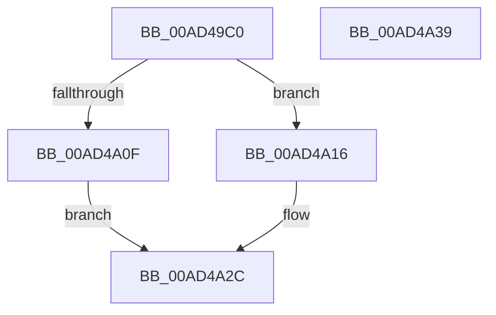

# HvExtendHivePrimaryFileValidDataLength

- RVA: `0x00AD49C0`–`0x00AD4A3A` (길이 `122` bytes)
- VA: `0x0000000140AD49C0`
- 실행 섹션: `PAGE`
- PDB 이름 있음: `예`; PDB Function 태그: `아니요`
- unwind 정보 RVA: `0x00089EA4`
- 디코드: `36`개 명령, `122/122` bytes 표시
- 미해석 바이트: `0` (있으면 어셈블리에 `.byte`로 보존)

> 이 문서는 커널 이미지의 기계어와 PDB 기호를 분석해 생성했습니다. 4번과 5번은 함수 원형과 자료형을 바이너리 사용 방식에서 추정한 C 해석이며 원본 소스 복구 결과는 아닙니다.

## 1. Dependencies

- 직접 호출 지점: **2**; 고유 호출 대상: **2**
- 직접 호출자로 확인된 함수: **1**
- RIP 상대 이미지 참조: **0**

### Outgoing calls
- `0x00AD4A06` → [guard_dispatch_icall](../../text/6B/guard_dispatch_icall_function_006BAAD0.md) (function, `0x006BAAD0`)
- `0x00AD4A1B` → [CmpFileFlushAndPurge](../9B/CmpFileFlushAndPurge_function_009B2BAC.md) (function, `0x009B2BAC`)

### Direct callers
- [CmpFlushHive](../9B/CmpFlushHive_function_009B3DC0.md) at `0x009B4523`

### Static image references
- 디코드된 RIP-relative 메모리 참조가 없습니다.

## 2. Other-region calls and transfers

- 다른 실행 섹션으로 향하는 call: **1**
  - `0x00AD4A06` → [guard_dispatch_icall](../../text/6B/guard_dispatch_icall_function_006BAAD0.md) (`PAGE` → `.text`)
- 별도 외부 분기/꼬리 이동을 확인하지 못했습니다.

## 3. Assembly (complete function range)

```asm
00AD49C0  4C 8B DC                        mov r11, rsp
00AD49C3  49 89 5B 08                     mov qword ptr [r11 + 8], rbx
00AD49C7  57                              push rdi
00AD49C8  48 83 EC 50                     sub rsp, 0x50
00AD49CC  8D 42 FC                        lea eax, [rdx - 4]
00AD49CF  45 89 43 C8                     mov dword ptr [r11 - 0x38], r8d
00AD49D3  89 44 24 30                     mov dword ptr [rsp + 0x30], eax
00AD49D7  4D 8D 43 D8                     lea r8, [r11 - 0x28]
00AD49DB  49 8D 43 10                     lea rax, [r11 + 0x10]
00AD49DF  C7 44 24 68 FE FE FE FE         mov dword ptr [rsp + 0x68], 0xfefefefe
00AD49E7  33 DB                           xor ebx, ebx
00AD49E9  33 D2                           xor edx, edx
00AD49EB  89 5C 24 34                     mov dword ptr [rsp + 0x34], ebx
00AD49EF  48 8B F9                        mov rdi, rcx
00AD49F2  49 89 43 E0                     mov qword ptr [r11 - 0x20], rax
00AD49F6  48 8B 41 28                     mov rax, qword ptr [rcx + 0x28]
00AD49FA  44 8D 4B 01                     lea r9d, [rbx + 1]
00AD49FE  C7 44 24 40 04 00 00 00         mov dword ptr [rsp + 0x40], 4
00AD4A06  E8 C5 60 BE FF                  call 0x1406baad0
00AD4A0B  85 C0                           test eax, eax
00AD4A0D  79 07                           jns 0x140ad4a16
00AD4A0F  B9 4D 01 00 C0                  mov ecx, 0xc000014d
00AD4A14  EB 16                           jmp 0x140ad4a2c
00AD4A16  33 D2                           xor edx, edx
00AD4A18  48 8B CF                        mov rcx, rdi
00AD4A1B  E8 8C E1 ED FF                  call 0x1409b2bac
00AD4A20  B9 4D 01 00 C0                  mov ecx, 0xc000014d
00AD4A25  85 C0                           test eax, eax
00AD4A27  0F 48 D9                        cmovs ebx, ecx
00AD4A2A  8B CB                           mov ecx, ebx
00AD4A2C  48 8B 5C 24 60                  mov rbx, qword ptr [rsp + 0x60]
00AD4A31  8B C1                           mov eax, ecx
00AD4A33  48 83 C4 50                     add rsp, 0x50
00AD4A37  5F                              pop rdi
00AD4A38  C3                              ret
00AD4A39  CC                              int3
```

## 4. C-style interpretation (structured pseudocode)

```c
__int64 __fastcall HvExtendHivePrimaryFileValidDataLength(__int64 a1, __int64 a2, int a3)
{
    __int64 result;
    __int64 v_rbx;
    __int64 v_rsp;
    unsigned int v_stack_m18;
    unsigned int v_stack_m24;
    unsigned int v_stack_m28;
    unsigned int v_stack_p10;
    unsigned __int64 v_stack_p8;

    *(unsigned __int64 *)(v_rsp + 8) = v_rbx;
    v_rsp = (v_rsp) - (80);
    *(unsigned int *)(v_rsp - 56) = a3;
    v_stack_m28 = (unsigned int)(a2 - 4);
    v_stack_p10 = 0xFEFEFEFEULL;
    v_rbx = 0;
    a2 = 0;
    v_stack_m24 = 0;
    *(unsigned __int64 *)(v_rsp - 32) = v_rsp + 16;
    v_stack_m18 = 4;
    result = guard_dispatch_icall(a1, a2, v_rsp - 40, v_rbx + 1);
    if (!sign_flag) goto loc_00AD4A16;
    goto loc_00AD4A2C;
loc_00AD4A16:
    a2 = 0;
    result = CmpFileFlushAndPurge(a1, a2, v_rsp - 40, v_rbx + 1);
    if (sign_flag) { v_rbx = (unsigned int)((unsigned int)(0xC000014DULL)); }
loc_00AD4A2C:
    v_rsp = (v_rsp) + (80);
    return (unsigned int)((unsigned int)((unsigned int)((unsigned int)(v_rbx))));
}
```

## 5. (Beta) C Style

```c
int64_t HvExtendHivePrimaryFileValidDataLength(void *Arg1, void *Arg2, int32_t Arg3)
{
    uint8_t *arg1 = (uint8_t *)Arg1;
    uint8_t *arg2 = (uint8_t *)Arg2;

    int64_t result;
    int64_t local_rbx;
    int64_t local_rsp;
    uint32_t v_stack_m18;
    uint32_t v_stack_m24;
    uint32_t v_stack_m28;
    uint32_t v_stack_p10;
    uint64_t v_stack_p8;

    *(uint64_t *)(local_rsp + 0x8) = local_rbx;
    local_rsp = (local_rsp) - (80);
    *(uint32_t *)(local_rsp - 0x38) = Arg3;
    v_stack_m28 = (uint32_t)(Arg2 - 4);
    v_stack_p10 = 0xFEFEFEFEULL;
    local_rbx = 0;
    Arg2 = 0;
    v_stack_m24 = 0;
    *(uint64_t *)(local_rsp - 0x20) = local_rsp + 16;
    v_stack_m18 = 4;
    result = guard_dispatch_icall(Arg1, Arg2, local_rsp - 40, local_rbx + 1);
    if (!sign_flag) goto loc_00AD4A16;
    goto loc_00AD4A2C;
loc_00AD4A16:
    Arg2 = 0;
    result = CmpFileFlushAndPurge(Arg1, Arg2, local_rsp - 40, local_rbx + 1);
    if (sign_flag) { local_rbx = (uint32_t)((uint32_t)(0xC000014DULL)); }
loc_00AD4A2C:
    local_rsp = (local_rsp) + (80);
    return (uint32_t)((uint32_t)((uint32_t)((uint32_t)(local_rbx))));
}
```

### 관측된 메모리 오프셋

구조체 형식이 확인되지 않은 접근은 인자 기준의 오프셋으로만 기록했습니다.

| 기준 인자 | 오프셋 표현 | 폭 (bit) | 접근 |
|---|---:|---:|---|
| `Arg1` | `+ 0x28` | `64` | `R` |
| `Arg2` | `- 0x4` | `32` | `R` |

## 6. Execution-region graph

[열기: 2D/3D 그래프와 함수 탐색 컨트롤 패널](../../../control-panel.html?section=page&rva=0x00AD49C0&view=graph)

- 2D 그래프는 위에서 아래로 흐르고, 3D 그래프는 빈 공간을 드래그해 회전합니다. Shift+드래그는 이동, 휠은 확대·축소, 함수 노드 선택은 대상 보고서 이동입니다.

### Static fallback


