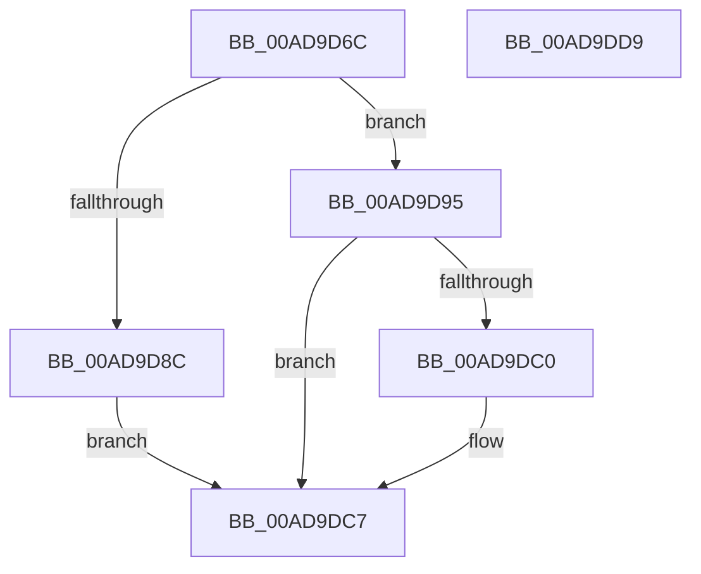

# IoGetDumpStack

- RVA: `0x00AD9D6C`–`0x00AD9DDA` (길이 `110` bytes)
- VA: `0x0000000140AD9D6C`
- 실행 섹션: `PAGE`
- PDB 이름 있음: `예`; PDB Function 태그: `아니요`
- unwind 정보 RVA: `0x000794E0`
- 디코드: `32`개 명령, `110/110` bytes 표시
- 미해석 바이트: `0` (있으면 어셈블리에 `.byte`로 보존)

> 이 문서는 커널 이미지의 기계어와 PDB 기호를 분석해 생성했습니다. 4번과 5번은 함수 원형과 자료형을 바이너리 사용 방식에서 추정한 C 해석이며 원본 소스 복구 결과는 아닙니다.

## 1. Dependencies

- 직접 호출 지점: **4**; 고유 호출 대상: **4**
- 직접 호출자로 확인된 함수: **1**
- RIP 상대 이미지 참조: **2**

### Outgoing calls
- `0x00AD9D81` → [IopLoadCrashdumpDriver](../../text/4E/IopLoadCrashdumpDriver_function_004E2F70.md) (function, `0x004E2F70`)
- `0x00AD9D8E` → [IopDumpTraceLoadCrashDumpDriverFailure](../../text/4E/IopDumpTraceLoadCrashDumpDriverFailure_function_004E2C18.md) (function, `0x004E2C18`)
- `0x00AD9DB5` → [guard_dispatch_icall](../../text/6B/guard_dispatch_icall_function_006BAAD0.md) (function, `0x006BAAD0`)
- `0x00AD9DC2` → [IopDumpTraceLoadDumpStackFailure](../../text/59/IopDumpTraceLoadDumpStackFailure_function_005952B8.md) (function, `0x005952B8`)

### Direct callers
- [PopAllocateHiberContext](PopAllocateHiberContext_function_00ADC05C.md) at `0x00ADC19C`

### Static image references
- `0x00AD9D95` → RVA `0x00E65FE0` (`.data`; read)
- `0x00AD9D9C` → RVA `0x00B01E60` (` ?? ::NNGAKEGL::`string'`; read)

## 2. Other-region calls and transfers

- 다른 실행 섹션으로 향하는 call: **4**
  - `0x00AD9D81` → [IopLoadCrashdumpDriver](../../text/4E/IopLoadCrashdumpDriver_function_004E2F70.md) (`PAGE` → `.text`)
  - `0x00AD9D8E` → [IopDumpTraceLoadCrashDumpDriverFailure](../../text/4E/IopDumpTraceLoadCrashDumpDriverFailure_function_004E2C18.md) (`PAGE` → `.text`)
  - `0x00AD9DB5` → [guard_dispatch_icall](../../text/6B/guard_dispatch_icall_function_006BAAD0.md) (`PAGE` → `.text`)
  - `0x00AD9DC2` → [IopDumpTraceLoadDumpStackFailure](../../text/59/IopDumpTraceLoadDumpStackFailure_function_005952B8.md) (`PAGE` → `.text`)
- 별도 외부 분기/꼬리 이동을 확인하지 못했습니다.

## 3. Assembly (complete function range)

```asm
00AD9D6C  48 89 5C 24 08                  mov qword ptr [rsp + 8], rbx
00AD9D71  48 89 74 24 10                  mov qword ptr [rsp + 0x10], rsi
00AD9D76  57                              push rdi
00AD9D77  48 83 EC 30                     sub rsp, 0x30
00AD9D7B  41 8B F9                        mov edi, r9d
00AD9D7E  48 8B F2                        mov rsi, rdx
00AD9D81  E8 EA 91 A0 FF                  call 0x1404e2f70
00AD9D86  8B D8                           mov ebx, eax
00AD9D88  85 C0                           test eax, eax
00AD9D8A  79 09                           jns 0x140ad9d95
00AD9D8C  8B C8                           mov ecx, eax
00AD9D8E  E8 85 8E A0 FF                  call 0x1404e2c18
00AD9D93  EB 32                           jmp 0x140ad9dc7
00AD9D95  48 8B 05 44 C2 38 00            mov rax, qword ptr [rip + 0x38c244]
00AD9D9C  48 8D 0D BD 80 02 00            lea rcx, [rip + 0x280bd]
00AD9DA3  48 83 64 24 20 00               and qword ptr [rsp + 0x20], 0
00AD9DA9  44 8B CF                        mov r9d, edi
00AD9DAC  41 B8 02 00 00 00               mov r8d, 2
00AD9DB2  48 8B D6                        mov rdx, rsi
00AD9DB5  E8 16 0D BE FF                  call 0x1406baad0
00AD9DBA  8B D8                           mov ebx, eax
00AD9DBC  85 C0                           test eax, eax
00AD9DBE  79 07                           jns 0x140ad9dc7
00AD9DC0  8B C8                           mov ecx, eax
00AD9DC2  E8 F1 B4 AB FF                  call 0x1405952b8
00AD9DC7  48 8B 74 24 48                  mov rsi, qword ptr [rsp + 0x48]
00AD9DCC  8B C3                           mov eax, ebx
00AD9DCE  48 8B 5C 24 40                  mov rbx, qword ptr [rsp + 0x40]
00AD9DD3  48 83 C4 30                     add rsp, 0x30
00AD9DD7  5F                              pop rdi
00AD9DD8  C3                              ret
00AD9DD9  CC                              int3
```

## 4. C-style interpretation (structured pseudocode)

```c
__int64 __fastcall IoGetDumpStack(__int64 a1, __int64 a2, __int64 a3, int a4)
{
    __int64 result;
    __int64 v_rsp;
    unsigned __int64 v_stack_m18;
    unsigned __int64 v_stack_p10;
    unsigned __int64 v_stack_p8;

    v_stack_p8 = v_rbx;
    v_stack_p10 = v_rsi;
    v_rsp = (v_rsp) - (48);
    result = IopLoadCrashdumpDriver(a1, a2, a3, a4);
    if (!sign_flag) goto loc_00AD9D95;
    result = IopDumpTraceLoadCrashDumpDriverFailure((unsigned int)((unsigned int)(result)), a2, a3, a4);
    goto loc_00AD9DC7;
loc_00AD9D95:
    result = guard_dispatch_icall(v_rip + 164029, a2, 2, (unsigned int)((unsigned int)((unsigned int)(a4))));
    if (sign_flag) {
        a1 = (unsigned int)(result);
        result = IopDumpTraceLoadDumpStackFailure(a1, a2, 2, (unsigned int)((unsigned int)((unsigned int)(a4))));
    }
    v_rsp = (v_rsp) + (48);
    return (unsigned int)((unsigned int)((unsigned int)((unsigned int)(result))));
}
```

## 5. (Beta) C Style

```c
int64_t IoGetDumpStack(int64_t Arg1, int64_t Arg2, int64_t Arg3, int32_t Arg4)
{
    int64_t result;
    int64_t local_rsp;
    uint64_t v_stack_m18;
    uint64_t v_stack_p10;
    uint64_t v_stack_p8;

    v_stack_p8 = local_rbx;
    v_stack_p10 = local_rsi;
    local_rsp = (local_rsp) - (48);
    result = IopLoadCrashdumpDriver(Arg1, Arg2, Arg3, Arg4);
    if (!sign_flag) goto loc_00AD9D95;
    result = IopDumpTraceLoadCrashDumpDriverFailure((uint32_t)((uint32_t)(result)), Arg2, Arg3, Arg4);
    goto loc_00AD9DC7;
loc_00AD9D95:
    result = guard_dispatch_icall(v_rip + 164029, Arg2, 2, (uint32_t)((uint32_t)((uint32_t)(Arg4))));
    if (sign_flag) {
        Arg1 = (uint32_t)(result);
        result = IopDumpTraceLoadDumpStackFailure(Arg1, Arg2, 2, (uint32_t)((uint32_t)((uint32_t)(Arg4))));
    }
    local_rsp = (local_rsp) + (48);
    return (uint32_t)((uint32_t)((uint32_t)((uint32_t)(result))));
}
```

## 6. Execution-region graph

[열기: 2D/3D 그래프와 함수 탐색 컨트롤 패널](../../../control-panel.html?section=page&rva=0x00AD9D6C&view=graph)

- 2D 그래프는 위에서 아래로 흐르고, 3D 그래프는 빈 공간을 드래그해 회전합니다. Shift+드래그는 이동, 휠은 확대·축소, 함수 노드 선택은 대상 보고서 이동입니다.

### Static fallback


