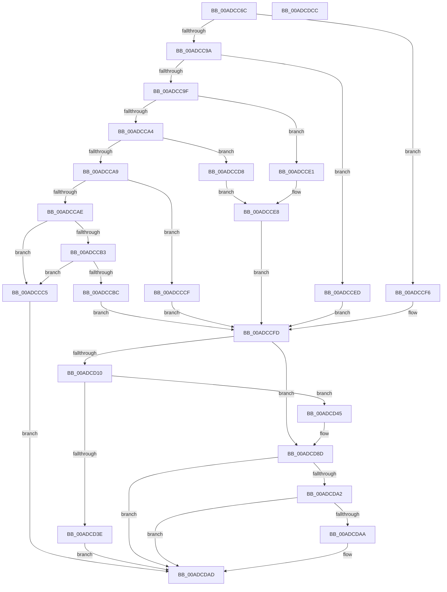

# IopCreateSecurityDescriptorPerType

- RVA: `0x00ADCC6C`–`0x00ADCDCD` (길이 `353` bytes)
- VA: `0x0000000140ADCC6C`
- 실행 섹션: `PAGE`
- PDB 이름 있음: `예`; PDB Function 태그: `아니요`
- unwind 정보 RVA: `0x000847EC`
- 디코드: `99`개 명령, `353/353` bytes 표시
- 미해석 바이트: `0` (있으면 어셈블리에 `.byte`로 보존)

> 이 문서는 커널 이미지의 기계어와 PDB 기호를 분석해 생성했습니다. 4번과 5번은 함수 원형과 자료형을 바이너리 사용 방식에서 추정한 C 해석이며 원본 소스 복구 결과는 아닙니다.

## 1. Dependencies

- 직접 호출 지점: **7**; 고유 호출 대상: **7**
- 직접 호출자로 확인된 함수: **1**
- RIP 상대 이미지 참조: **7**

### Outgoing calls
- `0x00ADCCB3` → [Feature_AppContainerVolumeDeviceAccess__private_IsEnabledDeviceUsageNoInline](../../text/59/Feature_AppContainerVolumeDeviceAccess__private_IsEnabledDeviceUsageNoInline_function_0059788C.md) (function, `0x0059788C`)
- `0x00ADCD05` → [RtlCreateSecurityDescriptor](../9F/RtlCreateSecurityDescriptor_function_009F1DF0.md) (function, `0x009F1DF0`)
- `0x00ADCD31` → [ExAllocatePool2](../../poolcode/B8/ExAllocatePool2_function_00B820F0.md) (function, `0x00B820F0`)
- `0x00ADCD53` → [RtlCreateAcl](../91/RtlCreateAcl_function_00916F00.md) (function, `0x00916F00`)
- `0x00ADCD74` → [RtlAddMandatoryAce](../92/RtlAddMandatoryAce_function_00929BA0.md) (function, `0x00929BA0`)
- `0x00ADCD84` → [RtlSetSaclSecurityDescriptor](../A1/RtlSetSaclSecurityDescriptor_function_00A18B80.md) (function, `0x00A18B80`)
- `0x00ADCD98` → [RtlSetDaclSecurityDescriptor](../9E/RtlSetDaclSecurityDescriptor_function_009EC210.md) (function, `0x009EC210`)

### Direct callers
- [IopCreateDefaultDeviceSecurityDescriptor](../9A/IopCreateDefaultDeviceSecurityDescriptor_function_009A5008.md) at `0x009A5095`

### Static image references
- `0x00ADCCBC` → RVA `0x00FD9B88` (`PAGEDATA`; read)
- `0x00ADCCCF` → RVA `0x00FD9C38` (`PAGEDATA`; read)
- `0x00ADCCD8` → RVA `0x00FD9BE8` (`PAGEDATA`; read)
- `0x00ADCCE1` → RVA `0x00FD9C40` (`PAGEDATA`; read)
- `0x00ADCCED` → RVA `0x00FD9B40` (`PAGEDATA`; read)
- `0x00ADCCF6` → RVA `0x00FD9C30` (`PAGEDATA`; read)
- `0x00ADCD10` → RVA `0x00F05878` (`.data`; read)

## 2. Other-region calls and transfers

- 다른 실행 섹션으로 향하는 call: **2**
  - `0x00ADCCB3` → [Feature_AppContainerVolumeDeviceAccess__private_IsEnabledDeviceUsageNoInline](../../text/59/Feature_AppContainerVolumeDeviceAccess__private_IsEnabledDeviceUsageNoInline_function_0059788C.md) (`PAGE` → `.text`)
  - `0x00ADCD31` → [ExAllocatePool2](../../poolcode/B8/ExAllocatePool2_function_00B820F0.md) (`PAGE` → `POOLCODE`)
- 별도 외부 분기/꼬리 이동을 확인하지 못했습니다.

## 3. Assembly (complete function range)

```asm
00ADCC6C  48 8B C4                        mov rax, rsp
00ADCC6F  48 89 58 08                     mov qword ptr [rax + 8], rbx
00ADCC73  48 89 68 10                     mov qword ptr [rax + 0x10], rbp
00ADCC77  48 89 70 18                     mov qword ptr [rax + 0x18], rsi
00ADCC7B  48 89 78 20                     mov qword ptr [rax + 0x20], rdi
00ADCC7F  41 54                           push r12
00ADCC81  41 56                           push r14
00ADCC83  41 57                           push r15
00ADCC85  48 83 EC 30                     sub rsp, 0x30
00ADCC89  40 32 F6                        xor sil, sil
00ADCC8C  49 8B F9                        mov rdi, r9
00ADCC8F  4D 8B E0                        mov r12, r8
00ADCC92  4C 8B F9                        mov r15, rcx
00ADCC95  83 EA 01                        sub edx, 1
00ADCC98  74 5C                           je 0x140adccf6
00ADCC9A  83 EA 01                        sub edx, 1
00ADCC9D  74 4E                           je 0x140adcced
00ADCC9F  83 EA 01                        sub edx, 1
00ADCCA2  74 3D                           je 0x140adcce1
00ADCCA4  83 EA 01                        sub edx, 1
00ADCCA7  74 2F                           je 0x140adccd8
00ADCCA9  83 EA 01                        sub edx, 1
00ADCCAC  74 21                           je 0x140adcccf
00ADCCAE  83 FA 01                        cmp edx, 1
00ADCCB1  75 12                           jne 0x140adccc5
00ADCCB3  E8 D4 AB AB FF                  call 0x14059788c
00ADCCB8  85 C0                           test eax, eax
00ADCCBA  74 09                           je 0x140adccc5
00ADCCBC  48 8B 1D C5 CE 4F 00            mov rbx, qword ptr [rip + 0x4fcec5]
00ADCCC3  EB 38                           jmp 0x140adccfd
00ADCCC5  B8 0D 00 00 C0                  mov eax, 0xc000000d
00ADCCCA  E9 DE 00 00 00                  jmp 0x140adcdad
00ADCCCF  48 8B 1D 62 CF 4F 00            mov rbx, qword ptr [rip + 0x4fcf62]
00ADCCD6  EB 25                           jmp 0x140adccfd
00ADCCD8  48 8B 1D 09 CF 4F 00            mov rbx, qword ptr [rip + 0x4fcf09]
00ADCCDF  EB 07                           jmp 0x140adcce8
00ADCCE1  48 8B 1D 58 CF 4F 00            mov rbx, qword ptr [rip + 0x4fcf58]
00ADCCE8  40 B6 01                        mov sil, 1
00ADCCEB  EB 10                           jmp 0x140adccfd
00ADCCED  48 8B 1D 4C CE 4F 00            mov rbx, qword ptr [rip + 0x4fce4c]
00ADCCF4  EB 07                           jmp 0x140adccfd
00ADCCF6  48 8B 1D 33 CF 4F 00            mov rbx, qword ptr [rip + 0x4fcf33]
00ADCCFD  BA 01 00 00 00                  mov edx, 1
00ADCD02  49 8B CF                        mov rcx, r15
00ADCD05  E8 E6 50 F1 FF                  call 0x1409f1df0
00ADCD0A  40 80 FE 01                     cmp sil, 1
00ADCD0E  75 7D                           jne 0x140adcd8d
00ADCD10  48 8B 05 61 8B 42 00            mov rax, qword ptr [rip + 0x428b61]
00ADCD17  B9 00 01 00 00                  mov ecx, 0x100
00ADCD1C  41 B8 49 6F 53 65               mov r8d, 0x65536f49
00ADCD22  0F B6 68 01                     movzx ebp, byte ptr [rax + 1]
00ADCD26  66 83 C5 06                     add bp, 6
00ADCD2A  66 C1 E5 02                     shl bp, 2
00ADCD2E  0F B7 D5                        movzx edx, bp
00ADCD31  E8 BA 53 0A 00                  call 0x140b820f0
00ADCD36  4C 8B F0                        mov r14, rax
00ADCD39  48 85 C0                        test rax, rax
00ADCD3C  75 07                           jne 0x140adcd45
00ADCD3E  B8 9A 00 00 C0                  mov eax, 0xc000009a
00ADCD43  EB 68                           jmp 0x140adcdad
00ADCD45  0F B7 D5                        movzx edx, bp
00ADCD48  49 8B CE                        mov rcx, r14
00ADCD4B  BD 02 00 00 00                  mov ebp, 2
00ADCD50  44 8B C5                        mov r8d, ebp
00ADCD53  E8 A8 A1 E3 FF                  call 0x140916f00
00ADCD58  4C 8B 0D 19 8B 42 00            mov r9, qword ptr [rip + 0x428b19]
00ADCD5F  45 33 C0                        xor r8d, r8d
00ADCD62  8B D5                           mov edx, ebp
00ADCD64  C7 44 24 28 01 00 00 00         mov dword ptr [rsp + 0x28], 1
00ADCD6C  49 8B CE                        mov rcx, r14
00ADCD6F  C6 44 24 20 11                  mov byte ptr [rsp + 0x20], 0x11
00ADCD74  E8 27 CE E4 FF                  call 0x140929ba0
00ADCD79  45 33 C9                        xor r9d, r9d
00ADCD7C  4D 8B C6                        mov r8, r14
00ADCD7F  B2 01                           mov dl, 1
00ADCD81  49 8B CF                        mov rcx, r15
00ADCD84  E8 F7 BD F3 FF                  call 0x140a18b80
00ADCD89  4D 89 34 24                     mov qword ptr [r12], r14
00ADCD8D  45 33 C9                        xor r9d, r9d
00ADCD90  4C 8B C3                        mov r8, rbx
00ADCD93  B2 01                           mov dl, 1
00ADCD95  49 8B CF                        mov rcx, r15
00ADCD98  E8 73 F4 F0 FF                  call 0x1409ec210
00ADCD9D  48 85 FF                        test rdi, rdi
00ADCDA0  74 0B                           je 0x140adcdad
00ADCDA2  83 0F 04                        or dword ptr [rdi], 4
00ADCDA5  40 84 F6                        test sil, sil
00ADCDA8  74 03                           je 0x140adcdad
00ADCDAA  83 0F 10                        or dword ptr [rdi], 0x10
00ADCDAD  48 8B 5C 24 50                  mov rbx, qword ptr [rsp + 0x50]
00ADCDB2  48 8B 6C 24 58                  mov rbp, qword ptr [rsp + 0x58]
00ADCDB7  48 8B 74 24 60                  mov rsi, qword ptr [rsp + 0x60]
00ADCDBC  48 8B 7C 24 68                  mov rdi, qword ptr [rsp + 0x68]
00ADCDC1  48 83 C4 30                     add rsp, 0x30
00ADCDC5  41 5F                           pop r15
00ADCDC7  41 5E                           pop r14
00ADCDC9  41 5C                           pop r12
00ADCDCB  C3                              ret
00ADCDCC  CC                              int3
```

## 4. C-style interpretation (structured pseudocode)

```c
__int64 __fastcall IopCreateSecurityDescriptorPerType(__int64 a1, int a2, __int64 a3, __int64 a4)
{
    __int64 result;
    __int64 v_rbp;
    __int64 v_rsi;
    __int64 v_rsp;
    unsigned int v_stack_m20;
    unsigned __int8 v_stack_m28;
    unsigned __int64 v_stack_p10;
    unsigned __int64 v_stack_p18;
    unsigned __int64 v_stack_p20;
    unsigned __int64 v_stack_p8;

    *(unsigned __int64 *)(v_rsp + 8) = v_rbx;
    *(unsigned __int64 *)(v_rsp + 16) = v_rbp;
    *(unsigned __int64 *)(v_rsp + 24) = v_rsi;
    *(unsigned __int64 *)(v_rsp + 32) = v_rdi;
    v_rsp = (v_rsp) - (48);
    v_rsi = 0;
    a2 = (unsigned int)((a2) - (1));
    if (condition_is_equal) goto loc_00ADCCF6;
    a2 = (unsigned int)((a2) - (1));
    if (condition_is_equal) goto loc_00ADCCED;
    a2 = (unsigned int)((a2) - (1));
    if (condition_is_equal) goto loc_00ADCCE1;
    a2 = (unsigned int)((a2) - (1));
    if (condition_is_equal) goto loc_00ADCCD8;
    a2 = (unsigned int)((a2) - (1));
    if (condition_is_equal) goto loc_00ADCCCF;
    if (a2 != 1) goto loc_00ADCCC5;
    result = Feature_AppContainerVolumeDeviceAccess__private_IsEnabledDeviceUsageNoInline(a1, a2, a3, a4);
    if ((unsigned int)(result) == 0) goto loc_00ADCCC5;
    goto loc_00ADCCFD;
loc_00ADCCC5:
    goto loc_00ADCDAD;
loc_00ADCCCF:
    goto loc_00ADCCFD;
loc_00ADCCD8:
    goto loc_00ADCCE8;
loc_00ADCCE1:
loc_00ADCCE8:
    goto loc_00ADCCFD;
loc_00ADCCED:
    goto loc_00ADCCFD;
loc_00ADCCF6:
loc_00ADCCFD:
    result = RtlCreateSecurityDescriptor(a1, 1, a3, a4);
    if (1 != 1) goto loc_00ADCD8D;
    v_rbp = (unsigned __int16)((*(unsigned __int8 *)(*(unsigned __int64 *)(v_rip + 4361057) + 1)) + (6));
    v_rbp = (unsigned __int16)((v_rbp) << (2));
    result = ExAllocatePool2(256, (unsigned __int16)(v_rbp), (unsigned int)(0x65536F49ULL), a4);
    if (result != 0) goto loc_00ADCD45;
    goto loc_00ADCDAD;
loc_00ADCD45:
    result = RtlCreateAcl(result, (unsigned __int16)(v_rbp), 2, a4);
    a3 = 0;
    v_stack_m20 = 1;
    v_stack_m28 = 17;
    result = RtlAddMandatoryAce(result, 2, a3, *(unsigned __int64 *)(v_rip + 4360985));
    a4 = 0;
    result = RtlSetSaclSecurityDescriptor(a1, 1, result, a4);
    *(unsigned __int64 *)(a3) = result;
loc_00ADCD8D:
    a4 = 0;
    result = RtlSetDaclSecurityDescriptor(a1, 1, *(unsigned __int64 *)(v_rip + 5230387), a4);
    if (0 == 0) goto loc_00ADCDAD;
    if (1 != 0) {
    }
    v_rsp = (v_rsp) + (48);
    return result;
}
```

## 5. (Beta) C Style

```c
int64_t IopCreateSecurityDescriptorPerType(int64_t Arg1, int32_t Arg2, void *Arg3, int64_t Arg4)
{
    uint8_t *arg3 = (uint8_t *)Arg3;

    int64_t result;
    int64_t local_rbp;
    int64_t local_rsi;
    int64_t local_rsp;
    uint32_t v_stack_m20;
    uint8_t v_stack_m28;
    uint64_t v_stack_p10;
    uint64_t v_stack_p18;
    uint64_t v_stack_p20;
    uint64_t v_stack_p8;

    *(uint64_t *)(local_rsp + 0x8) = local_rbx;
    *(uint64_t *)(local_rsp + 0x10) = local_rbp;
    *(uint64_t *)(local_rsp + 0x18) = local_rsi;
    *(uint64_t *)(local_rsp + 0x20) = local_rdi;
    local_rsp = (local_rsp) - (48);
    local_rsi = 0;
    Arg2 = (uint32_t)((Arg2) - (1));
    if (condition_is_equal) goto loc_00ADCCF6;
    Arg2 = (uint32_t)((Arg2) - (1));
    if (condition_is_equal) goto loc_00ADCCED;
    Arg2 = (uint32_t)((Arg2) - (1));
    if (condition_is_equal) goto loc_00ADCCE1;
    Arg2 = (uint32_t)((Arg2) - (1));
    if (condition_is_equal) goto loc_00ADCCD8;
    Arg2 = (uint32_t)((Arg2) - (1));
    if (condition_is_equal) goto loc_00ADCCCF;
    if (Arg2 != 1) goto loc_00ADCCC5;
    result = Feature_AppContainerVolumeDeviceAccess__private_IsEnabledDeviceUsageNoInline(Arg1, Arg2, Arg3, Arg4);
    if ((uint32_t)(result) == 0) goto loc_00ADCCC5;
    goto loc_00ADCCFD;
loc_00ADCCC5:
    goto loc_00ADCDAD;
loc_00ADCCCF:
    goto loc_00ADCCFD;
loc_00ADCCD8:
    goto loc_00ADCCE8;
loc_00ADCCE1:
loc_00ADCCE8:
    goto loc_00ADCCFD;
loc_00ADCCED:
    goto loc_00ADCCFD;
loc_00ADCCF6:
loc_00ADCCFD:
    result = RtlCreateSecurityDescriptor(Arg1, 1, Arg3, Arg4);
    if (1 != 1) goto loc_00ADCD8D;
    local_rbp = (uint16_t)((*(uint8_t *)(*(uint64_t *)(v_rip + 0x428B61) + 0x1)) + (6));
    local_rbp = (uint16_t)((local_rbp) << (2));
    result = ExAllocatePool2(256, (uint16_t)(local_rbp), (uint32_t)(0x65536F49ULL), Arg4);
    if (result != 0) goto loc_00ADCD45;
    goto loc_00ADCDAD;
loc_00ADCD45:
    result = RtlCreateAcl(result, (uint16_t)(local_rbp), 2, Arg4);
    Arg3 = 0;
    v_stack_m20 = 1;
    v_stack_m28 = 17;
    result = RtlAddMandatoryAce(result, 2, Arg3, *(uint64_t *)(v_rip + 0x428B19));
    Arg4 = 0;
    result = RtlSetSaclSecurityDescriptor(Arg1, 1, result, Arg4);
    *(uint64_t *)(arg3) = result;
loc_00ADCD8D:
    Arg4 = 0;
    result = RtlSetDaclSecurityDescriptor(Arg1, 1, *(uint64_t *)(v_rip + 0x4FCF33), Arg4);
    if (0 == 0) goto loc_00ADCDAD;
    if (1 != 0) {
    }
    local_rsp = (local_rsp) + (48);
    return result;
}
```

### 관측된 메모리 오프셋

구조체 형식이 확인되지 않은 접근은 인자 기준의 오프셋으로만 기록했습니다.

| 기준 인자 | 오프셋 표현 | 폭 (bit) | 접근 |
|---|---:|---:|---|
| `Arg3` | `+ 0x0` | `64` | `W` |

## 6. Execution-region graph

[열기: 2D/3D 그래프와 함수 탐색 컨트롤 패널](../../../control-panel.html?section=page&rva=0x00ADCC6C&view=graph)

- 2D 그래프는 위에서 아래로 흐르고, 3D 그래프는 빈 공간을 드래그해 회전합니다. Shift+드래그는 이동, 휠은 확대·축소, 함수 노드 선택은 대상 보고서 이동입니다.

### Static fallback


