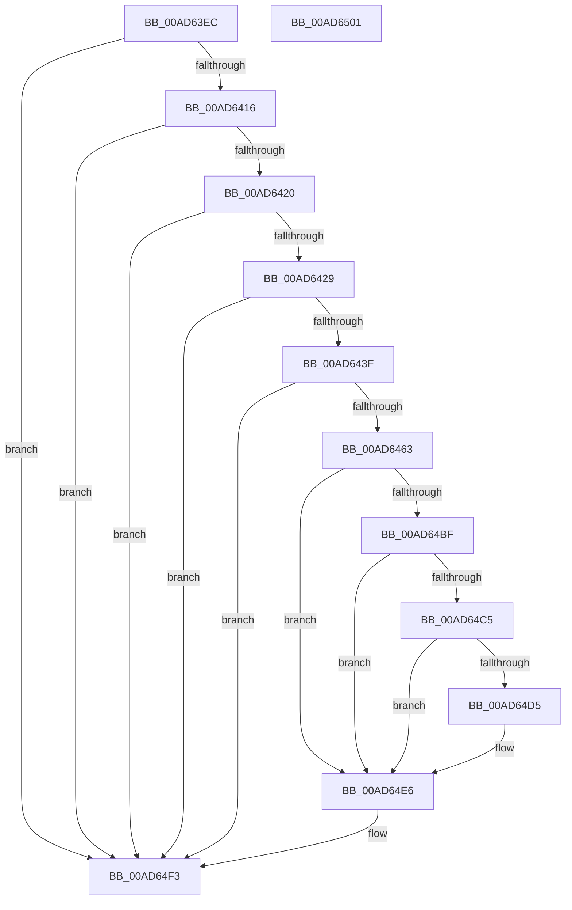

# IopDeviceObjectFromSymbolicName

- RVA: `0x00AD63EC`–`0x00AD6502` (길이 `278` bytes)
- VA: `0x0000000140AD63EC`
- 실행 섹션: `PAGE`
- PDB 이름 있음: `예`; PDB Function 태그: `아니요`
- unwind 정보 RVA: `0x000BEF34`
- 디코드: `78`개 명령, `278/278` bytes 표시
- 미해석 바이트: `0` (있으면 어셈블리에 `.byte`로 보존)

> 이 문서는 커널 이미지의 기계어와 PDB 기호를 분석해 생성했습니다. 4번과 5번은 함수 원형과 자료형을 바이너리 사용 방식에서 추정한 C 해석이며 원본 소스 복구 결과는 아닙니다.

## 1. Dependencies

- 직접 호출 지점: **7**; 고유 호출 대상: **7**
- 직접 호출자로 확인된 함수: **1**
- RIP 상대 이미지 참조: **2**

### Outgoing calls
- `0x00AD6432` → [PnpUnicodeStringToWstr](../9D/PnpUnicodeStringToWstr_function_009D90C0.md) (function, `0x009D90C0`)
- `0x00AD6452` → [ExAllocatePool2](../../poolcode/B8/ExAllocatePool2_function_00B820F0.md) (function, `0x00B820F0`)
- `0x00AD64A8` → [PnpGetObjectProperty](../8E/PnpGetObjectProperty_function_008E2180.md) (function, `0x008E2180`)
- `0x00AD64B6` → [PnpUnicodeStringToWstrFree](../8F/PnpUnicodeStringToWstrFree_function_008F59F0.md) (function, `0x008F59F0`)
- `0x00AD64CC` → [RtlInitUnicodeStringEx](../../text/46/RtlInitUnicodeStringEx_function_00463960.md) (function, `0x00463960`)
- `0x00AD64DE` → [PnpDeviceObjectFromDeviceInstanceWithTag](../8E/PnpDeviceObjectFromDeviceInstanceWithTag_function_008E7490.md) (function, `0x008E7490`)
- `0x00AD64EE` → [ExFreePoolWithTag](../../poolcode/B8/ExFreePoolWithTag_function_00B82870.md) (function, `0x00B82870`)

### Direct callers
- [IopGetSessionIdFromSymbolicName](../70/IopGetSessionIdFromSymbolicName_function_00702084.md) at `0x00702091`

### Static image references
- `0x00AD6486` → RVA `0x00E66398` (`.data`; read)
- `0x00AD6497` → RVA `0x00011490` (`.rdata`; read)

## 2. Other-region calls and transfers

- 다른 실행 섹션으로 향하는 call: **3**
  - `0x00AD6452` → [ExAllocatePool2](../../poolcode/B8/ExAllocatePool2_function_00B820F0.md) (`PAGE` → `POOLCODE`)
  - `0x00AD64CC` → [RtlInitUnicodeStringEx](../../text/46/RtlInitUnicodeStringEx_function_00463960.md) (`PAGE` → `.text`)
  - `0x00AD64EE` → [ExFreePoolWithTag](../../poolcode/B8/ExFreePoolWithTag_function_00B82870.md) (`PAGE` → `POOLCODE`)
- 별도 외부 분기/꼬리 이동을 확인하지 못했습니다.

## 3. Assembly (complete function range)

```asm
00AD63EC  40 55                           push rbp
00AD63EE  53                              push rbx
00AD63EF  56                              push rsi
00AD63F0  57                              push rdi
00AD63F1  41 56                           push r14
00AD63F3  48 8B EC                        mov rbp, rsp
00AD63F6  48 83 EC 70                     sub rsp, 0x70
00AD63FA  33 FF                           xor edi, edi
00AD63FC  0F 57 C0                        xorps xmm0, xmm0
00AD63FF  89 7D 38                        mov dword ptr [rbp + 0x38], edi
00AD6402  48 8B F1                        mov rsi, rcx
00AD6405  48 89 7D 40                     mov qword ptr [rbp + 0x40], rdi
00AD6409  0F 11 45 F0                     movups xmmword ptr [rbp - 0x10], xmm0
00AD640D  48 85 C9                        test rcx, rcx
00AD6410  0F 84 DD 00 00 00               je 0x140ad64f3
00AD6416  48 39 79 08                     cmp qword ptr [rcx + 8], rdi
00AD641A  0F 84 D3 00 00 00               je 0x140ad64f3
00AD6420  66 39 39                        cmp word ptr [rcx], di
00AD6423  0F 84 CA 00 00 00               je 0x140ad64f3
00AD6429  4C 8B C1                        mov r8, rcx
00AD642C  33 D2                           xor edx, edx
00AD642E  48 8D 4D 40                     lea rcx, [rbp + 0x40]
00AD6432  E8 89 2C F0 FF                  call 0x1409d90c0
00AD6437  85 C0                           test eax, eax
00AD6439  0F 88 B4 00 00 00               js 0x140ad64f3
00AD643F  BA 90 01 00 00                  mov edx, 0x190
00AD6444  B9 00 01 00 00                  mov ecx, 0x100
00AD6449  41 B8 50 6E 70 47               mov r8d, 0x47706e50
00AD644F  89 55 30                        mov dword ptr [rbp + 0x30], edx
00AD6452  E8 99 BC 0A 00                  call 0x140b820f0
00AD6457  4C 8B F0                        mov r14, rax
00AD645A  48 85 C0                        test rax, rax
00AD645D  0F 84 90 00 00 00               je 0x140ad64f3
00AD6463  8B 4D 30                        mov ecx, dword ptr [rbp + 0x30]
00AD6466  48 8D 45 30                     lea rax, [rbp + 0x30]
00AD646A  48 8B 55 40                     mov rdx, qword ptr [rbp + 0x40]
00AD646E  44 8D 47 03                     lea r8d, [rdi + 3]
00AD6472  89 7C 24 50                     mov dword ptr [rsp + 0x50], edi
00AD6476  45 33 C9                        xor r9d, r9d
00AD6479  48 89 44 24 48                  mov qword ptr [rsp + 0x48], rax
00AD647E  48 8D 45 38                     lea rax, [rbp + 0x38]
00AD6482  89 4C 24 40                     mov dword ptr [rsp + 0x40], ecx
00AD6486  48 8B 0D 0B FF 38 00            mov rcx, qword ptr [rip + 0x38ff0b]
00AD648D  4C 89 74 24 38                  mov qword ptr [rsp + 0x38], r14
00AD6492  48 89 44 24 30                  mov qword ptr [rsp + 0x30], rax
00AD6497  48 8D 05 F2 AF 53 FF            lea rax, [rip - 0xac500e]
00AD649E  48 89 44 24 28                  mov qword ptr [rsp + 0x28], rax
00AD64A3  48 89 7C 24 20                  mov qword ptr [rsp + 0x20], rdi
00AD64A8  E8 D3 BC E0 FF                  call 0x1408e2180
00AD64AD  48 8B 4D 40                     mov rcx, qword ptr [rbp + 0x40]
00AD64B1  48 8B D6                        mov rdx, rsi
00AD64B4  8B D8                           mov ebx, eax
00AD64B6  E8 35 F5 E1 FF                  call 0x1408f59f0
00AD64BB  85 DB                           test ebx, ebx
00AD64BD  78 27                           js 0x140ad64e6
00AD64BF  83 7D 38 12                     cmp dword ptr [rbp + 0x38], 0x12
00AD64C3  75 21                           jne 0x140ad64e6
00AD64C5  49 8B D6                        mov rdx, r14
00AD64C8  48 8D 4D F0                     lea rcx, [rbp - 0x10]
00AD64CC  E8 8F D4 98 FF                  call 0x140463960
00AD64D1  85 C0                           test eax, eax
00AD64D3  78 11                           js 0x140ad64e6
00AD64D5  BA 44 66 6C 74                  mov edx, 0x746c6644
00AD64DA  48 8D 4D F0                     lea rcx, [rbp - 0x10]
00AD64DE  E8 AD 0F E1 FF                  call 0x1408e7490
00AD64E3  48 8B F8                        mov rdi, rax
00AD64E6  BA 50 6E 70 47                  mov edx, 0x47706e50
00AD64EB  49 8B CE                        mov rcx, r14
00AD64EE  E8 7D C3 0A 00                  call 0x140b82870
00AD64F3  48 8B C7                        mov rax, rdi
00AD64F6  48 83 C4 70                     add rsp, 0x70
00AD64FA  41 5E                           pop r14
00AD64FC  5F                              pop rdi
00AD64FD  5E                              pop rsi
00AD64FE  5B                              pop rbx
00AD64FF  5D                              pop rbp
00AD6500  C3                              ret
00AD6501  CC                              int3
```

## 4. C-style interpretation (structured pseudocode)

```c
__int64 __fastcall IopDeviceObjectFromSymbolicName(__int64 a1, int a2, __int64 a3, int a4)
{
    __int64 result;
    __int64 v_rdi;
    __int64 v_rsp;
    unsigned __int64 v_stack_m38;
    unsigned int v_stack_m48;
    unsigned __int64 v_stack_m50;
    unsigned int v_stack_m58;
    unsigned __int64 v_stack_m60;
    unsigned __int64 v_stack_m68;
    unsigned __int64 v_stack_m70;
    unsigned __int64 v_stack_m78;
    unsigned int v_stack_p10;
    unsigned __int64 v_stack_p18;
    unsigned int v_stack_p8;

    v_rsp = (v_rsp) - (112);
    v_rdi = 0;
    v_stack_p10 = 0;
    v_stack_p18 = 0;
    v_stack_m38 = v_xmm0;
    if (a1 == 0) goto loc_00AD64F3;
    if ((*(unsigned __int64 *)(a1 + 8)) == 0) goto loc_00AD64F3;
    if ((*(unsigned __int16 *)(a1)) == 0) goto loc_00AD64F3;
    a2 = 0;
    result = PnpUnicodeStringToWstr(v_stack_p18, a2, a1, a4);
    if (sign_flag) goto loc_00AD64F3;
    v_stack_p8 = 400;
    result = ExAllocatePool2(256, 400, (unsigned int)(0x47706E50ULL), a4);
    if (result == 0) goto loc_00AD64F3;
    v_stack_m48 = 0;
    a4 = 0;
    v_stack_m50 = v_stack_p8;
    v_stack_m58 = (unsigned int)((unsigned int)(v_stack_p8));
    v_stack_m60 = result;
    v_stack_m68 = v_stack_p10;
    v_stack_m70 = v_rip - 11292686;
    v_stack_m78 = 0;
    result = PnpGetObjectProperty(*(unsigned __int64 *)(v_rip + 3735307), v_stack_p18, v_rdi + 3, a4);
    result = PnpUnicodeStringToWstrFree(v_stack_p18, a1, v_rdi + 3, a4);
    if (sign_flag) goto loc_00AD64E6;
    if (v_stack_p10 != 18) goto loc_00AD64E6;
    result = RtlInitUnicodeStringEx(v_stack_m38, result, v_rdi + 3, a4);
    if (!(sign_flag)) {
        a2 = 0x746C6644ULL;
        a1 = v_stack_m38;
        result = PnpDeviceObjectFromDeviceInstanceWithTag(a1, a2, v_rdi + 3, a4);
        v_rdi = result;
    }
    result = ExFreePoolWithTag(result, (unsigned int)(0x47706E50ULL), v_rdi + 3, a4);
loc_00AD64F3:
    v_rsp = (v_rsp) + (112);
    return v_rdi;
}
```

## 5. (Beta) C Style

```c
int64_t IopDeviceObjectFromSymbolicName(int64_t Arg1, int32_t Arg2, int64_t Arg3, int32_t Arg4)
{
    int64_t result;
    int64_t local_rdi;
    int64_t local_rsp;
    uint64_t v_stack_m38;
    uint32_t v_stack_m48;
    uint64_t v_stack_m50;
    uint32_t v_stack_m58;
    uint64_t v_stack_m60;
    uint64_t v_stack_m68;
    uint64_t v_stack_m70;
    uint64_t v_stack_m78;
    uint32_t v_stack_p10;
    uint64_t v_stack_p18;
    uint32_t v_stack_p8;

    local_rsp = (local_rsp) - (112);
    local_rdi = 0;
    v_stack_p10 = 0;
    v_stack_p18 = 0;
    v_stack_m38 = v_xmm0;
    if (Arg1 == 0) goto loc_00AD64F3;
    if ((*(uint64_t *)(Arg1 + 0x8)) == 0) goto loc_00AD64F3;
    if ((*(uint16_t *)(Arg1)) == 0) goto loc_00AD64F3;
    Arg2 = 0;
    result = PnpUnicodeStringToWstr(v_stack_p18, Arg2, Arg1, Arg4);
    if (sign_flag) goto loc_00AD64F3;
    v_stack_p8 = 400;
    result = ExAllocatePool2(256, 400, (uint32_t)(0x47706E50ULL), Arg4);
    if (result == 0) goto loc_00AD64F3;
    v_stack_m48 = 0;
    Arg4 = 0;
    v_stack_m50 = v_stack_p8;
    v_stack_m58 = (uint32_t)((uint32_t)(v_stack_p8));
    v_stack_m60 = result;
    v_stack_m68 = v_stack_p10;
    v_stack_m70 = v_rip - 11292686;
    v_stack_m78 = 0;
    result = PnpGetObjectProperty(*(uint64_t *)(v_rip + 0x38FF0B), v_stack_p18, local_rdi + 3, Arg4);
    result = PnpUnicodeStringToWstrFree(v_stack_p18, Arg1, local_rdi + 3, Arg4);
    if (sign_flag) goto loc_00AD64E6;
    if (v_stack_p10 != 18) goto loc_00AD64E6;
    result = RtlInitUnicodeStringEx(v_stack_m38, result, local_rdi + 3, Arg4);
    if (!(sign_flag)) {
        Arg2 = 0x746C6644ULL;
        Arg1 = v_stack_m38;
        result = PnpDeviceObjectFromDeviceInstanceWithTag(Arg1, Arg2, local_rdi + 3, Arg4);
        local_rdi = result;
    }
    result = ExFreePoolWithTag(result, (uint32_t)(0x47706E50ULL), local_rdi + 3, Arg4);
loc_00AD64F3:
    local_rsp = (local_rsp) + (112);
    return local_rdi;
}
```

## 6. Execution-region graph

[열기: 2D/3D 그래프와 함수 탐색 컨트롤 패널](../../../control-panel.html?section=page&rva=0x00AD63EC&view=graph)

- 2D 그래프는 위에서 아래로 흐르고, 3D 그래프는 빈 공간을 드래그해 회전합니다. Shift+드래그는 이동, 휠은 확대·축소, 함수 노드 선택은 대상 보고서 이동입니다.

### Static fallback


