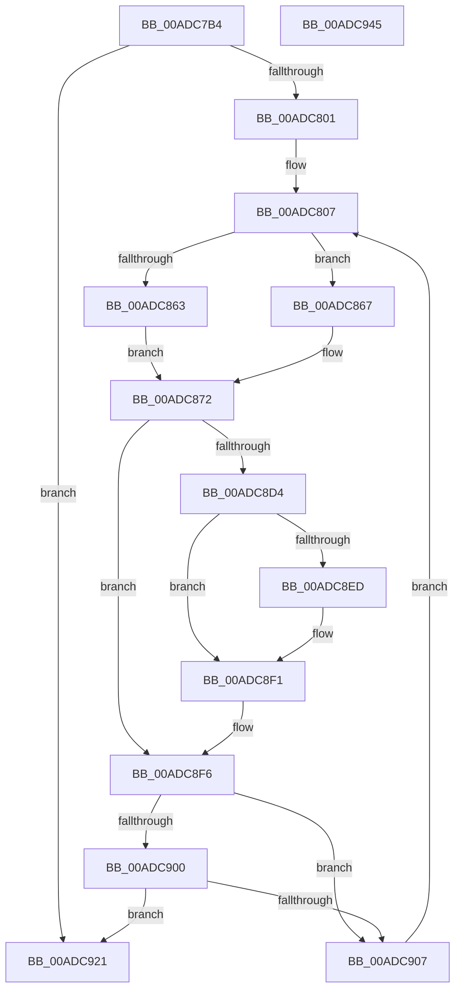

# IopFreeBandwidthContract

- RVA: `0x00ADC7B4`–`0x00ADC946` (길이 `402` bytes)
- VA: `0x0000000140ADC7B4`
- 실행 섹션: `PAGE`
- PDB 이름 있음: `예`; PDB Function 태그: `아니요`
- unwind 정보 RVA: `0x000BF6F8`
- 디코드: `104`개 명령, `402/402` bytes 표시
- 미해석 바이트: `0` (있으면 어셈블리에 `.byte`로 보존)

> 이 문서는 커널 이미지의 기계어와 PDB 기호를 분석해 생성했습니다. 4번과 5번은 함수 원형과 자료형을 바이너리 사용 방식에서 추정한 C 해석이며 원본 소스 복구 결과는 아닙니다.

## 1. Dependencies

- 직접 호출 지점: **10**; 고유 호출 대상: **10**
- 직접 호출자로 확인된 함수: **1**
- RIP 상대 이미지 참조: **1**

### Outgoing calls
- `0x00ADC812` → [KeInitializeEvent](../../text/40/KeInitializeEvent_function_0040DD10.md) (function, `0x0040DD10`)
- `0x00ADC81A` → [IopResetEvent](../../text/29/IopResetEvent_function_0029D5F0.md) (function, `0x0029D5F0`)
- `0x00ADC82E` → [IoGetRelatedDeviceObject](../../text/29/IoGetRelatedDeviceObject_function_0029B120.md) (function, `0x0029B120`)
- `0x00ADC83C` → [IopAllocateIrpMustSucceed](../../text/20/IopAllocateIrpMustSucceed_function_002076C0.md) (function, `0x002076C0`)
- `0x00ADC8B5` → [ObfReferenceObject](../../text/20/ObfReferenceObject_function_0020FA20.md) (function, `0x0020FA20`)
- `0x00ADC8BD` → [IopQueueThreadIrp](../../text/20/IopQueueThreadIrp_function_002075C0.md) (function, `0x002075C0`)
- `0x00ADC8C8` → [IofCallDriver](../../text/29/IofCallDriver_function_0029B4B0.md) (function, `0x0029B4B0`)
- `0x00ADC8F1` → [KeWaitForSingleObject](../../text/20/KeWaitForSingleObject_function_0020E6B0.md) (function, `0x0020E6B0`)
- `0x00ADC917` → [KeDelayExecutionThread](../../text/20/KeDelayExecutionThread_function_00209550.md) (function, `0x00209550`)
- `0x00ADC928` → [_security_check_cookie](../../text/6A/_security_check_cookie_function_006AC640.md) (function, `0x006AC640`)

### Direct callers
- [IopCloseFile](../86/IopCloseFile_function_008640C0.md) at `0x0086435E`

### Static image references
- `0x00ADC7CC` → RVA `0x00E0A740` (`.data`; read)

## 2. Other-region calls and transfers

- 다른 실행 섹션으로 향하는 call: **10**
  - `0x00ADC812` → [KeInitializeEvent](../../text/40/KeInitializeEvent_function_0040DD10.md) (`PAGE` → `.text`)
  - `0x00ADC81A` → [IopResetEvent](../../text/29/IopResetEvent_function_0029D5F0.md) (`PAGE` → `.text`)
  - `0x00ADC82E` → [IoGetRelatedDeviceObject](../../text/29/IoGetRelatedDeviceObject_function_0029B120.md) (`PAGE` → `.text`)
  - `0x00ADC83C` → [IopAllocateIrpMustSucceed](../../text/20/IopAllocateIrpMustSucceed_function_002076C0.md) (`PAGE` → `.text`)
  - `0x00ADC8B5` → [ObfReferenceObject](../../text/20/ObfReferenceObject_function_0020FA20.md) (`PAGE` → `.text`)
  - `0x00ADC8BD` → [IopQueueThreadIrp](../../text/20/IopQueueThreadIrp_function_002075C0.md) (`PAGE` → `.text`)
  - `0x00ADC8C8` → [IofCallDriver](../../text/29/IofCallDriver_function_0029B4B0.md) (`PAGE` → `.text`)
  - `0x00ADC8F1` → [KeWaitForSingleObject](../../text/20/KeWaitForSingleObject_function_0020E6B0.md) (`PAGE` → `.text`)
  - `0x00ADC917` → [KeDelayExecutionThread](../../text/20/KeDelayExecutionThread_function_00209550.md) (`PAGE` → `.text`)
  - `0x00ADC928` → [_security_check_cookie](../../text/6A/_security_check_cookie_function_006AC640.md) (`PAGE` → `.text`)
- 별도 외부 분기/꼬리 이동을 확인하지 못했습니다.

## 3. Assembly (complete function range)

```asm
00ADC7B4  48 89 5C 24 10                  mov qword ptr [rsp + 0x10], rbx
00ADC7B9  48 89 74 24 18                  mov qword ptr [rsp + 0x18], rsi
00ADC7BE  55                              push rbp
00ADC7BF  57                              push rdi
00ADC7C0  41 56                           push r14
00ADC7C2  48 8B EC                        mov rbp, rsp
00ADC7C5  48 81 EC 80 00 00 00            sub rsp, 0x80
00ADC7CC  48 8B 05 6D DF 32 00            mov rax, qword ptr [rip + 0x32df6d]
00ADC7D3  48 33 C4                        xor rax, rsp
00ADC7D6  48 89 45 F8                     mov qword ptr [rbp - 8], rax
00ADC7DA  33 C0                           xor eax, eax
00ADC7DC  0F 57 C0                        xorps xmm0, xmm0
00ADC7DF  0F 57 C9                        xorps xmm1, xmm1
00ADC7E2  48 8B F1                        mov rsi, rcx
00ADC7E5  0F 11 45 B8                     movups xmmword ptr [rbp - 0x48], xmm0
00ADC7E9  48 89 45 C8                     mov qword ptr [rbp - 0x38], rax
00ADC7ED  0F 11 45 D0                     movups xmmword ptr [rbp - 0x30], xmm0
00ADC7F1  89 45 F0                        mov dword ptr [rbp - 0x10], eax
00ADC7F4  0F 11 4D E0                     movups xmmword ptr [rbp - 0x20], xmm1
00ADC7F8  48 39 12                        cmp qword ptr [rdx], rdx
00ADC7FB  0F 84 20 01 00 00               je 0x140adc921
00ADC801  8B 79 50                        mov edi, dword ptr [rcx + 0x50]
00ADC804  83 E7 02                        and edi, 2
00ADC807  45 33 C0                        xor r8d, r8d
00ADC80A  48 8D 4D B8                     lea rcx, [rbp - 0x48]
00ADC80E  41 8D 50 01                     lea edx, [r8 + 1]
00ADC812  E8 F9 14 93 FF                  call 0x14040dd10
00ADC817  48 8B CE                        mov rcx, rsi
00ADC81A  E8 D1 0D 7C FF                  call 0x14029d5f0
00ADC81F  0F 57 C0                        xorps xmm0, xmm0
00ADC822  33 C0                           xor eax, eax
00ADC824  48 8B CE                        mov rcx, rsi
00ADC827  89 45 F0                        mov dword ptr [rbp - 0x10], eax
00ADC82A  0F 11 45 E0                     movups xmmword ptr [rbp - 0x20], xmm0
00ADC82E  E8 ED E8 7B FF                  call 0x14029b120
00ADC833  48 8B C8                        mov rcx, rax
00ADC836  4C 8B F0                        mov r14, rax
00ADC839  8A 50 4C                        mov dl, byte ptr [rax + 0x4c]
00ADC83C  E8 7F AE 72 FF                  call 0x1402076c0
00ADC841  48 8B D8                        mov rbx, rax
00ADC844  48 89 B0 C0 00 00 00            mov qword ptr [rax + 0xc0], rsi
00ADC84B  65 48 8B 0C 25 88 01 00 00      mov rcx, qword ptr gs:[0x188]
00ADC854  48 89 88 98 00 00 00            mov qword ptr [rax + 0x98], rcx
00ADC85B  C6 40 40 00                     mov byte ptr [rax + 0x40], 0
00ADC85F  85 FF                           test edi, edi
00ADC861  74 04                           je 0x140adc867
00ADC863  33 C9                           xor ecx, ecx
00ADC865  EB 0B                           jmp 0x140adc872
00ADC867  C7 40 10 04 00 00 00            mov dword ptr [rax + 0x10], 4
00ADC86E  48 8D 4D B8                     lea rcx, [rbp - 0x48]
00ADC872  48 89 48 50                     mov qword ptr [rax + 0x50], rcx
00ADC876  48 8D 45 D0                     lea rax, [rbp - 0x30]
00ADC87A  48 89 43 48                     mov qword ptr [rbx + 0x48], rax
00ADC87E  48 8B CE                        mov rcx, rsi
00ADC881  48 8B 83 B8 00 00 00            mov rax, qword ptr [rbx + 0xb8]
00ADC888  48 83 63 58 00                  and qword ptr [rbx + 0x58], 0
00ADC88D  C6 40 B8 06                     mov byte ptr [rax - 0x48], 6
00ADC891  48 89 70 E8                     mov qword ptr [rax - 0x18], rsi
00ADC895  C7 40 C0 14 00 00 00            mov dword ptr [rax - 0x40], 0x14
00ADC89C  C7 40 C8 2C 00 00 00            mov dword ptr [rax - 0x38], 0x2c
00ADC8A3  48 8D 45 E0                     lea rax, [rbp - 0x20]
00ADC8A7  48 83 63 70 00                  and qword ptr [rbx + 0x70], 0
00ADC8AC  48 83 63 08 00                  and qword ptr [rbx + 8], 0
00ADC8B1  48 89 43 18                     mov qword ptr [rbx + 0x18], rax
00ADC8B5  E8 66 31 73 FF                  call 0x14020fa20
00ADC8BA  48 8B CB                        mov rcx, rbx
00ADC8BD  E8 FE AC 72 FF                  call 0x1402075c0
00ADC8C2  48 8B D3                        mov rdx, rbx
00ADC8C5  49 8B CE                        mov rcx, r14
00ADC8C8  E8 E3 EB 7B FF                  call 0x14029b4b0
00ADC8CD  3D 03 01 00 00                  cmp eax, 0x103
00ADC8D2  75 22                           jne 0x140adc8f6
00ADC8D4  48 83 64 24 20 00               and qword ptr [rsp + 0x20], 0
00ADC8DA  48 8D 8E 98 00 00 00            lea rcx, [rsi + 0x98]
00ADC8E1  45 33 C9                        xor r9d, r9d
00ADC8E4  45 33 C0                        xor r8d, r8d
00ADC8E7  33 D2                           xor edx, edx
00ADC8E9  85 FF                           test edi, edi
00ADC8EB  75 04                           jne 0x140adc8f1
00ADC8ED  48 8D 4D B8                     lea rcx, [rbp - 0x48]
00ADC8F1  E8 BA 1D 73 FF                  call 0x14020e6b0
00ADC8F6  8B 45 D0                        mov eax, dword ptr [rbp - 0x30]
00ADC8F9  3D 9A 00 00 C0                  cmp eax, 0xc000009a
00ADC8FE  74 07                           je 0x140adc907
00ADC900  3D 17 00 00 C0                  cmp eax, 0xc0000017
00ADC905  75 1A                           jne 0x140adc921
00ADC907  4C 8D 45 B0                     lea r8, [rbp - 0x50]
00ADC90B  48 C7 45 B0 C0 BD F0 FF         mov qword ptr [rbp - 0x50], 0xfffffffffff0bdc0
00ADC913  33 D2                           xor edx, edx
00ADC915  33 C9                           xor ecx, ecx
00ADC917  E8 34 CC 72 FF                  call 0x140209550
00ADC91C  E9 E6 FE FF FF                  jmp 0x140adc807
00ADC921  48 8B 4D F8                     mov rcx, qword ptr [rbp - 8]
00ADC925  48 33 CC                        xor rcx, rsp
00ADC928  E8 13 FD BC FF                  call 0x1406ac640
00ADC92D  4C 8D 9C 24 80 00 00 00         lea r11, [rsp + 0x80]
00ADC935  49 8B 5B 28                     mov rbx, qword ptr [r11 + 0x28]
00ADC939  49 8B 73 30                     mov rsi, qword ptr [r11 + 0x30]
00ADC93D  49 8B E3                        mov rsp, r11
00ADC940  41 5E                           pop r14
00ADC942  5F                              pop rdi
00ADC943  5D                              pop rbp
00ADC944  C3                              ret
00ADC945  CC                              int3
```

## 4. C-style interpretation (structured pseudocode)

```c
__int64 __fastcall IopFreeBandwidthContract(__int64 a1, __int64 a2, int a3, int a4)
{
    __int64 result;
    __int64 v_rdi;
    __int64 v_rsp;
    unsigned __int64 v_stack_m18;
    unsigned __int64 v_stack_m20;
    unsigned int v_stack_m28;
    unsigned __int64 v_stack_m38;
    unsigned __int64 v_stack_m48;
    unsigned __int64 v_stack_m50;
    unsigned __int64 v_stack_m60;
    unsigned __int64 v_stack_m68;
    unsigned __int64 v_stack_m78;
    unsigned __int64 v_stack_p10;
    unsigned __int64 v_stack_p18;

    v_stack_p10 = v_rbx;
    v_stack_p18 = v_rsi;
    v_rsp = (v_rsp) - (128);
    result = (*(unsigned __int64 *)(v_rip + 3333997)) ^ (v_rsp);
    v_stack_m20 = result;
    result = 0;
    v_stack_m60 = v_xmm0;
    v_stack_m50 = 0;
    v_stack_m48 = v_xmm0;
    v_stack_m28 = 0;
    v_stack_m38 = v_xmm1;
    if ((*(unsigned __int64 *)(a2)) == a2) goto loc_00ADC921;
    v_rdi = (unsigned int)(((unsigned int)(*(unsigned int *)(a1 + 80))) & (2));
loc_00ADC807:
    a3 = 0;
    result = KeInitializeEvent(v_stack_m60, a3 + 1, a3, a4);
    result = IopResetEvent(a1, a3 + 1, a3, a4);
    result = 0;
    v_stack_m28 = 0;
    v_stack_m38 = v_xmm0;
    result = IoGetRelatedDeviceObject(a1, a3 + 1, a3, a4);
    result = IopAllocateIrpMustSucceed(result, *(unsigned __int8 *)(result + 76), a3, a4);
    *(unsigned __int64 *)(result + 192) = a1;
    *(unsigned __int64 *)(result + 152) = *(unsigned __int64 *)(gs_base + (0 + 392));
    *(unsigned __int8 *)(result + 64) = 0;
    if ((unsigned int)(v_rdi) == 0) goto loc_00ADC867;
    a1 = 0;
    goto loc_00ADC872;
loc_00ADC867:
    *(unsigned int *)(result + 16) = 4;
loc_00ADC872:
    *(unsigned __int64 *)(result + 80) = v_stack_m60;
    *(unsigned __int64 *)(result + 72) = v_stack_m48;
    *(unsigned __int8 *)(*(unsigned __int64 *)(result + 184) - 72) = 6;
    *(unsigned __int64 *)(*(unsigned __int64 *)(result + 184) - 24) = 0;
    *(unsigned int *)(*(unsigned __int64 *)(result + 184) - 64) = 20;
    *(unsigned int *)(*(unsigned __int64 *)(result + 184) - 56) = 44;
    *(unsigned __int64 *)(result + 24) = v_stack_m38;
    result = ObfReferenceObject(0, *(unsigned __int8 *)(result + 76), a3, a4);
    result = IopQueueThreadIrp(result, *(unsigned __int8 *)(result + 76), a3, a4);
    result = IofCallDriver(result, result, a3, a4);
    if (((unsigned int)(result)) != 259) goto loc_00ADC8F6;
    a4 = 0;
    a3 = 0;
    a2 = 0;
    if ((unsigned int)(v_rdi) == 0) {
        a1 = v_stack_m60;
    }
    result = KeWaitForSingleObject(a1, a2, a3, a4);
loc_00ADC8F6:
    if (((unsigned int)((unsigned int)(v_stack_m48))) == 0xC000009AULL) goto loc_00ADC907;
    if (((unsigned int)((unsigned int)(v_stack_m48))) != 0xC0000017ULL) goto loc_00ADC921;
loc_00ADC907:
    v_stack_m68 = 0xFFFFFFFFFFF0BDC0ULL;
    a2 = 0;
    a1 = 0;
    result = KeDelayExecutionThread(a1, a2, v_stack_m68, a4);
    goto loc_00ADC807;
loc_00ADC921:
    a1 = (v_stack_m20) ^ (v_rsp);
    result = _security_check_cookie(a1, a2, v_stack_m68, a4);
    return result;
}
```

## 5. (Beta) C Style

```c
int64_t IopFreeBandwidthContract(void *Arg1, void *Arg2, int32_t Arg3, int32_t Arg4)
{
    uint8_t *arg1 = (uint8_t *)Arg1;
    uint8_t *arg2 = (uint8_t *)Arg2;

    int64_t result;
    int64_t local_rdi;
    int64_t local_rsp;
    uint64_t v_stack_m18;
    uint64_t v_stack_m20;
    uint32_t v_stack_m28;
    uint64_t v_stack_m38;
    uint64_t v_stack_m48;
    uint64_t v_stack_m50;
    uint64_t v_stack_m60;
    uint64_t v_stack_m68;
    uint64_t v_stack_m78;
    uint64_t v_stack_p10;
    uint64_t v_stack_p18;

    v_stack_p10 = local_rbx;
    v_stack_p18 = local_rsi;
    local_rsp = (local_rsp) - (128);
    result = (*(uint64_t *)(v_rip + 0x32DF6D)) ^ (local_rsp);
    v_stack_m20 = result;
    result = 0;
    v_stack_m60 = v_xmm0;
    v_stack_m50 = 0;
    v_stack_m48 = v_xmm0;
    v_stack_m28 = 0;
    v_stack_m38 = v_xmm1;
    if ((*(uint64_t *)(arg2)) == Arg2) goto loc_00ADC921;
    local_rdi = (uint32_t)(((uint32_t)(*(uint32_t *)(arg1 + 0x50))) & (2));
loc_00ADC807:
    Arg3 = 0;
    result = KeInitializeEvent(v_stack_m60, Arg3 + 1, Arg3, Arg4);
    result = IopResetEvent(Arg1, Arg3 + 1, Arg3, Arg4);
    result = 0;
    v_stack_m28 = 0;
    v_stack_m38 = v_xmm0;
    result = IoGetRelatedDeviceObject(Arg1, Arg3 + 1, Arg3, Arg4);
    result = IopAllocateIrpMustSucceed(result, *(uint8_t *)(result + 0x4C), Arg3, Arg4);
    *(void **)(result + 0xC0) = Arg1;
    *(uint64_t *)(result + 0x98) = *(uint64_t *)(gs_base + (0 + 0x188));
    *(uint8_t *)(result + 0x40) = 0;
    if ((uint32_t)(local_rdi) == 0) goto loc_00ADC867;
    Arg1 = 0;
    goto loc_00ADC872;
loc_00ADC867:
    *(uint32_t *)(result + 0x10) = 4;
loc_00ADC872:
    *(uint64_t *)(result + 0x50) = v_stack_m60;
    *(uint64_t *)(result + 0x48) = v_stack_m48;
    *(uint8_t *)(*(uint64_t *)(result + 0xB8) - 0x48) = 6;
    *(uint64_t *)(*(uint64_t *)(result + 0xB8) - 0x18) = 0;
    *(uint32_t *)(*(uint64_t *)(result + 0xB8) - 0x40) = 20;
    *(uint32_t *)(*(uint64_t *)(result + 0xB8) - 0x38) = 44;
    *(uint64_t *)(result + 0x18) = v_stack_m38;
    result = ObfReferenceObject(0, *(uint8_t *)(result + 0x4C), Arg3, Arg4);
    result = IopQueueThreadIrp(result, *(uint8_t *)(result + 0x4C), Arg3, Arg4);
    result = IofCallDriver(result, result, Arg3, Arg4);
    if (((uint32_t)(result)) != 259) goto loc_00ADC8F6;
    Arg4 = 0;
    Arg3 = 0;
    Arg2 = 0;
    if ((uint32_t)(local_rdi) == 0) {
        Arg1 = v_stack_m60;
    }
    result = KeWaitForSingleObject(Arg1, Arg2, Arg3, Arg4);
loc_00ADC8F6:
    if (((uint32_t)((uint32_t)(v_stack_m48))) == 0xC000009AULL) goto loc_00ADC907;
    if (((uint32_t)((uint32_t)(v_stack_m48))) != 0xC0000017ULL) goto loc_00ADC921;
loc_00ADC907:
    v_stack_m68 = 0xFFFFFFFFFFF0BDC0ULL;
    Arg2 = 0;
    Arg1 = 0;
    result = KeDelayExecutionThread(Arg1, Arg2, v_stack_m68, Arg4);
    goto loc_00ADC807;
loc_00ADC921:
    Arg1 = (v_stack_m20) ^ (local_rsp);
    result = _security_check_cookie(Arg1, Arg2, v_stack_m68, Arg4);
    return result;
}
```

### 관측된 메모리 오프셋

구조체 형식이 확인되지 않은 접근은 인자 기준의 오프셋으로만 기록했습니다.

| 기준 인자 | 오프셋 표현 | 폭 (bit) | 접근 |
|---|---:|---:|---|
| `Arg1` | `+ 0x50` | `32` | `R` |
| `Arg1` | `+ 0x98` | `64` | `R` |
| `Arg2` | `+ 0x0` | `64` | `R` |

## 6. Execution-region graph

[열기: 2D/3D 그래프와 함수 탐색 컨트롤 패널](../../../control-panel.html?section=page&rva=0x00ADC7B4&view=graph)

- 2D 그래프는 위에서 아래로 흐르고, 3D 그래프는 빈 공간을 드래그해 회전합니다. Shift+드래그는 이동, 휠은 확대·축소, 함수 노드 선택은 대상 보고서 이동입니다.

### Static fallback


