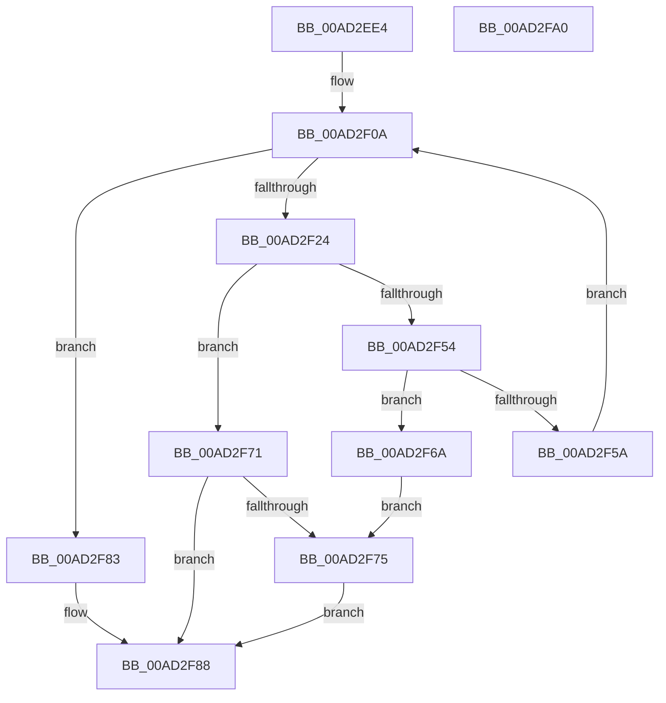

# IopGetPersistedStateLocation

- RVA: `0x00AD2EE4`–`0x00AD2FA1` (길이 `189` bytes)
- VA: `0x0000000140AD2EE4`
- 실행 섹션: `PAGE`
- PDB 이름 있음: `예`; PDB Function 태그: `아니요`
- unwind 정보 RVA: `0x000BEB4C`
- 디코드: `58`개 명령, `189/189` bytes 표시
- 미해석 바이트: `0` (있으면 어셈블리에 `.byte`로 보존)

> 이 문서는 커널 이미지의 기계어와 PDB 기호를 분석해 생성했습니다. 4번과 5번은 함수 원형과 자료형을 바이너리 사용 방식에서 추정한 C 해석이며 원본 소스 복구 결과는 아닙니다.

## 1. Dependencies

- 직접 호출 지점: **4**; 고유 호출 대상: **3**
- 직접 호출자로 확인된 함수: **1**
- RIP 상대 이미지 참조: **1**

### Outgoing calls
- `0x00AD2F17` → [ExAllocatePool2](../../poolcode/B8/ExAllocatePool2_function_00B820F0.md) (function, `0x00B820F0`)
- `0x00AD2F46` → [RtlGetPersistedStateLocation](../8C/RtlGetPersistedStateLocation_function_008C8DE0.md) (function, `0x008C8DE0`)
- `0x00AD2F63` → [ExFreePoolWithTag](../../poolcode/B8/ExFreePoolWithTag_function_00B82870.md) (function, `0x00B82870`)
- `0x00AD2F7A` → [ExFreePoolWithTag](../../poolcode/B8/ExFreePoolWithTag_function_00B82870.md) (function, `0x00B82870`)

### Direct callers
- [sub_00B2D22A](../B2/Unknown_function_00B2D22A.md) at `0x00B2D2CC`

### Static image references
- `0x00AD2F31` → RVA `0x00AFCCE0` (` ?? ::NNGAKEGL::`string'`; read)

## 2. Other-region calls and transfers

- 다른 실행 섹션으로 향하는 call: **3**
  - `0x00AD2F17` → [ExAllocatePool2](../../poolcode/B8/ExAllocatePool2_function_00B820F0.md) (`PAGE` → `POOLCODE`)
  - `0x00AD2F63` → [ExFreePoolWithTag](../../poolcode/B8/ExFreePoolWithTag_function_00B82870.md) (`PAGE` → `POOLCODE`)
  - `0x00AD2F7A` → [ExFreePoolWithTag](../../poolcode/B8/ExFreePoolWithTag_function_00B82870.md) (`PAGE` → `POOLCODE`)
- 별도 외부 분기/꼬리 이동을 확인하지 못했습니다.

## 3. Assembly (complete function range)

```asm
00AD2EE4  48 8B C4                        mov rax, rsp
00AD2EE7  48 89 58 08                     mov qword ptr [rax + 8], rbx
00AD2EEB  48 89 68 10                     mov qword ptr [rax + 0x10], rbp
00AD2EEF  44 89 40 18                     mov dword ptr [rax + 0x18], r8d
00AD2EF3  56                              push rsi
00AD2EF4  57                              push rdi
00AD2EF5  41 56                           push r14
00AD2EF7  48 83 EC 40                     sub rsp, 0x40
00AD2EFB  83 60 18 00                     and dword ptr [rax + 0x18], 0
00AD2EFF  4D 8B F1                        mov r14, r9
00AD2F02  48 8B EA                        mov rbp, rdx
00AD2F05  BE 00 01 00 00                  mov esi, 0x100
00AD2F0A  8B D6                           mov edx, esi
00AD2F0C  B9 00 01 00 00                  mov ecx, 0x100
00AD2F11  41 B8 49 6F 46 63               mov r8d, 0x63466f49
00AD2F17  E8 D4 F1 0A 00                  call 0x140b820f0
00AD2F1C  48 8B F8                        mov rdi, rax
00AD2F1F  48 85 C0                        test rax, rax
00AD2F22  74 5F                           je 0x140ad2f83
00AD2F24  48 8D 44 24 70                  lea rax, [rsp + 0x70]
00AD2F29  45 33 C9                        xor r9d, r9d
00AD2F2C  48 89 44 24 30                  mov qword ptr [rsp + 0x30], rax
00AD2F31  48 8D 0D A8 9D 02 00            lea rcx, [rip + 0x29da8]
00AD2F38  89 74 24 28                     mov dword ptr [rsp + 0x28], esi
00AD2F3C  4C 8B C5                        mov r8, rbp
00AD2F3F  33 D2                           xor edx, edx
00AD2F41  48 89 7C 24 20                  mov qword ptr [rsp + 0x20], rdi
00AD2F46  E8 95 5E DF FF                  call 0x1408c8de0
00AD2F4B  8B D8                           mov ebx, eax
00AD2F4D  3D 05 00 00 80                  cmp eax, 0x80000005
00AD2F52  75 1D                           jne 0x140ad2f71
00AD2F54  39 74 24 70                     cmp dword ptr [rsp + 0x70], esi
00AD2F58  76 10                           jbe 0x140ad2f6a
00AD2F5A  8B 74 24 70                     mov esi, dword ptr [rsp + 0x70]
00AD2F5E  33 D2                           xor edx, edx
00AD2F60  48 8B CF                        mov rcx, rdi
00AD2F63  E8 08 F9 0A 00                  call 0x140b82870
00AD2F68  EB A0                           jmp 0x140ad2f0a
00AD2F6A  BB E5 00 00 C0                  mov ebx, 0xc00000e5
00AD2F6F  EB 04                           jmp 0x140ad2f75
00AD2F71  85 C0                           test eax, eax
00AD2F73  79 13                           jns 0x140ad2f88
00AD2F75  33 D2                           xor edx, edx
00AD2F77  48 8B CF                        mov rcx, rdi
00AD2F7A  E8 F1 F8 0A 00                  call 0x140b82870
00AD2F7F  33 FF                           xor edi, edi
00AD2F81  EB 05                           jmp 0x140ad2f88
00AD2F83  BB 9A 00 00 C0                  mov ebx, 0xc000009a
00AD2F88  48 8B 6C 24 68                  mov rbp, qword ptr [rsp + 0x68]
00AD2F8D  8B C3                           mov eax, ebx
00AD2F8F  48 8B 5C 24 60                  mov rbx, qword ptr [rsp + 0x60]
00AD2F94  49 89 3E                        mov qword ptr [r14], rdi
00AD2F97  48 83 C4 40                     add rsp, 0x40
00AD2F9B  41 5E                           pop r14
00AD2F9D  5F                              pop rdi
00AD2F9E  5E                              pop rsi
00AD2F9F  C3                              ret
00AD2FA0  CC                              int3
```

## 4. C-style interpretation (structured pseudocode)

```c
__int64 __fastcall IopGetPersistedStateLocation(__int64 a1, __int64 a2, int a3, __int64 a4)
{
    __int64 result;
    __int64 v_rdi;
    __int64 v_rsp;
    unsigned __int64 v_stack_m28;
    unsigned int v_stack_m30;
    unsigned __int64 v_stack_m38;
    unsigned __int64 v_stack_p10;
    unsigned __int64 v_stack_p18;
    unsigned __int64 v_stack_p8;

    *(unsigned __int64 *)(v_rsp + 8) = v_rbx;
    *(unsigned __int64 *)(v_rsp + 16) = v_rbp;
    *(unsigned int *)(v_rsp + 24) = a3;
    v_rsp = (v_rsp) - (64);
loc_00AD2F0A:
    result = ExAllocatePool2(256, 256, (unsigned int)(0x63466F49ULL), a4);
    if (result == 0) goto loc_00AD2F83;
    a4 = 0;
    v_stack_m28 = v_stack_p18;
    v_stack_m30 = 256;
    a2 = 0;
    v_stack_m38 = result;
    result = RtlGetPersistedStateLocation(v_rip + 171432, a2, a2, a4);
    if (((unsigned int)(result)) != 0x80000005ULL) goto loc_00AD2F71;
    if (v_stack_p18 <= 256) goto loc_00AD2F6A;
    a2 = 0;
    result = ExFreePoolWithTag(result, a2, a2, a4);
    goto loc_00AD2F0A;
loc_00AD2F6A:
    goto loc_00AD2F75;
loc_00AD2F71:
    if (!sign_flag) goto loc_00AD2F88;
loc_00AD2F75:
    a2 = 0;
    result = ExFreePoolWithTag(result, a2, a2, a4);
    v_rdi = 0;
    goto loc_00AD2F88;
loc_00AD2F83:
loc_00AD2F88:
    *(unsigned __int64 *)(a4) = 0;
    v_rsp = (v_rsp) + (64);
    return (unsigned int)((unsigned int)((unsigned int)(0xC000009AULL)));
}
```

## 5. (Beta) C Style

```c
int64_t IopGetPersistedStateLocation(int64_t Arg1, int64_t Arg2, int32_t Arg3, void *Arg4)
{
    uint8_t *arg4 = (uint8_t *)Arg4;

    int64_t result;
    int64_t local_rdi;
    int64_t local_rsp;
    uint64_t v_stack_m28;
    uint32_t v_stack_m30;
    uint64_t v_stack_m38;
    uint64_t v_stack_p10;
    uint64_t v_stack_p18;
    uint64_t v_stack_p8;

    *(uint64_t *)(local_rsp + 0x8) = local_rbx;
    *(uint64_t *)(local_rsp + 0x10) = local_rbp;
    *(uint32_t *)(local_rsp + 0x18) = Arg3;
    local_rsp = (local_rsp) - (64);
loc_00AD2F0A:
    result = ExAllocatePool2(256, 256, (uint32_t)(0x63466F49ULL), Arg4);
    if (result == 0) goto loc_00AD2F83;
    Arg4 = 0;
    v_stack_m28 = v_stack_p18;
    v_stack_m30 = 256;
    Arg2 = 0;
    v_stack_m38 = result;
    result = RtlGetPersistedStateLocation(v_rip + 171432, Arg2, Arg2, Arg4);
    if (((uint32_t)(result)) != 0x80000005ULL) goto loc_00AD2F71;
    if (v_stack_p18 <= 256) goto loc_00AD2F6A;
    Arg2 = 0;
    result = ExFreePoolWithTag(result, Arg2, Arg2, Arg4);
    goto loc_00AD2F0A;
loc_00AD2F6A:
    goto loc_00AD2F75;
loc_00AD2F71:
    if (!sign_flag) goto loc_00AD2F88;
loc_00AD2F75:
    Arg2 = 0;
    result = ExFreePoolWithTag(result, Arg2, Arg2, Arg4);
    local_rdi = 0;
    goto loc_00AD2F88;
loc_00AD2F83:
loc_00AD2F88:
    *(uint64_t *)(arg4) = 0;
    local_rsp = (local_rsp) + (64);
    return (uint32_t)((uint32_t)((uint32_t)(0xC000009AULL)));
}
```

### 관측된 메모리 오프셋

구조체 형식이 확인되지 않은 접근은 인자 기준의 오프셋으로만 기록했습니다.

| 기준 인자 | 오프셋 표현 | 폭 (bit) | 접근 |
|---|---:|---:|---|
| `Arg4` | `+ 0x0` | `64` | `W` |

## 6. Execution-region graph

[열기: 2D/3D 그래프와 함수 탐색 컨트롤 패널](../../../control-panel.html?section=page&rva=0x00AD2EE4&view=graph)

- 2D 그래프는 위에서 아래로 흐르고, 3D 그래프는 빈 공간을 드래그해 회전합니다. Shift+드래그는 이동, 휠은 확대·축소, 함수 노드 선택은 대상 보고서 이동입니다.

### Static fallback


