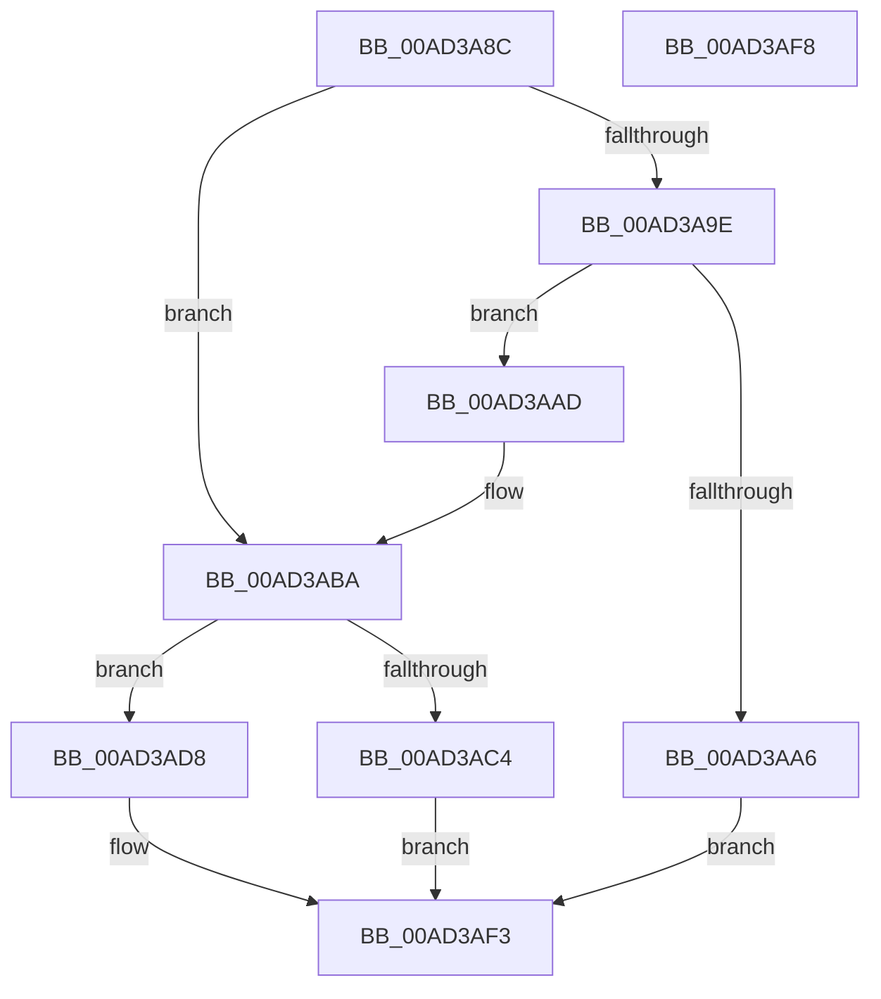

# IopIoRingReferenceFileObject

- RVA: `0x00AD3A8C`–`0x00AD3AF9` (길이 `109` bytes)
- VA: `0x0000000140AD3A8C`
- 실행 섹션: `PAGE`
- PDB 이름 있음: `예`; PDB Function 태그: `아니요`
- unwind 정보 RVA: `0x0005D2F4`
- 디코드: `30`개 명령, `109/109` bytes 표시
- 미해석 바이트: `0` (있으면 어셈블리에 `.byte`로 보존)

> 이 문서는 커널 이미지의 기계어와 PDB 기호를 분석해 생성했습니다. 4번과 5번은 함수 원형과 자료형을 바이너리 사용 방식에서 추정한 C 해석이며 원본 소스 복구 결과는 아닙니다.

## 1. Dependencies

- 직접 호출 지점: **2**; 고유 호출 대상: **2**
- 직접 호출자로 확인된 함수: **6**
- RIP 상대 이미지 참조: **0**

### Outgoing calls
- `0x00AD3AD1` → [ObReferenceFileObjectForWrite](../94/ObReferenceFileObjectForWrite_function_0094BDC0.md) (function, `0x0094BDC0`)
- `0x00AD3AEE` → [IopReferenceFileObject](../../text/29/IopReferenceFileObject_function_0029D530.md) (function, `0x0029D530`)

### Direct callers
- [IopIoRingDispatchCancel](../71/IopIoRingDispatchCancel_function_0071F96C.md) at `0x0071F9D2`
- [IopIoRingDispatchFlush](../71/IopIoRingDispatchFlush_function_0071FA2C.md) at `0x0071FA95`
- [IopIoRingDispatchReadScatter](../71/IopIoRingDispatchReadScatter_function_0071FB0C.md) at `0x0071FB7C`
- [IopIoRingDispatchWrite](../72/IopIoRingDispatchWrite_function_00720248.md) at `0x0072030B`
- [IopIoRingDispatchWriteGather](../72/IopIoRingDispatchWriteGather_function_007203F0.md) at `0x00720470`
- [sub_00B4A690](../B4/Unknown_function_00B4A690.md) at `0x00B4A702`

### Static image references
- 디코드된 RIP-relative 메모리 참조가 없습니다.

## 2. Other-region calls and transfers

- 다른 실행 섹션으로 향하는 call: **1**
  - `0x00AD3AEE` → [IopReferenceFileObject](../../text/29/IopReferenceFileObject_function_0029D530.md) (`PAGE` → `.text`)
- 별도 외부 분기/꼬리 이동을 확인하지 못했습니다.

## 3. Assembly (complete function range)

```asm
00AD3A8C  48 83 EC 38                     sub rsp, 0x38
00AD3A90  45 8A D9                        mov r11b, r9b
00AD3A93  4C 8B D2                        mov r10, rdx
00AD3A96  48 8B C1                        mov rax, rcx
00AD3A99  45 84 C0                        test r8b, r8b
00AD3A9C  74 1C                           je 0x140ad3aba
00AD3A9E  3B 91 C0 00 00 00               cmp edx, dword ptr [rcx + 0xc0]
00AD3AA4  72 07                           jb 0x140ad3aad
00AD3AA6  B8 D1 04 00 C0                  mov eax, 0xc00004d1
00AD3AAB  EB 46                           jmp 0x140ad3af3
00AD3AAD  48 8B 80 C8 00 00 00            mov rax, qword ptr [rax + 0xc8]
00AD3AB4  8B CA                           mov ecx, edx
00AD3AB6  4C 8B 14 C8                     mov r10, qword ptr [rax + rcx*8]
00AD3ABA  80 7C 24 60 00                  cmp byte ptr [rsp + 0x60], 0
00AD3ABF  49 8B CA                        mov rcx, r10
00AD3AC2  74 14                           je 0x140ad3ad8
00AD3AC4  4C 8B 4C 24 78                  mov r9, qword ptr [rsp + 0x78]
00AD3AC9  41 8A D3                        mov dl, r11b
00AD3ACC  4C 8B 44 24 70                  mov r8, qword ptr [rsp + 0x70]
00AD3AD1  E8 EA 82 E7 FF                  call 0x14094bdc0
00AD3AD6  EB 1B                           jmp 0x140ad3af3
00AD3AD8  48 8B 44 24 78                  mov rax, qword ptr [rsp + 0x78]
00AD3ADD  45 8A C3                        mov r8b, r11b
00AD3AE0  4C 8B 4C 24 70                  mov r9, qword ptr [rsp + 0x70]
00AD3AE5  8B 54 24 68                     mov edx, dword ptr [rsp + 0x68]
00AD3AE9  48 89 44 24 20                  mov qword ptr [rsp + 0x20], rax
00AD3AEE  E8 3D 9A 7C FF                  call 0x14029d530
00AD3AF3  48 83 C4 38                     add rsp, 0x38
00AD3AF7  C3                              ret
00AD3AF8  CC                              int3
```

## 4. C-style interpretation (structured pseudocode)

```c
__int64 __fastcall IopIoRingReferenceFileObject(__int64 a1, __int64 a2, unsigned __int8 a3, unsigned __int8 a4, unsigned __int8 a5, unsigned int a6, __int64 a7, __int64 a8)
{
    __int64 result;
    __int64 v_rsp;
    unsigned __int64 v_stack_m18;

    v_rsp = (v_rsp) - (56);
    if (a3 == 0) goto loc_00AD3ABA;
    if (((unsigned int)(a2)) < (*(unsigned int *)(a1 + 192))) goto loc_00AD3AAD;
    goto loc_00AD3AF3;
loc_00AD3AAD:
loc_00AD3ABA:
    if (a5 == 0) goto loc_00AD3AD8;
    result = ObReferenceFileObjectForWrite(*(unsigned __int64 *)(*(unsigned __int64 *)((unsigned int)(0xC00004D1ULL) + 200) + (unsigned int)((unsigned int)(a2)) * 8), a4, a7, a8);
    goto loc_00AD3AF3;
loc_00AD3AD8:
    v_stack_m18 = a8;
    result = IopReferenceFileObject(*(unsigned __int64 *)(*(unsigned __int64 *)((unsigned int)(0xC00004D1ULL) + 200) + (unsigned int)((unsigned int)(a2)) * 8), (unsigned int)(a6), a4, a7);
loc_00AD3AF3:
    v_rsp = (v_rsp) + (56);
    return result;
}
```

## 5. (Beta) C Style

```c
int64_t IopIoRingReferenceFileObject(void *Arg1, int64_t Arg2, uint8_t Arg3, uint8_t Arg4, uint8_t Arg5, uint32_t Arg6, int64_t Arg7, int64_t Arg8)
{
    uint8_t *arg1 = (uint8_t *)Arg1;

    int64_t result;
    int64_t local_rsp;
    uint64_t v_stack_m18;

    local_rsp = (local_rsp) - (56);
    if (Arg3 == 0) goto loc_00AD3ABA;
    if (((uint32_t)(Arg2)) < (*(uint32_t *)(arg1 + 0xC0))) goto loc_00AD3AAD;
    goto loc_00AD3AF3;
loc_00AD3AAD:
loc_00AD3ABA:
    if (Arg5 == 0) goto loc_00AD3AD8;
    result = ObReferenceFileObjectForWrite(*(uint64_t *)(*(uint64_t *)((uint32_t)(0xC00004D1ULL) + 0xC8) + (uint32_t)((uint32_t)(Arg2)) * 8), Arg4, Arg7, Arg8);
    goto loc_00AD3AF3;
loc_00AD3AD8:
    v_stack_m18 = Arg8;
    result = IopReferenceFileObject(*(uint64_t *)(*(uint64_t *)((uint32_t)(0xC00004D1ULL) + 0xC8) + (uint32_t)((uint32_t)(Arg2)) * 8), (uint32_t)(Arg6), Arg4, Arg7);
loc_00AD3AF3:
    local_rsp = (local_rsp) + (56);
    return result;
}
```

### 관측된 메모리 오프셋

구조체 형식이 확인되지 않은 접근은 인자 기준의 오프셋으로만 기록했습니다.

| 기준 인자 | 오프셋 표현 | 폭 (bit) | 접근 |
|---|---:|---:|---|
| `Arg1` | `+ 0xC0` | `32` | `R` |
| `Arg1` | `+ 0xC8` | `64` | `R` |

## 6. Execution-region graph

[열기: 2D/3D 그래프와 함수 탐색 컨트롤 패널](../../../control-panel.html?section=page&rva=0x00AD3A8C&view=graph)

- 2D 그래프는 위에서 아래로 흐르고, 3D 그래프는 빈 공간을 드래그해 회전합니다. Shift+드래그는 이동, 휠은 확대·축소, 함수 노드 선택은 대상 보고서 이동입니다.

### Static fallback


