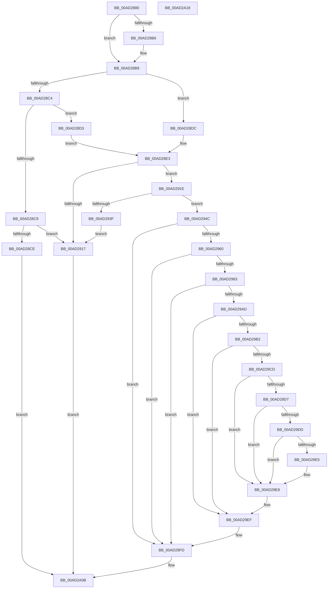

# IopSafebootDriverLoad

- RVA: `0x00AD2880`–`0x00AD2A19` (길이 `409` bytes)
- VA: `0x0000000140AD2880`
- 실행 섹션: `PAGE`
- PDB 이름 있음: `예`; PDB Function 태그: `아니요`
- unwind 정보 RVA: `0x000BEAD8`
- 디코드: `118`개 명령, `409/409` bytes 표시
- 미해석 바이트: `0` (있으면 어셈블리에 `.byte`로 보존)

> 이 문서는 커널 이미지의 기계어와 PDB 기호를 분석해 생성했습니다. 4번과 5번은 함수 원형과 자료형을 바이너리 사용 방식에서 추정한 C 해석이며 원본 소스 복구 결과는 아닙니다.

## 1. Dependencies

- 직접 호출 지점: **13**; 고유 호출 대상: **9**
- 직접 호출자로 확인된 함수: **2**
- RIP 상대 이미지 참조: **6**

### Outgoing calls
- `0x00AD28E7` → [RtlInitUnicodeString](../../text/42/RtlInitUnicodeString_function_0042A780.md) (function, `0x0042A780`)
- `0x00AD2909` → [ExAllocatePool2](../../poolcode/B8/ExAllocatePool2_function_00B820F0.md) (function, `0x00B820F0`)
- `0x00AD2926` → [RtlCopyUnicodeString](../../text/3F/RtlCopyUnicodeString_function_003FEF30.md) (function, `0x003FEF30`)
- `0x00AD2936` → [RtlAppendUnicodeToString](../../text/40/RtlAppendUnicodeToString_function_0040F990.md) (function, `0x0040F990`)
- `0x00AD2945` → [ExFreePoolWithTag](../../poolcode/B8/ExFreePoolWithTag_function_00B82870.md) (function, `0x00B82870`)
- `0x00AD2953` → [RtlAppendUnicodeStringToString](../../text/40/RtlAppendUnicodeStringToString_function_0040FA50.md) (function, `0x0040FA50`)
- `0x00AD297A` → [IopOpenRegistryKey](../A8/IopOpenRegistryKey_function_00A8F200.md) (function, `0x00A8F200`)
- `0x00AD2997` → [IopOpenRegistryKey](../A8/IopOpenRegistryKey_function_00A8F200.md) (function, `0x00A8F200`)
- `0x00AD29A4` → [ObCloseHandle](../8A/ObCloseHandle_function_008A1870.md) (function, `0x008A1870`)
- `0x00AD29C4` → [IopGetRegistryValue](../99/IopGetRegistryValue_function_009990EC.md) (function, `0x009990EC`)
- `0x00AD29EA` → [ExFreePoolWithTag](../../poolcode/B8/ExFreePoolWithTag_function_00B82870.md) (function, `0x00B82870`)
- `0x00AD29F5` → [ObCloseHandle](../8A/ObCloseHandle_function_008A1870.md) (function, `0x008A1870`)
- `0x00AD2A03` → [ExFreePoolWithTag](../../poolcode/B8/ExFreePoolWithTag_function_00B82870.md) (function, `0x00B82870`)

### Direct callers
- [sub_00B2CB5C](../B2/Unknown_function_00B2CB5C.md) at `0x00B2CBD2`
- [sub_00B2CB5C](../B2/Unknown_function_00B2CB5C.md) at `0x00B2CBE5`
- [sub_00B3807C](../B3/Unknown_function_00B3807C.md) at `0x00B38136`

### Static image references
- `0x00AD28B9` → RVA `0x00FC41C4` (`.data`; read)
- `0x00AD28D3` → RVA `0x00AFCA60` (` ?? ::NNGAKEGL::`string'`; read)
- `0x00AD28DC` → RVA `0x00AFC9A0` (` ?? ::NNGAKEGL::`string'`; read)
- `0x00AD292B` → RVA `0x00AFC990` (` ?? ::NNGAKEGL::`string'`; read)
- `0x00AD296D` → RVA `0x00FDA0B8` (`PAGEDATA`; read)
- `0x00AD29BD` → RVA `0x00AFCA40` (` ?? ::NNGAKEGL::`string'`; read)

## 2. Other-region calls and transfers

- 다른 실행 섹션으로 향하는 call: **8**
  - `0x00AD28E7` → [RtlInitUnicodeString](../../text/42/RtlInitUnicodeString_function_0042A780.md) (`PAGE` → `.text`)
  - `0x00AD2909` → [ExAllocatePool2](../../poolcode/B8/ExAllocatePool2_function_00B820F0.md) (`PAGE` → `POOLCODE`)
  - `0x00AD2926` → [RtlCopyUnicodeString](../../text/3F/RtlCopyUnicodeString_function_003FEF30.md) (`PAGE` → `.text`)
  - `0x00AD2936` → [RtlAppendUnicodeToString](../../text/40/RtlAppendUnicodeToString_function_0040F990.md) (`PAGE` → `.text`)
  - `0x00AD2945` → [ExFreePoolWithTag](../../poolcode/B8/ExFreePoolWithTag_function_00B82870.md) (`PAGE` → `POOLCODE`)
  - `0x00AD2953` → [RtlAppendUnicodeStringToString](../../text/40/RtlAppendUnicodeStringToString_function_0040FA50.md) (`PAGE` → `.text`)
  - `0x00AD29EA` → [ExFreePoolWithTag](../../poolcode/B8/ExFreePoolWithTag_function_00B82870.md) (`PAGE` → `POOLCODE`)
  - `0x00AD2A03` → [ExFreePoolWithTag](../../poolcode/B8/ExFreePoolWithTag_function_00B82870.md) (`PAGE` → `POOLCODE`)
- 별도 외부 분기/꼬리 이동을 확인하지 못했습니다.

## 3. Assembly (complete function range)

```asm
00AD2880  48 89 5C 24 08                  mov qword ptr [rsp + 8], rbx
00AD2885  55                              push rbp
00AD2886  56                              push rsi
00AD2887  57                              push rdi
00AD2888  48 8B EC                        mov rbp, rsp
00AD288B  48 83 EC 50                     sub rsp, 0x50
00AD288F  33 FF                           xor edi, edi
00AD2891  0F 57 C0                        xorps xmm0, xmm0
00AD2894  48 89 7D 28                     mov qword ptr [rbp + 0x28], rdi
00AD2898  0F 57 C9                        xorps xmm1, xmm1
00AD289B  48 89 7D 30                     mov qword ptr [rbp + 0x30], rdi
00AD289F  48 8B F2                        mov rsi, rdx
00AD28A2  48 89 7D 38                     mov qword ptr [rbp + 0x38], rdi
00AD28A6  48 8B D9                        mov rbx, rcx
00AD28A9  0F 11 45 E0                     movups xmmword ptr [rbp - 0x20], xmm0
00AD28AD  0F 11 4D F0                     movups xmmword ptr [rbp - 0x10], xmm1
00AD28B1  48 85 D2                        test rdx, rdx
00AD28B4  74 03                           je 0x140ad28b9
00AD28B6  40 88 3A                        mov byte ptr [rdx], dil
00AD28B9  8B 05 05 19 4F 00               mov eax, dword ptr [rip + 0x4f1905]
00AD28BF  83 E8 01                        sub eax, 1
00AD28C2  74 18                           je 0x140ad28dc
00AD28C4  83 E8 01                        sub eax, 1
00AD28C7  74 0A                           je 0x140ad28d3
00AD28C9  83 F8 01                        cmp eax, 1
00AD28CC  75 49                           jne 0x140ad2917
00AD28CE  E9 38 01 00 00                  jmp 0x140ad2a0b
00AD28D3  48 8D 15 86 A1 02 00            lea rdx, [rip + 0x2a186]
00AD28DA  EB 07                           jmp 0x140ad28e3
00AD28DC  48 8D 15 BD A0 02 00            lea rdx, [rip + 0x2a0bd]
00AD28E3  48 8D 4D F0                     lea rcx, [rbp - 0x10]
00AD28E7  E8 94 7E 95 FF                  call 0x14042a780
00AD28EC  0F B7 45 F0                     movzx eax, word ptr [rbp - 0x10]
00AD28F0  B9 00 01 00 00                  mov ecx, 0x100
00AD28F5  66 83 C0 08                     add ax, 8
00AD28F9  41 B8 49 6F 20 20               mov r8d, 0x20206f49
00AD28FF  66 03 03                        add ax, word ptr [rbx]
00AD2902  0F B7 D0                        movzx edx, ax
00AD2905  66 89 55 E2                     mov word ptr [rbp - 0x1e], dx
00AD2909  E8 E2 F7 0A 00                  call 0x140b820f0
00AD290E  48 89 45 E8                     mov qword ptr [rbp - 0x18], rax
00AD2912  48 85 C0                        test rax, rax
00AD2915  75 07                           jne 0x140ad291e
00AD2917  32 C0                           xor al, al
00AD2919  E9 ED 00 00 00                  jmp 0x140ad2a0b
00AD291E  48 8D 55 F0                     lea rdx, [rbp - 0x10]
00AD2922  48 8D 4D E0                     lea rcx, [rbp - 0x20]
00AD2926  E8 05 C6 92 FF                  call 0x1403fef30
00AD292B  48 8D 15 5E A0 02 00            lea rdx, [rip + 0x2a05e]
00AD2932  48 8D 4D E0                     lea rcx, [rbp - 0x20]
00AD2936  E8 55 D0 93 FF                  call 0x14040f990
00AD293B  85 C0                           test eax, eax
00AD293D  79 0D                           jns 0x140ad294c
00AD293F  48 8B 4D E8                     mov rcx, qword ptr [rbp - 0x18]
00AD2943  33 D2                           xor edx, edx
00AD2945  E8 26 FF 0A 00                  call 0x140b82870
00AD294A  EB CB                           jmp 0x140ad2917
00AD294C  48 8B D3                        mov rdx, rbx
00AD294F  48 8D 4D E0                     lea rcx, [rbp - 0x20]
00AD2953  E8 F8 D0 93 FF                  call 0x14040fa50
00AD2958  85 C0                           test eax, eax
00AD295A  0F 88 9D 00 00 00               js 0x140ad29fd
00AD2960  BB 3F 00 0F 00                  mov ebx, 0xf003f
00AD2965  40 88 7C 24 20                  mov byte ptr [rsp + 0x20], dil
00AD296A  44 8B CB                        mov r9d, ebx
00AD296D  4C 8D 05 44 77 50 00            lea r8, [rip + 0x507744]
00AD2974  33 D2                           xor edx, edx
00AD2976  48 8D 4D 28                     lea rcx, [rbp + 0x28]
00AD297A  E8 81 C8 FB FF                  call 0x140a8f200
00AD297F  85 C0                           test eax, eax
00AD2981  78 7A                           js 0x140ad29fd
00AD2983  48 8B 55 28                     mov rdx, qword ptr [rbp + 0x28]
00AD2987  4C 8D 45 E0                     lea r8, [rbp - 0x20]
00AD298B  44 8B CB                        mov r9d, ebx
00AD298E  40 88 7C 24 20                  mov byte ptr [rsp + 0x20], dil
00AD2993  48 8D 4D 30                     lea rcx, [rbp + 0x30]
00AD2997  E8 64 C8 FB FF                  call 0x140a8f200
00AD299C  48 8B 4D 28                     mov rcx, qword ptr [rbp + 0x28]
00AD29A0  33 D2                           xor edx, edx
00AD29A2  8B D8                           mov ebx, eax
00AD29A4  E8 C7 EE DC FF                  call 0x1408a1870
00AD29A9  85 DB                           test ebx, ebx
00AD29AB  78 50                           js 0x140ad29fd
00AD29AD  48 85 F6                        test rsi, rsi
00AD29B0  74 3D                           je 0x140ad29ef
00AD29B2  48 8B 4D 30                     mov rcx, qword ptr [rbp + 0x30]
00AD29B6  4C 8D 4D 38                     lea r9, [rbp + 0x38]
00AD29BA  45 33 C0                        xor r8d, r8d
00AD29BD  48 8D 15 7C A0 02 00            lea rdx, [rip + 0x2a07c]
00AD29C4  E8 23 67 EC FF                  call 0x1409990ec
00AD29C9  85 C0                           test eax, eax
00AD29CB  78 22                           js 0x140ad29ef
00AD29CD  48 8B 4D 38                     mov rcx, qword ptr [rbp + 0x38]
00AD29D1  83 79 04 04                     cmp dword ptr [rcx + 4], 4
00AD29D5  75 11                           jne 0x140ad29e8
00AD29D7  83 79 0C 04                     cmp dword ptr [rcx + 0xc], 4
00AD29DB  75 0B                           jne 0x140ad29e8
00AD29DD  8B 41 08                        mov eax, dword ptr [rcx + 8]
00AD29E0  39 3C 08                        cmp dword ptr [rax + rcx], edi
00AD29E3  74 03                           je 0x140ad29e8
00AD29E5  C6 06 01                        mov byte ptr [rsi], 1
00AD29E8  33 D2                           xor edx, edx
00AD29EA  E8 81 FE 0A 00                  call 0x140b82870
00AD29EF  48 8B 4D 30                     mov rcx, qword ptr [rbp + 0x30]
00AD29F3  33 D2                           xor edx, edx
00AD29F5  E8 76 EE DC FF                  call 0x1408a1870
00AD29FA  40 B7 01                        mov dil, 1
00AD29FD  48 8B 4D E8                     mov rcx, qword ptr [rbp - 0x18]
00AD2A01  33 D2                           xor edx, edx
00AD2A03  E8 68 FE 0A 00                  call 0x140b82870
00AD2A08  40 8A C7                        mov al, dil
00AD2A0B  48 8B 5C 24 70                  mov rbx, qword ptr [rsp + 0x70]
00AD2A10  48 83 C4 50                     add rsp, 0x50
00AD2A14  5F                              pop rdi
00AD2A15  5E                              pop rsi
00AD2A16  5D                              pop rbp
00AD2A17  C3                              ret
00AD2A18  CC                              int3
```

## 4. C-style interpretation (structured pseudocode)

```c
__int64 __fastcall IopSafebootDriverLoad(__int64 a1, __int64 a2)
{
    __int64 result;
    __int64 v_rdi;
    __int64 v_rsp;
    unsigned __int64 v_stack_m28;
    unsigned __int64 v_stack_m30;
    unsigned __int16 v_stack_m36;
    unsigned __int64 v_stack_m38;
    unsigned __int8 v_stack_m48;
    unsigned __int64 v_stack_p10;
    unsigned __int64 v_stack_p18;
    unsigned __int64 v_stack_p20;
    unsigned __int64 v_stack_p8;

    v_stack_p8 = v_rbx;
    v_rsp = (v_rsp) - (80);
    v_rdi = 0;
    v_stack_p10 = 0;
    v_stack_p18 = 0;
    v_stack_p20 = 0;
    v_stack_m38 = v_xmm0;
    v_stack_m28 = v_xmm1;
    if (a2 != 0) {
        *(unsigned __int8 *)(a2) = 0;
    }
    result = (unsigned int)(((unsigned int)(*(unsigned int *)(v_rip + 5183749))) - (1));
    if (condition_is_equal) goto loc_00AD28DC;
    result = (unsigned int)((result) - (1));
    if (condition_is_equal) goto loc_00AD28D3;
    if (((unsigned int)(result)) != 1) goto loc_00AD2917;
    goto loc_00AD2A0B;
loc_00AD28D3:
    goto loc_00AD28E3;
loc_00AD28DC:
loc_00AD28E3:
    result = RtlInitUnicodeString(v_stack_m28, v_rip + 172221, a3, a4);
    result = (unsigned __int16)((v_stack_m28) + (8));
    result = (unsigned __int16)((result) + (*(unsigned __int16 *)(a1)));
    v_stack_m36 = (unsigned __int16)((unsigned __int16)(result));
    result = ExAllocatePool2(256, (unsigned __int16)(result), (unsigned int)(0x20206F49ULL), a4);
    v_stack_m30 = result;
    if (result != 0) goto loc_00AD291E;
loc_00AD2917:
    result = 0;
    goto loc_00AD2A0B;
loc_00AD291E:
    result = RtlCopyUnicodeString(v_stack_m38, v_stack_m28, (unsigned int)(0x20206F49ULL), a4);
    result = RtlAppendUnicodeToString(v_stack_m38, v_rip + 172126, (unsigned int)(0x20206F49ULL), a4);
    if (!sign_flag) goto loc_00AD294C;
    a2 = 0;
    result = ExFreePoolWithTag(v_stack_m30, a2, (unsigned int)(0x20206F49ULL), a4);
    goto loc_00AD2917;
loc_00AD294C:
    result = RtlAppendUnicodeStringToString(v_stack_m38, a1, (unsigned int)(0x20206F49ULL), a4);
    if (sign_flag) goto loc_00AD29FD;
    v_stack_m48 = 0;
    a2 = 0;
    result = IopOpenRegistryKey(v_stack_p10, a2, v_rip + 5273412, (unsigned int)((unsigned int)((unsigned int)(0xF003FULL))));
    if (sign_flag) goto loc_00AD29FD;
    v_stack_m48 = 0;
    result = IopOpenRegistryKey(v_stack_p18, v_stack_p10, v_stack_m38, (unsigned int)((unsigned int)((unsigned int)(0xF003FULL))));
    a2 = 0;
    result = ObCloseHandle(v_stack_p10, a2, v_stack_m38, (unsigned int)((unsigned int)((unsigned int)(0xF003FULL))));
    if (sign_flag) goto loc_00AD29FD;
    if (0 == 0) goto loc_00AD29EF;
    a3 = 0;
    result = IopGetRegistryValue(v_stack_p18, v_rip + 172156, a3, v_stack_p20);
    if (sign_flag) goto loc_00AD29EF;
    if ((*(unsigned int *)(v_stack_p20 + 4)) != 4) goto loc_00AD29E8;
    if ((*(unsigned int *)(v_stack_p20 + 12)) != 4) goto loc_00AD29E8;
    if ((*(unsigned int *)((unsigned int)(*(unsigned int *)(v_stack_p20 + 8)) + v_stack_p20 * 1)) != 0) {
        *(unsigned __int8 *)(a2) = 1;
    }
    a2 = 0;
    result = ExFreePoolWithTag(v_stack_p20, a2, a3, v_stack_p20);
loc_00AD29EF:
    a2 = 0;
    result = ObCloseHandle(v_stack_p18, a2, a3, v_stack_p20);
loc_00AD29FD:
    a2 = 0;
    result = ExFreePoolWithTag(v_stack_m30, a2, a3, v_stack_p20);
loc_00AD2A0B:
    v_rsp = (v_rsp) + (80);
    return 1;
}
```

## 5. (Beta) C Style

```c
int64_t IopSafebootDriverLoad(void *Arg1, int64_t Arg2)
{
    uint8_t *arg1 = (uint8_t *)Arg1;

    int64_t result;
    int64_t local_rdi;
    int64_t local_rsp;
    uint64_t v_stack_m28;
    uint64_t v_stack_m30;
    uint16_t v_stack_m36;
    uint64_t v_stack_m38;
    uint8_t v_stack_m48;
    uint64_t v_stack_p10;
    uint64_t v_stack_p18;
    uint64_t v_stack_p20;
    uint64_t v_stack_p8;

    v_stack_p8 = local_rbx;
    local_rsp = (local_rsp) - (80);
    local_rdi = 0;
    v_stack_p10 = 0;
    v_stack_p18 = 0;
    v_stack_p20 = 0;
    v_stack_m38 = v_xmm0;
    v_stack_m28 = v_xmm1;
    if (Arg2 != 0) {
        *(uint8_t *)(Arg2) = 0;
    }
    result = (uint32_t)(((uint32_t)(*(uint32_t *)(v_rip + 0x4F1905))) - (1));
    if (condition_is_equal) goto loc_00AD28DC;
    result = (uint32_t)((result) - (1));
    if (condition_is_equal) goto loc_00AD28D3;
    if (((uint32_t)(result)) != 1) goto loc_00AD2917;
    goto loc_00AD2A0B;
loc_00AD28D3:
    goto loc_00AD28E3;
loc_00AD28DC:
loc_00AD28E3:
    result = RtlInitUnicodeString(v_stack_m28, v_rip + 172221, a3, a4);
    result = (uint16_t)((v_stack_m28) + (8));
    result = (uint16_t)((result) + (*(uint16_t *)(arg1)));
    v_stack_m36 = (uint16_t)((uint16_t)(result));
    result = ExAllocatePool2(256, (uint16_t)(result), (uint32_t)(0x20206F49ULL), a4);
    v_stack_m30 = result;
    if (result != 0) goto loc_00AD291E;
loc_00AD2917:
    result = 0;
    goto loc_00AD2A0B;
loc_00AD291E:
    result = RtlCopyUnicodeString(v_stack_m38, v_stack_m28, (uint32_t)(0x20206F49ULL), a4);
    result = RtlAppendUnicodeToString(v_stack_m38, v_rip + 172126, (uint32_t)(0x20206F49ULL), a4);
    if (!sign_flag) goto loc_00AD294C;
    Arg2 = 0;
    result = ExFreePoolWithTag(v_stack_m30, Arg2, (uint32_t)(0x20206F49ULL), a4);
    goto loc_00AD2917;
loc_00AD294C:
    result = RtlAppendUnicodeStringToString(v_stack_m38, Arg1, (uint32_t)(0x20206F49ULL), a4);
    if (sign_flag) goto loc_00AD29FD;
    v_stack_m48 = 0;
    Arg2 = 0;
    result = IopOpenRegistryKey(v_stack_p10, Arg2, v_rip + 5273412, (uint32_t)((uint32_t)((uint32_t)(0xF003FULL))));
    if (sign_flag) goto loc_00AD29FD;
    v_stack_m48 = 0;
    result = IopOpenRegistryKey(v_stack_p18, v_stack_p10, v_stack_m38, (uint32_t)((uint32_t)((uint32_t)(0xF003FULL))));
    Arg2 = 0;
    result = ObCloseHandle(v_stack_p10, Arg2, v_stack_m38, (uint32_t)((uint32_t)((uint32_t)(0xF003FULL))));
    if (sign_flag) goto loc_00AD29FD;
    if (0 == 0) goto loc_00AD29EF;
    a3 = 0;
    result = IopGetRegistryValue(v_stack_p18, v_rip + 172156, a3, v_stack_p20);
    if (sign_flag) goto loc_00AD29EF;
    if ((*(uint32_t *)(v_stack_p20 + 0x4)) != 4) goto loc_00AD29E8;
    if ((*(uint32_t *)(v_stack_p20 + 0xC)) != 4) goto loc_00AD29E8;
    if ((*(uint32_t *)((uint32_t)(*(uint32_t *)(v_stack_p20 + 0x8)) + v_stack_p20 * 1)) != 0) {
        *(uint8_t *)(Arg2) = 1;
    }
    Arg2 = 0;
    result = ExFreePoolWithTag(v_stack_p20, Arg2, a3, v_stack_p20);
loc_00AD29EF:
    Arg2 = 0;
    result = ObCloseHandle(v_stack_p18, Arg2, a3, v_stack_p20);
loc_00AD29FD:
    Arg2 = 0;
    result = ExFreePoolWithTag(v_stack_m30, Arg2, a3, v_stack_p20);
loc_00AD2A0B:
    local_rsp = (local_rsp) + (80);
    return 1;
}
```

### 관측된 메모리 오프셋

구조체 형식이 확인되지 않은 접근은 인자 기준의 오프셋으로만 기록했습니다.

| 기준 인자 | 오프셋 표현 | 폭 (bit) | 접근 |
|---|---:|---:|---|
| `Arg1` | `+ 0x0` | `16` | `R` |

## 6. Execution-region graph

[열기: 2D/3D 그래프와 함수 탐색 컨트롤 패널](../../../control-panel.html?section=page&rva=0x00AD2880&view=graph)

- 2D 그래프는 위에서 아래로 흐르고, 3D 그래프는 빈 공간을 드래그해 회전합니다. Shift+드래그는 이동, 휠은 확대·축소, 함수 노드 선택은 대상 보고서 이동입니다.

### Static fallback


