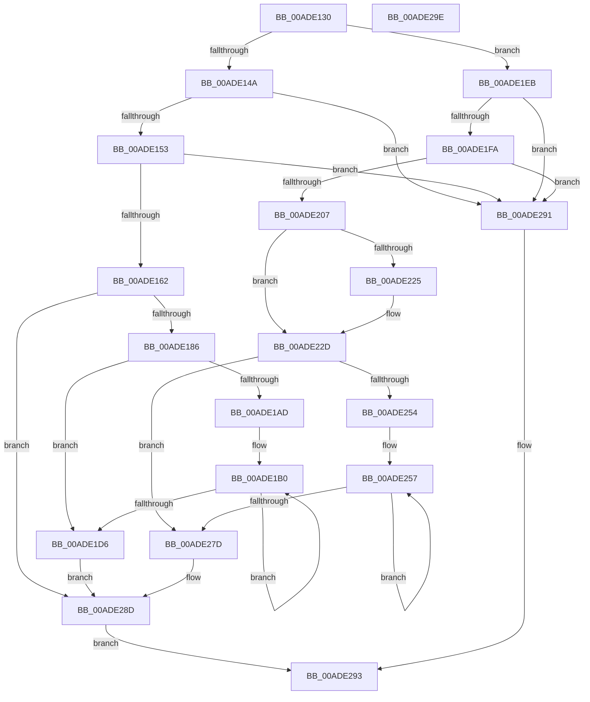

# KeAddSystemServiceTable

- RVA: `0x00ADE130`–`0x00ADE29F` (길이 `367` bytes)
- VA: `0x0000000140ADE130`
- 실행 섹션: `PAGE`
- PDB 이름 있음: `예`; PDB Function 태그: `아니요`
- unwind 정보 RVA: `0x0005CAAC`
- 디코드: `90`개 명령, `367/367` bytes 표시
- 미해석 바이트: `0` (있으면 어셈블리에 `.byte`로 보존)

> 이 문서는 커널 이미지의 기계어와 PDB 기호를 분석해 생성했습니다. 4번과 5번은 함수 원형과 자료형을 바이너리 사용 방식에서 추정한 C 해석이며 원본 소스 복구 결과는 아닙니다.

## 1. Dependencies

- 직접 호출 지점: **2**; 고유 호출 대상: **2**
- 직접 호출자로 확인된 함수: **0**
- RIP 상대 이미지 참조: **11**

### Outgoing calls
- `0x00ADE21C` → [Feature_Servicing_SyscallProviderWin32kMetadata__private_IsEnabledDeviceUsageNoInline](../../text/5B/Feature_Servicing_SyscallProviderWin32kMetadata__private_IsEnabledDeviceUsageNoInline_function_005B1458.md) (function, `0x005B1458`)
- `0x00ADE228` → [PsRegisterSyscallProviderServiceTableMetadata](PsRegisterSyscallProviderServiceTableMetadata_function_00ADB224.md) (function, `0x00ADB224`)

### Direct callers
- 이 함수 시작 RVA로 연결되는 직접 call은 확인되지 않았습니다. 간접 호출은 완전히 역산할 수 없습니다.

### Static image references
- `0x00ADE155` → RVA `0x00FC73E0` (`ALMOSTRO`; read)
- `0x00ADE162` → RVA `0x00FC73C0` (`ALMOSTRO`; read)
- `0x00ADE194` → RVA `0x00EF0E1C` (`.data`; read)
- `0x00ADE19B` → RVA `0x00FC73F0` (`ALMOSTRO`; read)
- `0x00ADE1E0` → RVA `0x00EF0E1C` (`.data`; write)
- `0x00ADE1ED` → RVA `0x012018E0` (`CFGRO`; read)
- `0x00ADE1FA` → RVA `0x00FC72A0` (`ALMOSTRO`; read)
- `0x00ADE207` → RVA `0x00FC72A0` (`ALMOSTRO`; write)
- `0x00ADE20E` → RVA `0x00FC72B0` (`ALMOSTRO`; write)
- `0x00ADE215` → RVA `0x00FC72B8` (`ALMOSTRO`; write)
- `0x00ADE242` → RVA `0x00FC72B0` (`ALMOSTRO`; read)

## 2. Other-region calls and transfers

- 다른 실행 섹션으로 향하는 call: **1**
  - `0x00ADE21C` → [Feature_Servicing_SyscallProviderWin32kMetadata__private_IsEnabledDeviceUsageNoInline](../../text/5B/Feature_Servicing_SyscallProviderWin32kMetadata__private_IsEnabledDeviceUsageNoInline_function_005B1458.md) (`PAGE` → `.text`)
- 별도 외부 분기/꼬리 이동을 확인하지 못했습니다.

## 3. Assembly (complete function range)

```asm
00ADE130  48 89 5C 24 08                  mov qword ptr [rsp + 8], rbx
00ADE135  57                              push rdi
00ADE136  48 83 EC 20                     sub rsp, 0x20
00ADE13A  8B 54 24 50                     mov edx, dword ptr [rsp + 0x50]
00ADE13E  4C 8B D1                        mov r10, rcx
00ADE141  83 FA 01                        cmp edx, 1
00ADE144  0F 84 A1 00 00 00               je 0x140ade1eb
00ADE14A  83 FA 02                        cmp edx, 2
00ADE14D  0F 85 3E 01 00 00               jne 0x140ade291
00ADE153  33 DB                           xor ebx, ebx
00ADE155  48 39 1D 84 92 4E 00            cmp qword ptr [rip + 0x4e9284], rbx
00ADE15C  0F 85 2F 01 00 00               jne 0x140ade291
00ADE162  48 8D 05 57 92 4E 00            lea rax, [rip + 0x4e9257]
00ADE169  8D 4A FF                        lea ecx, [rdx - 1]
00ADE16C  48 C1 E1 05                     shl rcx, 5
00ADE170  4C 89 14 01                     mov qword ptr [rcx + rax], r10
00ADE174  44 89 44 01 10                  mov dword ptr [rcx + rax + 0x10], r8d
00ADE179  4C 89 4C 01 18                  mov qword ptr [rcx + rax + 0x18], r9
00ADE17E  3B D2                           cmp edx, edx
00ADE180  0F 85 07 01 00 00               jne 0x140ade28d
00ADE186  4C 8B 15 53 92 4E 00            mov r10, qword ptr [rip + 0x4e9253]
00ADE18D  48 8D 05 4C 92 4E 00            lea rax, [rip + 0x4e924c]
00ADE194  44 8B 0D 81 2C 41 00            mov r9d, dword ptr [rip + 0x412c81]
00ADE19B  44 8B 1D 4E 92 4E 00            mov r11d, dword ptr [rip + 0x4e924e]
00ADE1A2  45 03 CA                        add r9d, r10d
00ADE1A5  44 03 C8                        add r9d, eax
00ADE1A8  45 85 DB                        test r11d, r11d
00ADE1AB  74 29                           je 0x140ade1d6
00ADE1AD  49 8B FA                        mov rdi, r10
00ADE1B0  49 63 12                        movsxd rdx, dword ptr [r10]
00ADE1B3  44 8D 43 01                     lea r8d, [rbx + 1]
00ADE1B7  48 8B C2                        mov rax, rdx
00ADE1BA  4D 8D 52 04                     lea r10, [r10 + 4]
00ADE1BE  48 C1 F8 04                     sar rax, 4
00ADE1C2  41 8B D8                        mov ebx, r8d
00ADE1C5  8B 0C 38                        mov ecx, dword ptr [rax + rdi]
00ADE1C8  03 CA                           add ecx, edx
00ADE1CA  44 33 C9                        xor r9d, ecx
00ADE1CD  45 0F AF C8                     imul r9d, r8d
00ADE1D1  45 3B C3                        cmp r8d, r11d
00ADE1D4  72 DA                           jb 0x140ade1b0
00ADE1D6  8B 05 40 2C 41 00               mov eax, dword ptr [rip + 0x412c40]
00ADE1DC  42 8D 0C 48                     lea ecx, [rax + r9*2]
00ADE1E0  89 0D 36 2C 41 00               mov dword ptr [rip + 0x412c36], ecx
00ADE1E6  E9 A2 00 00 00                  jmp 0x140ade28d
00ADE1EB  33 DB                           xor ebx, ebx
00ADE1ED  48 39 1D EC 36 72 00            cmp qword ptr [rip + 0x7236ec], rbx
00ADE1F4  0F 85 97 00 00 00               jne 0x140ade291
00ADE1FA  48 39 1D 9F 90 4E 00            cmp qword ptr [rip + 0x4e909f], rbx
00ADE201  0F 85 8A 00 00 00               jne 0x140ade291
00ADE207  4C 89 15 92 90 4E 00            mov qword ptr [rip + 0x4e9092], r10
00ADE20E  44 89 05 9B 90 4E 00            mov dword ptr [rip + 0x4e909b], r8d
00ADE215  4C 89 0D 9C 90 4E 00            mov qword ptr [rip + 0x4e909c], r9
00ADE21C  E8 37 32 AD FF                  call 0x1405b1458
00ADE221  85 C0                           test eax, eax
00ADE223  75 08                           jne 0x140ade22d
00ADE225  8D 4B 01                        lea ecx, [rbx + 1]
00ADE228  E8 F7 CF FF FF                  call 0x140adb224
00ADE22D  4C 8B 15 6C 90 4E 00            mov r10, qword ptr [rip + 0x4e906c]
00ADE234  48 8D 05 65 90 4E 00            lea rax, [rip + 0x4e9065]
00ADE23B  44 8B 0D DA 2B 41 00            mov r9d, dword ptr [rip + 0x412bda]
00ADE242  44 8B 1D 67 90 4E 00            mov r11d, dword ptr [rip + 0x4e9067]
00ADE249  45 03 CA                        add r9d, r10d
00ADE24C  44 03 C8                        add r9d, eax
00ADE24F  45 85 DB                        test r11d, r11d
00ADE252  74 29                           je 0x140ade27d
00ADE254  49 8B FA                        mov rdi, r10
00ADE257  49 63 12                        movsxd rdx, dword ptr [r10]
00ADE25A  44 8D 43 01                     lea r8d, [rbx + 1]
00ADE25E  48 8B C2                        mov rax, rdx
00ADE261  4D 8D 52 04                     lea r10, [r10 + 4]
00ADE265  48 C1 F8 04                     sar rax, 4
00ADE269  41 8B D8                        mov ebx, r8d
00ADE26C  8B 0C 38                        mov ecx, dword ptr [rax + rdi]
00ADE26F  03 CA                           add ecx, edx
00ADE271  44 33 C9                        xor r9d, ecx
00ADE274  45 0F AF C8                     imul r9d, r8d
00ADE278  45 3B C3                        cmp r8d, r11d
00ADE27B  72 DA                           jb 0x140ade257
00ADE27D  8B 0D 99 2B 41 00               mov ecx, dword ptr [rip + 0x412b99]
00ADE283  42 8D 14 49                     lea edx, [rcx + r9*2]
00ADE287  89 15 8F 2B 41 00               mov dword ptr [rip + 0x412b8f], edx
00ADE28D  B0 01                           mov al, 1
00ADE28F  EB 02                           jmp 0x140ade293
00ADE291  32 C0                           xor al, al
00ADE293  48 8B 5C 24 30                  mov rbx, qword ptr [rsp + 0x30]
00ADE298  48 83 C4 20                     add rsp, 0x20
00ADE29C  5F                              pop rdi
00ADE29D  C3                              ret
00ADE29E  CC                              int3
```

## 4. C-style interpretation (structured pseudocode)

```c
__int64 __fastcall KeAddSystemServiceTable(__int64 a1, __int64 a2, int a3, __int64 a4, unsigned int a5)
{
    __int64 result;
    __int64 v_rbx;
    __int64 v_rsp;
    unsigned __int64 v_stack_p8;

    v_stack_p8 = v_rbx;
    v_rsp = (v_rsp) - (32);
    if (((unsigned int)((unsigned int)(a5))) == 1) goto loc_00ADE1EB;
    if (((unsigned int)((unsigned int)(a5))) != 2) goto loc_00ADE291;
    v_rbx = 0;
    if ((*(unsigned __int64 *)(v_rip + 5149316)) != 0) goto loc_00ADE291;
    a1 = ((unsigned int)(a5) - 1) << (5);
    *(unsigned __int64 *)(a1 + v_rip + 5149271 * 1) = a1;
    *(unsigned int *)(a1 + v_rip + 5149271 * 1 + 16) = a3;
    *(unsigned __int64 *)(a1 + v_rip + 5149271 * 1 + 24) = a4;
    if (((unsigned int)((unsigned int)(a5))) != ((unsigned int)((unsigned int)(a5)))) goto loc_00ADE28D;
    a4 = (unsigned int)(((unsigned int)(*(unsigned int *)(v_rip + 4271233))) + ((unsigned int)(*(unsigned __int64 *)(v_rip + 5149267))));
    a4 = (unsigned int)((a4) + ((unsigned int)(v_rip + 5149260)));
    if ((unsigned int)((unsigned int)(*(unsigned int *)(v_rip + 5149262))) == 0) goto loc_00ADE1D6;
loc_00ADE1B0:
    result = ((int)(*(unsigned int *)(*(unsigned __int64 *)(v_rip + 5149267)))) >> (4);
    a1 = (unsigned int)(((unsigned int)(*(unsigned int *)(result + *(unsigned __int64 *)(v_rip + 5149267) * 1))) + ((unsigned int)((int)(*(unsigned int *)(*(unsigned __int64 *)(v_rip + 5149267))))));
    a4 = (unsigned int)((a4) ^ ((unsigned int)(a1)));
    a4 = (unsigned int)((a4) * ((unsigned int)(v_rbx + 1)));
    if (((unsigned int)(v_rbx + 1)) < ((unsigned int)((unsigned int)(*(unsigned int *)(v_rip + 5149262))))) goto loc_00ADE1B0;
loc_00ADE1D6:
    *(unsigned int *)(v_rip + 4271158) = (unsigned int)((unsigned int)(*(unsigned int *)(v_rip + 4271168)) + a4 * 2);
    goto loc_00ADE28D;
loc_00ADE1EB:
    v_rbx = 0;
    if ((*(unsigned __int64 *)(v_rip + 7485164)) != 0) goto loc_00ADE291;
    if ((*(unsigned __int64 *)(v_rip + 5148831)) != 0) goto loc_00ADE291;
    *(unsigned __int64 *)(v_rip + 5148818) = *(unsigned __int64 *)(v_rip + 5149267) + 4;
    *(unsigned int *)(v_rip + 5148827) = (unsigned int)(v_rbx + 1);
    *(unsigned __int64 *)(v_rip + 5148828) = a4;
    result = Feature_Servicing_SyscallProviderWin32kMetadata__private_IsEnabledDeviceUsageNoInline((unsigned int)(*(unsigned int *)(v_rip + 4271168)) + a4 * 2, (int)(*(unsigned int *)(*(unsigned __int64 *)(v_rip + 5149267))), v_rbx + 1, a4);
    if ((unsigned int)(result) == 0) {
        a1 = v_rbx + 1;
        result = PsRegisterSyscallProviderServiceTableMetadata(a1, (int)(*(unsigned int *)(*(unsigned __int64 *)(v_rip + 5149267))), v_rbx + 1, a4);
    }
    a4 = (unsigned int)(((unsigned int)(*(unsigned int *)(v_rip + 4271066))) + ((unsigned int)(*(unsigned __int64 *)(v_rip + 5148780))));
    a4 = (unsigned int)((a4) + ((unsigned int)(v_rip + 5148773)));
    if ((unsigned int)((unsigned int)(*(unsigned int *)(v_rip + 5148775))) == 0) goto loc_00ADE27D;
loc_00ADE257:
    result = ((int)(*(unsigned int *)(*(unsigned __int64 *)(v_rip + 5148780)))) >> (4);
    a1 = (unsigned int)(((unsigned int)(*(unsigned int *)(result + *(unsigned __int64 *)(v_rip + 5148780) * 1))) + ((unsigned int)((int)(*(unsigned int *)(*(unsigned __int64 *)(v_rip + 5148780))))));
    a4 = (unsigned int)((a4) ^ ((unsigned int)(a1)));
    a4 = (unsigned int)((a4) * ((unsigned int)(v_rbx + 1)));
    if (((unsigned int)(v_rbx + 1)) < ((unsigned int)((unsigned int)(*(unsigned int *)(v_rip + 5148775))))) goto loc_00ADE257;
loc_00ADE27D:
    *(unsigned int *)(v_rip + 4270991) = (unsigned int)((unsigned int)(*(unsigned int *)(v_rip + 4271001)) + a4 * 2);
loc_00ADE28D:
    goto loc_00ADE293;
loc_00ADE291:
    result = 0;
loc_00ADE293:
    v_rsp = (v_rsp) + (32);
    return result;
}
```

## 5. (Beta) C Style

```c
int64_t KeAddSystemServiceTable(int64_t Arg1, int64_t Arg2, int32_t Arg3, int64_t Arg4, uint32_t Arg5)
{
    int64_t result;
    int64_t local_rbx;
    int64_t local_rsp;
    uint64_t v_stack_p8;

    v_stack_p8 = local_rbx;
    local_rsp = (local_rsp) - (32);
    if (((uint32_t)((uint32_t)(Arg5))) == 1) goto loc_00ADE1EB;
    if (((uint32_t)((uint32_t)(Arg5))) != 2) goto loc_00ADE291;
    local_rbx = 0;
    if ((*(uint64_t *)(v_rip + 0x4E9284)) != 0) goto loc_00ADE291;
    Arg1 = ((uint32_t)(Arg5) - 1) << (5);
    *(uint64_t *)(Arg1 + v_rip + 0x4E9257 * 1) = Arg1;
    *(uint32_t *)(Arg1 + v_rip + 0x4E9257 * 1 + 0x10) = Arg3;
    *(uint64_t *)(Arg1 + v_rip + 0x4E9257 * 1 + 0x18) = Arg4;
    if (((uint32_t)((uint32_t)(Arg5))) != ((uint32_t)((uint32_t)(Arg5)))) goto loc_00ADE28D;
    Arg4 = (uint32_t)(((uint32_t)(*(uint32_t *)(v_rip + 0x412C81))) + ((uint32_t)(*(uint64_t *)(v_rip + 0x4E9253))));
    Arg4 = (uint32_t)((Arg4) + ((uint32_t)(v_rip + 5149260)));
    if ((uint32_t)((uint32_t)(*(uint32_t *)(v_rip + 0x4E924E))) == 0) goto loc_00ADE1D6;
loc_00ADE1B0:
    result = ((int32_t)(*(uint32_t *)(*(uint64_t *)(v_rip + 0x4E9253)))) >> (4);
    Arg1 = (uint32_t)(((uint32_t)(*(uint32_t *)(result + *(uint64_t *)(v_rip + 0x4E9253) * 1))) + ((uint32_t)((int32_t)(*(uint32_t *)(*(uint64_t *)(v_rip + 0x4E9253))))));
    Arg4 = (uint32_t)((Arg4) ^ ((uint32_t)(Arg1)));
    Arg4 = (uint32_t)((Arg4) * ((uint32_t)(local_rbx + 1)));
    if (((uint32_t)(local_rbx + 1)) < ((uint32_t)((uint32_t)(*(uint32_t *)(v_rip + 0x4E924E))))) goto loc_00ADE1B0;
loc_00ADE1D6:
    *(uint32_t *)(v_rip + 0x412C36) = (uint32_t)((uint32_t)(*(uint32_t *)(v_rip + 0x412C40)) + Arg4 * 2);
    goto loc_00ADE28D;
loc_00ADE1EB:
    local_rbx = 0;
    if ((*(uint64_t *)(v_rip + 0x7236EC)) != 0) goto loc_00ADE291;
    if ((*(uint64_t *)(v_rip + 0x4E909F)) != 0) goto loc_00ADE291;
    *(uint64_t *)(v_rip + 0x4E9092) = *(uint64_t *)(v_rip + 0x4E9253) + 4;
    *(uint32_t *)(v_rip + 0x4E909B) = (uint32_t)(local_rbx + 1);
    *(uint64_t *)(v_rip + 0x4E909C) = Arg4;
    result = Feature_Servicing_SyscallProviderWin32kMetadata__private_IsEnabledDeviceUsageNoInline((uint32_t)(*(uint32_t *)(v_rip + 0x412C40)) + Arg4 * 2, (int32_t)(*(uint32_t *)(*(uint64_t *)(v_rip + 0x4E9253))), local_rbx + 1, Arg4);
    if ((uint32_t)(result) == 0) {
        Arg1 = local_rbx + 1;
        result = PsRegisterSyscallProviderServiceTableMetadata(Arg1, (int32_t)(*(uint32_t *)(*(uint64_t *)(v_rip + 0x4E9253))), local_rbx + 1, Arg4);
    }
    Arg4 = (uint32_t)(((uint32_t)(*(uint32_t *)(v_rip + 0x412BDA))) + ((uint32_t)(*(uint64_t *)(v_rip + 0x4E906C))));
    Arg4 = (uint32_t)((Arg4) + ((uint32_t)(v_rip + 5148773)));
    if ((uint32_t)((uint32_t)(*(uint32_t *)(v_rip + 0x4E9067))) == 0) goto loc_00ADE27D;
loc_00ADE257:
    result = ((int32_t)(*(uint32_t *)(*(uint64_t *)(v_rip + 0x4E906C)))) >> (4);
    Arg1 = (uint32_t)(((uint32_t)(*(uint32_t *)(result + *(uint64_t *)(v_rip + 0x4E906C) * 1))) + ((uint32_t)((int32_t)(*(uint32_t *)(*(uint64_t *)(v_rip + 0x4E906C))))));
    Arg4 = (uint32_t)((Arg4) ^ ((uint32_t)(Arg1)));
    Arg4 = (uint32_t)((Arg4) * ((uint32_t)(local_rbx + 1)));
    if (((uint32_t)(local_rbx + 1)) < ((uint32_t)((uint32_t)(*(uint32_t *)(v_rip + 0x4E9067))))) goto loc_00ADE257;
loc_00ADE27D:
    *(uint32_t *)(v_rip + 0x412B8F) = (uint32_t)((uint32_t)(*(uint32_t *)(v_rip + 0x412B99)) + Arg4 * 2);
loc_00ADE28D:
    goto loc_00ADE293;
loc_00ADE291:
    result = 0;
loc_00ADE293:
    local_rsp = (local_rsp) + (32);
    return result;
}
```

## 6. Execution-region graph

[열기: 2D/3D 그래프와 함수 탐색 컨트롤 패널](../../../control-panel.html?section=page&rva=0x00ADE130&view=graph)

- 2D 그래프는 위에서 아래로 흐르고, 3D 그래프는 빈 공간을 드래그해 회전합니다. Shift+드래그는 이동, 휠은 확대·축소, 함수 노드 선택은 대상 보고서 이동입니다.

### Static fallback


