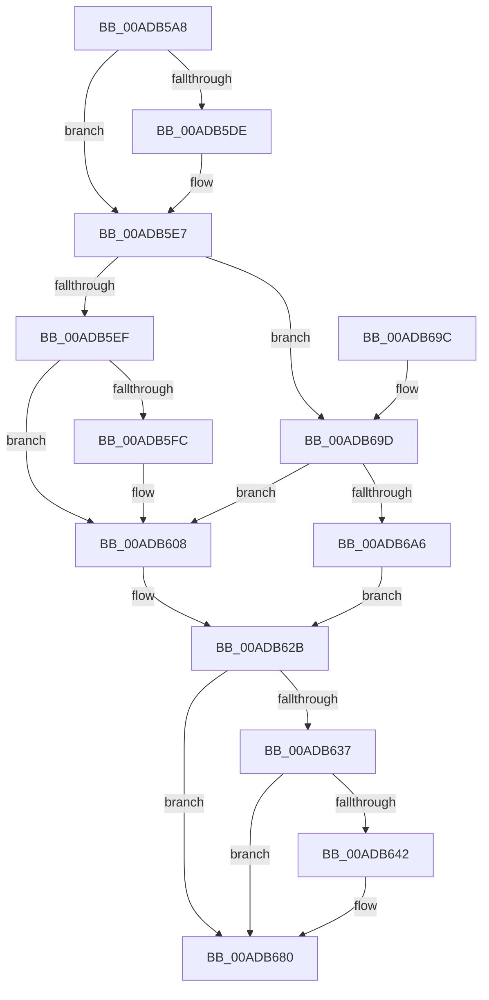

# KeSetIntervalProfile

- RVA: `0x00ADB5A8`–`0x00ADB6B1` (길이 `265` bytes)
- VA: `0x0000000140ADB5A8`
- 실행 섹션: `PAGE`
- PDB 이름 있음: `예`; PDB Function 태그: `아니요`
- unwind 정보 RVA: `0x000BF54C`
- 디코드: `66`개 명령, `265/265` bytes 표시
- 미해석 바이트: `0` (있으면 어셈블리에 `.byte`로 보존)

> 이 문서는 커널 이미지의 기계어와 PDB 기호를 분석해 생성했습니다. 4번과 5번은 함수 원형과 자료형을 바이너리 사용 방식에서 추정한 C 해석이며 원본 소스 복구 결과는 아닙니다.

## 1. Dependencies

- 직접 호출 지점: **6**; 고유 호출 대상: **5**
- 직접 호출자로 확인된 함수: **4**
- RIP 상대 이미지 참조: **6**

### Outgoing calls
- `0x00ADB5E0` → [KeQueryIntervalProfile](../74/KeQueryIntervalProfile_function_00746F90.md) (function, `0x00746F90`)
- `0x00ADB600` → [KiSanitizeProfileInterval](../../text/5C/KiSanitizeProfileInterval_function_005C5018.md) (function, `0x005C5018`)
- `0x00ADB626` → [KeGenericProcessorCallback](../../text/39/KeGenericProcessorCallback_function_00398C2C.md) (function, `0x00398C2C`)
- `0x00ADB639` → [KeQueryIntervalProfile](../74/KeQueryIntervalProfile_function_00746F90.md) (function, `0x00746F90`)
- `0x00ADB67B` → [EtwTraceKernelEvent](../../text/23/EtwTraceKernelEvent_function_00235350.md) (function, `0x00235350`)
- `0x00ADB687` → [_security_check_cookie](../../text/6A/_security_check_cookie_function_006AC640.md) (function, `0x006AC640`)

### Direct callers
- [EtwpTimeProfileStart](../6F/EtwpTimeProfileStart_function_006FF5E0.md) at `0x006FF5EC`
- [EtwpCoverageSamplerStart](../7C/EtwpCoverageSamplerStart_function_007C2248.md) at `0x007C24D5`
- [NtSetIntervalProfile](../7D/NtSetIntervalProfile_function_007D2260.md) at `0x007D2298`
- [KiInitializeCacheErrataSupport](../../init/C3/KiInitializeCacheErrataSupport_function_00C3A0D0.md) at `0x00C3A1A7`

### Static image references
- `0x00ADB5B7` → RVA `0x00E0A740` (`.data`; read)
- `0x00ADB5D0` → RVA `0x00FC6B04` (`ALMOSTRO`; read)
- `0x00ADB5EF` → RVA `0x00FC6D28` (`ALMOSTRO`; read)
- `0x00ADB618` → RVA `0x005C07F0` (`KiSetIntervalWorker`; read)
- `0x00ADB61F` → RVA `0x00FC7120` (`ALMOSTRO`; read)
- `0x00ADB6A6` → RVA `0x00F23430` (`.data`; write)

## 2. Other-region calls and transfers

- 다른 실행 섹션으로 향하는 call: **4**
  - `0x00ADB600` → [KiSanitizeProfileInterval](../../text/5C/KiSanitizeProfileInterval_function_005C5018.md) (`PAGE` → `.text`)
  - `0x00ADB626` → [KeGenericProcessorCallback](../../text/39/KeGenericProcessorCallback_function_00398C2C.md) (`PAGE` → `.text`)
  - `0x00ADB67B` → [EtwTraceKernelEvent](../../text/23/EtwTraceKernelEvent_function_00235350.md) (`PAGE` → `.text`)
  - `0x00ADB687` → [_security_check_cookie](../../text/6A/_security_check_cookie_function_006AC640.md) (`PAGE` → `.text`)
- 별도 외부 분기/꼬리 이동을 확인하지 못했습니다.

## 3. Assembly (complete function range)

```asm
00ADB5A8  48 89 5C 24 18                  mov qword ptr [rsp + 0x18], rbx
00ADB5AD  55                              push rbp
00ADB5AE  56                              push rsi
00ADB5AF  57                              push rdi
00ADB5B0  48 8B EC                        mov rbp, rsp
00ADB5B3  48 83 EC 70                     sub rsp, 0x70
00ADB5B7  48 8B 05 82 F1 32 00            mov rax, qword ptr [rip + 0x32f182]
00ADB5BE  48 33 C4                        xor rax, rsp
00ADB5C1  48 89 45 F0                     mov qword ptr [rbp - 0x10], rax
00ADB5C5  33 F6                           xor esi, esi
00ADB5C7  89 4D C0                        mov dword ptr [rbp - 0x40], ecx
00ADB5CA  48 21 75 C8                     and qword ptr [rbp - 0x38], rsi
00ADB5CE  8B DA                           mov ebx, edx
00ADB5D0  F7 05 2A B5 4E 00 02 04 00 00   test dword ptr [rip + 0x4eb52a], 0x402
00ADB5DA  8B F9                           mov edi, ecx
00ADB5DC  74 09                           je 0x140adb5e7
00ADB5DE  8B CA                           mov ecx, edx
00ADB5E0  E8 AB B9 C6 FF                  call 0x140746f90
00ADB5E5  8B F0                           mov esi, eax
00ADB5E7  85 DB                           test ebx, ebx
00ADB5E9  0F 85 AE 00 00 00               jne 0x140adb69d
00ADB5EF  48 F7 05 2E B7 4E 00 FC FF FF FF  test qword ptr [rip + 0x4eb72e], -4
00ADB5FA  74 0C                           je 0x140adb608
00ADB5FC  48 8D 4D C0                     lea rcx, [rbp - 0x40]
00ADB600  E8 13 9A AE FF                  call 0x1405c5018
00ADB605  8B 7D C0                        mov edi, dword ptr [rbp - 0x40]
00ADB608  41 B9 01 00 00 00               mov r9d, 1
00ADB60E  89 5D C8                        mov dword ptr [rbp - 0x38], ebx
00ADB611  4C 8D 45 C8                     lea r8, [rbp - 0x38]
00ADB615  89 7D CC                        mov dword ptr [rbp - 0x34], edi
00ADB618  48 8D 15 D1 51 AE FF            lea rdx, [rip - 0x51ae2f]
00ADB61F  48 8D 0D FA BA 4E 00            lea rcx, [rip + 0x4ebafa]
00ADB626  E8 01 D6 8B FF                  call 0x140398c2c
00ADB62B  F7 05 CF B4 4E 00 02 04 00 00   test dword ptr [rip + 0x4eb4cf], 0x402
00ADB635  74 49                           je 0x140adb680
00ADB637  8B CB                           mov ecx, ebx
00ADB639  E8 52 B9 C6 FF                  call 0x140746f90
00ADB63E  3B C6                           cmp eax, esi
00ADB640  74 3E                           je 0x140adb680
00ADB642  83 65 EC 00                     and dword ptr [rbp - 0x14], 0
00ADB646  48 8D 4D E0                     lea rcx, [rbp - 0x20]
00ADB64A  89 45 D4                        mov dword ptr [rbp - 0x2c], eax
00ADB64D  41 B9 48 0F 00 00               mov r9d, 0xf48
00ADB653  48 8D 45 D0                     lea rax, [rbp - 0x30]
00ADB657  89 5D D0                        mov dword ptr [rbp - 0x30], ebx
00ADB65A  BA 01 00 00 00                  mov edx, 1
00ADB65F  48 89 45 E0                     mov qword ptr [rbp - 0x20], rax
00ADB663  41 B8 02 04 00 20               mov r8d, 0x20000402
00ADB669  89 75 D8                        mov dword ptr [rbp - 0x28], esi
00ADB66C  C7 45 E8 0C 00 00 00            mov dword ptr [rbp - 0x18], 0xc
00ADB673  C7 44 24 20 02 19 50 00         mov dword ptr [rsp + 0x20], 0x501902
00ADB67B  E8 D0 9C 75 FF                  call 0x140235350
00ADB680  48 8B 4D F0                     mov rcx, qword ptr [rbp - 0x10]
00ADB684  48 33 CC                        xor rcx, rsp
00ADB687  E8 B4 0F BD FF                  call 0x1406ac640
00ADB68C  48 8B 9C 24 A0 00 00 00         mov rbx, qword ptr [rsp + 0xa0]
00ADB694  48 83 C4 70                     add rsp, 0x70
00ADB698  5F                              pop rdi
00ADB699  5E                              pop rsi
00ADB69A  5D                              pop rbp
00ADB69B  C3                              ret
00ADB69C  CC                              int3
00ADB69D  83 FB 01                        cmp ebx, 1
00ADB6A0  0F 85 62 FF FF FF               jne 0x140adb608
00ADB6A6  89 3D 84 7D 44 00               mov dword ptr [rip + 0x447d84], edi
00ADB6AC  E9 7A FF FF FF                  jmp 0x140adb62b
```

## 4. C-style interpretation (structured pseudocode)

```c
__int64 __fastcall KeSetIntervalProfile(int a1, int a2)
{
    __int64 result;
    __int64 v_rdi;
    __int64 v_rsi;
    __int64 v_rsp;
    unsigned __int64 v_stack_m28;
    unsigned int v_stack_m2C;
    unsigned int v_stack_m30;
    unsigned __int64 v_stack_m38;
    unsigned int v_stack_m40;
    unsigned int v_stack_m44;
    unsigned __int64 v_stack_m48;
    unsigned int v_stack_m4C;
    unsigned __int64 v_stack_m50;
    unsigned int v_stack_m58;
    unsigned int v_stack_m68;
    unsigned __int64 v_stack_p18;

    v_stack_p18 = v_rbx;
    v_rsp = (v_rsp) - (112);
    result = (*(unsigned __int64 *)(v_rip + 3338626)) ^ (v_rsp);
    v_stack_m28 = result;
    v_rsi = 0;
    v_stack_m58 = a1;
    if (((*(unsigned int *)(v_rip + 5158186)) & (0x402ULL)) != 0) {
        a1 = a2;
        result = KeQueryIntervalProfile(a1, a2, a3, a4);
        v_rsi = (unsigned int)(result);
    }
    if ((unsigned int)((unsigned int)(a2)) != 0) goto loc_00ADB69D;
    v_rdi = (unsigned int)(a1);
    if (((*(unsigned __int64 *)(v_rip + 5158702)) & (-4)) != 0) {
        a1 = v_stack_m58;
        result = KiSanitizeProfileInterval(a1, a2, a3, a4);
        v_rdi = v_stack_m58;
    }
    v_stack_m50 = (unsigned int)((unsigned int)(a2));
    v_stack_m4C = (unsigned int)(v_rdi);
    result = KeGenericProcessorCallback(v_rip + 5159674, v_rip - 5353007, v_stack_m50, 1);
loc_00ADB62B:
    if (((*(unsigned int *)(v_rip + 5158095)) & (0x402ULL)) == 0) goto loc_00ADB680;
    result = KeQueryIntervalProfile((unsigned int)((unsigned int)((unsigned int)(a2))), v_rip - 5353007, v_stack_m50, 1);
    if (((unsigned int)(result)) != ((unsigned int)(v_rsi))) {
        a1 = v_stack_m38;
        v_stack_m44 = (unsigned int)(result);
        a4 = 0xF48ULL;
        result = v_stack_m48;
        v_stack_m48 = (unsigned int)((unsigned int)(a2));
        a2 = 1;
        v_stack_m38 = result;
        a3 = 0x20000402ULL;
        v_stack_m40 = (unsigned int)(v_rsi);
        v_stack_m30 = 12;
        v_stack_m68 = 0x501902ULL;
        result = EtwTraceKernelEvent(a1, a2, a3, a4);
    }
    a1 = (v_stack_m28) ^ (v_rsp);
    result = _security_check_cookie(a1, a2, a3, a4);
    v_rsp = (v_rsp) + (112);
    return result;
loc_00ADB69D:
    if (((unsigned int)(v_stack_p18)) != 1) goto loc_00ADB608;
    *(unsigned int *)(v_rip + 4488580) = (unsigned int)(v_rdi);
    goto loc_00ADB62B;
}
```

## 5. (Beta) C Style

```c
int64_t KeSetIntervalProfile(int32_t Arg1, int32_t Arg2)
{
    int64_t result;
    int64_t local_rdi;
    int64_t local_rsi;
    int64_t local_rsp;
    uint64_t v_stack_m28;
    uint32_t v_stack_m2C;
    uint32_t v_stack_m30;
    uint64_t v_stack_m38;
    uint32_t v_stack_m40;
    uint32_t v_stack_m44;
    uint64_t v_stack_m48;
    uint32_t v_stack_m4C;
    uint64_t v_stack_m50;
    uint32_t v_stack_m58;
    uint32_t v_stack_m68;
    uint64_t v_stack_p18;

    v_stack_p18 = local_rbx;
    local_rsp = (local_rsp) - (112);
    result = (*(uint64_t *)(v_rip + 0x32F182)) ^ (local_rsp);
    v_stack_m28 = result;
    local_rsi = 0;
    v_stack_m58 = Arg1;
    if (((*(uint32_t *)(v_rip + 0x4EB52A)) & (0x402ULL)) != 0) {
        Arg1 = Arg2;
        result = KeQueryIntervalProfile(Arg1, Arg2, a3, a4);
        local_rsi = (uint32_t)(result);
    }
    if ((uint32_t)((uint32_t)(Arg2)) != 0) goto loc_00ADB69D;
    local_rdi = (uint32_t)(Arg1);
    if (((*(uint64_t *)(v_rip + 0x4EB72E)) & (-4)) != 0) {
        Arg1 = v_stack_m58;
        result = KiSanitizeProfileInterval(Arg1, Arg2, a3, a4);
        local_rdi = v_stack_m58;
    }
    v_stack_m50 = (uint32_t)((uint32_t)(Arg2));
    v_stack_m4C = (uint32_t)(local_rdi);
    result = KeGenericProcessorCallback(v_rip + 5159674, v_rip - 5353007, v_stack_m50, 1);
loc_00ADB62B:
    if (((*(uint32_t *)(v_rip + 0x4EB4CF)) & (0x402ULL)) == 0) goto loc_00ADB680;
    result = KeQueryIntervalProfile((uint32_t)((uint32_t)((uint32_t)(Arg2))), v_rip - 5353007, v_stack_m50, 1);
    if (((uint32_t)(result)) != ((uint32_t)(local_rsi))) {
        Arg1 = v_stack_m38;
        v_stack_m44 = (uint32_t)(result);
        a4 = 0xF48ULL;
        result = v_stack_m48;
        v_stack_m48 = (uint32_t)((uint32_t)(Arg2));
        Arg2 = 1;
        v_stack_m38 = result;
        a3 = 0x20000402ULL;
        v_stack_m40 = (uint32_t)(local_rsi);
        v_stack_m30 = 12;
        v_stack_m68 = 0x501902ULL;
        result = EtwTraceKernelEvent(Arg1, Arg2, a3, a4);
    }
    Arg1 = (v_stack_m28) ^ (local_rsp);
    result = _security_check_cookie(Arg1, Arg2, a3, a4);
    local_rsp = (local_rsp) + (112);
    return result;
loc_00ADB69D:
    if (((uint32_t)(v_stack_p18)) != 1) goto loc_00ADB608;
    *(uint32_t *)(v_rip + 0x447D84) = (uint32_t)(local_rdi);
    goto loc_00ADB62B;
}
```

## 6. Execution-region graph

[열기: 2D/3D 그래프와 함수 탐색 컨트롤 패널](../../../control-panel.html?section=page&rva=0x00ADB5A8&view=graph)

- 2D 그래프는 위에서 아래로 흐르고, 3D 그래프는 빈 공간을 드래그해 회전합니다. Shift+드래그는 이동, 휠은 확대·축소, 함수 노드 선택은 대상 보고서 이동입니다.

### Static fallback


